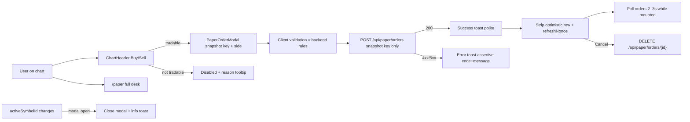
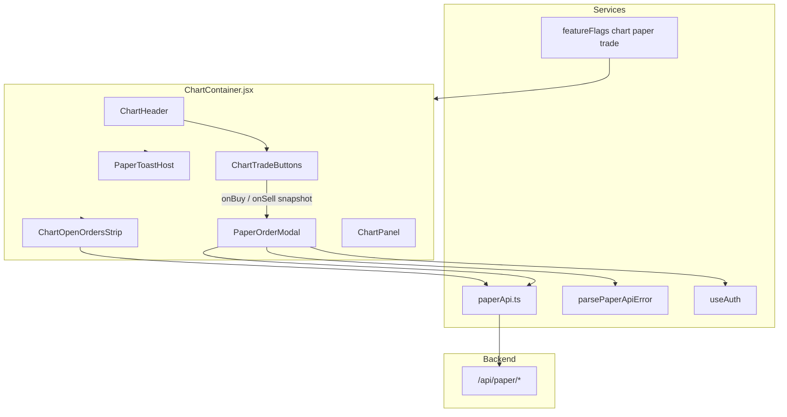

# Chart-Integrated Paper Buy/Sell (TIP-2) — Design Document

| Field | Value |
|---|---|
| **Document** | Chart-Integrated Paper Buy/Sell Design v1.0 |
| **Author** | TIP-2 Architecture |
| **Date** | 2026-07-28 |
| **Status** | Accepted — ready to implement (rev 2, saved 2026-07-28) |
| **Repo path** | `Chart-Paper-Trade-Design-v1.0.md` (repo root) |
| **Related** | `Manual-Paper-Trading-Design-v1.0.md` (manual OMS SoT; chart ticket deferred → this doc delivers it), `docs/PRODUCT-DECISIONS.md`, `frontend/src/components/ChartHeader.jsx`, `frontend/src/components/ChartContainer.jsx`, `frontend/src/pages/PaperTradingPage.jsx`, `frontend/src/services/paperApi.ts`, `frontend/src/services/http.ts`, `frontend/src/config/featureFlags.ts`, `backend/app/api/paper.py`, `backend/app/paper/*` |

---

## Overview

TIP-2 already ships a **manual paper OMS** (`/api/paper/*`, `/paper` desk) that places MARKET / LIMIT / SL / SL-M orders, holds separate long/short lots (MIS/CNC), and fills against live Upstox ticks. Chart users still leave the chart to trade.

This design adds **quick paper entry on the chart**: green **Buy** / red **Sell** buttons in the chart header open a **centered full-ticket modal** locked to a **snapshot** of the active chart symbol at open. Post-place feedback is a **toast** plus a **mini open-orders strip** under the chart (light poll). The full desk remains at `/paper` for positions, close-lot flows, history, and cash overview.

**No backend schema changes** are expected; existing paper APIs are sufficient with small FE client gaps: `GET /api/paper/ltp/{key}` (backend exists, unused in `paperApi.ts`) and a **required** structured paper error parser so toasts can show `code — message`.

---

## Background & Motivation

### Current state

| Area | What exists |
|---|---|
| Paper OMS | `backend/app/paper/*` + `backend/app/api/paper.py` — place/cancel/modify, account, orders, positions, fills, ledger, LTP |
| FE client | `frontend/src/services/paperApi.ts` — account/orders/positions/fills/ledger/place/cancel; **no LTP helper, no modify, no structured error code** |
| HTTP errors | `frontend/src/services/http.ts` `ApiError` has `status`/`path`/`message`; `coerceServerMessage` prefers nested `message` and **drops `code`** when `detail` is `{ code, message }` |
| Full desk | `PaperTradingPage.jsx` + `paperTrading.css` — full ticket fields, open lots (Close), open/recent orders, 3s poll; **weaker client validation** than backend (HTML `required` + server errors only; no SL band, no MARKET field omission, no `clientOrderId`) |
| Chart chrome | `ChartHeader.jsx` — title, connection, timeframe, chart type, Stats/Paper links, admin, user menu |
| Chart host | `ChartContainer.jsx` — watchlist, `activeSymbolId`, `activeEntry`, `controlsDisabled` (series readiness), mobile dock ≤768 |
| Eligibility | Backend `is_paper_tradable` (`NSE_EQ` + EQ/BE, not INDEX, active, not REMOVING; `require_ready=False` by default — FAILED can still pass). Paper desk FE filter is a **partial** mirror (active + segment/type; omits REMOVING). Chart util **targets backend `eligibility.py`**, not the weaker desk filter |
| Auth | `useAuth` → `user` with optional `tradingEnabled` |
| Feature flags | `frontend/src/config/featureFlags.ts` (`VITE_FEATURE_*` pattern + tests) |
| Toast | **None** in FE today (only unrelated `aria-live` on OHLC legend / startup) |
| Backend modify | `PATCH /api/paper/orders/{id}` exists — desk may use later; **not** chart strip scope |

### Pain points

1. Chart analysis and order entry are split — users switch to `/paper` and re-select symbol.
2. Manual OMS design explicitly deferred chart ticket (`placeOrder` export only); product now wants chart quick entry.
3. No lightweight “working orders for this symbol” visibility while staring at the chart.

### Why now

- Backend OMS and REST surface are implemented and stable.
- Chart header already hosts Paper nav; same chrome is the natural Buy/Sell host.
- Product Q&A has locked UX decisions (location, modal, semantics, mobile).

---

## Goals & Non-Goals

### Goals

1. **Chart-header Buy / Sell** that open a full paper ticket modal for the **chart symbol snapshotted at open**.
2. **Ticket field set matching `/paper` desk** (MARKET, LIMIT, SL, SL_M, MIS/CNC, qty, price, trigger; default product **MIS**) with **client validation parity to backend** `place_order` / `_validate_prices` / SL band (stricter than today’s desk HTML-only checks).
3. **Side semantics**: Buy → open long; Sell → open short; **no auto-netting / no auto-close** (close still needs `closeLotId` on `/paper` or a later strip enhancement).
4. **Eligibility UX**: buttons always visible; **disabled** with **reason-specific** tooltips (see §4 matrix).
5. **Feedback**: success/error **toast** (error shows `code — message`) + **mini open-orders strip** under chart (poll 2–3s; always mounted when chart trade UI is on).
6. **Keep `/paper`** as full trading desk.
7. **Mobile ≤768**: same header, **compact** Buy/Sell chips; modal full-screen-ish; collapse priority defined in §3.2 / §9.
8. **Reuse** existing paper APIs and `paperApi` patterns; no new OMS rules.
9. **Safe symbol identity**: place payload uses **only** the snapshotted instrument key; symbol change while modal open **auto-closes** (PR2, not polish).

### Non-Goals (explicit)

| Non-goal | Notes |
|---|---|
| Chart markers for fills / order levels | Out of scope v1 |
| Drag stop / limit on chart canvas | Out of scope |
| Real broker execution | Forbidden (AD0) |
| Strategy / pattern auto bots | Deferred (`Paper-Strategy-Design-v1.0.md`) |
| Position close from chart | Chart Buy/Sell do not auto-close; link to `/paper` for close-lot |
| Modify order from chart strip | Cancel only in strip v1; backend PATCH exists for desk later |
| Rebind-in-place while modal open | Explicitly **out of scope** — auto-close only |
| Backend schema / migration | Not required |
| Multi-leg / OCO / bracket / GTT | Out of scope |
| Replacing `/paper` page | Keep as full desk |
| Full focus trap library | Optional; Esc + initial focus + focus restore are **required** |

---

## Product decisions (LOCKED)

| Topic | Decision |
|---|---|
| Button location | **Chart header** near timeframe / user (Stats / Paper links area) |
| Popup | **Centered modal dialog** with full order options |
| Ticket contents | Full ticket field set matching `/paper`; **symbol snapshotted** at open |
| Buy / Sell semantics | **Buy opens long; Sell opens short** — no auto-netting; close needs `closeLotId` |
| Non-tradable symbol | Buttons **visible but disabled** + **reason-specific** tooltip (§4) |
| Post-place feedback | **Toast + mini open-orders strip** under chart (light poll); full desk `/paper` |
| `/paper` page | **Keep** as full trading desk; chart is quick entry |
| Modal style | Centered modal |
| Default product | **MIS** |
| Mobile ≤768 | Same header, **compact** Buy/Sell chips; modal full-screen-ish |
| Side in modal | **Fixed by opener button** (BUY badge / SELL badge); not user-switchable |
| Symbol while modal open | **Snapshot key for place** + **auto-close** on `activeSymbolId` change when **not** submitting (info: “ticket closed”); **defer close until place settles** if in-flight; no rebind |
| FAILED bootstrap | **Disable** trade with “Symbol not ready” (FE stricter than backend `require_ready=False`) |
| Optimistic strip | **Yes** — insert accepted order into strip state on place success |
| Modal a11y floor | Esc close, initial focus into dialog, restore focus to opener; trap optional |
| PAPER badge | Between Sell and Stats (inside/adjacent `chart-header__trade`) |
| Feature flag | **`VITE_FEATURE_CHART_PAPER_TRADE`** in `featureFlags.ts`, default **ON** |

---

## Proposed Design

### 1. High-level UX flow



### 2. Component architecture



### 3. UX wireframe description

#### 3.1 Chart header (desktop)

```
┌──────────────────────────────────────────────────────────────────────────────┐
│ RELIANCE  ● Live  [1m 5m …] [Candle|Line]  [Buy] [Sell] PAPER  Stats Paper Admin user ▾ │
└──────────────────────────────────────────────────────────────────────────────┘
```

- **Buy / Sell colors**: use the **single token table in §9** (do not invent alternate greens/reds in the wireframe).
- Labels: “Buy” / “Sell”; `aria-label="Paper buy {tradingSymbol}"` / `"Paper sell {tradingSymbol}"`.
- **PAPER** badge: small pill (reuse `.paper-badge` palette) **between Sell and Stats**, adjacent to trade buttons.
- Placement: new group `chart-header__trade` **between** `__controls` and `__user`. `__user` keeps `margin-left: auto` (do not move auto-margin onto `__trade`).
- Keyboard: real `<button>`s; Tab order: title → TF → type → Buy → Sell → Stats → Paper → …
- Disabled: `disabled` + `title` (+ optional `aria-describedby`) from **`paperTradeDisabledReason(entry, user)`** (§4). Never collapse all failures to one string.

#### 3.2 Mobile ≤768

- Same header region; Buy/Sell use **compact** padding but **min height 40–44px** (align with mobile dock ~44px touch where possible; never below 40px).
- **Collapse priority** (narrow → tighter):
  1. Full “Buy” / “Sell” labels with compact padding
  2. Hide **PAPER** text badge (optional tiny “P” or omit)
  3. Shorten / hide less-critical nav labels if needed (existing Stats/Paper already small)
  4. Only if width still insufficient (&lt;380px): labels “B” / “S” with full `aria-label`
- **Manual QA**: Admin user (extra Admin link) at **375px** width.
- Modal: near full-screen card (`width: 100%` on mobile; `max-height: 100dvh`); portal to `document.body`.

#### 3.3 Modal (PaperOrderModal)

```
┌──────────── Paper order ──────────── × ─┐
│  RELIANCE · NSE_EQ          [BUY] badge │
│  LTP ₹2,451.20 · Free ₹98,200.00        │
│                                          │
│  Product   [ MIS ▾ ]   Type [ MARKET ▾ ] │
│  Qty       [ 1     ]                     │
│  Price     [ —     ]  (LIMIT / SL)       │
│  Trigger   [ —     ]  (SL / SL_M)        │
│                                          │
│  [ Cancel ]              [ Place BUY ]   │
└──────────────────────────────────────────┘
```

**Props contract (mandatory)**

```ts
type PaperOrderModalProps = {
  side: 'BUY' | 'SELL'
  /** Snapshotted at open — NEVER live-bound to activeSymbolId while open */
  instrumentKey: string
  tradingSymbol: string
  /** Parent active chart key — used only to detect switch-away */
  activeSymbolId: string
  onClose: () => void
  onPlaced: (order: PaperOrder) => void
}
```

**UX states**

| State | Behavior |
|---|---|
| Opening | Focus first focusable (product or qty); backdrop click / Esc closes; `document.body` scroll lock |
| Loading account/LTP | “—” for free cash / LTP; form still editable |
| Submitting | Primary disabled, “Working…”; single in-flight; report `onSubmittingChange(true|false)` to parent; `clientOrderId` = `chart-${crypto.randomUUID()}` |
| Success | Close modal → success toast → `onPlaced(order)` (parent bumps strip + optimistic row). If chart symbol already diverged during flight, still apply success for **snapshot** instrument (strip may filter by live symbol — parent may keep `lastPlacedOrder` briefly or bump refresh so user sees it on switch-back) |
| API error | **Keep modal open** only if snapshot still matches chart **or** user has not switched; if deferred symbol-switch pending after error, close + error toast (see rule below); re-enable submit if modal remains |
| Symbol switch while open (not submitting) | Auto-close draft ticket (no rebind). Info toast: **“Symbol changed — ticket closed”** (draft abandoned only — **no** server cancel). Place always posts snapshot key only |
| Symbol switch while **in-flight place** | **Defer auto-close until settle** (do not unmount mid-POST). After settle: success → `onPlaced` + success toast + close; error → error toast + close. Optional second info line only if useful; **never** say “order cancelled” for a place that may still accept. No abort of the HTTP request in v1 |
| Market closed / TRADING_DISABLED | Server codes on submit; buttons already disabled if `tradingEnabled === false` |

**Side badge**: fixed by opener. **No side selector.**

**Symbol display**: from snapshot props only (not live `displayName` if chart already switched — modal should be closed by then).

**Rebind-in-place**: **out of scope**.

**a11y (v1 — required floor)**

- `role="dialog"`, `aria-modal="true"`, `aria-labelledby`.
- **Esc** closes.
- **Initial focus** into dialog on open; **restore focus** to the Buy or Sell button that opened it on close.
- Focus trap: **optional** v1.
- When setting `aria-hidden` / inert on chart chrome, **ToastHost must stay outside** that subtree (portal sibling).

**Symbol-switch effect (parent — required in PR2)**

Locked rule:

1. **Not submitting** → close modal immediately; info toast **“Symbol changed — ticket closed”** (draft only; nothing cancelled on server).
2. **Submitting (`placeInFlight`)** → **do not close**; leave modal mounted (may show “Working…”) until `POST` settles; then always close and surface success/error for the **snapshot** key. Do not cancel/abort the in-flight request in v1.
3. Never use copy that claims the **order** was cancelled unless `DELETE` ran.

```js
// orderModal: null | { side, instrumentKey, tradingSymbol }
// placeInFlight: boolean from modal onSubmittingChange
useEffect(() => {
  if (!orderModal) return
  if (!activeSymbolId || activeSymbolId === orderModal.instrumentKey) return
  if (placeInFlight) {
    // Defer: mark pending close; settle handler closes + toasts place result
    setCloseAfterPlace(true)
    return
  }
  setOrderModal(null)
  pushToast({
    kind: 'info',
    message: 'Symbol changed — ticket closed',
  })
}, [activeSymbolId, orderModal, placeInFlight])
```

Open handlers **snapshot**:

```js
onBuy={() =>
  setOrderModal({
    side: 'BUY',
    instrumentKey: activeSymbolId,
    tradingSymbol: displayName,
  })
}
```

Modal receives `instrumentKey={orderModal.instrumentKey}` (snapshot), **not** live `activeSymbolId`.

#### 3.4 Mini open-orders strip (under chart)

Placement: **below** `ChartPanel` inside `chart-main`, full width of chart column. Only meaningful when `mobilePanel === 'chart'` (CSS already hides non-active mobile panels).

```
┌ Open paper orders (RELIANCE) · 2 ──────────── Paper desk ─┐
│ BUY  LIMIT  MIS  10@2450  OPEN        [Cancel]            │
│ SELL SL_M   MIS  5  trig 2400  TRIGGER_PENDING [Cancel]   │
└───────────────────────────────────────────────────────────┘
```

| Behavior | Spec |
|---|---|
| Mount | **Always mount** `ChartOpenOrdersStrip` when chart paper trade UI is enabled (auth + feature flag + chart page), including when empty |
| Empty UI | Return **null** for visible chrome when no open rows for active symbol (no empty box), **but component stays mounted** so poll / `refreshNonce` work |
| Filter | **Active chart symbol** (`instrumentKey === activeSymbolId`) |
| Statuses | `OPEN`, `TRIGGER_PENDING`, `PARTIALLY_FILLED` (`OPEN_ORDER_STATUSES` = backend `OPEN_STATUSES`) |
| Optimistic row | **Yes**: on `onPlaced`, parent passes order (or strip merges by id) so row appears before next poll |
| refreshNonce | Parent increments on place success and cancel; strip `useEffect` depends on it and refetches immediately |
| Cancel | `cancelPaperOrder(id)` → success/error toast + refresh |
| Poll | **2–3s** while mounted, `document.visibilityState === 'visible'`, and feature on; pause when tab hidden. Do **not** unmount solely because list is empty |
| Link | “Paper desk” → `/paper` |
| No close-lot UI | Desk link only |

#### 3.5 Toast

Greenfield `PaperToastHost` under `components/` (portal to `document.body`).

| Kind | role / live | Style | Duration |
|---|---|---|---|
| Success | `role="status"` + `aria-live="polite"` | Green: “Order accepted · BUY MARKET RELIANCE ×10” | ~4s |
| Error | `role="alert"` + `aria-live="assertive"` | Red: **`{code} — {message}`** when code present, else message | ~6s + **dismiss button** |
| Info | `role="status"` + `aria-live="polite"` | Neutral: symbol changed, cancel ok | ~3.5s |

Additional rules:

- Always render code/message as **text nodes** (no `dangerouslySetInnerHTML`).
- **Pause auto-dismiss** on hover/focus.
- **z-index ≥ 1100** (above modal ≥ 1000) so errors remain visible while modal stays open on API failure.
- Stack top-right; multiple toasts stack vertically; no focus steal on success; dismiss control is keyboard-reachable on errors.
- Prefer `prefers-reduced-motion: reduce` → no slide animation (instant show/hide).

---

### 4. Eligibility (client)

**Source of truth for rules**: backend `backend/app/paper/eligibility.py` (`is_paper_tradable`), plus FE-only **FAILED** gate (documented stricter UX). **Not** a pure copy of `PaperTradingPage`’s thinner filter (desk omits REMOVING today; chart util may later be reused to improve the desk).

```ts
// frontend/src/utils/paperTradable.ts

export function isPaperTradableEntry(entry, { treatFailedAsBlocked = true } = {}) {
  if (!entry || entry.active === false) return false
  if (normalizeStatus(entry.bootstrapStatus) === 'REMOVING') return false
  if (treatFailedAsBlocked && normalizeStatus(entry.bootstrapStatus) === 'FAILED') return false
  const seg = (entry.segment || '').toUpperCase()
  const itype = (entry.instrumentType || '').toUpperCase()
  const id = entry.symbolId || ''
  if (seg.includes('INDEX') || id.startsWith('NSE_INDEX')) return false
  if (seg !== 'NSE_EQ') return false
  return itype === 'EQ' || itype === 'BE'
}

/** Ordered tooltip / title text — first match wins */
export function paperTradeDisabledReason(entry, user) {
  if (!entry?.symbolId) return 'Select a symbol'
  if (user?.tradingEnabled === false) return 'Trading disabled for your account'
  if (entry.active === false) return 'Symbol not active'
  if (normalizeStatus(entry.bootstrapStatus) === 'REMOVING') return 'Symbol not active'
  if (normalizeStatus(entry.bootstrapStatus) === 'FAILED') return 'Symbol not ready'
  // segment / type / index (same universe as backend eligibility)
  const seg = (entry.segment || '').toUpperCase()
  const itype = (entry.instrumentType || '').toUpperCase()
  const id = entry.symbolId || ''
  if (
    seg.includes('INDEX') ||
    id.startsWith('NSE_INDEX') ||
    seg !== 'NSE_EQ' ||
    (itype !== 'EQ' && itype !== 'BE')
  ) {
    return 'Paper equities only'
  }
  return '' // enabled
}
```

**Trade enablement vs chart series readiness**

- `controlsDisabled` in `ChartContainer` gates timeframe/type when loading / PENDING / FAILED for **series** UX.
- **Trade buttons are not gated by `controlsDisabled`.**
- Trade enablement = `paperTradeDisabledReason(activeEntry, user) === ''` (and feature flag on).
- **PENDING** bootstrap: **allowed** if otherwise tradable (matches backend `require_ready=False`).
- **FAILED** bootstrap: **blocked** on FE with “Symbol not ready” even though backend may still accept if entry is active EQ — intentional UX-only stricter gate; server remains authoritative if FE mis-detects.

Server still returns `INSTRUMENT_NOT_TRADABLE`, `TRADING_DISABLED`, etc.

---

### 5. Modal fields & validation

Align with `PlaceOrderBody` and **`PaperTradingService.place_order` / `_validate_prices` / SL band** (`backend/app/paper/service.py`). Desk `PaperTradingPage` supplies the **field set** and defaults only — **do not** copy desk’s weaker client checks as sufficient.

| Field | UI | Rules |
|---|---|---|
| instrumentKey | Fixed display | **Snapshot** from open; place body uses this only |
| side | Badge only | `BUY` / `SELL` from opener |
| product | Select MIS / CNC | Default **MIS** |
| orderType | MARKET \| LIMIT \| SL \| SL_M | Default MARKET |
| qty | number ≥ 1 integer | Required |
| price | number step 0.05 | Required for LIMIT, SL; **omit from body** for MARKET, SL_M |
| triggerPrice | number | Required for SL, SL_M; **omit** otherwise |
| closeLotId | **Absent** | Opens only; close on `/paper` |
| clientOrderId | Hidden | **Required** on chart submit: `chart-${crypto.randomUUID()}` (≤64 chars; ~42 with prefix) |

**Client validation (backend parity)**

| orderType | price | trigger | Extra |
|---|---|---|---|
| MARKET | must be absent | must be absent | — |
| LIMIT | &gt; 0 required | absent | — |
| SL | &gt; 0 required | &gt; 0 required | BUY: price ≥ trigger; SELL: price ≤ trigger (`INVALID_SL_BAND`) |
| SL_M | absent | &gt; 0 required | — |

Shared constants (PR1 or PR2):

```ts
export const OPEN_ORDER_STATUSES = ['OPEN', 'TRIGGER_PENDING', 'PARTIALLY_FILLED'] as const
export const PAPER_ORDER_TYPES = ['MARKET', 'LIMIT', 'SL', 'SL_M'] as const
export const PAPER_PRODUCTS = ['MIS', 'CNC'] as const
```

Submit body:

```ts
{
  instrumentKey: orderModal.instrumentKey, // snapshot only
  side: orderModal.side,
  orderType,
  product,
  qty,
  // price / triggerPrice only when required by matrix
  clientOrderId: `chart-${crypto.randomUUID()}`,
}
```

---

### 6. LTP & free cash in modal

| Data | Source | Refresh |
|---|---|---|
| LTP | `GET /api/paper/ltp/{instrumentKey}` using **snapshot** key | On open + every 2–3s while modal open |
| Free cash | `GET /api/paper/account` → `freeCash` | On open; parent may refresh after place |

```ts
// paperApi.ts
export async function fetchPaperLtp(instrumentKey: string): Promise<{
  instrumentKey: string
  ltp: number | null
  timestampMs: number | null
}> {
  return api(`/api/paper/ltp/${encodeURIComponent(instrumentKey)}`)
}
```

If LTP null: show “LTP —”; LIMIT/SL still allowed; MARKET/SL_M may get `NO_LTP` — show via `parsePaperApiError`. Optional chart last close is **indicative only**, never lock/fill price.

---

### 7. ChartHeader / ChartContainer wiring

#### 7.1 `ChartHeader.jsx`

Preferred: dumb header + `tradeSlot`:

```jsx
// ChartHeader — between controls and user
<div className="chart-header__trade">{tradeSlot}</div>
<div className="chart-header__user">…</div>
```

#### 7.2 `ChartContainer` (sketch)

**Flag must not unmount `ChartHeader`.** Always render header (title, connection, timeframe, type, Stats/Paper, user). Feature flag only gates **trade chrome**: `tradeSlot` content, modal open paths, strip, and (optionally) toast host if unused elsewhere. Rollback/QA “Flag OFF hides trade chrome” means Buy/Sell/PAPER/strip/modal — **not** the whole chart header.

```jsx
const chartPaperTradeOn = isChartPaperTradeEnabled() // featureFlags.ts

const [orderModal, setOrderModal] = useState(null)
// null | { side, instrumentKey, tradingSymbol }
const [placeInFlight, setPlaceInFlight] = useState(false)
const [closeAfterPlace, setCloseAfterPlace] = useState(false)
const [stripRefreshNonce, setStripRefreshNonce] = useState(0)
const [toasts, setToasts] = useState([])
const openerRef = useRef(null) // 'buy' | 'sell' for focus restore

const disabledReason = paperTradeDisabledReason(activeEntry, user) // '' when enabled
const tradeEnabled = chartPaperTradeOn && disabledReason === ''

// PR2 required: auto-close on symbol switch (defer if place in flight)
useEffect(() => {
  if (!orderModal) return
  if (!activeSymbolId || activeSymbolId === orderModal.instrumentKey) return
  if (placeInFlight) {
    setCloseAfterPlace(true)
    return
  }
  setOrderModal(null)
  pushToast({ kind: 'info', message: 'Symbol changed — ticket closed' })
}, [activeSymbolId, orderModal, placeInFlight])

// ALWAYS render ChartHeader — flag only controls tradeSlot
<ChartHeader
  ...existing
  tradeSlot={
    chartPaperTradeOn ? (
      <ChartTradeButtons
        disabled={!tradeEnabled}
        // Pass '' when enabled — ChartTradeButtons applies title only if disabled
        disabledReason={disabledReason}
        onBuy={() => {
          if (!activeSymbolId || !tradeEnabled) return
          openerRef.current = 'buy'
          setCloseAfterPlace(false)
          setOrderModal({
            side: 'BUY',
            instrumentKey: activeSymbolId,
            tradingSymbol: displayName,
          })
        }}
        onSell={() => {
          if (!activeSymbolId || !tradeEnabled) return
          openerRef.current = 'sell'
          setCloseAfterPlace(false)
          setOrderModal({
            side: 'SELL',
            instrumentKey: activeSymbolId,
            tradingSymbol: displayName,
          })
        }}
      />
    ) : null
  }
/>

{chartPaperTradeOn && orderModal && (
  <PaperOrderModal
    side={orderModal.side}
    instrumentKey={orderModal.instrumentKey}
    tradingSymbol={orderModal.tradingSymbol}
    activeSymbolId={activeSymbolId}
    onSubmittingChange={setPlaceInFlight}
    onClose={() => {
      if (placeInFlight) return // block Esc/backdrop cancel mid-POST (optional hard rule)
      setOrderModal(null)
    }}
    onPlaced={(order) => {
      pushToast({
        kind: 'success',
        message: `Order accepted · ${order.side} ${order.orderType} ${order.tradingSymbol} ×${order.qty}`,
      })
      setStripRefreshNonce((n) => n + 1)
      setLastPlacedOrder(order)
      setPlaceInFlight(false)
      setCloseAfterPlace(false)
      setOrderModal(null)
    }}
    onPlaceError={(err) => {
      const { code, message } = parsePaperApiError(err)
      pushToast({
        kind: 'error',
        message: code ? `${code} — ${message}` : message,
      })
      setPlaceInFlight(false)
      if (closeAfterPlace) {
        setCloseAfterPlace(false)
        setOrderModal(null)
      }
      // else keep modal open for correction
    }}
  />
)}

{/* Strip + toast only when trade feature on */}
{chartPaperTradeOn && (
  <ChartOpenOrdersStrip
    instrumentKey={activeSymbolId}
    tradingSymbol={displayName}
    refreshNonce={stripRefreshNonce}
    optimisticOrder={lastPlacedOrder}
    onCancelDone={() => setStripRefreshNonce((n) => n + 1)}
  />
)}

{chartPaperTradeOn && <PaperToastHost toasts={toasts} onDismiss={…} />}
```

**`ChartTradeButtons` tooltip contract**

```js
// title / aria-describedby ONLY when disabled
<button
  type="button"
  disabled={disabled}
  title={disabled && disabledReason ? disabledReason : undefined}
  aria-describedby={disabled && disabledReason ? 'chart-trade-disabled-hint' : undefined}
>
```

Do **not** pass `disabledReason || 'Select a symbol'` at the call site when enabled (`disabledReason === ''`). Fallback “Select a symbol” is only for the disabled + empty-reason edge (e.g. missing activeSymbolId while reason helper not yet run) **inside** the button component if needed.

#### 7.3 Layout insertion for strip

```jsx
<div className="chart-main" data-mobile-panel="chart">
  <ChartPanel … />
  {chartPaperTradeOn && (
    <ChartOpenOrdersStrip … />
  )}
</div>
```

`.chart-main` is already column flex; strip `flex-shrink: 0`; panel `flex: 1; min-height: 0`.

---

### 8. Component breakdown

| Component | Path (proposed) | Responsibility |
|---|---|---|
| `ChartTradeButtons` | `frontend/src/components/ChartTradeButtons.jsx` | Buy/Sell; **`title` only when `disabled`**; compact class |
| `PaperOrderModal` | `frontend/src/components/PaperOrderModal.jsx` | Snapshot ticket, backend-parity validation, place; `onSubmittingChange` |
| `ChartOpenOrdersStrip` | `frontend/src/components/ChartOpenOrdersStrip.jsx` | Mount always when feature on; null UI if empty; poll; cancel; optimistic merge; `refreshNonce` |
| `PaperToastHost` | `frontend/src/components/PaperToast.jsx` | polite/assertive split, z-index 1100, dismiss on error |
| `paperTradable.ts` | `frontend/src/utils/paperTradable.ts` | `isPaperTradableEntry`, `paperTradeDisabledReason` |
| `parsePaperApiError` | `paperApi.ts` and/or `http.ts` | **Required** structured `{ code?, message, status }` |
| `featureFlags.ts` | `isChartPaperTradeEnabled()` | `VITE_FEATURE_CHART_PAPER_TRADE` default ON |
| CSS | `frontend/src/styles/chartTrade.css` + layout/responsive | §9 tokens |
| Shared constants | e.g. `utils/paperOrderConstants.ts` | order types, products, open statuses — **no** full ticket extract from desk in v1 |

**Do not** put form state in `ChartHeader`.

---

### 9. CSS / responsive notes

**Files**

- `layout.css` — `.chart-header__trade` (`display: flex; align-items: center; gap: 8px; flex-shrink: 0`) between controls and user; **do not** apply `margin-left: auto` here.
- `responsive.css` — ≤768 / ≤480 / ≤380 collapse priority (§3.2).
- `chartTrade.css` — buttons, modal, strip, toast.

**Single color token table (authoritative)**

| Element | Token |
|---|---|
| Buy bg | `#15803d` |
| Buy hover | `#16a34a` |
| Sell bg | `#b91c1c` |
| Sell hover | `#dc2626` |
| Button text | `#ffffff` |
| Radius / weight | 6px, font-weight 600 |
| Disabled | opacity 0.45, cursor not-allowed |
| PAPER badge | reuse `.paper-badge` palette |
| Modal backdrop | `rgba(0,0,0,0.55)`, z-index **1000** (dock is 40) |
| Modal card | bg `#12161f`, border `#2a3348`, max-width 28rem |
| Strip | bg `#0c0f16`, border-top `#1e2433`, max-height ~7.5rem, overflow-y auto, font 0.75rem |
| Toast host | fixed top-right, z-index **1100** |
| Touch min | height **40–44px** for Buy/Sell |

**Header wrap**: trade group `flex-shrink: 0` next to user cluster; user keeps right pin.

**Mobile dock**: modal + toast portals to `body`; strip only in chart panel.

---

### 10. API / Interface changes

#### Backend

| Endpoint | Change |
|---|---|
| All `/api/paper/*` used by chart | **None** |
| Schema / migrations | **None** |

#### Frontend (required gaps)

1. **`fetchPaperLtp`** in `paperApi.ts`.
2. **`parsePaperApiError(err)` (required PR1)** — single path for toasts/inline errors:

```ts
export type PaperApiErrorShape = {
  code?: string
  message: string
  status?: number
}

/**
 * Prefer extending ApiError with optional `code` when parsing JSON body in http.ts:
 * if detail is { code, message }, set both.
 * Also export parsePaperApiError for callers that only have thrown Error.
 *
 * Toast format: code ? `${code} — ${message}` : message
 */
export function parsePaperApiError(err: unknown): PaperApiErrorShape {
  // 1) ApiError with .code if http.ts enhanced
  // 2) else parse err.message if it is JSON / "code — msg"
  // 3) fallback { message: String(err) }
}
```

**Do not** leave per-modal ad-hoc JSON scraping as the only path. PR1 either:

- extends `ApiError` with optional `code` set in `messageFromBody` / response parse when `detail` is an object with `code`, **or**
- stores raw `detail` on `ApiError` and maps in `parsePaperApiError`.

3. Feature flag helper in `featureFlags.ts` + unit test pattern matching existing flags.

#### Routes / auth

No new routes. JWT as today. `tradingEnabled` false → disable + server 403.

---

### 11. Data model changes

**None.** Chart UI consumes existing `PaperOrder` / `PlaceOrderRequest` shapes.

---

### 12. Alternatives considered

#### A. Inline ticket in right rail — not chosen

Competes with alerts/watchlist; weak on mobile; product locked centered modal.

#### B. Deep-link only to `/paper?symbol&side` — not chosen

Leaves chart context; product wants quick entry.

#### C. Side switchable in modal — not chosen

Ambiguous vs dedicated Buy/Sell gestures.

#### D. Netting sell against long — not chosen

Violates lot model; close requires `closeLotId`.

#### E. Live-bind modal symbol without auto-close — rejected

Race: place against wrong key after watchlist click. Snapshot + auto-close is mandatory.

#### F. WebSocket paper push — deferred

No paper events on WS; poll 2–3s matches desk.

---

## Security & Privacy

| Topic | Approach |
|---|---|
| AuthZ | JWT paper routes; own orders only |
| Trading gate | `tradingEnabled` client + `TRADING_DISABLED` server |
| Real broker | Paper only |
| IDOR | Cancel scoped server-side |
| Abuse | Existing max open orders/lots |
| clientOrderId | `chart-` + UUID reduces double-click; 409 on duplicate |
| XSS | Text nodes for API messages |

---

## Observability

| Signal | Detail |
|---|---|
| BE logs | place / reject / cancel unchanged |
| FE | Toast + optional dev log with status/code from `parsePaperApiError` |
| clientOrderId prefix | `chart-` distinguishes chart origin in DB/logs later |
| UX | Codes: `NO_LTP`, `MARKET_CLOSED`, `INSUFFICIENT_CASH`, `INSTRUMENT_NOT_TRADABLE`, `TRADING_DISABLED`, `INVALID_SL_BAND`, `PAPER_DISABLED`, … |

---

## Rollout Plan

1. **PR1** — LTP client, **required** error-code path, tradable/disabled-reason helpers, feature flag + tests.
2. **PR2** — Header buttons, modal (snapshot + auto-close + a11y floor), toast host, place path, desktop CSS; mobile basic usable.
3. **PR3** — Open-orders strip (always mounted, optimistic, refreshNonce, cancel); hard-dep PR2 toasts.
4. **PR4** — Collapse polish at 375px/Admin, reduced-motion, docs (`PRODUCT-DECISIONS`, Manual design pointer); status → Accepted.

Flag default ON; set `VITE_FEATURE_CHART_PAPER_TRADE=false` to hide **trade** chrome only (`tradeSlot` / modal / strip / trade toasts). **`ChartHeader` always remains mounted.** Rollback: flag off or revert FE; backend untouched.

---

## Risks & mitigations

| Risk | Mitigation |
|---|---|
| `trading_enabled` false | Disable + tooltip; server 403 |
| Market closed | `MARKET_CLOSED` assertive toast |
| `NO_LTP` | LTP —; MARKET fails with code |
| Double-submit | Busy flag + `clientOrderId` |
| Symbol switch while modal open | Snapshot key for place; auto-close draft with “ticket closed”; **defer close while place in-flight**, then settle success/error — never claim order cancelled unless DELETE |
| Header overcrowding | Collapse priority §3.2; QA 375px Admin |
| Strip empty + unmount stall | Always mount; null UI; `refreshNonce` + optimistic row |
| Toast under open modal | z-index 1100 assertive errors |
| PAPER_DISABLED 503 | Toast via parser |
| Focus / scroll lock | body overflow hidden; restore focus to opener |
| FE FAILED vs BE allow | Documented stricter UX; server still final |

---

## Open Questions

Resolved into Key Decisions / product locks (rev 2):

| # | Topic | Resolution |
|---|---|---|
| 1 | Optimistic strip row | **Yes** |
| 2 | Focus trap | **Optional**; Esc + initial focus + restore **required** (PR2) |
| 3 | FAILED bootstrap | **Disable** + “Symbol not ready” |
| 4 | Shared ticket extract from desk | **Constants only** first; no full extract required |
| 5 | PAPER badge placement | **Between Sell and Stats** |
| 6 | Flag vs ChartHeader | Flag gates trade chrome only; **always render ChartHeader** |
| 7 | Enabled button tooltip | **No** `title` when enabled; reason only if disabled |
| 8 | Symbol switch mid-place | **Defer close until settle**; toast truthfully (ticket closed vs place result) |

No open product questions remaining for implementability. Implementation nits can be resolved in PR review.

---

## References

| Artifact | Path / role |
|---|---|
| Manual OMS design | `Manual-Paper-Trading-Design-v1.0.md` |
| Product decisions | `docs/PRODUCT-DECISIONS.md` (update chart ticket on ship) |
| Paper API | `backend/app/api/paper.py` |
| Eligibility | `backend/app/paper/eligibility.py` |
| Place validation | `backend/app/paper/service.py` (`place_order`, `_validate_prices`, SL band) |
| FE paper client | `frontend/src/services/paperApi.ts` |
| HTTP errors | `frontend/src/services/http.ts` |
| Feature flags | `frontend/src/config/featureFlags.ts` |
| Paper desk UI | `frontend/src/pages/PaperTradingPage.jsx` (field set reference only) |
| Chart header / host | `ChartHeader.jsx`, `ChartContainer.jsx` |
| Header CSS | `layout.css`, `responsive.css` |
| Auth | `useAuth`, `user.tradingEnabled` |
| Watchlist DTO | `watchlistApi.ts` |

---

## Key Decisions (with rationale)

1. **Buttons in chart header, not rail or canvas** — Product lock; matches analysis workflow; avoids covering candles.
2. **Centered full-ticket modal** — Field parity with desk + **validation parity with backend**; MIS default.
3. **Side fixed by Buy/Sell** — One-gesture intent; Sell = open short, not close long.
4. **No closeLotId on chart** — Lot model safety; desk for close.
5. **Disabled-visible + reason matrix** — Distinct tooltips for no symbol / trading disabled / inactive-removing / failed / non-equity (§4).
6. **Toast + symbol-scoped strip** — Quick feedback without leaving chart; full history on `/paper`.
7. **No backend schema changes** — OMS complete; FE LTP + structured errors only.
8. **Snapshot instrumentKey at open + auto-close on symbol change (PR2)** — Eliminates live-bind race; rebind out of scope; place posts snapshot only. Idle close copy: “Symbol changed — ticket closed”. **In-flight place: defer close until settle** (no abort; never claim “order cancelled” for a POST that may still accept).
9. **clientOrderId `chart-`+UUID** — Double-submit + origin tagging.
10. **Portal modal/toast + compact mobile chips** — Works with dock z-index 40; collapse priority documented.
11. **FAILED bootstrap disables trade (FE-only stricter)** — Clearer UX while chart is broken; copy “Symbol not ready”.
12. **Optimistic strip + always-mounted strip + refreshNonce** — Avoids hide-when-empty poll stall after place.
13. **Toast a11y split** — Errors `alert`/`assertive`; success/info `status`/`polite`; z-index above modal; dismiss on errors.
14. **Required `parsePaperApiError` in PR1** — Single code path for `code — message`; no ad-hoc modal scraping.
15. **Trade enablement independent of `controlsDisabled`** — PENDING OK; only eligibility matrix + flag + auth.
16. **Feature flag default ON via `featureFlags.ts`** — Gates **trade chrome only** (`tradeSlot` / modal / strip / trade toasts); **never unmounts `ChartHeader`**.
17. **PAPER badge between Sell and Stats** — Reinforces simulation next to trade actions.
18. **Tooltip only when disabled** — Pass `disabledReason` as-is (`''` when enabled); `ChartTradeButtons` sets `title` / `aria-describedby` only if `disabled`.

---

## PR Plan (ordered, independently mergeable)

### PR1 — Paper FE client: LTP, errors, eligibility, flag

| | |
|---|---|
| **Description** | Add `fetchPaperLtp`; **required** `ApiError.code` and/or `parsePaperApiError` with toast format `{code} — {message}`; `isPaperTradableEntry` + **`paperTradeDisabledReason`** ordered matrix; `OPEN_ORDER_STATUSES` / type constants; `isChartPaperTradeEnabled()` in `featureFlags.ts` + tests. No chart chrome. |
| **Files** | `paperApi.ts`, `http.ts`, `utils/paperTradable.ts`, `utils/paperOrderConstants.ts` (or colocated), `config/featureFlags.ts`, `featureFlags.test.ts`, paperTradable tests |
| **Deps** | None |
| **Merge criteria** | Typecheck; LTP null-safe; unit tests for disabled-reason order (index vs inactive vs FAILED vs trading disabled); parsePaperApiError returns code for FastAPI-style detail; flag default ON |
| **QA** | Unit only |

### PR2 — Chart Buy/Sell + modal + toast (safe place path)

| | |
|---|---|
| **Description** | `ChartTradeButtons`, `PaperOrderModal`, `PaperToastHost`; **always** render `ChartHeader` with `tradeSlot={flag ? buttons : null}`; wire snapshot open state, symbol-switch auto-close (**defer if place in-flight**), Esc + initial focus + focus restore + body scroll lock; backend-parity validation; place with `clientOrderId`; eligibility disable tooltips **only when disabled**; toast polite/assertive + z-index 1100; desktop CSS; mobile usable. Symbol-switch is **merge-blocking**, not polish. |
| **Files** | `ChartTradeButtons.jsx`, `PaperOrderModal.jsx`, `PaperToast.jsx`, `ChartHeader.jsx`, `ChartContainer.jsx`, `layout.css`, `responsive.css`, `chartTrade.css` |
| **Deps** | **PR1** (hard) |
| **Merge criteria** | Place MARKET/LIMIT/SL/SL_M for EQ; place body uses snapshot key only; symbol switch while **idle** closes + “ticket closed”; symbol switch while **Working…** keeps modal until settle then success/error (no false cancel copy); flag OFF → header still present, no Buy/Sell/strip/modal; index → “Paper equities only”; enabled buttons have **no** disabled tooltip; error toast assertive with code |
| **QA checklist** | Desktop MARKET place; SL band client reject; MARKET omits price fields; index NIFTY disabled tooltip; enabled EQ has no title tooltip; symbol switch idle vs in-flight; Esc + focus restore; toast above modal; flag OFF keeps ChartHeader |

### PR3 — Chart open-orders strip

| | |
|---|---|
| **Description** | `ChartOpenOrdersStrip` always mounted when feature on; filter active symbol; optimistic merge from `onPlaced`; `refreshNonce`; cancel + toast; 2–3s visibility-aware poll; null UI when empty; link to `/paper`. |
| **Files** | `ChartOpenOrdersStrip.jsx`, `ChartContainer.jsx`, `chartTrade.css` |
| **Deps** | **PR2 hard** (shared toast host / pushToast) |
| **Merge criteria** | After place, row appears immediately (optimistic) and survives poll; cancel works; empty → no chrome but remount not required for next place; poll pauses when `document.hidden` |
| **QA** | Place → strip row; cancel; switch symbol → strip filters; tab background pauses (manual) |

### PR4 — Mobile collapse polish + docs

| | |
|---|---|
| **Description** | Fine-tune ≤375px Admin header (collapse priority); reduced-motion toasts; optional focus-trap nicety; update `docs/PRODUCT-DECISIONS.md` (chart ticket shipped); pointer from Manual design “Chart extension”; design status → Accepted. |
| **Files** | `responsive.css`, minor a11y CSS, `docs/PRODUCT-DECISIONS.md`, `Manual-Paper-Trading-Design-v1.0.md` (pointer), this design status |
| **Deps** | PR2–PR3 |
| **Merge criteria** | Manual QA mobile 375px Admin + desktop; docs consistent |
| **Note** | Does **not** own symbol-switch, error codes, or toast a11y floor — those ship in PR1–PR2 |

---

## Implementation QA checklist (cross-PR)

| # | Case | PR |
|---|---|---|
| 1 | Desktop MARKET place on EQ watchlist symbol | PR2 |
| 2 | LIMIT / SL / SL_M field show-hide + body omission | PR2 |
| 3 | SL band client reject before network | PR2 |
| 4 | Index / non-EQ disabled “Paper equities only” | PR2 |
| 5 | Inactive / REMOVING “Symbol not active” | PR2 |
| 6 | FAILED “Symbol not ready” | PR2 |
| 7 | `tradingEnabled` false tooltip | PR2 |
| 8 | Symbol switch while modal **idle** → close + “ticket closed”; no wrong-key place | PR2 |
| 8b | Symbol switch while **place in-flight** → defer close; settle success/error for snapshot; no “order cancelled” | PR2 |
| 9 | Error toast assertive + code; visible over open modal | PR2 |
| 10 | Strip optimistic + cancel + empty hide UI | PR3 |
| 11 | Mobile dock: modal portal, strip on chart panel only | PR2–3 |
| 12 | 375px Admin header collapse priority | PR4 |
| 13 | Flag OFF hides trade chrome only; **ChartHeader still rendered** | PR2 |
| 14 | Enabled Buy/Sell have no `title` tooltip | PR2 |

---

*End of Chart-Integrated Paper Buy/Sell Design v1.0 (rev 2)*
