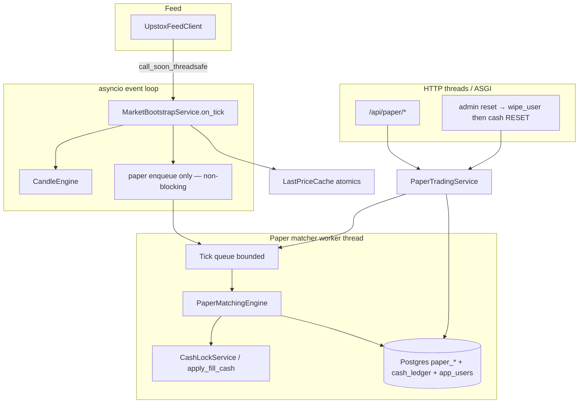
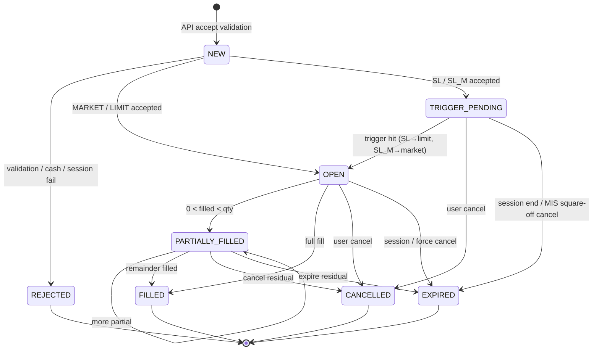

# Manual Paper Trading OMS (v1) — Design Document

| Field | Value |
|---|---|
| **Document** | Manual Paper Trading OMS Design v1.0 |
| **Author** | TIP-2 Architecture |
| **Date** | 2026-07-28 |
| **Status** | Implemented (v1 manual OMS — 2026-07-28) |
| **Repo path** | `Manual-Paper-Trading-Design-v1.0.md` (repo root) |
| **Related** | `docs/PRODUCT-DECISIONS.md`, `Architectural-Decisions.md` (AD0), `Paper-Strategy-Design-v1.0.md` (**deferred/superseded for v1**), `contracts/API-CONTRACT.md`, `backend/app/user/*`, `backend/app/market/*` |

---

## Overview

TIP-2 is a Trading Intelligence Platform (Python FastAPI + React) for NSE equities. Today it is **read-only for real brokerage** (AD0): live Upstox ticks → session-anchored candles → pattern detection → alerts. Multi-user auth, admin-managed `cash_balance` / `cash_ledger`, and a shared watchlist already exist.

This design introduces a **manual paper trading OMS (Order Management System lite)** so authenticated users with `tradingEnabled` can place, modify, and cancel paper orders (market, limit, SL, SL-M), hold **separate long/short lots** (MIS or CNC), and see real-time P&amp;L — all simulated against **live Upstox ticks**, never against a real broker.

**Product stance for v1:** simpler **manual** paper first. The older locked design `Paper-Strategy-Design-v1.0.md` (pattern-driven auto strategy bots) is **explicitly deferred/superseded for v1**. Strategy auto-trade may later reuse this package’s ledger, cash lock, and lot model as a future phase.

---

## Background & Motivation

### Current state

| Area | What exists |
|---|---|
| Users | `AppUserRow.cash_balance`, `trading_enabled`; admin seed/reset (`UserService.seed_cash`, `reset_user`) |
| Ledger | `CashLedgerRow` with types `SEED`, `RESET`, `ADJUST`, `BUY`, `SELL`, `FEE`, `SQUARE_OFF` (V5) — **BUY/SELL/FEE unused in production paths today** |
| Market | `Tick(instrument_key, price, volume_traded_today, timestamp_ms)`; `MarketBootstrapService.on_tick` fans into candle engine only when `phase_from_clock() == OPEN` |
| Feed dispatch | `UpstoxFeedClient._dispatch` schedules tick callbacks via `loop.call_soon_threadsafe` — **handlers run on the asyncio event loop** |
| Events | `EventBus` — candle/pattern/phase/watchlist events; **no tick-level event** yet; publish is synchronous and swallows handler exceptions |
| Instruments | Watchlist includes equities + NIFTY 50 index (`NSE_INDEX`); segment/`instrument_type` available on `WatchlistEntry` (EQ, BE, INDEX) |
| Real OMS | None — AD0 forbids real broker execution |
| Deploy | Single backend instance (Render / local); no multi-writer |

### Pain points

1. Paper cash is seeded but **cannot be exercised** — no orders, positions, or fill ledger.
2. Product docs still point at **strategy auto-trade** as next; operators need a simpler manual OMS first for multi-user paper practice.
3. Without a tick-driven matcher and cash-lock model, any future strategy bot would reinvent capital accounting.

### Why now

- Foundations (users, ledger types, live ticks, market phase clock) are already in place.
- Manual OMS is independently valuable and **de-risks** later strategy work by proving fill/margin semantics on real ticks.

---

## Goals & Non-Goals

### Goals

1. **Manual paper orders only** — market, limit, SL, SL-M; modify; cancel; short + long.
2. **Full OMS lite in one design**, shipped in **phased PRs** (see PR Plan).
3. **Next-tick live fill** from Upstox ticks (not candle close, not stale cached LTP).
4. **Cash lock** (1× notional, no MIS leverage multipliers) with free-cash rejection and **fill-funding policy** that never violates `cash_balance >= 0`.
5. **Separate position lots** (no netting); MIS force-flat at **15:20 IST** (configurable); CNC overnight.
6. **Watchlist equities only** — reject index / non-equity instruments.
7. **Zero costs v1** (schema retains `FEE` for later).
8. Dedicated paper UI + REST APIs reusable later by a chart ticket.
9. Persist open orders/lots; **resume matching after restart** without false fills.
10. Update AD0 / PRODUCT-DECISIONS so paper simulation is allowed; real broker still forbidden.
11. **Non-blocking tick path**: matcher work runs off the asyncio event loop.

### Non-Goals (v1)

| Non-goal | Notes |
|---|---|
| Pattern-driven auto strategies | Deferred; see `Paper-Strategy-Design-v1.0.md` for future |
| Real broker / Upstox order APIs | Forever out of scope under AD0 evolution |
| Order book / depth simulation | No L2; crossing price fills full remaining qty (or config cap) |
| Brokerage / STT / slippage models | Zero costs; optional later via `FEE` |
| Index / F&amp;O / currency | Equities on shared watchlist only |
| Netting / average position book | Explicit lot-per-entry model |
| Chart-embedded buy/sell ticket | API extension point only; not required for v1 UI |
| Multi-leg / OCO / bracket / GTT | Out of scope |
| Self-serve signup | Still admin-created users |
| Multi-instance matching | Single backend replica only (documented) |

---

## Proposed Design

### 1. Package layout

Prefer **`backend/app/paper/`** (clear domain name; reserve a future `backend/app/strategy/` for bots). Do **not** put auto-trade under this package.

```
backend/app/paper/
  __init__.py
  models.py           # domain enums, dataclasses (Order, Fill, PositionLot, CashSnapshot)
  entities.py         # SQLAlchemy rows
  dto.py              # request/response mappers → camelCase JSON
  cash.py             # free/locked cash; apply_fill_cash; ledger writes; invariants
  orders.py           # place / modify / cancel; validation; state transitions
  positions.py        # open/close lots; MTM helpers; partial close
  matching.py         # matching engine logic (pure; called by worker)
  worker.py           # dedicated matcher worker thread + tick queue
  margin.py           # lock amount computation (intent-aware)
  square_off.py       # MIS force-flat job (idempotent)
  service.py          # PaperTradingService façade (API + wipe_user + enqueue)
  repository.py       # Postgres persistence
  eligibility.py      # is_paper_tradable(entry) — shared rule
  events.py           # optional bus events for future WS (not tick intake)
  last_price.py       # LTP cache for UI quotes + lock sizing ONLY (never fill price)

backend/app/api/
  paper.py            # REST routes under /api/paper/*

backend/db/migration/
  V7__paper_trading.sql
```

**Dependency rules:**

- `paper` may depend on: `user` (read cash / write ledger via shared session patterns), `watchlist`, `market.models.Tick`, `market.nse_clock`, `config.Settings`, `db`.
- `paper` **must not** import `app.patterns.*`.
- `user` **must not** import `paper` (admin wipe is wired from API/container — see §5.3).
- `market` / `patterns` must not import `paper` (tick fan-out via callback → queue only).

### 2. High-level architecture



### 3. Tick wiring & matcher worker (critical)

**Reality:** `UpstoxFeedClient._dispatch` uses `loop.call_soon_threadsafe(cb, tick)`, so `MarketBootstrapService.on_tick` runs on the **FastAPI asyncio event loop**. Candle processing already consumes loop time; synchronous multi-user SQLAlchemy fill transactions **must not** run there.

#### 3.1 Design: dedicated matcher worker

| Component | Responsibility |
|---|---|
| **Event-loop path** | `on_tick`: (1) gate phase `OPEN` as today for candles; (2) update `LastPriceCache` (lock-free/atomic); (3) **enqueue** a lightweight tick copy to paper queue; return immediately |
| **Worker thread** | Owns open-order index, per-user locks, matching, DB commits, square-off processing |
| **HTTP path** | Place/modify/cancel under same per-user locks + DB txns; publishes order into index under lock |

**Intake API (preferred over EventBus for ticks):**

```python
# MarketBootstrapService.__init__ accepts optional:
#   on_tick_extra: Callable[[Tick], None] | None = None

def on_tick(self, tick: Tick) -> None:
    from app.market.nse_clock import MarketPhase, phase_from_clock
    if phase_from_clock() != MarketPhase.OPEN:
        return
    if self._on_tick_extra is not None:
        try:
            self._on_tick_extra(tick)  # MUST be non-blocking
        except Exception:
            logger.exception("on_tick_extra failed")
    for tf in self._settings.supported_timeframes:
        ...
```

Container wires:

```python
self._on_tick_extra = self.paper_service.enqueue_tick  # put_nowait / drop-oldest policy
```

**Do not** use `EventBus.publish(TickReceivedEvent)` as the primary fill path: handlers are synchronous, exceptions are swallowed (`events.py`), and there is no retry. Optional domain events (`PaperFillEvent`) may be published **from the worker after commit** for future WS — not for intake.

#### 3.2 Tick queue policy

| Setting | Default | Behavior |
|---|---|---|
| Queue maxsize | 10_000 | Bound memory |
| Full policy | Drop oldest tick for same symbol, or drop new with metric `paper_tick_drop` | Prefer coalescing: keep **latest price per symbol** in a pending map + condition variable (better than raw queue of every tick) |
| **Recommended structure** | `pending_ltp: dict[symbol, Tick]` + `wake` Event; worker drains all dirty symbols each cycle | Natural coalesce under burst |

**Work caps per worker cycle:**

- Max symbols per cycle: all dirty (typically ≪ 50 watchlist).
- Max orders processed per symbol per cycle: all open for that symbol (hard cap 50 instruments × max open orders — see KD-P17).
- Time budget soft log if cycle &gt; 50ms.

#### 3.3 Failure policy

- Failed fill transaction: **rollback entirely**; order remains open; retry on next tick. Never half-commit (fill without ledger, etc.).
- Worker exceptions: log, continue loop; do not kill feed.
- `SELECT … FOR UPDATE` on `app_users` (and order row) only inside short worker/HTTP transactions — new pattern for this codebase; keep txn scope minimal.

#### 3.4 Next-tick-after-accept rule (process-local sequence)

**Primary rule for v1 (single process):** do **not** rely on Upstox `timestamp_ms` / LTT ordering for “next tick.”

| Field | Storage | Role |
|---|---|---|
| `accepted_at` | Postgres timestamptz | Audit only |
| `accepted_tick_ms` | Postgres bigint nullable | Audit / debug only (feed LTT at accept if known) |
| `accept_seq` | Postgres bigint | Process-assigned monotonic id at accept (global or per-symbol counter in worker+service) |
| In-memory | `seen_tick_seq[symbol]` | Monotonic counter incremented **once per matcher-observed tick** for that symbol |

**Market / post-activation SL-M fill condition:**

```text
order.status in (OPEN, PARTIALLY_FILLED)
and working_type == MARKET
and seen_tick_seq[symbol] > order.accept_seq_at_market_ready
```

Where `accept_seq_at_market_ready` is set when the order becomes marketable as MARKET:

- On place of MARKET: set to current `seen_tick_seq[symbol]` (fill requires a **later** observed tick).
- On SL-M trigger: set to `seen_tick_seq[symbol] - 1` **or** allow same-tick fill by setting `allow_same_tick_fill=true` for SL-M only (see §4.3).

**On process startup / rebuild:**

1. Load open orders/lots/locks from DB; rebuild `_open_by_symbol` and per-user indexes.
2. Reset `seen_tick_seq[symbol] = 0` for all symbols; reset process accept counter from `max(accept_seq)` in DB (or `time.time_ns()`).
3. For each rebuilt MARKET-working order, set in-memory `accept_seq_at_market_ready = 0` and **also** set a flag `warmup_required=True` until **one** post-rebuild tick is observed for that symbol.
4. **Do not fill** any order until `warmup_required` is cleared for that symbol (first observed tick after rebuild only advances seq / clears warmup; **second** tick may fill — or: first tick clears warmup and may fill if product requires aggressiveness; **choose: first post-rebuild tick clears warmup only; fills from the next tick**). This prevents restart + stale LTT false fills and “fill on first reconnect print without user-visible live market.”

**Index / lock order on place (HTTP):**

```text
acquire user_lock(user_id)
  BEGIN
    SELECT app_users FOR UPDATE
    validate + insert order + insert lock + commit
  update _open_by_symbol under same user_lock (or matcher global index lock ordered after user lock)
release user_lock
```

Matcher never fills an order not yet in the index; place never exposes an order to the index before commit succeeds.

### 4. Order types & state machine

#### 4.1 Types

| Type | Side | Behavior |
|---|---|---|
| `MARKET` | BUY / SELL | Accept as open; fill on **first matcher-observed tick after** market-ready seq (see §3.4) |
| `LIMIT` | BUY / SELL | Rest; fill when tick **crosses or touches** limit (buy: `price <= limit`; sell: `price >= limit`) |
| `SL` | BUY / SELL | `TRIGGER_PENDING` until trigger; then **LIMIT** at `price` |
| `SL_M` | BUY / SELL | `TRIGGER_PENDING` until trigger; then **MARKET**; **same-tick fill allowed** at trigger price |

**Product:** MIS | CNC (per order).  
**Quantity:** integer shares, min 1.  
**Short:** SELL without `closeLotId` opens a short lot. BUY/SELL with `closeLotId` closes/reduces that lot only.

#### 4.2 State machine



**Status derivation rules (authoritative):**

| Condition | Status |
|---|---|
| Rejected at place (not persisted or persisted for audit) | `REJECTED` |
| SL/SL_M not yet triggered | `TRIGGER_PENDING` |
| `filled_qty == 0` and working | `OPEN` |
| `0 < filled_qty < qty` | **`PARTIALLY_FILLED`** (always, including rare Policy A residual cancels) |
| `filled_qty == qty` | `FILLED` |
| User cancel residual | `CANCELLED` |
| Session / system cancel residual | `EXPIRED` |

`NEW` is API-transient: validate → insert as OPEN/TRIGGER_PENDING or return REJECTED in one response. Optionally persist REJECTED for audit (`source=USER`, terminal).

#### 4.3 SL / SL-M — durable working state

**Schema:** store both original and working type:

| Column | Meaning |
|---|---|
| `order_type` | As placed: `MARKET` \| `LIMIT` \| `SL` \| `SL_M` (immutable) |
| `working_order_type` | Current matcher behavior: `MARKET` \| `LIMIT` \| `NONE` (NONE while TRIGGER_PENDING) |
| `triggered_at` | Set when stop triggers |

**Inference fallback (if column missing in older row):**  
`triggered_at IS NOT NULL` ⇒ SL works as LIMIT at `price`; SL_M as MARKET. Prefer explicit column in V7.

**Place-time validation (frozen defaults):**

| Order | Rules |
|---|---|
| SL BUY | `trigger_price` required; `price` required; **`price >= trigger_price`**; reject nulls |
| SL SELL | `trigger_price` required; `price` required; **`price <= trigger_price`** |
| SL_M BUY/SELL | `trigger_price` required; `price` must be null |
| LIMIT | `price` required; `trigger_price` null |
| MARKET | both prices null |

**Trigger rules (tick price `p`):**

- BUY SL / SL_M: `p >= trigger_price`
- SELL SL / SL_M: `p <= trigger_price`

**Same-transaction activation (worker):**

```text
BEGIN
  lock order row (FOR UPDATE) + user row
  if still TRIGGER_PENDING and triggered(p):
    set triggered_at, working_order_type = LIMIT|MARKET, status = OPEN
    if SL and marketable at p: apply_fill(...)  # may partial
    if SL_M: apply_fill at p same tick (full/partial per funding)
  COMMIT
```

No crash window where status is OPEN-as-MARKET without attempting fill in the same txn when SL_M triggers.

#### 4.4 Partial fills & partial closes

**Fill qty policy:**

| Policy | Behavior |
|---|---|
| **A (default)** | When marketable, attempt `fill_qty = remaining_qty` at tick price, then **reduce by funding** (§5.4) |
| **B (config)** | `tip.paper.max_fill_qty_per_tick` caps raw attempt before funding check |

```text
attempt = min(remaining, max_fill_per_tick or remaining)
fill_qty = apply_funding_cap(order, attempt, tick.price)  # may be 0..attempt
if fill_qty == 0: leave open (or cancel residual if policy says unfundable forever — see §5.4)
```

**Partial close:** explicitly **allowed**. Place opposite-side order with `closeLotId` and `qty <= lot.qty_open`.  
API **400** if:

- `qty > lot.qty_open`
- lot not `OPEN` / wrong user
- order side incompatible with lot side (must be opposite)
- `product` **must equal** lot.product (MIS close with MIS only; CNC with CNC)

**Lot updates on partial close:**

```text
lot.qty_open -= fill_qty
lot.qty_closed += fill_qty
lot.realized_pnl += pnl_for_fill
if lot.qty_open == 0: lot.status = CLOSED; lot.closed_at = now
```

Opening fills for the same entry order merge into **one lot** (VWAP `avg_entry_price`). Closing always targets an existing lot via `closeLotId` (no auto-net).

**Cancel residual after partial — lock release:**

```text
# Prefer recompute over proportional drift:
if intent requires order lock:
  new_lock = lock_unit_price * qty_remaining_after_cancel_or_fill
  adjust lock row amount to new_lock (or release + re-insert)
else:
  release order lock fully
```

Proportional formula if needed: `release = lock_amount * fill_qty / qty_remaining_before` with final recompute on last residual.

### 5. Capital / cash lock model

#### 5.1 Accounting identity

```text
cash_balance  = free_cash + locked_cash     # invariant (assert in tests)
locked_cash   = SUM(paper_cash_locks.amount WHERE released_at IS NULL)
free_cash     = cash_balance - locked_cash
```

- `app_users.cash_balance` is total paper cash (CHECK `>= 0` in V5).
- Locks are **not** ledger lines; they are `paper_cash_locks` rows.
- All money values use `money()` (`Decimal` 2 dp, `ROUND_HALF_UP`) from `app.user.service`.
- Fill `amount` on `paper_fills` = `money(qty * price)` even though price has 4 dp.

#### 5.2 Intent matrix (authoritative)

Four intents. SELL without `closeLotId` is **always open short** (even if longs exist). BUY without `closeLotId` is **always open long**.

| Intent | Side | closeLotId | Lock at accept | `cash_balance` Δ on fill | Lock on fill | Ledger |
|---|---|---|---|---|---|---|
| **1. Open long** | BUY | null | `qty_rem × lock_px` (see ref) | `− money(fill_qty × fill_px)` | Release filled portion of order lock | `BUY`, amount = **negative** notional |
| **2. Close long** | SELL | required | **0** (validate qty ≤ lot) | `+ money(fill_qty × fill_px)` | none | `SELL`, amount = **positive** notional |
| **3. Open short** | SELL | null | `qty_rem × lock_px` (1× short margin) | **0** | Keep/adjust short margin on lot; release order lock portion | `SELL`, amount = **0**, note records notional for audit |
| **4. Cover short** | BUY | required | **0 extra** if lot already has SHORT_MARGIN lock; else ensure lot margin exists | P&amp;L: `+ money((entry − exit) × fill_qty)` for short | Release margin for filled qty | `BUY` or `SQUARE_OFF`, amount = **P&amp;L** (signed) |

**Lock reference price `lock_px`:**

| Order type | `lock_px` |
|---|---|
| LIMIT / SL (has price) | `price` |
| MARKET / SL_M | `LTP × market_lock_haircut` (default haircut **1.02**) from `LastPriceCache`; if no LTP → **reject place** `NO_LTP` |

`LastPriceCache` allowed uses: **(1)** lock sizing at accept/modify, **(2)** UI quotes / MTM display. **Forbidden:** using cache as fill price or as “immediate market fill.”

#### 5.3 Worked examples

**Example A — Long MARKET, adverse up-tick (fill-funding)**

- Balance 100_000; free 100_000; LTP 100; haircut 1.02 → lock 10 × 102 = 1_020 for qty 10.
- Next tick p = 110. Required for full fill = 1_100.
- `free + this_order_lock = (100_000 − 1_020) + 1_020 = 100_000` ≥ 1_100 → full fill OK.
- After: cash_balance = 98_900; lock released; long lot qty 10 @ 110.

**Example B — Long MARKET, fill would exceed spendable cash (single lock)**

- Balance 1_000; lock 10 × 102 = 1_020 but wait — free must cover lock at accept: free 1_000 &lt; 1_020 → **reject at place**.  
- Balance 5_000; qty 50; LTP 100; lock = 50 × 102 = 5_100 &gt; free → reject place.
- Balance 5_000; qty 40; lock = 4_080; free after lock = 920; **other_locks = 0**.
- Tick p = 130; full notional = 5_200.  
  **Funding cap (authoritative):**  
  `spendable = free_cash + this_order_lock = 920 + 4_080 = 5_000`  
  `= cash_balance − other_locks = 5_000 − 0`  
  `affordable = min(40, floor(5_000 / 130)) = 38`.  
  Fill 38; residual 2 → cancel residual with `INSUFFICIENT_CASH_AT_FILL` for MARKET (v1). LIMIT leaves residual open.

**v1 fill-funding policy (frozen):**

1. Compute `affordable_qty` with **§5.4 spendable formula** (never full `cash_balance` when other locks exist).
2. If `affordable_qty == 0` on a MARKET-working order: **cancel residual** (`EXPIRED` or `CANCELLED` with reason `INSUFFICIENT_CASH_AT_FILL`) — do not spin forever.
3. If `0 < affordable_qty < remaining` on MARKET: fill affordable, cancel rest with same reason.
4. If LIMIT: fill affordable only; **leave residual OPEN/PARTIALLY_FILLED** (user may cancel); do not auto-cancel.

**Example C — Close long SELL**

- Lot LONG 10 @ 100; close SELL MARKET qty 10; lock 0.
- Tick 105 → cash += 1_050; ledger SELL +1050; lot CLOSED; realized +50.

**Example D — Open short**

- SELL open short qty 10; LTP 100; lock 10 × 102 = 1_020; cash_balance unchanged on fill at 100.
- Ledger SELL amount 0, note `OPEN_SHORT notional=1000`.
- Lot SHORT 10 @ 100; SHORT_MARGIN lock 1_000 (recompute to entry × qty on fill; release order lock).

**Example E — Cover short squeeze**

- Short 10 @ 100; margin lock 1_000; cash_balance 100_000; free 99_000.
- Cover BUY at 120; P&amp;L = (100−120)×10 = −200.
- Release margin 1_000; cash_balance += −200 → 99_800; free increases by released margin net of loss.
- If loss would drive cash_balance &lt; 0: set cash_balance = 0, ledger `ADJUST` shortfall note (blow-up) — same floor as before for catastrophic shorts.

**Example F — Mixed locks: open short margin + long MARKET must not consume short margin**

- `cash_balance` = 10_000.
- Existing **SHORT_MARGIN** lock = 5_000 (other_locks = 5_000).
- Free cash before new order = 5_000.
- Place long MARKET qty 50; LTP 100; haircut 1.02 → required lock = 50 × 102 = 5_100 &gt; free 5_000 → **reject at place** (correct).
- Place long MARKET qty 40 instead; lock = 40 × 102 = 4_080 ≤ free 5_000 → accept.  
  Now: free = 920; locks = short 5_000 + order 4_080 = 9_080; balance still 10_000.
- Tick p = 100; full notional for 40 = 4_000.
  - **Wrong (do not use):** `floor(cash_balance / p) = floor(10000/100) = 100` → would allow spending short margin.
  - **Correct:**  
    `this_order_lock = 4_080`  
    `other_locks = 5_000`  
    `spendable = cash_balance − other_locks = 5_000`  
    `= free_cash + this_order_lock = 920 + 4_080`  
    `affordable = min(40, floor(5000/100)) = 40` → full fill OK; after fill balance 6_000, short margin still 5_000, free = 1_000.
- Same setup, tick p = 130; full notional 40 × 130 = 5_200 &gt; spendable 5_000:  
  `affordable = floor(5000/130) = 38`. Fill 38 @ 130 (notional 4_940); cancel residual 2 with `INSUFFICIENT_CASH_AT_FILL`.  
  After: balance = 10_000 − 4_940 = 5_060; short margin still 5_000; free = 60 ≥ 0.  
  **Never** debit into the 5_000 short-margin reservation.

#### 5.4 `apply_fill_cash(...)` algorithm

Centralize in `cash.py` (unit-tested in PR1 pure logic + PR2c integration).

**Authoritative open-long spendable cash (single formula — use everywhere):**

```text
# locks = all open paper_cash_locks for user (released_at IS NULL)
this_order_lock = amount of ORDER lock for this order (0 if none)
other_locks     = sum(all open locks) - this_order_lock
# Identity: free_cash + this_order_lock == cash_balance - other_locks
spendable       = money(user.cash_balance - other_locks)
                = money(free_cash + this_order_lock)

# Precompute max fill qty for open_long (before mutating locks):
affordable = min(attempt, floor(spendable / fill_px))   # integer shares
if affordable < 0:
  affordable = 0

# DO NOT use floor(user.cash_balance / fill_px) — that ignores other locks
# and can drive free_cash negative when SHORT_MARGIN or other ORDER locks exist.
```

```text
function apply_fill(order, lot, fill_qty, fill_px, user_row, locks):
  intent = resolve_intent(order)  # open_long | close_long | open_short | cover_short
  notional = money(fill_qty * fill_px)

  if intent == open_long:
    this_lock = order_lock_amount(order, locks)
    other_locks = sum_open_locks(user) - this_lock
    spendable = money(user.cash_balance - other_locks)  # free + this order lock
    if notional > spendable:
      raise AbortFill  # caller must precompute affordable; never debit other locks
    release_order_lock_portion(order, fill_qty)  # reduces remaining lock for residual qty
    # After release of filled portion, remaining open locks still include other_locks
    # (+ residual order lock if any). Debit only spendable cash:
    user.cash_balance = money(user.cash_balance - notional)
    ledger(BUY, -notional, user.cash_balance)
    open_or_update_long_lot(...)

  if intent == close_long:
    user.cash_balance = money(user.cash_balance + notional)
    ledger(SELL, +notional, user.cash_balance)
    reduce_lot(...)

  if intent == open_short:
    release_order_lock_portion(order, fill_qty)
    ensure_lot_margin_lock(lot, money(fill_qty * fill_px))  # entry-based 1×
    # cash_balance unchanged
    ledger(SELL, 0, user.cash_balance, note=...)
    open_or_update_short_lot(...)

  if intent == cover_short:
    entry = lot.avg_entry_price
    pnl = money((entry - fill_px) * fill_qty)  # short pnl
    release_lot_margin_portion(lot, fill_qty)
    new_bal = money(user.cash_balance + pnl)
    if new_bal < 0:
      ledger(ADJUST, -user.cash_balance, 0, note="short blow-up")
      user.cash_balance = 0
    else:
      user.cash_balance = new_bal
      ledger(SQUARE_OFF or BUY, pnl, user.cash_balance)
    reduce_lot(...)

  assert user.cash_balance >= 0
  free = money(user.cash_balance - sum_open_locks(user))
  assert free >= 0  # free_cash never negative (incl. mixed short margin + long fills)
```

**Post-fill residual order lock (open long partial):** recompute  
`remaining_order_lock = lock_unit_px * qty_remaining` (or proportional), so  
`other_locks` on a subsequent tick still excludes only *this* order’s current lock row.

#### 5.5 Admin seed / reset — no UserService → paper import

```text
# backend/app/api/admin_users.py  (or thin orchestration in container)
@router.post("/{user_id}/reset")
def reset_user(...):
    paper = request.app.state.container.paper_service  # may be None if disabled
    if paper is not None:
        paper.wipe_user(user_id, close_price_policy="LTP_ELSE_ENTRY")
    return user_service.reset_user(user_id, amount)  # cash RESET ledger only
```

| API | Behavior |
|---|---|
| **`PaperTradingService.wipe_user`** | Under `user_lock`: cancel non-terminal orders; force-close open lots at LTP else entry; release all locks; no change to cash_balance (caller resets cash) |
| **`UserService.reset_user`** | Unchanged: set cash + ledger `RESET` only — **never imports paper** |
| **Seed top-up** | Does not wipe positions; allowed while locks exist |
| **`trading_enabled=false`** | Block new orders; resting orders remain |

**Lock order:** `user_lock` → DB txn (paper tables + optional user row) → commit → release.

### 6. Positions — separate lots (no netting)

| Field | Description |
|---|---|
| `id` | UUID |
| `user_id` | Owner |
| `instrument_key` | Symbol |
| `side` | `LONG` \| `SHORT` |
| `product` | `MIS` \| `CNC` |
| `qty_open` / `qty_closed` | Integers |
| `avg_entry_price` | VWAP of opening fills |
| `realized_pnl` | On closes |
| `status` | `OPEN` \| `CLOSED` |
| `entry_order_id` | Originating open order |
| `opened_at` / `closed_at` / `updated_at` | Timestamps |

**MTM display:**  
`long: (ltp - entry) * qty_open` · `short: (entry - ltp) * qty_open`  
CNC overnight: MTM uses next session LTP from cache when available.

### 7. Modify / cancel rules

| Action | Rules |
|---|---|
| **Cancel** | Status ∈ {`OPEN`, `TRIGGER_PENDING`, `PARTIALLY_FILLED`}. Residual locks released via recompute. |
| **Modify** | Same statuses. PATCH fields: `qty` ( ≥ filled_qty, ≥ 1 residual), `price`, `triggerPrice` (SL family only). Recompute lock; reject if need more free cash. |
| **Reject** | Terminal states; session not OPEN; invalid bands; product/side immutable |

Optional `clientOrderId`: unique per user; blank → NULL (not `''`).

### 8. Session guards & MIS square-off

#### 8.1 Session

| Phase | New/modify orders | Matching |
|---|---|---|
| `OPEN` | Allowed | Active |
| `PRE_OPEN` | **Reject** `MARKET_CLOSED` | Inactive |
| `CLOSED` | **Reject** | Inactive |

Session OPEN guard ships with **first place path** (PR2b), not deferred to MIS PR.

#### 8.2 MIS force-flat

**Cadence (mandatory primary):**

1. **Worker-side clock check** every cycle / every tick drain: if IST time ≥ `mis_square_off_time` (default 15:20) and trading day, run idempotent square-off.
2. Optional backup: dedicated **5s** timer in worker (not the 30s candle reconciler alone — 30s is too coarse and can fire 15:20–15:50).

**Idempotency:**

- Table or settings row: `paper_square_off_runs(user_id, trade_date, completed_at)` OR lot flag `square_off_enqueued_at`.
- Safe to re-enter: skip lots already CLOSED; skip if SYSTEM_SQUARE_OFF order already open for lot.

**Steps:**

1. Cancel open **MIS** orders → `EXPIRED`, reason `MIS_SQUARE_OFF`.
2. For each open **MIS** lot: enqueue system MARKET close (`source=SYSTEM_SQUARE_OFF`, `close_lot_id`, product MIS, opposite side, qty=`qty_open`).
3. Fill via normal market next-tick path (funding rules apply for short covers).
4. On phase → `CLOSED` or no LTP: force-close remaining MIS at **last LTP else avg entry**; ledger `SQUARE_OFF`. Same for watchlist-removed / bootstrap FAILED symbols (no live ticks).
5. CNC: unfilled CNC orders at session end → `EXPIRED`; CNC lots **remain**.

**Product consistency:** close/square-off order product **must match** lot product. User cannot close MIS lot with CNC order (400 `PRODUCT_MISMATCH`).

**Stuck SYSTEM_SQUARE_OFF:** CLOSED fallback force-closes; if funding blocks cover, blow-up policy (§5.3 E) + force lot CLOSED.

### 9. Instrument eligibility

Centralize in `paper/eligibility.py`:

```python
def is_paper_tradable(entry: WatchlistEntry) -> bool:
    if not entry.active:
        return False
    if entry.bootstrap_status == SymbolBootstrapStatus.REMOVING:
        return False
    if settings.require_ready and entry.bootstrap_status != SymbolBootstrapStatus.READY:
        return False
    seg = (entry.segment or "").upper()
    if "INDEX" in seg or entry.symbol_id.startswith("NSE_INDEX"):
        return False
    if seg != "NSE_EQ":
        return False
    # Allow EQ and BE (banned equity) cash stocks; reject other types
    itype = (entry.instrument_type or "").upper()
    return itype in ("EQ", "BE")
```

FE order ticket uses the same filter (watchlist fetch → client-side filter + server re-check).

Open CNC lots on removed symbols: still closable via API (eligibility for **new opens** only; closes by `closeLotId` skip watchlist active check but still require instrument_key match).

### 10. Concurrency & correctness

| Mechanism | Detail |
|---|---|
| **Matcher worker** | Single thread; sole owner of fill commits from ticks |
| **Per-user `threading.RLock`** | Shared by HTTP place/modify/cancel/wipe and worker when touching that user |
| **Tick processing order** | Group open `order_ids` for a symbol **by `user_id`**; acquire user lock once; process all that user’s orders for the symbol; commit per user (or per order txn under same lock) |
| **Index** | Updates under user lock (place) or worker; optional global index lock ordered **after** user locks to avoid deadlock (never: index lock → user lock) |
| **Optimistic concurrency** | Column `version INT NOT NULL DEFAULT 0`; updates `WHERE id=? AND version=?` increment version; or `WHERE status IN (open-states)` with rowcount check |
| **Double-fill** | Single worker + status guards + one txn per fill |
| **Deploy** | **One backend replica** for paper matcher correctness; document in rollout / RENDER notes |

### 11. Data model (Postgres V7)

#### 11.1 `paper_orders`

```sql
CREATE TABLE paper_orders (
    id                   UUID PRIMARY KEY,
    user_id              UUID NOT NULL REFERENCES app_users (id) ON DELETE CASCADE,
    client_order_id      VARCHAR(64),  -- NULL if omitted; never ''
    instrument_key       TEXT NOT NULL,
    trading_symbol       VARCHAR(64) NOT NULL,
    side                 VARCHAR(8) NOT NULL,
    order_type           VARCHAR(8) NOT NULL,   -- as placed; immutable
    working_order_type   VARCHAR(8) NOT NULL,   -- MARKET | LIMIT | NONE
    product              VARCHAR(8) NOT NULL,
    qty                  INT NOT NULL,
    filled_qty           INT NOT NULL DEFAULT 0,
    price                NUMERIC(18, 4),
    trigger_price        NUMERIC(18, 4),
    status               VARCHAR(32) NOT NULL,
    reject_reason        VARCHAR(256),
    close_lot_id         UUID,
    source               VARCHAR(32) NOT NULL DEFAULT 'USER',
    accept_seq           BIGINT NOT NULL,
    accepted_at          TIMESTAMPTZ,
    accepted_tick_ms     BIGINT,
    triggered_at         TIMESTAMPTZ,
    completed_at         TIMESTAMPTZ,
    version              INT NOT NULL DEFAULT 0,
    created_at           TIMESTAMPTZ NOT NULL,
    updated_at           TIMESTAMPTZ NOT NULL,
    CONSTRAINT ck_paper_orders_side CHECK (side IN ('BUY', 'SELL')),
    CONSTRAINT ck_paper_orders_type CHECK (order_type IN ('MARKET', 'LIMIT', 'SL', 'SL_M')),
    CONSTRAINT ck_paper_orders_working CHECK (working_order_type IN ('MARKET', 'LIMIT', 'NONE')),
    CONSTRAINT ck_paper_orders_product CHECK (product IN ('MIS', 'CNC')),
    CONSTRAINT ck_paper_orders_status CHECK (status IN (
        'OPEN', 'TRIGGER_PENDING', 'PARTIALLY_FILLED',
        'FILLED', 'CANCELLED', 'REJECTED', 'EXPIRED'
    )),
    CONSTRAINT ck_paper_orders_qty CHECK (qty >= 1 AND filled_qty >= 0 AND filled_qty <= qty),
    CONSTRAINT uq_paper_orders_client UNIQUE (user_id, client_order_id)
);

CREATE INDEX idx_paper_orders_user_status ON paper_orders (user_id, status);
CREATE INDEX idx_paper_orders_symbol_status ON paper_orders (instrument_key, status);
CREATE INDEX idx_paper_orders_close_lot ON paper_orders (close_lot_id);
```

Note: PG UNIQUE allows multiple NULLs for `client_order_id`; app normalizes blank → NULL.

#### 11.2 `paper_fills`

```sql
CREATE TABLE paper_fills (
    id              UUID PRIMARY KEY,
    order_id        UUID NOT NULL REFERENCES paper_orders (id) ON DELETE CASCADE,
    user_id         UUID NOT NULL REFERENCES app_users (id) ON DELETE CASCADE,
    instrument_key  TEXT NOT NULL,
    side            VARCHAR(8) NOT NULL,
    qty             INT NOT NULL,
    price           NUMERIC(18, 4) NOT NULL,
    amount          NUMERIC(18, 2) NOT NULL,  -- money(qty * price)
    tick_ts_ms      BIGINT NOT NULL,
    lot_id          UUID,
    created_at      TIMESTAMPTZ NOT NULL
);
-- immutable; no updated_at

CREATE INDEX idx_paper_fills_user_created ON paper_fills (user_id, created_at DESC);
CREATE INDEX idx_paper_fills_order ON paper_fills (order_id);
```

#### 11.3 `paper_position_lots`

```sql
CREATE TABLE paper_position_lots (
    id               UUID PRIMARY KEY,
    user_id          UUID NOT NULL REFERENCES app_users (id) ON DELETE CASCADE,
    instrument_key   TEXT NOT NULL,
    trading_symbol   VARCHAR(64) NOT NULL,
    side             VARCHAR(8) NOT NULL,
    product          VARCHAR(8) NOT NULL,
    qty_open         INT NOT NULL,
    qty_closed       INT NOT NULL DEFAULT 0,
    avg_entry_price  NUMERIC(18, 4) NOT NULL,
    realized_pnl     NUMERIC(18, 2) NOT NULL DEFAULT 0,
    status           VARCHAR(16) NOT NULL,
    entry_order_id   UUID REFERENCES paper_orders (id),
    opened_at        TIMESTAMPTZ NOT NULL,
    closed_at        TIMESTAMPTZ,
    updated_at       TIMESTAMPTZ NOT NULL,
    CONSTRAINT ck_paper_lots_side CHECK (side IN ('LONG', 'SHORT')),
    CONSTRAINT ck_paper_lots_product CHECK (product IN ('MIS', 'CNC')),
    CONSTRAINT ck_paper_lots_status CHECK (status IN ('OPEN', 'CLOSED')),
    CONSTRAINT ck_paper_lots_qty CHECK (qty_open >= 0 AND qty_closed >= 0)
);

CREATE INDEX idx_paper_lots_user_status ON paper_position_lots (user_id, status);
```

#### 11.4 `paper_cash_locks`

```sql
CREATE TABLE paper_cash_locks (
    id           UUID PRIMARY KEY,
    user_id      UUID NOT NULL REFERENCES app_users (id) ON DELETE CASCADE,
    amount       NUMERIC(18, 2) NOT NULL,
    reason       VARCHAR(32) NOT NULL,  -- ORDER | SHORT_MARGIN
    order_id     UUID REFERENCES paper_orders (id) ON DELETE CASCADE,
    lot_id       UUID REFERENCES paper_position_lots (id) ON DELETE CASCADE,
    created_at   TIMESTAMPTZ NOT NULL,
    released_at  TIMESTAMPTZ,
    CONSTRAINT ck_paper_locks_amount CHECK (amount >= 0),
    CONSTRAINT ck_paper_locks_reason CHECK (reason IN ('ORDER', 'SHORT_MARGIN')),
    CONSTRAINT ck_paper_locks_fk CHECK (
        (reason = 'ORDER' AND order_id IS NOT NULL AND lot_id IS NULL)
        OR (reason = 'SHORT_MARGIN' AND lot_id IS NOT NULL AND order_id IS NULL)
    )
);

CREATE INDEX idx_paper_locks_user_open ON paper_cash_locks (user_id)
    WHERE released_at IS NULL;
```

#### 11.5 Ledger reuse

Existing types: `BUY`, `SELL`, `FEE`, `SQUARE_OFF`, `SEED`, `RESET`, `ADJUST`.  
Signs: see intent matrix §5.2. Optional `ref_id` later (V8+).

### 12. Matching engine — sequences & pseudo-code

#### 12.1 Accept sequence (HTTP)

```mermaid
sequenceDiagram
  participant FE
  participant API
  participant Svc as PaperTradingService
  participant DB
  participant Idx as OpenIndex

  FE->>API: POST /api/paper/orders
  API->>Svc: place_order
  Svc->>Svc: user_lock.acquire
  Svc->>DB: BEGIN; SELECT user FOR UPDATE
  Svc->>Svc: session OPEN? equity? cash? locks?
  alt reject
    Svc->>DB: ROLLBACK
    Svc-->>FE: 400/403
  else accept
    Svc->>DB: INSERT order, lock; COMMIT
    Svc->>Idx: add order_id under user_lock
    Svc->>Svc: user_lock.release
    Svc-->>FE: 201 OrderDto status OPEN/TRIGGER_PENDING
  end
```

#### 12.2 Tick → fill sequence (worker)

```mermaid
sequenceDiagram
  participant Loop as asyncio loop
  participant Q as Pending LTP map
  participant W as Matcher worker
  participant DB

  Loop->>Q: enqueue_tick (non-blocking)
  W->>Q: drain dirty symbols
  W->>W: maybe_run_mis_square_off(now_ist)
  loop each symbol
    W->>W: bump seen_tick_seq; clear warmup
    W->>W: group orders by user_id
    loop each user
      W->>W: user_lock.acquire
      W->>DB: BEGIN; lock user + orders
      W->>W: triggers / marketable / apply_fill_cash
      W->>DB: COMMIT or ROLLBACK full
      W->>W: user_lock.release
    end
  end
```

#### 12.3 Worker match loop (corrected)

```python
def process_symbol(self, symbol: str, tick: Tick) -> None:
    self._seen_tick_seq[symbol] = self._seen_tick_seq.get(symbol, 0) + 1
    self._warmup.discard(symbol)  # first tick after rebuild clears warmup membership
    # Fills allowed only if symbol not in warmup_block (block for first tick only):
    if symbol in self._warmup_block_first:
        self._warmup_block_first.discard(symbol)
        return  # no fills on the very first post-rebuild tick

    order_ids = list(self._index.get(symbol, ()))
    by_user: dict[UUID, list[UUID]] = defaultdict(list)
    meta = self._order_user  # id -> user_id cache
    for oid in order_ids:
        by_user[meta[oid]].append(oid)

    for user_id, oids in by_user.items():
        with self._user_locks[user_id]:
            try:
                self._match_user_orders(user_id, oids, tick)
            except Exception:
                logger.exception("match failed user=%s", user_id)
                # orders left open for retry
```

#### 12.4 Invariants (tests assert)

```text
user.cash_balance >= 0
free_cash = cash_balance - sum(open locks) >= 0
# open_long fills: notional <= spendable = cash_balance - other_locks
#   (never floor(cash_balance / px) when other_locks > 0)
sum(open locks) == locked_cash reported by account API
for each order lock: amount == unit_px * qty_remaining (within money rounding)
for each short lot OPEN: exists SHORT_MARGIN lock ≈ entry * qty_open
mixed locks: after long fill with short margin held, free_cash >= 0 and short margin unchanged
```

### 13. Configuration

| Key | Default | Meaning |
|---|---|---|
| `TIP_PAPER_ENABLED` | `true` | Master switch |
| `TIP_PAPER_MIS_SQUARE_OFF` | `15:20` | IST `HH:MM` |
| `TIP_PAPER_MAX_FILL_QTY_PER_TICK` | empty | Unlimited attempt before funding |
| `TIP_PAPER_MARKET_LOCK_HAIRCUT` | `1.02` | MARKET/SL_M lock multiplier on LTP |
| `TIP_PAPER_REQUIRE_WATCHLIST_READY` | `true` | Bootstrap READY for new opens |
| `TIP_PAPER_MAX_OPEN_ORDERS` | `50` | Per user non-terminal |
| `TIP_PAPER_MAX_OPEN_LOTS` | `50` | Per user OPEN lots |
| `TIP_PAPER_WS_EVENTS` | `false` | Off until WS auth exists |

#### Feature-flag / boot truth table

| Condition | Matcher subscribe | HTTP `/api/paper/*` | Behavior |
|---|---|---|---|
| `session_factory is None` (memory profile) | No | Mount but **503** `PAPER_REQUIRES_POSTGRES` | Consistent with durable OMS |
| Postgres + `TIP_PAPER_ENABLED=false` | No | **404** (router not mounted) or 503 `PAPER_DISABLED` — **choose 404 not mounted** | Clean disable |
| Postgres + enabled | Yes | Full | Normal |
| Health optional | — | — | `paper: { enabled, openOrders }` when enabled |

---

## API / Interface Changes

Auth: JWT `AuthUser`. Mutating routes require `active && tradingEnabled` else **403**.

Base: `/api/paper`

### Endpoints (v1 ship set)

| Method | Path | Auth | Description |
|---|---|---|---|
| `GET` | `/api/paper/account` | User | Balance, free, locked, unrealized |
| `GET` | `/api/paper/orders` | User | List; see query |
| `GET` | `/api/paper/orders/{orderId}` | User | Detail + fills |
| `POST` | `/api/paper/orders` | User | Place |
| `PATCH` | `/api/paper/orders/{orderId}` | User | Modify |
| `DELETE` | `/api/paper/orders/{orderId}` | User | Cancel |
| `GET` | `/api/paper/positions` | User | Lots |
| `GET` | `/api/paper/fills` | User | Fills |
| `GET` | `/api/paper/ledger` | User | **Ship v1** — user-scoped cash_ledger read |
| `POST` | `/api/admin/users/{id}/reset` | Admin | wipe_user then cash RESET |

**Cut from v1:** admin paper audit list endpoints (admin can use DB or later PR).

### List query & pagination

```
GET /api/paper/orders?status=OPEN,PARTIALLY_FILLED&symbolId=&limit=50&cursor=
```

- `cursor`: opaque base64 of `(created_at ISO, id)` for keyset pagination; empty = start.
- Default **excludes** `REJECTED` unless `status` includes it; terminal history: pass `status=FILLED,CANCELLED,EXPIRED` or `includeTerminal=true` helper later.
- `limit` max 100.

### Place body

```json
{
  "symbolId": "NSE_EQ|RELIANCE",
  "side": "BUY",
  "orderType": "LIMIT",
  "product": "MIS",
  "qty": 10,
  "price": 2950.0,
  "triggerPrice": null,
  "closeLotId": null,
  "clientOrderId": "ui-optional-uuid"
}
```

### Modify body (PATCH)

```json
{
  "qty": 8,
  "price": 2945.0,
  "triggerPrice": null
}
```

All fields optional; only present fields change. Cannot change `side`, `orderType`, `product`, `symbolId`, `closeLotId`.

### Error envelope (frozen)

Align with FastAPI but structured for paper codes:

```json
{
  "detail": {
    "code": "INSUFFICIENT_CASH",
    "message": "Free cash 1000.00 is less than required lock 2040.00"
  }
}
```

Stable codes: `INSUFFICIENT_CASH`, `INSUFFICIENT_CASH_AT_FILL`, `MARKET_CLOSED`, `NO_LTP`, `NOT_TRADABLE`, `TRADING_DISABLED`, `PRODUCT_MISMATCH`, `LOT_QTY`, `ORDER_NOT_MODIFIABLE`, `MAX_OPEN_ORDERS`, `PAPER_REQUIRES_POSTGRES`.

Where existing deps use plain string `detail`, paper router uses the object form consistently.

### Account response

```json
{
  "cashBalance": 100000.0,
  "lockedCash": 29500.0,
  "freeCash": 70500.0,
  "unrealizedPnl": 120.5,
  "tradingEnabled": true,
  "openOrderCount": 2,
  "openLotCount": 1
}
```

### WebSocket

v1: **REST poll only** (WS hub unauthenticated). Optional post-commit events internal for future. Do not broadcast paper payloads on unauthenticated `/ws/live`.

---

## Data Model Changes

| Change | Migration |
|---|---|
| `paper_orders`, `paper_fills`, `paper_position_lots`, `paper_cash_locks` | V7 |
| Reuse `cash_ledger` / `app_users` | No change |
| Paper requires Postgres | Runtime |

---

## Alternatives Considered

### (a) Strategy-first auto-trade

Deferred — complexity before manual practice value.

### (b) Candle-close fills

Rejected for manual OMS — product wants live ticks.

### (c) Netted positions

Rejected — separate lots locked.

### (d) Immediate cache LTP market fill

Rejected — stale LTP risk; next observed tick after accept.

### (e) Package `trading/` vs `paper/`

Chose `paper/`.

### (f) Gross leverage MIS

Rejected — 1× cash lock only.

### (g) Sync EventBus tick handler vs dedicated matcher queue/worker

| | Sync EventBus on loop | Dedicated worker + enqueue |
|---|---|---|
| Pros | Fewer moving parts | Non-blocking loop; coalesce ticks; isolation |
| Cons | Blocks asyncio (WS, other); swallowed exceptions; hard DB | Extra thread; queue policy |
| **Decision** | **Worker + non-blocking enqueue for v1** (Issue 2). EventBus optional for post-commit UI events only. |

---

## Security & Privacy Considerations

| Topic | Approach |
|---|---|
| AuthZ | Own data only; admin wipe/reset |
| Trading gate | `trading_enabled` + `active` |
| Real broker | No execution path |
| IDOR | `order_id` + `user_id` |
| Abuse | Max 50 open orders / 50 open lots per user |
| WS | No paper on unauthenticated hub |
| Audit | Immutable fills + ledger |

---

## Observability

| Signal | Detail |
|---|---|
| Logs | place, fill, cancel, square_off, wipe, tick_drop, match_cycle_ms |
| Metrics | fills/min, drops, open_orders, reject codes, worker lag |
| Alerts | worker death, invariant breach, square-off failures |
| Health | optional paper block when enabled |

---

## Rollout Plan

1. **Early docs banner** (PR1 first commit or tiny PR0): PRODUCT-DECISIONS points to this design as v1 SoT; strategy deferred.
2. Feature flag + Postgres requirement.
3. Backend PRs 1→2a→2b→2c→… before FE.
4. **Single replica** only while paper enabled.
5. Rollback: `TIP_PAPER_ENABLED=false` (unmount routes, stop worker); tables retained.

---

## Frontend

### Routes & nav

| Path | Page |
|---|---|
| `/paper` | `PaperTradingPage` behind `RequireAuth` |

**Nav host:** Add “Paper” link next to existing chrome used by chart / stats — specifically in the same user-facing header actions pattern as `PatternStatsPage` / chart header (`ChartHeader` / auth menu): **Paper | Patterns | Admin (if admin) | Logout**. Concrete: extend `ChartHeader` (and stats page header if duplicated) with `<Link to="/paper">Paper</Link>`.

### Polling

- Endpoints: `account`, `orders?status=OPEN,TRIGGER_PENDING,PARTIALLY_FILLED`, `positions`, optional fills tab on demand.
- Interval: **3s** while `document.visibilityState === 'visible'`; **pause** when `document.hidden`; backoff to 10s after repeated errors; stop on 401.
- On 409 modify: refetch order and toast.

### Services

`frontend/src/services/paperApi.ts` — mirror `adminUsersApi.ts` + `api()` helper.  
Filter symbols with client-side equity check aligned to server `is_paper_tradable`.

### Chart extension

`placeOrder(...)` export only; no chart ticket in v1.

---

## Tests plan

### Unit

| Test | Focus |
|---|---|
| `test_cash_lock.py` | invariant, intent matrix |
| `test_apply_fill_cash.py` | Examples A–F; spendable=`cash_balance−other_locks`; mixed short+long; free_cash≥0; blow-up |
| `test_order_state_machine.py` | status derivation |
| `test_matching_market.py` | process-local seq; no fill on accept tick; restart warmup |
| `test_matching_limit.py` | cross/touch |
| `test_matching_sl.py` | trigger+fill same txn; restart working_order_type |
| `test_partial_close.py` | qty &lt; open; product match |
| `test_mis_square_off.py` | idempotent; multi-lot long+short; no LTP fallback |
| `test_session_guard.py` | non-OPEN reject |
| `test_eligibility.py` | INDEX reject; EQ/BE allow; inactive |
| `test_worker_nonblocking.py` | enqueue returns without DB |

### API

Place/list/cancel; trading disabled; reset wipe; insufficient cash; structured error codes.

### FE

`paperApi` mapping; optional page smoke.

---

## Docs updates

| Doc | Change |
|---|---|
| **PR1 / early banner** | `docs/PRODUCT-DECISIONS.md` — Manual Paper design is v1 SoT; strategy deferred |
| AD0 | Paper sim allowed; real broker never |
| `docs/README.md` | Link this design |
| `Paper-Strategy-Design-v1.0.md` | Banner superseded for v1 sequence |
| `contracts/API-CONTRACT.md` | Full `/api/paper/*` in PR8 |
| `MIGRATION.md` | V7 |
| Deploy notes | Single replica when paper enabled |

### AD0 evolution (proposed)

> **AD0 (updated):** TIP does **not** place real broker orders. Upstox credentials are for **market data only**. **Paper trading simulation** (manual OMS and, later, strategy bots) is allowed entirely inside TIP’s database with no broker execution path.

---

## Relation to deferred strategy design

Strategy may later call `PaperTradingService.place_order(..., source=STRATEGY)` reusing matcher, locks, lots, ledger. No pattern imports in `paper`. Fill model may differ (bar-close) via a separate entry path later — out of v1 scope.

---

## Risks

| Risk | Severity | Mitigation |
|---|---|---|
| Event-loop blocking from fills | **Critical→mitigated** | Worker + enqueue only on loop |
| Fill above lock / cash CHECK | **Critical→mitigated** | Funding cap + haircut + cancel residual |
| Cash race | High | Per-user lock + FOR UPDATE |
| Double-fill | Medium | Single worker + version/status WHERE |
| Restart false fill / stuck market | Medium | Process-local seq + first-tick warmup |
| MIS late square-off | Medium | Worker 5s / tick clock, not 30s reconciler alone |
| Multi-instance | High if scaled | Single replica documented |
| Admin reset race | Medium | wipe under user_lock before cash RESET |
| Short blow-up | Medium | Floor cash at 0 + ADJUST |

---

## Open Questions (closed with defaults)

| # | Question | **v1 default** |
|---|---|---|
| 1 | User ledger self-read? | **Yes** — `GET /api/paper/ledger` ships in PR6 |
| 2 | SL limit bands? | **Yes** — BUY SL `price >= trigger`; SELL SL `price <= trigger` |
| 3 | Max open orders/lots? | **50 / 50** per user |
| 4 | Block seed when locks exist? | **No** — allow top-up |
| 5 | Short margin UI line items? | **Account lockedCash only** in v1; optional later |
| 6 | No-tick / removed symbol MIS? | **Force close at LTP else entry** on square-off / CLOSED job |

---

## References

- `backend/app/user/entities.py`, `service.py` (`money`, seed/reset)
- `backend/app/market/bootstrap.py`, `upstox_feed.py` (loop dispatch), `models.py`, `nse_clock.py`
- `backend/app/events.py`, `container.py`
- `backend/db/migration/V5__app_users.sql`
- `backend/app/api/deps.py`, `admin_users.py`, `websocket/live.py`
- `docs/PRODUCT-DECISIONS.md`, `Architectural-Decisions.md` AD0
- `Paper-Strategy-Design-v1.0.md`
- `frontend/src/App.jsx`, `services/http.ts`, `components/ChartHeader` (nav host)

---

## Key Decisions

| ID | Decision | Rationale |
|---|---|---|
| KD-P1 | Manual paper OMS first; strategy deferred | Faster multi-user value |
| KD-P2 | Package `backend/app/paper/` | Clear simulation boundary |
| KD-P3 | Live tick matching; market fill on **first post-ready matcher tick** (process-local seq) | Avoid stale LTP and LTT clock bugs |
| KD-P4 | Cash lock 1× + **fill-funding cap**; spendable = `cash_balance − other_locks` (= free + this order lock); MARKET lock haircut 1.02 | Preserve `cash_balance >= 0` **and** `free_cash >= 0` under mixed locks |
| KD-P5 | Separate lots; explicit `closeLotId`; partial close OK | No accidental netting |
| KD-P6 | Long & short; MIS 15:20; CNC overnight | NSE-style practice |
| KD-P7 | `NSE_EQ` + instrument_type EQ/BE only | Index excluded; BE allowed as cash equity |
| KD-P8 | Zero costs v1 | Speed |
| KD-P9 | Default full attempt on cross; funding may partial; status rules explicit | No depth; honest cash |
| KD-P10 | `working_order_type` durable; SL bands at place; SL-M same-tick fill in one txn | Restart-safe stops |
| KD-P11 | Reject outside `OPEN` from first place PR | No bad historical orders |
| KD-P12 | Admin wipe via `PaperTradingService.wipe_user` in API layer | No user→paper dependency |
| KD-P13 | Paper requires Postgres | Restart durability |
| KD-P14 | No patterns dependency | Modularity |
| KD-P15 | Dedicated `/paper` UI; chart reuses API later | Ship v1 |
| KD-P16 | AD0: paper sim OK, real broker never | Product/legal clarity |
| KD-P17 | Max 50 open orders & 50 open lots | Abuse bound |
| KD-P18 | **Dedicated matcher worker**; event loop only enqueues | Protect asyncio / WS |
| KD-P19 | Single backend replica for paper | Correctness without distributed locks |
| KD-P20 | Structured paper error `detail.{code,message}` | FE-stable handling |

---

## PR Plan

### PR0 / PR1 first commit — Docs banner (early)

| | |
|---|---|
| **Title** | `docs: point PRODUCT-DECISIONS paper v1 at Manual OMS design` |
| **Depends on** | None |
| **Files** | `docs/PRODUCT-DECISIONS.md` (banner + table pointer), optional one-line `docs/README.md` |
| **Description** | Prevent strategy-first implementation drift. Full API contract remains PR8. |

### PR1 — Schema + domain models + cash lock helpers

| | |
|---|---|
| **Title** | `paper: V7 schema, entities, cash lock + apply_fill_cash pure logic` |
| **Depends on** | PR0 optional |
| **Files** | `V7__paper_trading.sql`; `paper/entities.py`, `models.py`, `cash.py`, `margin.py`, `eligibility.py`; tests `test_cash_lock.py`, `test_apply_fill_cash.py` (examples A–F pure logic; assert free_cash≥0 under mixed locks) |
| **Description** | Durable tables including `working_order_type`, `accept_seq`, `version`, lock CHECKs. No matcher, no HTTP. Freeze spendable = cash_balance − other_locks in `cash.py`. |

### PR2a — Tick enqueue + LTP + worker shell

| | |
|---|---|
| **Title** | `paper: non-blocking tick enqueue, LTP cache, matcher worker shell` |
| **Depends on** | PR1 |
| **Files** | `paper/worker.py`, `last_price.py`; `bootstrap.py` `on_tick_extra`; `container.py` start/stop worker; tests enqueue non-blocking |
| **Description** | No fills yet; worker drains ticks / coalesces LTP; proves loop stays clear. |

### PR2b — Market place/cancel + locks + session OPEN guard

| | |
|---|---|
| **Title** | `paper: market place/cancel, cash locks, session OPEN + equity gates` |
| **Depends on** | PR2a |
| **Files** | `orders.py`, `service.py`, `repository.py`, `eligibility.py`; admin path **not** required yet; tests place reject closed/index/cash |
| **Description** | Accept MARKET (and cancel) with locks; **session OPEN** + watchlist equity checks on place; index insert after commit. No fill yet (or fill stub). |

### PR2c — Fills + lots + ledger + restart rebuild

| | |
|---|---|
| **Title** | `paper: next-tick market fills, lots, ledger, restart warmup` |
| **Depends on** | PR2b |
| **Files** | `matching.py`, `positions.py`, `cash.py` integration; worker match path; wipe_user; wire admin reset orchestration in `admin_users.py`; tests market seq, funding partial, lots, wipe |
| **Description** | Full market lifecycle; rebuild index; warmup first tick; funding policy; admin wipe without UserService import of paper. |

### PR3 — Limit + modify

| | |
|---|---|
| **Title** | `paper: limit orders, modify, residual cancel locks` |
| **Depends on** | PR2c |
| **Files** | `orders.py`, `matching.py`; tests |

### PR4 — SL / SL-M

| | |
|---|---|
| **Title** | `paper: SL and SL-M triggers with durable working type` |
| **Depends on** | PR3 |
| **Files** | matching/orders validation; tests same-txn trigger+fill, restart |

### PR5 — MIS square-off + session-end expiry

| | |
|---|---|
| **Title** | `paper: MIS 15:20 square-off job and CNC residual expiry` |
| **Depends on** | PR2c (PR4 preferred) |
| **Files** | `square_off.py`, worker timer; tests multi-lot, no LTP fallback |
| **Description** | Session OPEN already in 2b; this PR is force-flat + end-of-day expiry only. |

### PR6 — REST API complete + ledger

| | |
|---|---|
| **Title** | `paper: REST /api/paper complete surface` |
| **Depends on** | PR2c+ (feature-complete subset OK) |
| **Files** | `api/paper.py`, `dto.py`, `main.py`; API tests; feature-flag mount table |
| **Description** | All user endpoints including ledger; structured errors; flag truth table. |

### PR7 — Frontend

| | |
|---|---|
| **Title** | `fe: /paper trading page` |
| **Depends on** | PR6 |
| **Files** | `PaperTradingPage.jsx`, `paperApi.ts`, `App.jsx`, `ChartHeader` (and stats header) Paper link; visibility-aware poll |

### PR8 — Docs freeze

| | |
|---|---|
| **Title** | `docs: AD0, API-CONTRACT paper section, strategy banner` |
| **Depends on** | PR6 API freeze |
| **Files** | AD0, API-CONTRACT, MIGRATION, strategy design banner, RENDER single-replica note |

### Merge order

```text
PR0/banner → PR1 → PR2a → PR2b → PR2c → PR3 → PR4 → PR5 → PR6 → PR7 → PR8
```

---

*End of Manual Paper Trading OMS Design v1.0 — Draft revised 2026-07-28 (post design review).*
