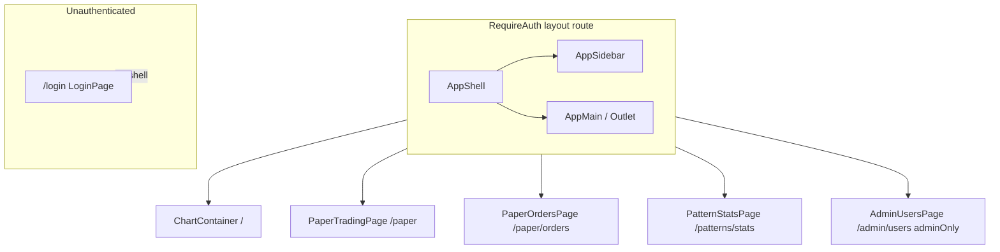
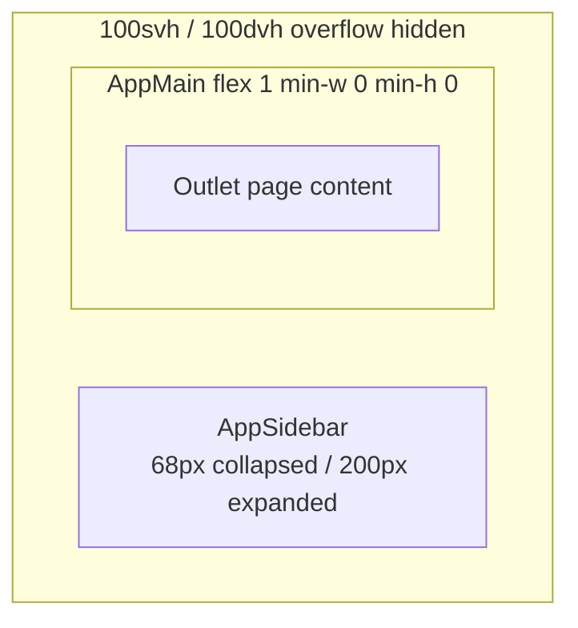
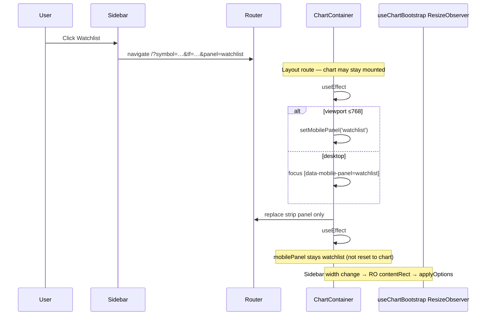
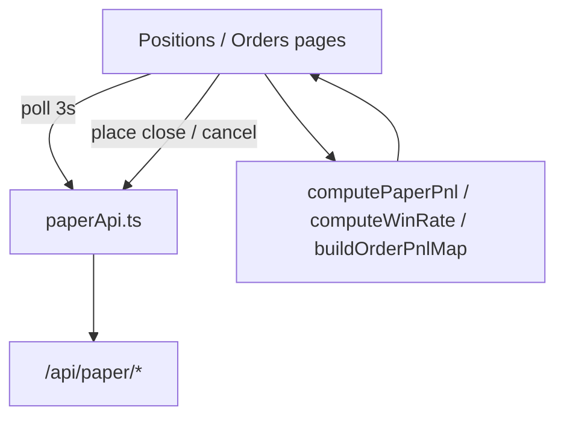
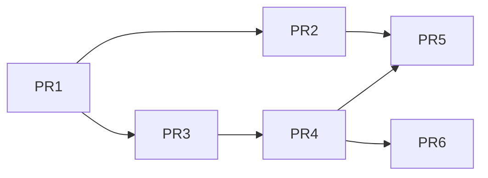

# TIP-2 UI Layout Redesign — Broker-style App Shell + Positions/Orders Tables

| Field | Value |
|-------|--------|
| **Document** | TIP-2 App Shell & Desk Layout Design |
| **Author** | _(TBD)_ |
| **Date** | 2026-07-30 |
| **Status** | Draft (rev 4 — public market desk: shell is public; login in header) |
| **Scope** | Frontend layout/visual redesign; paper APIs stable |
| **Reference mock** | `C:\Users\Khasim\Desktop\tradingapp\TIP-2\blxiF.jpg` |
| **Related** | `docs/PRODUCT-DECISIONS.md`, Chart Paper Trade design, Manual Paper Trading design |

---

## Overview

TIP-2’s paper desk and chart experience currently feel like separate apps: the chart is a full-viewport workspace with a horizontal header and right rail, while Positions (`/paper`) and Orders (`/paper/orders`) use a standalone `PaperPageChrome` header and card-heavy layouts. The product goal is a **unified broker-style shell** matching the reference mock — dark navy chrome, **left vertical sidebar** navigation, rounded content panels, and **dense trading tables** for both Positions and Orders.

This design is **frontend-first**: reuse existing paper REST endpoints (`paperApi.ts`), P&L helpers (`computePaperPnl`, `buildOrderPnlMap`), and auth (`RequireAuth`, JWT). Backend schema changes are out of scope. **Order modify** already exists as `PATCH /api/paper/orders/{id}` but has no frontend client; the UI may surface Modify in a later PR after wiring `modifyPaperOrder`. **Cancel** and **Close lot** remain the primary v1 actions.

---

## Background & Motivation

### Current state

| Surface | Route | Layout today |
|---------|-------|----------------|
| Charts | `/` | `ChartContainer` — `100svh` column; `ChartHeader` + chart body + right rail (Alerts + Watchlist); mobile dock |
| Positions | `/paper` | `PaperTradingPage` + `PaperPageChrome`; cash row; **2** P&L cards; positions as **card grid** |
| Orders | `/paper/orders` | `PaperOrdersPage` + chrome; Open/Closed tabs; dense tables (closest to mock) |
| Pattern stats | `/patterns/stats` | Own page chrome (horizontal links) |
| Admin | `/admin/users` | Admin-only page |

**Nav duplication:** Chart header links to Stats / Positions / Orders; paper chrome links Chart / Positions / Orders / Stats / Admin. No single app shell.

**Visual gap vs mock:**

- No left sidebar; active nav is underline/links, not pill highlight.
- Positions are cards (`paper-pos-grid` / `paper-pos-card`), not a compact table with **Close** actions.
- Positions lack **Win Rate** metric card (mock has three summary cards).
- Orders lack filter row (symbol chip, Buy/Sell, Status dropdowns) and mock column semantics (Type = Buy/Sell pills; fill-state / residual qty; Cancel).
- Backgrounds differ slightly (`#0a0c10` chart vs `#0b1220` paper) with no shared token set for buy/sell pills and sidebar active state.

### Pain points

1. **Cognitive split** — users leave the “app” metaphor when opening paper desk.
2. **Positions density** — card grid wastes vertical space for multi-lot desks.
3. **Inconsistent chrome** — three navigation patterns (chart header, paper chrome, stats header).
4. **Missing mock affordances** — filters on orders; win-rate summary on positions.

### Constraints (from product)

- Paper-only trading; no real broker execution.
- Prefer no backend/schema changes.
- Preserve JWT auth, `RequireAuth`, admin-only routes.
- Chart Lightweight Charts layout must not break (height/resize).
- Mobile must remain usable (sidebar drawer; no double bottom bars on chart).

---

## Goals & Non-Goals

### Goals

1. Introduce a **shared App Shell** (left sidebar + main outlet) for authenticated app routes.
2. Restyle **Positions** and **Orders** to match mock visual language: rounded panels, pill badges, compact tables, three P&L/metric cards on Positions.
3. Map mock nav items to real TIP-2 surfaces with clear UX for Watchlist/Alerts (chart-context panels).
4. Shared **design tokens** (colors, density, sidebar active state).
5. Incremental, flaggable rollout with a **safe default** and minimal dual-path surface.
6. Accessibility: focus management, complete ARIA tab pattern, keyboard cancel/close.

### Non-Goals

1. Real broker connectivity or multi-account brokerage UX.
2. Backend schema migrations for win rate or order history.
3. Full redesign of Lightweight Charts internals, pattern overlay algorithms, or admin user management UX beyond shell chrome.
4. Dedicated full-page Watchlist/Alerts editors as separate data models (panels stay chart-bound).
5. Implementing strategy bots or backtesting UI.
6. Pixel-perfect mock cloning of non-TIP fields (crypto-style fractional qty, generic “#hash” ids) — adapt to paper lot/order IDs and INR equity qty.

---

## Key Decisions

| # | Decision | Rationale |
|---|----------|-----------|
| K1 | **AppShell wraps the public market desk** (charts, stats, Learn) **and** private routes. `RequireAuth` is per-route on `/paper`, `/paper/orders`, `/admin/users` only. Dedicated `/login` stays a sibling; **header Login popover** is in-shell. Unknown routes → `/`. | Guests land on charts; same chrome for everyone. See `docs/design-public-market-desk.md` |
| K2 | **Sidebar primary nav** maps: Dashboard→Pattern Stats (**provisional**); Charts→`/`; Watchlist→`/?panel=watchlist`; Orders→`/paper/orders`; Positions→`/paper`; Alerts→`/?panel=alerts` | Matches mock labels without inventing empty pages; Watchlist/Alerts remain chart-context (see [Panel deep-link contract](#panel-deep-link-contract)) |
| K3 | **Chart height contract ships with shell (PR1)** — `.chart-page--in-shell` uses `height:100%` of main, never `100svh` under shell | Avoids shipping broken double-viewport layout; ResizeObserver alone is not sufficient |
| K4 | **Positions become a dense table**; cards removed as primary layout | Mock + trading-desk density; Close action column |
| K5 | **Three summary cards**: Today’s P&L, Total P&L, Win Rate — cash row becomes compact meta strip | Matches mock; cash still visible without competing with P&L hierarchy |
| K6 | **Win Rate = closed-lot win rate** client-side (`realizedPnl > 0` win, `< 0` loss); card labeled “Closed lots (all time)” | No backend change; `list_positions(open_only=false)` is unpaginated today |
| K7 | **Order Modify deferred to PR6**; **Working** column (mock “Open”) always shows **residual qty** (`qty - filledQty`) + partial badge when partially filled — never “—” / order-type filler on open rows | Backend `PATCH` exists but no `modifyPaperOrder`; avoid dead Modify links |
| K8 | **`PaperPageChrome` retired in PR5**; during dual-path, desk **markup is single-path** — only chrome differs | Eliminate triple nav without dual table implementations |
| K9 | **`VITE_FEATURE_APP_SHELL` default OFF** until PR1–4 land and staging QA passes; **PR5 flips default ON and deletes the legacy dual tree** (flag helper remains for emergency rollback) | Other flags default ON, but shell+chart is a layout contract risk; dual-path must truly end in PR5 |
| K10 | **Mobile: drawer-only for app nav (≤768)**; **no app bottom nav on chart route**. Chart keeps existing mobile dock (chart \| alerts \| watchlist). Optional app bottom nav **only on non-chart routes** if drawer discoverability fails QA — not in v1 | Avoids two bottom bars crowding Buy/Sell + open-orders strip |
| K11 | **UserAccountMenu transitional rule:** keep on **ChartHeader** (trade muscle memory) **and** sidebar footer when shell ON; non-chart pages use **sidebar footer only** (no second floating header chrome) | Resolves dual-placement ambiguity |
| K12 | **Logo:** reuse `public/favicon.svg` scaled in sidebar header for v1; replace with dedicated `shell-logo.svg` only if contrast/size fails visual QA | Avoids blocking on asset work |

---

## Proposed Design

### High-level architecture



Login is a **sibling** of the authenticated layout — not a parent of the shell.

### Component structure

```
frontend/src/
  components/shell/
    AppShell.jsx          # flex row: sidebar + main; mobile drawer state
    AppSidebar.jsx        # logo + nav items + collapsed mode + UserAccountMenu footer
    AppMain.jsx           # scrollable main OR fill-height for chart; owns desk padding when shell on
    navConfig.js          # route ↔ nav id mapping, icons, isActive helpers
    shell.css             # shell + sidebar + page-root under-shell rules
  components/
    ChartContainer.jsx    # adapted for shell (height, panel query effect)
    ChartHeader.jsx       # drop Positions/Orders/Stats links when shell on; keep trade + user
    PaperPageChrome.jsx   # flag-OFF only; deleted in PR5
  pages/
    PaperTradingPage.jsx  # table + 3 metric cards + cash strip (single markup path)
    PaperOrdersPage.jsx   # mock columns + filters (single markup path)
  styles/
    tokens.css            # NEW shared color/spacing tokens
    layout.css            # chart layout adjusted under shell
    paper-desk.css        # refactor/extend paperTrading.css table styles
  config/
    featureFlags.ts       # + isAppShellEnabled() default OFF
  services/
    paperApi.ts           # + modifyPaperOrder (PR6)
  utils/
    paperPnl.ts           # + computeWinRate(lots)
    panelDeepLink.ts      # parse/apply panel query (PR2); unit-tested
```

### App shell layout



**Desktop (≥900px)**

- Sidebar fixed left, full height, dark panel (`#0d1220` / `#12182a` range).
- Width: default **expanded with labels** on desktop (≥1100px); **icon + tooltip** collapsed mode 900–1099px; optional user toggle (localStorage `tip.shell.sidebarExpanded`).
- Active nav: lighter rounded pill background (`rgba(148,163,184,0.14)` / `#1e293b`), icon + label weight 600.
- Logo: K12 — `favicon.svg` in sidebar top; links to Charts `/`.

**Main content**

- Background: deep navy-black with **subtle CSS grid** — `background-color: var(--tip-bg-app)` + faint grid at low opacity. **Shell owns the surface.**
- **Padding owner:** `AppMain` applies `padding: 20–28px` for desk/stats/admin routes; **0** for chart. Pages must not double-pad when shell is on (see [Page root CSS contract](#page-root-css-contract-under-shell)).
- Desk pages: page title top-left (“Orders”, “Positions”); top-right **username** chip (not raw UUID) + refresh button calling existing `refresh()`.

### Page root CSS contract (under shell)

Today:

```css
/* paperTrading.css — legacy full page */
.paper-page {
  min-height: 100vh;
  background: #0b1220;
  padding: 20px 24px 48px;
}
```

```css
/* layout.css — legacy full viewport chart */
.chart-page {
  height: 100svh;
  min-height: 100svh;
  overflow: hidden;
}
```

**When shell is on**, page roots **must not** compete with the shell for viewport height or background:

| Class / context | Under shell (`--in-shell` or parent `.app-shell`) | Flag OFF (legacy) |
|-----------------|--------------------------------------------------|-------------------|
| `.chart-page` | `height: 100%; min-height: 0; overflow: hidden; background: transparent` (shell/main paint surface) **or** keep chart bg but **never** `100svh` | Unchanged `100svh` |
| `.paper-page` | `min-height: 0; height: auto; background: transparent; padding: 0` — padding from `AppMain` | Unchanged full-page styles |
| Pattern stats / admin page roots | Same as paper: no `min-height: 100vh` / competing bg when shell on | Unchanged |

**Flex chain (chart)** — all must be `min-height: 0` / flex fill so ResizeObserver sees non-zero `contentRect`:

```
.app-shell (100svh/dvh, flex row, overflow hidden)
  └── .app-main--chart (flex 1, min-width 0, min-height 0, overflow hidden)
        └── .chart-page--in-shell (height 100%, min-height 0, flex column)
              └── .chart-body / .chart-main / .chart-panel / containerRef
```

**Acceptance:** after mount under shell, `containerRef.current.clientHeight > 0`. In `import.meta.env.DEV`, log once if height stays 0 after first layout frame.

**Ownership:** this CSS contract is part of **PR1** (not deferred).

### Dual-path (feature flag) scope

Flag OFF must keep the app usable without shell. To limit operational cost:

| Layer | Dual-path? | Rule |
|-------|------------|------|
| `App.jsx` routing | **Yes** | Flag ON → layout route + `AppShell`; flag OFF → today’s flat routes |
| `PaperPageChrome` / chart header cross-links | **Yes** | Render chrome/links only when flag OFF **or** when shell not wrapping (thin condition) |
| Positions/Orders **table, filters, metrics** | **No** | Single markup; works under both shell and legacy chrome |
| Page root CSS | **Yes (classes)** | Add `--in-shell` modifier from parent context or prop; legacy rules remain for flag OFF |
| `ErrorBoundary` + route `key`s | **Both paths** | Must preserve on each path (see Routing) |

**Time-box:** dual path removed in **PR5** (same release train as shell completion). Files that must stay dual-aware until PR5:

- `App.jsx`
- `ChartHeader.jsx` (nav links visibility)
- `PaperTradingPage.jsx` / `PaperOrdersPage.jsx` (whether to mount `PaperPageChrome`)
- `PatternStatsPage.jsx` / `AdminUsersPage.jsx` (legacy header links if any)
- `paperTrading.css` / `layout.css` / `shell.css` (modifiers)

**Do not** maintain two Positions tables or two Orders filter UIs.

### Routing

```jsx
// Conceptual App.jsx — flag ON path (preserves ErrorBoundary + keys)
function ShellLayout() {
  return (
    <AppShell>
      <Outlet />
    </AppShell>
  )
}

// Inside BrowserRouter + AuthProvider + outer ErrorBoundary:
<Routes>
  <Route path="/login" element={<LoginPage />} />

  {/* Authenticated layout — RequireAuth once */}
  <Route
    element={
      <RequireAuth>
        <ShellLayout />
      </RequireAuth>
    }
  >
    <Route
      index
      element={
        <ErrorBoundary>
          <ChartContainer key="chart-home" />
        </ErrorBoundary>
      }
    />
    <Route
      path="paper"
      element={
        <ErrorBoundary>
          <PaperTradingPage key="paper-trading" />
        </ErrorBoundary>
      }
    />
    <Route
      path="paper/orders"
      element={
        <ErrorBoundary>
          <PaperOrdersPage key="paper-orders" />
        </ErrorBoundary>
      }
    />
    <Route
      path="patterns/stats"
      element={
        <ErrorBoundary>
          <PatternStatsPage key="pattern-stats" />
        </ErrorBoundary>
      }
    />
    <Route
      path="admin/users"
      element={
        <RequireAuth adminOnly>
          <ErrorBoundary>
            <AdminUsersPage key="admin-users" />
          </ErrorBoundary>
        </RequireAuth>
      }
    />
  </Route>

  <Route path="/admin" element={<Navigate to="/admin/users" replace />} />
  <Route path="*" element={<Navigate to="/" replace />} />
</Routes>
```

**Preserved production safeguards:**

| Safeguard | Policy under shell |
|-----------|-------------------|
| Outer `ErrorBoundary` | Stays around `AuthProvider` / router as today |
| Per-route `ErrorBoundary` | Required on every outlet page element |
| Chart `key="chart-home"` | Keep so leaving admin/stats and returning remounts clean chart + WS (same reason as today) |
| Paper/stats/admin keys | Keep for consistent remount behavior |
| Nested `RequireAuth adminOnly` | Valid: outer ensures session; inner enforces admin. Prefer this over a second full tree |
| Flag OFF path | Copy of **current** `App.jsx` structure (no shell), same boundaries/keys |

Routes stay path-compatible (`/paper`, `/paper/orders`) — no URL migration.

### Nav mapping (mock → product)

| Mock item | Target | Behavior |
|-----------|--------|----------|
| **Dashboard** | `/patterns/stats` | **Provisional** analytics dashboard; rename path later without shell rework (Open Question 3) |
| **Charts** | `/` (no `panel`) | Full chart workspace |
| **Watchlist** | `/?panel=watchlist` (+ preserve other params) | See [Panel deep-link contract](#panel-deep-link-contract) |
| **Orders** | `/paper/orders` | Orders desk |
| **Positions** | `/paper` | Positions desk |
| **Alerts** | `/?panel=alerts` | Same contract as Watchlist |
| **Admin** (extra) | `/admin/users` | Sidebar footer when `isAdmin` |
| **User menu** | K11 | ChartHeader + sidebar footer on chart; sidebar footer only elsewhere |

**Why Dashboard ≠ Positions:** Mock lists both. Mapping Dashboard to Pattern Stats avoids two nav items on the same route and improves Stats discoverability. If product later wants a multi-widget home, only `navConfig` target changes.

### Panel deep-link contract

Chart already deep-links from Pattern Stats via **one-shot bootstrap read** of `symbol` / `tf`:

```js
// useChartBootstrap.js (today)
const sp = new URLSearchParams(window.location.search)
deepSymbol = sp.get('symbol')
deepTf = sp.get('tf')
```

`ChartContainer` owns `mobilePanel` (`'chart' | 'alerts' | 'watchlist'`) with **no** search-param sync today. Mobile dock is CSS-gated ≤768px. Desktop always shows the right rail.

#### Spec (implement in PR2)

| Rule | Detail |
|------|--------|
| **Allowed values** | `panel=watchlist` \| `panel=alerts`. Unknown values **ignored** (no throw). |
| **Coexistence** | **Merge** with existing params. Never strip `symbol` or `tf` when setting or clearing `panel`. Valid example: `/?symbol=NSE_EQ%7CINE002A01018&tf=5m&panel=watchlist`. |
| **Read path** | `useSearchParams()` (or `useLocation().search`) in `ChartContainer` (or small `usePanelDeepLink` / `panelDeepLink.ts`). React to **search changes** via `useEffect` — chart often **stays mounted** under layout route when only the query string changes. |
| **URL without `panel` (invariant)** | **No-op.** Do **not** change `mobilePanel`, do **not** re-focus the rail, do **not** treat the URL as two-way source of truth after strip. Absence of `panel` is the steady state after every successful apply. Dock changes only via: (1) apply when `panel` is **present**, or (2) user taps on the existing mobile-dock buttons. **Forbidden:** `setMobilePanel(panel ?? 'chart')` — that undoes mobile Watchlist/Alerts nav on the post-strip effect re-entry. |
| **Apply — mobile (≤768)** | **Only when `panel` is present:** `setMobilePanel('watchlist' \| 'alerts')` so existing dock/CSS shows that panel. |
| **Apply — desktop (≥769)** | **Only when `panel` is present:** do **not** change layout. Focus the region: `document.querySelector('[data-mobile-panel="watchlist|alerts"]')` → `scrollIntoView({ block: 'nearest' })` + `focus({ preventScroll: true })` if focusable (add `tabIndex={-1}` on rail section if needed). Optional one-shot CSS class `is-panel-flash` (~1.2s) for discoverability. |
| **After apply** | **`replace` strip `panel` only** — keep `symbol`/`tf` and any other params. Prevents sticky panel on refresh and avoids Charts vs Watchlist active-state thrash after navigation. Use `navigate({ pathname, search: withoutPanel }, { replace: true })`. The subsequent effect run (search without `panel`) **must hit the no-op branch**. |
| **Sidebar active state** | Custom `isActive` (not bare `NavLink end` on `/`): while URL still contains `panel=watchlist|alerts`, that nav item is active; after strip, **Charts** is active (Watchlist/Alerts are “actions” that land on chart). Optionally keep a short-lived React state `lastPanelNav` for ~1.5s highlight — **not required** if strip-after-apply is enough for click feedback. |
| **Nav link builders** | Sidebar Watchlist → `createSearchParams` from current search (if already on `/`) or empty, set `panel=watchlist`, navigate to `/?…`. Same for Alerts. |
| **Bootstrap interaction** | `symbol`/`tf` remain bootstrap’s responsibility (one-shot on chart engine init). Panel effect is independent and may re-run on every search change. |
| **Tests** | Unit-test pure helpers: parse allowed panel; merge/strip without dropping `symbol`/`tf`; ignore garbage `panel=foo`. **Effect re-entry:** after apply+strip, `mobilePanel` remains `watchlist`/`alerts` on a simulated ≤768 path; second effect run with no `panel` is a no-op (does not reset to `chart`). |

**Implementation sketch (PR2) — presence-only apply:**

```ts
// ChartContainer or usePanelDeepLink — NOT two-way URL sync
useEffect(() => {
  const panel = parsePanel(search) // 'watchlist' | 'alerts' | null
  if (!panel) return // critical: post-strip re-entry must not reset mobilePanel
  applyPanel(panel) // ≤768: setMobilePanel(panel); ≥769: focus rail
  replaceStripPanelOnly() // navigate replace; keeps symbol/tf
}, [search])
```

Optional cold-mount nicety (not required if effect runs immediately):  
`useState(() => parsePanel(window.location.search) ?? 'chart')` to avoid a one-frame flash when the URL already has `panel` on first paint.



### Chart page inside shell

**Problem:** Today `.chart-page { height: 100svh }` assumes full viewport. With sidebar, that overflows or double-scrolls.

**Solution (PR1 height + PR2 chrome/panel):**

1. `AppShell` root: `display:flex; height:100svh; height:100dvh; overflow:hidden`.
2. `AppMain` for chart route: `flex:1; min-width:0; min-height:0; overflow:hidden` (no page scroll). Detect chart via `useMatch('/')` / `location.pathname === '/'` and set `app-main--chart`.
3. `ChartContainer` root: `chart-page chart-page--in-shell` with height contract above.
4. **Resize path (verified):** `ResizeObserver` lives in **`useChartBootstrap.js`** (not `useChartEngine`). It calls `chart.applyOptions({ width, height })` + `applyVolumePaneHeight`. `ChartContainer` also calls `chart.resize` when `mobilePanel` returns to `'chart'`. Shell sidebar toggle changes main width → RO fires **if** parent chain has non-zero height. RO is **necessary but not sufficient** without the flex/min-height chain.
5. **DEV assert:** if `containerRef` height is 0 after layout, `console.warn` once.
6. **Right rail unchanged** structurally (Alerts + Watchlist).
7. **ChartHeader (PR2):** when shell ON, remove `Link`s to Stats/Positions/Orders (sidebar owns IA). Keep: symbol title, connection, timeframes, chart type, Buy/Sell, `UserAccountMenu` (K11).
8. **Mobile:** chart dock only on `/` (existing). **No app-level bottom nav on chart** (K10). Hamburger opens sidebar drawer for Positions/Orders/etc.

### Positions page redesign

#### Page chrome (inside main)

```
[ Positions ]                    [ Free ₹x · Cash ₹y · Locked ₹z ]  [ ↻ ]
```

Optional short paper badge “PAPER”.

#### Summary metric cards (3-column grid)

| Card | Primary | Sub-breakdown / helper |
|------|---------|------------------------|
| **Today's P&L** | `pnl.dayTotal` (₹, green/red) | Realized = `dayRealized`; Unrealized = `dayUnrealized` (existing `computePaperPnl` / IST day-realized semantics) |
| **Total P&L** | `pnl.overallTotal` | Realized / Unrealized overall |
| **Win Rate** | See display matrix | Subtitle: **“Closed lots (all time)”**; line `"X Wins / Y Losses"` |

**Win Rate definition (client-side):**

```ts
// utils/paperPnl.ts — additive
export type WinRateSummary = {
  wins: number
  losses: number
  flats: number
  /** wins / (wins + losses); null if no decided closed lots */
  winRate: number | null
}

export function computeWinRate(lots: PaperLotLike[]): WinRateSummary {
  let wins = 0, losses = 0, flats = 0
  for (const lot of lots || []) {
    if ((lot.status || '').toUpperCase() !== 'CLOSED') continue
    const r = Number(lot.realizedPnl)
    if (!Number.isFinite(r) || r === 0) { flats++; continue }
    if (r > 0) wins++
    else losses++
  }
  const decided = wins + losses
  return {
    wins, losses, flats,
    winRate: decided === 0 ? null : wins / decided,
  }
}

/** Display: one decimal percent, e.g. 62.5% */
export function formatWinRatePct(winRate: number | null): string {
  if (winRate == null) return '—'
  return `${(winRate * 100).toFixed(1)}%`
}
```

**Display matrix**

| Condition | Primary | Sub-line |
|-----------|---------|----------|
| `winRate == null` (no decided closed lots: empty, all open, or only flats) | **—** (not `0%`) | `0 Wins / 0 Losses` if no wins/losses; if flats-only still `0 Wins / 0 Losses` with helper “Closed lots (all time)” |
| `winRate` finite | e.g. `62.5%` (1 decimal) | `X Wins / Y Losses` |
| Flats | Not in denominator; not shown as third count in v1 sub-line | Optional title tooltip: “N breakeven lots excluded” if `flats > 0` |

**Semantics callout:** this is **lot win rate (all-time closed lots)**, not day-trade win rate and not per-order win rate. Card title **Win Rate**; helper **Closed lots (all time)**.

**Backend list scope (verified):** `PaperService.list_positions` returns **all** user lots when `open_only=false` — **no limit/pagination** in service (`service.py`). Risk class today is memory/size for power users, not silent truncation. If pagination is added later, win rate undercounts the same way order P&L can undercount at 500 fills — document then. Day P&L still depends on fills/orders capped at 500 on the client poll.

**Unit tests (`paperPnl.test.ts`):** empty; all open; all flat closed; mixed wins/losses; non-CLOSED with nonzero `realizedPnl` excluded; `formatWinRatePct(null) === '—'`.

#### Cash balances

Compact strip under title or above metrics: Free (emphasized) · Cash · Locked — same account fields.

#### Positions table

Replace `paper-pos-grid` cards with `paper-table`.

| Column | Source field | Notes |
|--------|--------------|-------|
| Symbol | `tradingSymbol` | Bold; optional side chip LONG/SHORT |
| Side | `side` | Optional column or chip under symbol |
| Product | `product` | MIS/CNC chip (TIP needs it) |
| Qty | `qtyOpen` | Integer shares |
| Avg | `avgEntryPrice` | ₹ |
| LTP | `ltp` | ₹ |
| P&L | `unrealizedPnl` | Color `pnl-pos` / `pnl-neg` |
| Action | — | **Close** button (red outline), `onCloseLot` → `placePaperOrder` MARKET + `closeLotId` |

Row density: compact. Empty state: “No open lots”. **Polling:** keep 3s for account, positions, orders, fills.

### Orders page redesign

#### Structure

```
[ Orders ]                              [ username · ↻ ]

┌─ Inner rounded panel ─────────────────────────────┐
│  [ Open Orders ]  [ Order History ]               │
│  [ Symbol filter ]     [ Buy/Sell ▾ ] [ Status ▾ ] │
│  ┌ table ───────────────────────────────────────┐ │
│  └──────────────────────────────────────────────┘ │
└───────────────────────────────────────────────────┘
```

Tabs map to existing `tab === 'open' | 'closed'`:

- **Open Orders** ← `OPEN`, `TRIGGER_PENDING`, `PARTIALLY_FILLED`
- **Order History** ← `FILLED`, `CANCELLED`, `REJECTED`, `EXPIRED`

**History display cap (fixed):** show latest **100** closed orders (current behavior `.slice(0, 100)`). Fetch remains `limit: 500` for P&L map completeness. Raising the display cap is a product follow-up, not “or 200” ambiguity.

#### Filters (client-side only)

| Control | Behavior |
|---------|----------|
| Symbol chip / text | Case-insensitive match on `tradingSymbol`; clear button |
| Buy/Sell dropdown | All · Buy · Sell → filter `side` |
| Status dropdown | Open tab: All · Open · Trigger pending · Partially filled; History: All · Filled · Cancelled · Rejected · Expired |

#### Column mapping

**Open Orders tab**

| Column | TIP field / behavior |
|--------|----------------------|
| Time | `createdAt` via `formatTime` |
| Symbol | `tradingSymbol` |
| Type | **Side** pill Buy green / Sell red; `orderType` as muted subtext under side or separate narrow column |
| Quantity | `filledQty > 0 ? filledQty/qty : qty` |
| Price | `price` or `—` for MARKET; `triggerPrice` sub line when set |
| **Working** (mock “Open”) | **Always residual qty** `qty - filledQty` (equals full `qty` when unfilled). Never “—” for residual on open orders. Green badge **Partially Filled** only when `status === 'PARTIALLY_FILLED'` (equivalently `filledQty > 0 && filledQty < qty`). **No Modify link in PR4.** |
| Status / Action | Working: red **Cancel**; terminal edge case: status text |

Column header label: **Working** (clearer than mock “Open” without Modify). Residual is always a number for sorting/filter mental model; badge is status-only.

**Keep (TIP-specific, collapse &lt;900px):** Product, per-order P&L (`OrderPnlCell`).

**Order History tab**

| Column | Source |
|--------|--------|
| Time | `createdAt` |
| Symbol | `tradingSymbol` |
| Type | Buy/Sell pill |
| Quantity | `filledQty/qty` |
| Price | limit/avg display |
| P&L | `OrderPnlCell` |
| Status | colored text |
| Reason | `rejectReason` |

#### Modify (phase 2 / PR6)

Backend already supports `PATCH /api/paper/orders/{order_id}` with body `{ qty?, price?, triggerPrice? }`.

**Client type extension (required in PR6)** — backend `_order_dto` already returns these; frontend `PaperOrder` in `paperApi.ts` does not yet:

```ts
// paperApi.ts — extend PaperOrder
export type PaperOrder = {
  // ...existing fields...
  /** ISO timestamp when stop activated; null/undefined = untriggered */
  triggeredAt?: string | null
  /** Optional; backend workingOrderType after trigger (LIMIT/MARKET) */
  workingOrderType?: string | null
}
```

**Rule:** for `orderType === 'SL_M'`, show the **price** field only when `triggeredAt != null`. Do not infer trigger state from `status` alone (open SL-M can be untriggered or triggered).

**Modifiable matrix** (from `PaperService.modify_order`):

| Prerequisite | Rule |
|--------------|------|
| Market phase | Must be **OPEN**; else `MARKET_CLOSED` |
| Status | Must be in open statuses (`OPEN`, `TRIGGER_PENDING`, `PARTIALLY_FILLED`); else `NOT_MODIFIABLE` |
| `qty` | Optional; if set: `qty >= 1` and `qty >= filledQty`; else `INVALID_QTY` |
| `price` | Not allowed on `MARKET`; not allowed on `SL_M` until triggered; else `PRICE_NOT_ALLOWED`. Allowed on `LIMIT`, `SL` (and `SL_M` after trigger) |
| `triggerPrice` | Only `SL` / `SL_M`; else `TRIGGER_NOT_ALLOWED` |
| Cash | Increasing lock may yield `INSUFFICIENT_CASH` |
| Identity | Wrong user / missing → `NOT_FOUND` |

**UI matrix (when to show Modify):**

| Order type | Trigger state | Show Modify | Editable fields |
|------------|---------------|-------------|-----------------|
| LIMIT | n/a | Yes | qty, price |
| SL | n/a | Yes | qty, price, triggerPrice |
| SL-M | `triggeredAt == null` | Yes | qty, triggerPrice (**not** price) |
| SL-M | `triggeredAt != null` | Yes | qty, price |
| MARKET | n/a | **No** | — |

**Error → toast copy (use `parsePaperApiError`):**

| Code | Suggested toast |
|------|-----------------|
| `MARKET_CLOSED` | Modify only during market OPEN |
| `NOT_MODIFIABLE` | Order can no longer be modified |
| `INVALID_QTY` | Qty must be ≥ filled qty |
| `PRICE_NOT_ALLOWED` | Price not valid for this order type |
| `TRIGGER_NOT_ALLOWED` | Trigger only for SL orders |
| `INSUFFICIENT_CASH` | Not enough free cash for this modify |
| `NOT_FOUND` | Order not found |

Until PR6: **do not show disabled Modify**.

### Shared visual tokens

Add `frontend/src/styles/tokens.css` (imported from `main.jsx` or `App.jsx`):

```css
:root {
  /* Surfaces */
  --tip-bg-app: #0a0e1a;
  --tip-bg-sidebar: #0c1020;
  --tip-bg-panel: #12182a;
  --tip-bg-panel-elevated: #161d32;
  --tip-border-subtle: #1e293b;
  --tip-border-panel: rgba(51, 65, 85, 0.65);
  --tip-grid-line: rgba(148, 163, 184, 0.04);

  /* Text */
  --tip-text-primary: #e2e8f0;
  --tip-text-muted: #94a3b8;
  --tip-text-faint: #64748b;

  /* Sidebar */
  --tip-nav-active-bg: rgba(148, 163, 184, 0.14);
  --tip-nav-active-text: #f1f5f9;
  --tip-nav-idle: #94a3b8;
  --tip-sidebar-width-expanded: 200px;
  --tip-sidebar-width-collapsed: 68px;

  /* Buy / Sell pills */
  --tip-buy-bg: rgba(34, 197, 94, 0.15);
  --tip-buy-text: #4ade80;
  --tip-buy-border: rgba(34, 197, 94, 0.35);
  --tip-sell-bg: rgba(239, 68, 68, 0.15);
  --tip-sell-text: #f87171;
  --tip-sell-border: rgba(239, 68, 68, 0.35);

  /* P&L */
  --tip-pnl-pos: #4ade80;
  --tip-pnl-neg: #f87171;

  /* Actions */
  --tip-danger: #ef4444;
  --tip-danger-outline: rgba(239, 68, 68, 0.55);
  --tip-focus-ring: #38bdf8;

  /* Density */
  --tip-table-row-h: 40px;
  --tip-radius-panel: 14px;
  --tip-radius-pill: 999px;
  --tip-radius-nav: 10px;
}
```

Map existing classes: `.paper-side--long` → buy tokens; `.paper-side--short` → sell; `.pnl-pos` / `.pnl-neg` → P&L tokens.

### Component inventory

| Component | Action | Notes |
|-----------|--------|-------|
| `AppShell` | **New** | Layout + mobile drawer |
| `AppSidebar` | **New** | Nav config, custom `isActive`, K11 user footer |
| `AppMain` | **New** | Outlet; desk padding; `app-main--chart` |
| `navConfig.js` | **New** | Items + icons + panel link builders |
| `panelDeepLink.ts` | **New** (PR2) | Parse/merge/strip helpers + tests |
| `shell.css` / `tokens.css` | **New** | Incl. `--in-shell` page roots |
| `PaperMetricCards` | **New** (optional extract) | 3 cards |
| `PaperPositionsTable` | **New** (optional extract) | Table body |
| `PaperOrdersFilters` | **New** | Symbol + side + status |
| `SidePill` | **New** small | Buy/Sell badge |
| `PaperTradingPage` | **Refactor** | Cards→table; 3 metrics; chrome only if flag OFF |
| `PaperOrdersPage` | **Refactor** | Filters; Working column; complete tab a11y |
| `paperTrading.css` | **Refactor** | Table density; `--in-shell` |
| `PaperPageChrome` | **Remove PR5** | Flag-OFF only until then |
| `ChartContainer` | **Adapt** | Height PR1; panel effect PR2 |
| `ChartHeader` | **Slim PR2** | Drop cross-page links when shell ON |
| `PatternStatsPage` | **Light adapt** | Shell title; drop duplicate nav when shell ON |
| `AdminUsersPage` | **Light adapt** | Shell only when ON |
| `featureFlags.ts` | **Extend** | `isAppShellEnabled` default **false** + tests |
| `paperApi.ts` | **PR6** | `modifyPaperOrder` + `PaperOrder.triggeredAt` / `workingOrderType` |
| `paperPnl.ts` | **Extend** | `computeWinRate` + `formatWinRatePct` + tests |
| `docs/PRODUCT-DECISIONS.md` | **Update PR5** (or PR1 note) | Shell IA + flag |

### Responsive behavior

| Breakpoint | Shell | Chart | Desk tables |
|------------|-------|-------|-------------|
| ≥1100px | Expanded sidebar + labels | Right rail ~300px | Full columns |
| 900–1099 | Collapsed icons or narrow labels | Rail ~260px | Hide Product on orders |
| ≤899 | Sidebar as **drawer** (hamburger in `AppMain` top bar); overlay | Existing column stack / rail row | Horizontal scroll tables |
| ≤768 | **Drawer only** for app routes (K10). **No** app bottom nav on `/` | Existing mobile dock for chart/alerts/watchlist | Stack metric cards 1-col |

**Phone breakpoint for shell drawer aligns with chart dock at 768px** (same as `responsive.css` mobile dock).

**Drawer a11y:** focus trap when open; Esc closes; return focus to menu button; backdrop inert.

### State & data flow (unchanged APIs)



Endpoints:

- `GET /api/paper/account`
- `GET /api/paper/positions?openOnly=` (unpaginated list)
- `GET /api/paper/orders?limit=`
- `GET /api/paper/fills?limit=`
- `POST /api/paper/orders` (close lot)
- `DELETE /api/paper/orders/{id}` (cancel)
- Later: `PATCH /api/paper/orders/{id}`

---

## API / Interface Changes

### Backend

**None required for layout redesign.**

### Frontend service additions (PR6)

```ts
// paperApi.ts — extend PaperOrder (backend _order_dto already returns these) + client
export type PaperOrder = {
  id: string
  instrumentKey: string
  tradingSymbol: string
  side: string
  orderType: string
  product: string
  qty: number
  filledQty: number
  price: number | null
  triggerPrice: number | null
  status: string
  rejectReason: string | null
  closeLotId: string | null
  createdAt: string | null
  /** ISO when stop activated; null = untriggered. Required for SL-M modify UI. */
  triggeredAt?: string | null
  workingOrderType?: string | null
}

export async function modifyPaperOrder(
  id: string,
  body: { qty?: number; price?: number | null; triggerPrice?: number | null },
): Promise<PaperOrder> {
  return api<PaperOrder>(`/api/paper/orders/${id}`, {
    method: 'PATCH',
    headers: { 'Content-Type': 'application/json' },
    body: JSON.stringify(body),
  })
}
```

### Feature flag

```ts
// featureFlags.ts
/**
 * Broker-style app shell (left sidebar).
 * Default OFF until shell + chart height + panel nav are QA'd (PR1–PR2).
 * Set VITE_FEATURE_APP_SHELL=true in staging/prod after acceptance.
 */
export function isAppShellEnabled(): boolean {
  return envTruthy(
    import.meta.env.VITE_FEATURE_APP_SHELL as string | undefined,
    false,
  )
}
```

Mirror existing tests in `featureFlags.test.ts`: default OFF when unset; accepts true/1/on; can force false.

When flag OFF: current `App.jsx` routes + `PaperPageChrome` + full chart header links. Dual-path scope limited per [Dual-path scope](#dual-path-feature-flag-scope).

---

## Data Model Changes

**None.** Win Rate derived client-side:

| Field | Use |
|-------|-----|
| `PaperPosition.status` | OPEN vs CLOSED |
| `PaperPosition.realizedPnl` | Win/loss classification |
| Existing P&L helpers | Today / Total cards |

No migration scripts.

---

## Alternatives Considered

### A1. Shell only on paper routes; chart stays full-bleed standalone

- **Pros:** Minimal chart risk.
- **Cons:** Fails unified-app mock; dual nav remains; Watchlist/Alerts orphaned.
- **Rejected** in favor of full authenticated shell with height contract in PR1.

### A2. Dedicated `/watchlist` and `/alerts` pages

- **Pros:** 1:1 mock routes.
- **Cons:** Tight coupling to chart engine/overlay; fragile state lift.
- **Rejected** for panel deep-link contract.

### A3. Positions stay cards; only restyle chrome

- **Pros:** Smaller Positions PR.
- **Cons:** User ask is table density.
- **Rejected** as primary UX.

### A4. Compute Win Rate on backend

- **Pros:** Stable if lists later paginate.
- **Cons:** Backend out of scope; positions list unpaginated today.
- **Deferred** until pagination exists.

### A5. Single “Paper desk” route with internal tabs

- **Pros:** Fewer routes.
- **Cons:** Breaks bookmarks; mock treats Positions/Orders as separate nav.
- **Rejected**.

### A6. Shared horizontal top nav only (no left sidebar)

- **Pros:** Lower layout risk than sidebar + chart flex chain; smaller CSS surface; reuses existing header muscle memory.
- **Cons:** Diverges from mock’s defining left rail; active pill vertical IA lost; less “broker terminal” feel.
- **Rejected** for mock fidelity; height-contract work is still required if chart ever sits under any non-full-bleed chrome — sidebar is the chosen chrome.

---

## Security & Privacy Considerations

| Topic | Approach |
|-------|----------|
| Auth | Shell only inside `RequireAuth`; unauthenticated users never see sidebar |
| Admin | Admin nav gated by `isAdmin`; route still `adminOnly` |
| Order actions | Cancel/Close/Modify still JWT; no new privilege |
| Account chip | **Username** only (not internal UUID) |
| XSS | React text binding for table cells |
| Trading | Paper-only; Close via `closeLotId` |

Threat model delta: **low**. Drawer backdrop must block pointer events to chart trade controls.

---

## Observability

| Signal | How |
|--------|-----|
| Layout errors | Outer + per-route `ErrorBoundary` |
| Paper action failures | `parsePaperApiError` + `role="alert"` / toasts |
| Chart height 0 | DEV `console.warn` once; manual QA acceptance |
| Optional analytics | `data-nav-id` on sidebar if pipeline added later |

---

## Accessibility

1. **Sidebar:** `<nav aria-label="Primary">`; `aria-current="page"` on active item (custom `isActive`).
2. **Orders tabs:** **complete** the tab pattern in PR4 — today only `tablist` + `tab` + `aria-selected` exist; **add** `role="tabpanel"`, `aria-controls` / `id` pairing, and optional arrow-key roving tabindex. Do not claim this is already complete.
3. **Tables:** real `<table>` + `<th scope="col">`; Close/Cancel names include symbol (`Close RELIANCE lot`).
4. **Focus:** after Cancel/Close, next row or table region; Modify modal trap in PR6.
5. **Color:** Buy/Sell text labels inside pills; P&L uses sign + color.
6. **Focus ring:** `--tip-focus-ring`; no bare `outline: none`.
7. **Motion:** `prefers-reduced-motion` for drawer.

---

## Rollout Plan

1. **Flag** `VITE_FEATURE_APP_SHELL` **default OFF**. Enable in staging after PR1 acceptance (height) and PR2 (panel + header); then prod.
2. **PR sequence** — see [PR Plan](#pr-plan). No parallel PR3 while chart height unfixed under a default-ON flag (flag is OFF).
3. **Rollback:** `VITE_FEATURE_APP_SHELL=false` redeploy frontend; no DB rollback.
4. **QA checklist** (expanded):
   - Desktop Chrome/Edge: shell ON — chart non-zero height; place/cancel paper order; positions close; orders cancel; admin link (admin user); login/logout; pattern stats filters
   - Flag OFF regression: no sidebar; PaperPageChrome + chart header links work; paper desk usable
   - `/?symbol=…&tf=5m&panel=watchlist` — symbol/tf still apply; panel focuses/opens; panel stripped from URL after apply
   - `/?panel=alerts` on mobile ≤768 — alerts panel shown
   - Narrow width: sidebar + right rail + chart trade modal usable
   - Keyboard: drawer open/close Esc; tab through sidebar
   - Win rate: only open lots → primary “—”; mixed closed lots → expected %
   - `featureFlags.test.ts` covers `isAppShellEnabled`

### Risks

| Risk | Severity | Mitigation |
|------|----------|------------|
| Chart height 0 / blank canvas under shell | **High** | Height contract **in PR1**; flag default OFF; DEV assert; QA gate before enabling flag |
| Sidebar + right rail squeeze | Medium | Collapse labels &lt;1100px; existing rail min-width |
| Double mobile nav | Medium | **K10:** no app bottom nav on chart; drawer only |
| Win rate misread as day win rate | Low | Card helper “Closed lots (all time)” |
| Dual-path drift | Medium | Dual-path limited to chrome/routing; removed PR5 |
| Users miss header links | Low | Sidebar desktop; drawer mobile |

---

## Open Questions

1. **Sidebar default expanded vs icon-rail on 1080p** — design picks expanded ≥1100px; confirm after PR1 screenshots.
2. ~~UserAccountMenu location~~ — **resolved K11**.
3. **Dashboard content** — Pattern Stats mapping is **provisional**; product may rename later.
4. **Modify UX** — popover vs modal in PR6.
5. ~~History display cap~~ — **fixed at 100** for v1; product may raise later.
6. ~~Flag default ON vs deploy-env only~~ — **resolved:** PR5 flips code default to `true` **and** deletes the legacy dual tree; flag helper stays for emergency `VITE_FEATURE_APP_SHELL=false` rollback only (no dual-tree OFF path after PR5).

---

## References

- Visual mock: `TIP-2/blxiF.jpg`
- Routes: `frontend/src/App.jsx`
- Positions: `frontend/src/pages/PaperTradingPage.jsx`, `paperTrading.css`
- Orders: `frontend/src/pages/PaperOrdersPage.jsx`
- Chrome: `frontend/src/components/PaperPageChrome.jsx`
- Chart: `frontend/src/components/ChartContainer.jsx`, `ChartHeader.jsx`, `styles/layout.css`, `styles/responsive.css`
- ResizeObserver + symbol/tf deep-link: `frontend/src/hooks/useChartBootstrap.js`
- Paper client: `frontend/src/services/paperApi.ts`
- P&L: `frontend/src/utils/paperPnl.ts`, `paperOrderPnl.ts`
- Flags: `frontend/src/config/featureFlags.ts`, `featureFlags.test.ts`
- Auth: `frontend/src/auth/RequireAuth.jsx`
- Backend paper API / modify / list_positions: `backend/app/api/paper.py`, `backend/app/paper/service.py`
- Product decisions: `docs/PRODUCT-DECISIONS.md` (update in PR5)

---

## PR Plan

### PR 1 — Tokens + AppShell + chart height contract (flag default OFF)

- **Title:** `feat(ui): app shell, design tokens, and chart height under shell (flagged off)`
- **Files/components affected:**
  - `frontend/src/styles/tokens.css` (new)
  - `frontend/src/components/shell/*` (new)
  - `frontend/src/config/featureFlags.ts` + `featureFlags.test.ts`
  - `frontend/src/App.jsx` (layout route when flag on; legacy when off; preserve ErrorBoundary + keys)
  - `frontend/src/styles/layout.css`, `shell.css` — `.chart-page--in-shell` + flex chain
  - `frontend/src/components/ChartContainer.jsx` — apply `--in-shell` class when shell parent / flag
  - `frontend/src/pages/paperTrading.css` — `.paper-page--in-shell` (no double min-height/padding)
- **Dependencies:** None
- **Description:** Ship shell chrome **and** non-broken chart height together. Desk tables still legacy look but must not `100vh` under shell. Flag **defaults OFF** so merge is safe for day-to-day. Mobile drawer (no app bottom nav).
- **Acceptance tests:**
  - Flag OFF: visual/behavior parity with current app
  - Flag ON local: chart `containerRef.clientHeight > 0`; no document double-scroll; sidebar navigates to paper/orders/stats
  - Admin gate still blocks non-admin

### PR 2 — Chart header slim + panel deep-links

- **Title:** `feat(chart): shell header cleanup and panel deep-link contract`
- **Files/components affected:**
  - `ChartContainer.jsx`, `ChartHeader.jsx`
  - `utils/panelDeepLink.ts` + tests
  - `navConfig.js` / `AppSidebar.jsx` active state
  - `responsive.css` if flash class needed
- **Dependencies:** PR 1
- **Description:** Strip chart header cross-page links when shell ON; implement full panel deep-link contract (merge symbol/tf, **presence-only apply**, replace-strip panel, **no-op when `panel` absent**). Custom sidebar active rules.
- **Acceptance tests:**
  - `/?symbol=X&tf=5m&panel=watchlist` preserves symbol/tf after strip
  - Mobile ≤768: after apply+strip, `mobilePanel` remains `watchlist`/`alerts` (not reset to `chart`)
  - Second effect run with no `panel` is a no-op (unit/integration)
  - Desktop focuses rail region only when `panel` present
  - Unit tests for parse/merge/strip + no-op on null panel

### PR 3 — Positions desk: metrics + table

- **Title:** `feat(paper): broker-style Positions summary cards and table`
- **Files/components affected:**
  - `PaperTradingPage.jsx`, `paperTrading.css`
  - `paperPnl.ts` + `paperPnl.test.ts`
  - Optional extracts
- **Dependencies:** PR 1 (height/CSS under shell). PR 2 not required.
- **Description:** Three metric cards + win rate display matrix; cash strip; positions table + Close. Single markup for flag ON/OFF; chrome only when flag OFF. **Safe to merge while flag OFF in prod.**
- **Acceptance tests:**
  - Close lot MARKET still works
  - Win rate unit tests + UI “—” with only open lots
  - No `min-height: 100vh` double scroll under shell

### PR 4 — Orders desk: panel, filters, columns

- **Title:** `feat(paper): Orders panel filters and Working column layout`
- **Files/components affected:**
  - `PaperOrdersPage.jsx`, `paperTrading.css`
  - Optional `PaperOrdersFilters.jsx`, `SidePill.jsx`
- **Dependencies:** PR 1; ideally PR 3 for shared table/pill styles
- **Description:** Open Orders / Order History; filters; Buy/Sell pills; **Working** column = always residual `qty - filledQty` + Partially Filled badge when applicable; Cancel; complete `tabpanel` a11y; history display cap **100**. No Modify.
- **Acceptance tests:**
  - Cancel order; filters; tabpanel keyboard/ARIA smoke
  - Unfilled open row Working cell shows full `qty` (not “—”)
  - History length ≤ 100 rows rendered

### PR 5 — Retire dual tree + PaperPageChrome + PRODUCT-DECISIONS + flag default ON

- **Title:** `refactor(ui): single shell path; remove PaperPageChrome; enable app shell by default`
- **Files/components affected:**
  - Delete `PaperPageChrome.jsx`
  - `App.jsx` — **delete** flag-OFF flat-route dual tree; shell layout is the only authenticated path
  - `featureFlags.ts` — flip `isAppShellEnabled` default to **`true`**; retain helper for emergency env override docs, but **no dual-tree OFF path** after this PR (if flag is false, still mount shell; emergency rollback = redeploy prior frontend artifact)
  - `PatternStatsPage.jsx`, `AdminUsersPage.jsx` polish
  - `docs/PRODUCT-DECISIONS.md` — shell IA, flag, nav mapping
- **Dependencies:** PR 1–4 + staging QA of shell ON
- **Description:** Dual-path **ends** here (no “PR5a keep dual tree”). Delete legacy routes + `PaperPageChrome`. Flip flag default ON after staging QA of PR1–4. Single chrome path only.
- **Acceptance tests:** no remaining imports of `PaperPageChrome`; no flag-OFF route tree; flag default true smoke; PRODUCT-DECISIONS updated

### PR 6 — Order modify (optional)

- **Title:** `feat(paper): modifyPaperOrder client and Orders Modify action`
- **Files/components affected:**
  - `paperApi.ts` — `modifyPaperOrder` + extend `PaperOrder` with `triggeredAt` / `workingOrderType`
  - `PaperOrdersPage.jsx` + modal/popover
- **Dependencies:** PR 4
- **Description:** Wire PATCH; extend client DTO; show Modify per modifiable matrix using `triggeredAt` for SL-M price field; map error codes to toasts.
- **Acceptance tests:** modify LIMIT price during OPEN; SL-M untriggered hides price field; reject MARKET modify in UI; toast on `MARKET_CLOSED`

### Suggested merge order



- **PR1 must include chart height** (not a later fix).
- **PR2 ∥ PR3** is OK because flag defaults OFF; do not enable flag in prod until PR2 acceptance if Watchlist/Alerts nav is required for the “complete” shell story (Charts/Positions/Orders work after PR1 alone).
- PR5 cleanup; PR6 optional.

### Per-PR effort (indicative)

| PR | Effort | Primary owner skill |
|----|--------|---------------------|
| PR1 | M–L | Layout/CSS + routing |
| PR2 | M | Chart + router search params |
| PR3 | M | Paper desk + unit tests |
| PR4 | M | Paper desk + a11y |
| PR5 | S | Cleanup + docs |
| PR6 | M | API client + form UX |
