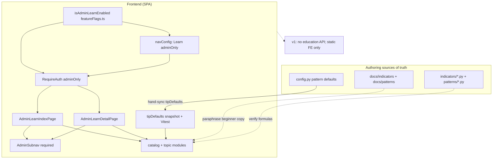
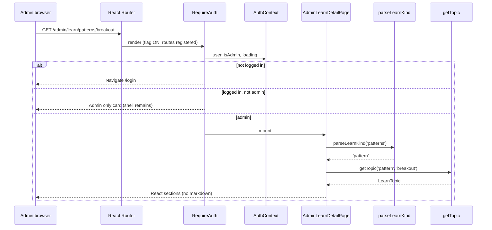

# Design: Admin Education — Indicator & Pattern Calculations

| Field | Value |
|---|---|
| **Document** | Admin Education UI (calculations behind indicators & patterns) |
| **Author** | _TBD_ |
| **Date** | 2026-08-03 |
| **Status** | Draft (revised after design review) |
| **Product** | TIP-2 trading app |
| **Related** | `docs/indicators/*`, `docs/patterns/*`, `frontend/src/pages/AdminUsersPage.jsx`, `backend/app/indicators/`, `backend/app/patterns/`, `frontend/src/config/featureFlags.ts` |

---

## Overview

Admins need a beginner-friendly place to understand **how TIP-2 computes each indicator and detects each chart pattern**, without reading Python detector code or engineer-oriented markdown. Today that knowledge lives only in `docs/` (engineering reference with LaTeX-style formulas and legacy Java package names) and in backend modules under `backend/app/indicators/` and `backend/app/patterns/`. Non-admin users see pattern alerts and stats, but not the math behind them—and the requirement explicitly gates education to **ADMIN**.

This design adds an **admin-only educational surface** under the existing admin desk area: a separate nav entry and routes (`/admin/learn`, `/admin/learn/:kind/:slug`) that present plain-English explanations, simplified formulas, worked numerical examples, TIP parameters (from `app/config.py` defaults), and related links. Content is **static frontend modules** paraphrased from authoritative docs and verified against detector code—no new public formula API in v1. Access reuses the established FE gate (`RequireAuth adminOnly` + `isAdminRole`) and admin layout patterns (`admin-page`, `authPages.css`).

**Ship policy:** Learn nav + routes are gated by `isAdminLearnEnabled()` in `featureFlags.ts` (**default OFF**) until indicator content (PR2) is ready; flag flips ON with content. Parameter tables are CI-checked against a committed defaults snapshot (not process-only).

---

## Background & Motivation

### Current state

| Area | Reality in TIP-2 |
|---|---|
| **Indicators (3)** | `AtrIndicator` (`atr.py`, period 14, Wilder), `DonchianIndicator` (`donchian.py`, 20, incl. prior window), `VolumeSmaIndicator` (`volume_sma.py`, 20). Only Volume SMA is plotted on the chart (`frontend/src/chart/helpers.js`, `VOLUME_SMA_PERIOD = 20`). ATR and Donchian are backend-only inputs to patterns. |
| **Patterns (11)** | `PatternType` enum in `backend/app/patterns/models.py`: `breakout`, `breakdown`, `consolidation`, `volume_breakout`, `hammer`, `shooting_star`, `bullish_engulfing`, `bearish_engulfing`, `inside_bar`, `higher_high`, `lower_low`. Detectors under `backend/app/patterns/`. Defaults in `backend/app/config.py` (`breakout`, `pinbar`, etc.). |
| **Engineering docs** | `docs/indicators/*.md` (3 files), `docs/patterns/*.md` (8 files; some docs cover two PatternTypes, e.g. engulfing, hammer-shooting-star, hh-ll). Formulas are correct but not beginner-friendly; still mention `com.tip.*` Java packages though runtime is Python. |
| **Admin surface** | Single page `/admin/users` (`AdminUsersPage.jsx`), nested `RequireAuth adminOnly`, sidebar item `Admin` only when `isAdmin` (`navConfig.js`). Styles: `.admin-page`, `.admin-card`, etc. in `authPages.css`. |
| **Mobile shell** | Bottom nav = `getNavItems(...).slice(0, 5)` → Dashboard, Charts, Watchlist, Orders, Positions only (`AppShell.jsx`). **Admin is drawer/sidebar-only** on ≤899px; same will apply to Learn. |
| **Feature flags** | `frontend/src/config/featureFlags.ts` — `VITE_FEATURE_*` with `envTruthy` defaults. New Learn flag must follow this pattern. |
| **All-user learning-ish UI** | `/patterns/stats` (`PatternStatsPage`) is available to every authenticated user—**stats only**, not formulas. Chart chrome must stay uncluttered (recent mobile redesign). |
| **Testing stack** | Vitest only (`package.json`); **no** `@testing-library` / RTL. |

### Pain points

1. **Opacity**: Operators cannot explain “why did this breakout fire?” without reading detectors or dense docs.
2. **Drift risk**: Docs and code can diverge (parameters, prior-window semantics). Education must stay tied to runtime truth.
3. **Audience mismatch**: Existing docs target implementers (warmup tables, PI design IDs), not beginners.
4. **Discoverability**: No product surface points admins at calculation explanations.

### Why now

Product requirement: show calculations on the frontend, understandable by beginners, via another link, **admin-only**. The inventory of 3 indicators + 11 patterns is small and stable enough for a curated content pack in v1.

---

## Goals & Non-Goals

### Goals

1. **Admin-only educational UI** explaining every TIP indicator and every `PatternType`.
2. **Beginner-first language**: plain English first; formula second; footnotes for support (source paths, detector version).
3. **Separate routes / nav link** (not embedded in chart chrome or alert cards).
4. **Fit existing admin desk design system** (`admin-page--in-shell`, cards, tables, tokens).
5. **Content inventory complete** for all 3 + 11 items at ship, including **every key** in each detector’s `config.py` dict.
6. **Sync strategy with CI teeth** so education parameters cannot silently diverge from `config.py` / indicator defaults.
7. **Deep-link protection**: non-admin hits to `/admin/learn*` see the same “Admin only” treatment as `/admin/users` (no content flash).
8. **Mobile IA explicit**: Learn reachable via drawer/sidebar + required AdminSubnav; **not** bottom-nav.

### Non-Goals

1. **Not** teaching general technical analysis beyond what TIP implements (no full Nison curriculum).
2. **Not** live formula evaluation / “replay this candle” calculators in v1.
3. **Not** exposing education to USER role (explicit product constraint); Pattern Stats remains all-users.
4. **Not** plotting ATR/Donchian on the main chart as part of this work.
5. **Not** rewriting engineering `docs/` into the SPA (docs stay repo reference; FE content is a beginner paraphrase).
6. **Not** a CMS, DB-backed content, or markdown editor for admins.
7. **Not** multi-language i18n beyond English in v1.
8. **Not** changing detector math or config defaults.
9. **Not** stuffing Learn (or Admin) into the 5-slot mobile bottom nav.
10. **Not** a “More” overflow menu for admin tools in v1 (optional later).
11. **Not** installing React Testing Library for this feature.

---

## Proposed Design

### Information architecture

```
Admin tools (sidebar/drawer, adminOnly; gated by isAdminLearnEnabled for Learn)
├── Users          → /admin/users          (existing)
└── Learn          → /admin/learn          (NEW — index)
                     ├── Indicators
                     │   ├── atr-14
                     │   ├── donchian-20
                     │   └── volume-sma-20
                     └── Patterns
                         ├── breakout … (11 total; slug = PatternType value)
```

**Routes**

| Path | Page | Gate |
|---|---|---|
| `/admin` | **Always** `Navigate` → `/admin/users` (unchanged; Learn is never the default hub) | n/a |
| `/admin/users` | `AdminUsersPage` | `RequireAuth adminOnly` |
| `/admin/learn` | `AdminLearnIndexPage` | `RequireAuth adminOnly` + flag ON |
| `/admin/learn/:kind/:slug` | `AdminLearnDetailPage` | `RequireAuth adminOnly` + flag ON |

Unknown or invalid `:kind` / unknown `:slug` → friendly **“Topic not found”** card within admin layout (still admin-gated), with link back to `/admin/learn`.

### Route / kind contract (implementable)

```ts
// frontend/src/learn/routing.ts

export type LearnKind = 'indicator' | 'pattern'

/** URL segment → internal kind. Only these two strings are valid. */
export function parseLearnKind(param: string): LearnKind | null {
  if (param === 'indicators') return 'indicator'
  if (param === 'patterns') return 'pattern'
  return null
}

export function learnKindToPath(kind: LearnKind): 'indicators' | 'patterns' {
  return kind === 'indicator' ? 'indicators' : 'patterns'
}

/** Build canonical detail path. */
export function learnTopicPath(kind: LearnKind, slug: string): string {
  return `/admin/learn/${learnKindToPath(kind)}/${slug}`
}
```

| Rule | Behavior |
|---|---|
| Valid kinds | URL: only `indicators` \| `patterns` (plural). Internal: `indicator` \| `pattern` (singular). |
| `parseLearnKind` returns `null` | Same UI as unknown slug: “Topic not found” |
| Slug match | Exact catalog slug (pattern slugs = `PatternType` values with underscores, e.g. `volume_breakout`, `bullish_engulfing`) |
| Trailing slash | Rely on React Router defaults; no special case required |
| `getTopic(kind, slug)` | Always takes **singular** `LearnKind`; never URL plurals |
| `/admin` redirect | **Stays** `/admin/users` forever for this design |

Router registration (single dynamic route is correct):

```jsx
// App.jsx — only when isAdminLearnEnabled()
<Route path="admin/learn" element={/* adminOnly + Index */} />
<Route path="admin/learn/:kind/:slug" element={/* adminOnly + Detail */} />
```

Detail page:

```ts
const kind = parseLearnKind(params.kind)
const topic = kind ? getTopic(kind, params.slug) : undefined
if (!topic) return <TopicNotFound />
```

### Navigation

**Desktop / drawer sidebar:** second admin-only item when flag ON and `isAdmin`.

```js
// navConfig.js — conceptual
/** @typedef {'dashboard'|'charts'|'watchlist'|'orders'|'positions'|'alerts'|'admin'|'learn'} NavId */

if (isAdmin) {
  items.push({ id: 'admin', label: 'Admin', to: '/admin/users', icon: 'admin', adminOnly: true })
  if (isAdminLearnEnabled()) {
    items.push({ id: 'learn', label: 'Learn', to: '/admin/learn', icon: 'learn', adminOnly: true })
  }
}
```

**Active-state rules (must split — today `admin` matches all `/admin*`):**

| Nav id | Active when |
|---|---|
| `admin` | `path === '/admin/users' \|\| path === '/admin/users/'` (or `path.startsWith('/admin/users')`) |
| `learn` | `path.startsWith('/admin/learn')` |
| (neither) | Other `/admin/*` if any future page without its own item |

**Page title (`AppMain.pageTitle`):**

| Path | Title |
|---|---|
| `/admin/learn` or under it | `"Learn"` |
| other `/admin*` | `"Admin"` (Users) |

**`NavIcon`:** implement explicit `case 'learn':` (book SVG)—**not** the default circle fallback.

#### Mobile IA (required, not optional)

Verified in `AppShell.jsx`: bottom bar uses `mobileNav.slice(0, 5)` → first five non-panel items (Dashboard, Charts, Watchlist, Orders, Positions). **Admin never appears in the bottom bar today; Learn must not either.**

| Surface | Behavior |
|---|---|
| Mobile bottom nav (≤899px) | **Unchanged** — still 5 items; Learn **not** added |
| Hamburger drawer / sidebar | Learn appears after Admin when flag ON + isAdmin |
| **AdminSubnav** (`Users \| Learn`) | **Required in PR1** on Users + Learn pages — primary mobile discoverability once user is inside any admin page |
| Optional later “More” overflow | **Non-goal** for v1 |

**Why separate sidebar item + required subnav:** product asked for “another link”; Learn is education, not user ops; subnav ensures admins who land on Users (or deep-link Users) can reach Learn without hunting the drawer; bottom-nav crowding is rejected.

### Architecture diagram



### Content model (frozen schema — single shape)

**One data shape only.** No free-form `LearnSection` / markdown-lite dual model. Multi-paragraph copy uses `string[]` (one string per paragraph). Rendering is **React text nodes, `<ol>` / `<ul>`, `<table>`, and `<pre>` only**—no markdown parser, no `dangerouslySetInnerHTML`, no HTML in strings.

```ts
// frontend/src/learn/types.ts

export type LearnKind = 'indicator' | 'pattern'

/** Index chips / filters */
export type LearnGroup =
  | 'indicator'
  | 'range'        // breakout family, consolidation, volume_breakout, inside_bar
  | 'candlestick'  // pin + engulfing
  | 'structure'    // HH / LL

export type LearnDirection = 'long' | 'short' | 'both' | 'regime'

export type TipParameter = {
  /**
   * Display label / leaf key as shown in the UI table (may equal snapshot leaf).
   * Example: "lookback_candles", "period".
   * **Not** used for snapshot equality (see configKey).
   */
  name: string
  /**
   * Canonical string form of the default — must match tipDefaults via
   * `serializeTipDefault(value)` (see Sync plan · Value stringification).
   */
  value: string
  /**
   * Stable path into tipDefaults for Vitest equality.
   * Format: `{bucket}.{leaf}` or top-level leaf.
   * Examples: `breakout.lookback_candles`, `pinbar.shadow_body_mult`,
   * `indicators.atr.period`, `atr_period`, `VOLUME_SMA_PERIOD`.
   * **Snapshot compare uses configKey only** (split on last `.` → bucket + leaf,
   * or whole string if no bucket prefix for top-level keys).
   */
  configKey: string
  /** Beginner note; optional "advanced / support" for rare keys */
  notes?: string
  /** If true, show in UI but smaller type — still required in array for completeness */
  advanced?: boolean
}

export type WorkedExample = {
  /** Setup story */
  narrative: string
  /**
   * When example uses reduced N (e.g. 3 instead of 14/20), state it here.
   * Required if toyPeriod !== tipPeriod.
   */
  periodNote?: string
  inputs: { label: string; value: string }[]
  steps: string[]
  /** Final “TIP would / would not detect” sentence */
  result: string
}

export type LearnTopic = {
  kind: LearnKind
  slug: string
  title: string
  shortDescription: string          // ≤120 chars, index card
  group: LearnGroup
  direction?: LearnDirection        // patterns; indicators omit
  plottedOnChart: boolean           // indicators; patterns false

  /** Section 1 — 2–4 short paragraphs */
  plainEnglish: string[]
  /** Section 2 — numbered how-to (5–8 steps) */
  howWeCalculate: string[]
  /** Section 3a — English formula */
  formulaPlain: string
  /** Section 3b — monospace formal; no KaTeX */
  formulaFormal: string
  /** Section 4 */
  workedExample: WorkedExample
  /**
   * Section 5 — MUST include every key from the topic’s mapped tipDefaults
   * bucket(s) (see TOPIC_DEFAULTS_BUCKET). Snapshot equality uses configKey
   * + serializeTipDefault(value), not name.
   */
  tipParameters: TipParameter[]
  /** Section 6 — patterns only; 6–10 short bullets */
  lifecycle?: string[]
  /**
   * Mandatory extra bullets when applicable (merged into display under
   * plainEnglish or a “Rules that always apply” callout):
   * - closedCandleOnly: always true for patterns in TIP
   * - indexVolumeNote: breakout/breakdown CLOSE_FALLBACK; volume_breakout skips index
   */
  closedCandleOnly: boolean
  indexVolumeNote?: string

  relatedSlugs: { kind: LearnKind; slug: string; label: string }[]
  patternTypeId?: string            // required when kind === 'pattern'; === PatternType value
  sourceDocs: string[]
  sourceCode: string[]
  lastReviewed: string              // ISO date YYYY-MM-DD
  detectorVersionHint?: string      // e.g. breakout-v1 — shown in footnote
}
```

**Fixed detail page section order:**

1. Header (title, kind badge, direction, patternTypeId)  
2. **Disclaimer** one-liner (global component; see K13)  
3. **In plain English** (`plainEnglish[]`) + closed-candle / index callouts when set  
4. **How we calculate it** (`howWeCalculate` as `<ol>`)  
5. **Formula** — plain paragraph + `<pre>{formulaFormal}</pre>`  
6. **Worked example** (`LearnWorkedExample`)  
7. **Parameters used in TIP** (`tipParameters` table; `advanced` rows still listed)  
8. **Lifecycle** (if `lifecycle` present)  
9. **Related**  
10. **Footnote** — `sourceDocs`, `sourceCode`, `detectorVersionHint`, `lastReviewed` (visible to admins for support)

### Beginner content Definition of Done (DoD)

A topic is shippable only if **all** apply:

| # | Criterion |
|---|---|
| D1 | Uses frozen `LearnTopic` fields only (no markdown/HTML) |
| D2 | `plainEnglish` answers: what it is, what question it answers, what TIP uses it for |
| D3 | `howWeCalculate` ≤ 8 steps; no PI design IDs; no `com.tip.*` |
| D4 | Worked example ends with detect / no-detect sentence; if toy period ≠ TIP period, `periodNote` required (e.g. “Example uses N=3; TIP uses 14”) |
| D5 | `tipParameters` includes **every** key from the matching `config.py` dict (patterns) or indicator defaults + chart constant (indicators)—verified by snapshot test |
| D6 | Patterns: `lifecycle` present; `closedCandleOnly: true`; breakout/breakdown include `indexVolumeNote` for CLOSE_FALLBACK; volume_breakout note is **“does not fire on index symbols”** (not fallback) |
| D7 | Reading target: a non-engineer admin can answer “why might this have fired?” after one read |
| D8 | Banned in copy: `com.tip.*`, raw Java class names, unexplained acronyms (R, ATR, SMA, MFE, MAE must be glossed once) |
| D9 | Eng self-review checklist completed (open detector + config + docs side-by-side); product writer optional |

**Index page must include a short glossary card** (always visible, not only in detail):

| Term | Beginner gloss |
|---|---|
| Closed candle | A bar that has finished; TIP only decides after the bar closes (no repaint mid-bar). |
| Non-repainting | Once a bar is closed, the detect decision for that bar does not flip later. |
| Prior window | For breakouts, the high/low lookback **excludes** the signal bar. |
| ATR / R-unit | “Normal move size”; many targets/stops are multiples of ATR at detect. |
| Confirmation modes | `volume` = busy volume on detect bar; `close` = later bar still beyond level; `both` = both (default); `close_fallback` = volume unusable so close-only. |

### Content authoring strategy

| Option | Choice for v1 |
|---|---|
| Static TS modules in `frontend/src/learn/content/` | **Yes (primary)** |
| Import/render `docs/**/*.md` via Vite plugin | No — engineer tone, Java names |
| Admin API serving markdown | No for v1 |
| Full prose codegen from docs | Rejected — wrong audience |
| **Param snapshot from config** | **Required** (see Sync plan) |

**Authoring workflow:**

1. Engineer updates detector or `config.py`.  
2. Update corresponding `docs/` file (existing practice).  
3. Update `tipDefaults` snapshot (or regenerate via script).  
4. Update FE learn topic module + `lastReviewed` + `detectorVersionHint`.  
5. CI: catalog completeness + **parameter snapshot** tests fail if skipped.

### Catalog registry

```ts
// frontend/src/learn/catalog.ts
export const INDICATOR_TOPICS: LearnTopic[] = [ atr14, donchian20, volumeSma20 ]
export const PATTERN_TOPICS: LearnTopic[] = [ /* 11 when complete */ ]

export function getTopic(kind: LearnKind, slug: string): LearnTopic | undefined
export function listTopics(kind?: LearnKind): LearnTopic[]
```

### Feature flag

Align with `frontend/src/config/featureFlags.ts`:

```ts
/**
 * VITE_FEATURE_ADMIN_LEARN — admin Learn education UI (nav + routes).
 *   default OFF when unset; set to "true" / "1" / "on" to enable.
 *   Turn ON in the content PR (PR2+) once indicators are usable.
 */
export function isAdminLearnEnabled(): boolean {
  return envTruthy(
    import.meta.env.VITE_FEATURE_ADMIN_LEARN as string | undefined,
    false, // default OFF
  )
}
```

| Policy | Detail |
|---|---|
| Default | **OFF** |
| When ON | Register routes; show Learn nav; AdminSubnav Learn link active |
| When OFF | No Learn nav item; routes may still 404 via catch-all or simply not register—**prefer not registering routes** so deep links fall through to `*` → home, or register routes but Index shows “disabled” only for admin debug—**preferred: omit routes when OFF** so production never exposes empty shell |
| Flip ON | Same PR that ships first real content (PR2 minimum: 3 indicators) |

### UX — Index (`/admin/learn`)

**PR1 (flag OFF by default):** if shell lands alone for local testing with flag forced ON, index is a **stub only**—no fake topic cards: title, AdminSubnav, disclaimer, glossary, empty state “Topics will appear here when content is enabled.”

**PR2+ (flag ON + content):**

```
┌─────────────────────────────────────────────────────────────┐
│ Admin · Learn                                               │
│ Signed in as admin · ADMIN                                  │
│ [Users]  [Learn]          ← AdminSubnav (required)          │
├─────────────────────────────────────────────────────────────┤
│ Educational only — not investment advice.                   │
│                                                             │
│ Glossary (collapsed/open card)                              │
│                                                             │
│ How TIP calculates indicators and patterns                  │
│ 🔍 Search topics…     [All][Indicators][Range][Candle]…     │
│                                                             │
│ INDICATORS (3)  …cards…                                     │
│ PATTERNS (11)   …cards…                                     │
└─────────────────────────────────────────────────────────────┘
```

- Reuse `.admin-page.admin-page--in-shell`, `.admin-header`, `.admin-card`.  
- Cards: title, shortDescription, badges from `plottedOnChart` / `direction` / `group`.  
- Client-side search: title + shortDescription.  
- Group chips from `LearnGroup` (PR2 minimum: sections by kind; chips OK in PR2 or PR4).  
- Mobile: stacked cards; desk scroll via `app-main--desk`.

### UX — Detail

As schema section order above. Sticky mini-TOC optional for long breakout/breakdown pages only. Lifecycle stays 6–10 bullets—not a second rules engine.

### Frontend file layout

```
frontend/src/
  config/featureFlags.ts          # isAdminLearnEnabled
  learn/
    types.ts
    routing.ts                    # parseLearnKind, learnTopicPath
    catalog.ts
    tipDefaults.ts                # or tipDefaults.json — committed snapshot
    catalog.test.ts
    tipDefaults.test.ts           # param alignment
    routing.test.ts
    content/
      indicators/{atr-14,donchian-20,volume-sma-20}.ts
      patterns/{breakout,breakdown,...}.ts
    components/
      AdminSubnav.jsx             # REQUIRED PR1
      LearnDisclaimer.jsx
      LearnGlossary.jsx
      LearnTopicCard.jsx
      LearnParamsTable.jsx
      LearnWorkedExample.jsx
  pages/
    AdminLearnIndexPage.jsx
    AdminLearnDetailPage.jsx
    adminLearn.css
  components/shell/
    navConfig.js                  # NavId includes 'learn'; active split
    NavIcon.jsx                   # case 'learn'
    AppMain.jsx                   # title Learn
```

Optional later: `scripts/export_tip_defaults.py` dumps Settings defaults for snapshot refresh (see Sync plan).

### Routing & auth wiring

**Deep-link security (FE):**

- Unauthenticated → `/login` with `state.from`.  
- Authenticated non-admin → existing “Admin only” card (`RequireAuth.jsx`)—**no topic body mounts**.  
- **Parity with `/admin/users`:** AppShell chrome remains (sidebar without admin-only items for USER); only the outlet is gated. Do **not** full-page redirect away from shell.  
- Catch-all `*`: admin routes registered before `*`.

**Backend (v1):** No education API. SPA assets are not secret; gate is operator UX, not DRM of formulas (already in `docs/`).

Future API (`GET /api/admin/learn/...`) **must** use `AdminUser` / `require_admin` → 403. Record in `docs/PRODUCT-DECISIONS.md`: *Learn is operator education UX, not access control of proprietary math.*

### AdminSubnav (required PR1)

| Label | `to` | Active when |
|---|---|---|
| Users | `/admin/users` | path starts with `/admin/users` |
| Learn | `/admin/learn` | path starts with `/admin/learn` (disabled/hidden if flag OFF) |

Mount on `AdminUsersPage` and both Learn pages. Styles: `.admin-header__actions` / `.admin-link`.

---

## Content inventory

### Indicators (3)

| Slug | Title | Code | Docs | On chart | group | Required tipParameters |
|---|---|---|---|---|---|---|
| `atr-14` | ATR (14) | `indicators/atr.py` | `docs/indicators/atr-14.md` | No | indicator | `period` = 14 (`atr_period` / `AtrIndicator.DEFAULT_PERIOD`) |
| `donchian-20` | Donchian (20) | `indicators/donchian.py` | `docs/indicators/donchian-20.md` | No | indicator | `period` = 20 (`DonchianIndicator.DEFAULT_PERIOD`); document prior-window methods |
| `volume-sma-20` | Volume SMA (20) | `volume_sma.py` + `helpers.js` | `docs/indicators/volume-sma-20.md` | **Yes** | indicator | `period` = 20 BE + `VOLUME_SMA_PERIOD` = 20 FE (must match) |

**Beginner angles:**

| Topic | Plain English core | Worked example |
|---|---|---|
| ATR | “How big is a normal candle move?” | Toy N=3 TR → first ATR → one Wilder step; `periodNote` → TIP uses 14 |
| Donchian | Highest high / lowest low; breakouts ignore signal bar | Toy N=5 prior window vs including last |
| Volume SMA | Average volume for “busy day” | Toy N=5; prior SMA excluding signal bar |

### Patterns (11) — full config keys

**Rule:** every key in the detector’s `Settings` dict in `config.py` appears in `tipParameters`. Also list shared `atr_period` (14) where the detector reads ATR. Values below are defaults as of 2026-08-03.

#### breakout (`config.breakout`) — direction `long`, group `range`

| Key | Default |
|---|---|
| `lookback_candles` | 20 |
| `volume_avg_period` | 20 |
| `confirmation_mode` | `"both"` |
| `volume_multiplier` | 1.5 |
| `retest_atr_mult` | 0.25 |
| `strengthen_atr_mult` | 1.0 |
| `success_rr` | 2.0 (retest-path target: `ref + success_rr * risk`) |
| `success_atr_mult_without_retest` | 2.0 |
| `detector_version` | `"breakout-v1"` |
| + `atr_period` | 14 (shared Settings field) |

**indexVolumeNote:** When segment is INDEX or volume unusable → `CLOSE_FALLBACK` (close-only confirmation).  
**Doc / code:** `docs/patterns/breakout.md`, `patterns/breakout.py`

#### breakdown (`config.breakdown`) — direction `short`, group `range`

Mirror of breakout keys with `detector_version`: `"breakdown-v1"`. Same CLOSE_FALLBACK note.  
**Doc / code:** `docs/patterns/breakdown.md`, `patterns/breakdown.py`

#### consolidation (`config.consolidation`) — direction `regime`, group `range`

| Key | Default |
|---|---|
| `window_candles` | 10 |
| `range_atr_mult` | 1.5 |
| `max_duration_candles` | 30 |
| `tighten_ratio` | 0.85 |
| `detector_version` | `"consolidation-v1"` |
| + `atr_period` | 14 |

Note: detect stores `PatternDirection.LONG` as placeholder; copy must say **not a directional long signal at detect**.

#### volume_breakout (`config.volume_breakout`) — direction `both`, group `range`

| Key | Default |
|---|---|
| `volume_avg_period` | 20 |
| `volume_multiplier` | 2.0 |
| `min_range_atr_mult` | 0.5 |
| `success_atr_mult` | 1.5 |
| `max_candles_after_detect` | 20 |
| `detector_version` | `"volume-breakout-v1"` |
| + `atr_period` | 14 |

**indexVolumeNote:** **Does not fire on index symbols** (`index_segment` → no detect). Do **not** describe as CLOSE_FALLBACK.

#### hammer / shooting_star (`config.pinbar`) — group `candlestick`

Shared pinbar config for both topics:

| Key | Default |
|---|---|
| `shadow_body_mult` | 2.0 |
| `max_body_range_ratio` | 0.35 |
| `max_opposite_wick_range_ratio` | 0.25 |
| `min_range_atr_mult` | 0.5 |
| `success_atr_mult` | 1.5 |
| `require_trend_context` | true (serialized `"true"`, not Python `True`) |
| `trend_lookback` | 10 |
| `max_candles_after_detect` | 20 |
| `detector_version` | `"pinbar-v1"` |
| + `atr_period` | 14 |

Directions: hammer `long`, shooting_star `short`. Doc: `docs/patterns/hammer-shooting-star.md`, code: `patterns/pinbar.py`.

#### bullish_engulfing / bearish_engulfing (`config.engulfing`) — group `candlestick`

| Key | Default |
|---|---|
| `min_range_atr_mult` | 0.5 |
| `success_atr_mult` | 1.5 |
| `max_candles_after_detect` | 20 |
| `detector_version` | `"engulfing-v1"` |
| + `atr_period` | 14 |

#### inside_bar (`config.inside_bar`) — direction `both`, group `range`

| Key | Default |
|---|---|
| `min_mother_range_atr_mult` | 0.5 |
| `success_atr_mult` | 1.5 |
| `max_candles_after_detect` | 20 |
| `max_bars_after_inside` | 5 |
| `detector_version` | `"inside-bar-v1"` |
| + `atr_period` | 14 |

#### higher_high / lower_low (`config.structure`) — group `structure`

| Key | Default |
|---|---|
| `fractal_width` | 2 |
| `success_atr_mult` | 1.5 |
| `max_candles_after_detect` | **30** |
| `detector_version` | `"structure-v1"` |
| + `atr_period` | 14 |

Directions: higher_high `long`, lower_low `short`. Doc: `docs/patterns/hh-ll.md`, code: `patterns/structure.py`.

### Index grouping (`LearnGroup`)

| Group | Slugs |
|---|---|
| `indicator` | atr-14, donchian-20, volume-sma-20 |
| `range` | breakout, breakdown, consolidation, volume_breakout, inside_bar |
| `candlestick` | hammer, shooting_star, bullish_engulfing, bearish_engulfing |
| `structure` | higher_high, lower_low |

---

## API / Interface Changes

### v1: none on backend

### Frontend interfaces

| Interface | Change |
|---|---|
| `featureFlags.ts` | `isAdminLearnEnabled()` default **false** |
| `getNavItems` | Learn item when `isAdmin && isAdminLearnEnabled()`; `NavId` includes `'learn'` |
| `isNavItemActive` | Split admin vs learn (see Navigation) |
| `App.jsx` | Routes only if flag ON |
| `AppMain.pageTitle` | Learn title |
| `NavIcon` | Explicit `learn` case |
| `AdminUsersPage` | **AdminSubnav** |
| New pages/components | Index, Detail, learn/* |

### Optional later API (not v1)

```
GET /api/admin/learn/topics
GET /api/admin/learn/topics/{kind}/{slug}
→ AdminUser only; 403 for USER
```

---

## Data Model Changes

**None** (no DB). Content + `tipDefaults` snapshot in version control.

---

## Sync plan (education ↔ detectors)

### Source hierarchy

1. **Runtime truth:** detectors + `Settings` defaults in `config.py` + FE `VOLUME_SMA_PERIOD`.  
2. **Engineering narrative:** `docs/indicators`, `docs/patterns`.  
3. **Beginner UI:** `frontend/src/learn/content/*` paraphrases (1).  
4. **Param snapshot:** `frontend/src/learn/tipDefaults.ts` (or `.json`) hand-copied / script-refreshed from (1)—**required in v1**, grown in **phases** (below).

### tipDefaults shape (canonical)

```ts
// frontend/src/learn/tipDefaults.ts — conceptual
export const tipDefaults = {
  atr_period: 14,                    // Settings.atr_period (top-level)
  VOLUME_SMA_PERIOD: 20,             // FE chart constant (must match BE default)
  indicators: {
    atr: { period: 14 },             // AtrIndicator.DEFAULT_PERIOD
    donchian: { period: 20 },
    volume_sma: { period: 20 },
  },
  // Pattern detector dicts — same keys as Settings fields in config.py
  breakout: { /* all keys */ },
  breakdown: { /* … */ },
  pinbar: { /* … */ },
  engulfing: { /* … */ },
  inside_bar: { /* … */ },
  structure: { /* … */ },
  consolidation: { /* … */ },
  volume_breakout: { /* … */ },
} as const
```

Values in the committed file may be raw JSON types (`number` | `boolean` | `string`). UI `TipParameter.value` and cross-checks always use **serialized** form (next section).

### Value stringification (canonical — FE and Python)

One serializer shared by Vitest and `export_tip_defaults.py` so booleans/numbers never false-fail.

**Frozen number rule (whole floats):** Integer-valued numbers serialize **without a decimal point**.  
Examples: config `2.0` / JS `2` / Python `2.0` → **`"2"`**; config `1.0` → **`"1"`**; non-integer `1.5` → **`"1.5"`**.  
Do **not** use `json.dumps(2.0)` (→ `"2.0"`) or inventory-style `"2.0"` as `TipParameter.value`.

| Runtime type | Serialized string | Examples / notes |
|---|---|---|
| `bool` | `true` / `false` | Lowercase JSON style — never `True`/`False` |
| `int` | decimal digits | `14` → `"14"` |
| `float` / JS `number` | If **integer-valued** (`n === Math.trunc(n)` / `n.is_integer()`): same as int → `"2"`. Else shortest decimal **without** trailing zeros pad → `"1.5"` (not `"1.50"`) | `success_rr` 2.0 → **`"2"`**; `volume_multiplier` 1.5 → **`"1.5"`**; `retest_atr_mult` 0.25 → **`"0.25"`** |
| `str` | as-is | `both`, `breakout-v1` |
| `null` | not used in tipDefaults | — |

```ts
// FE reference (tests + optional helper) — frozen contract
export function serializeTipDefault(v: unknown): string {
  if (typeof v === 'boolean') return v ? 'true' : 'false'
  if (typeof v === 'number') {
    if (!Number.isFinite(v)) throw new Error('non-finite tip default')
    // Integer-valued floats → no decimal (2.0 and 2 both become "2")
    if (Number.isInteger(v)) return String(v)
    return String(v) // 1.5 → "1.5", 0.25 → "0.25"
  }
  if (typeof v === 'string') return v
  throw new Error(`unsupported tip default type: ${typeof v}`)
}
// Note: In JS, JSON.parse('2.0') is number 2; Number.isInteger(2) is true → "2".
// tipDefaults may store raw numbers; always compare via this helper.
```

```python
# Python reference (export_tip_defaults.py) — must match FE (never json.dumps for floats)
def serialize_tip_default(v) -> str:
    if isinstance(v, bool):
        return "true" if v else "false"  # before int — bool is int subclass
    if isinstance(v, int):
        return str(v)
    if isinstance(v, float):
        if v.is_integer():
            return str(int(v))  # 2.0 → "2", 1.0 → "1"  (NOT json.dumps → "2.0")
        return str(v)           # 1.5 → "1.5", 0.25 → "0.25"
    if isinstance(v, str):
        return v
    raise TypeError(type(v))
```

**Authoring rule for `TipParameter.value`:** always the **serialized** form, not the Python/config literal with a trailing `.0`.

| Config / inventory display | `tipParameters[].value` |
|---|---|
| `2.0`, `success_rr: 2.0` | `"2"` |
| `1.0`, `strengthen_atr_mult: 1.0` | `"1"` |
| `1.5` | `"1.5"` |
| `0.25` | `"0.25"` |
| `0.35` | `"0.35"` |
| `true` | `"true"` |

Inventory “Default” columns may still show `2.0` to mirror `config.py` float literals; the **serialized** column / topic modules use the table above. Unit tests: `serializeTipDefault(2)`, `serializeTipDefault(2.0)` (if distinguished), and Python `serialize_tip_default(2.0)` all equal `"2"`.

**Equality rule:** `serializeTipDefault(snapshotLeaf) === tipParameter.value` after looking up leaf via `configKey`.

### Topic → tipDefaults bucket map (required const)

Vitest must use this map (not invent slug→bucket rules). Shared detector configs require **each** dual topic to list the **full** bucket key set.

| Topic slug(s) | tipDefaults bucket | Snapshot paths (`configKey` examples) |
|---|---|---|
| `atr-14` | `indicators.atr` **and** top-level `atr_period` | `indicators.atr.period`, `atr_period` |
| `donchian-20` | `indicators.donchian` | `indicators.donchian.period` |
| `volume-sma-20` | `indicators.volume_sma` **and** top-level `VOLUME_SMA_PERIOD` | `indicators.volume_sma.period`, `VOLUME_SMA_PERIOD` |
| `breakout` | `breakout` | `breakout.lookback_candles`, … (+ topic also lists `atr_period`) |
| `breakdown` | `breakdown` | same shape as breakout |
| `consolidation` | `consolidation` | + `atr_period` |
| `volume_breakout` | `volume_breakout` | + `atr_period` |
| `inside_bar` | `inside_bar` | + `atr_period` |
| `hammer`, `shooting_star` | **`pinbar`** (shared) | `pinbar.shadow_body_mult`, … — **both** topics list full pinbar keys + `atr_period` |
| `bullish_engulfing`, `bearish_engulfing` | **`engulfing`** (shared) | full engulfing keys on **both** topics + `atr_period` |
| `higher_high`, `lower_low` | **`structure`** (shared) | full structure keys on **both** topics + `atr_period` |

```ts
// frontend/src/learn/topicBuckets.ts
export const TOPIC_DEFAULTS_BUCKET: Record<string, string[]> = {
  'atr-14': ['indicators.atr', 'atr_period'],
  'donchian-20': ['indicators.donchian'],
  'volume-sma-20': ['indicators.volume_sma', 'VOLUME_SMA_PERIOD'],
  breakout: ['breakout', 'atr_period'],
  breakdown: ['breakdown', 'atr_period'],
  consolidation: ['consolidation', 'atr_period'],
  volume_breakout: ['volume_breakout', 'atr_period'],
  inside_bar: ['inside_bar', 'atr_period'],
  hammer: ['pinbar', 'atr_period'],
  shooting_star: ['pinbar', 'atr_period'],
  bullish_engulfing: ['engulfing', 'atr_period'],
  bearish_engulfing: ['engulfing', 'atr_period'],
  higher_high: ['structure', 'atr_period'],
  lower_low: ['structure', 'atr_period'],
}
```

**Per-topic coverage rule (always, any phase):** For each **existing** catalog topic `T`, every leaf under each mapped bucket (and each top-level key in the map) must appear as some `tipParameters[].configKey` on `T`, and values must match via `serializeTipDefault`. Dual topics (hammer/star, etc.) each carry the full shared bucket—no “split keys across siblings.”

**Global reverse coverage** (“every tipDefaults pattern bucket is covered by some topic”) is **not** required until PR3c (see phases).

### Phased tipDefaults rules (PR2 → PR3c)

These rules replace the earlier single “full Settings equality + every key covered by some topic” statement, which conflicted with shipping indicators-only at flag ON.

| Phase | tipDefaults contents | Python `--check` | Vitest topic coverage | Catalog completeness |
|---|---|---|---|---|
| **PR2** (flag may ON) | **Required:** `atr_period`, `VOLUME_SMA_PERIOD`, `indicators.{atr,donchian,volume_sma}`. **Optional but recommended:** commit full pattern detector dicts early (values stay warm) even with zero pattern topics. | **Subset projection:** every key **present** in tipDefaults must equal `Settings()` / FE constant after serialize. Does **not** require tipDefaults to contain all Settings pattern dicts yet. If pattern dicts are present, they are value-checked. | Only **existing** topics (3 indicators): each covers 100% of its mapped buckets. **No** reverse requirement that every tipDefaults pattern bucket has a topic. | Indicators only (3 slugs). Patterns section empty/hidden. |
| **PR3a / PR3b** | Add or keep pattern buckets for topics shipping in that PR (must exist before topics land). | Same subset rule: all present keys match Settings. | Each **new** topic covers 100% of its mapped bucket(s). Partial catalog OK. | Partial pattern set OK; do not claim “all 11 done.” |
| **PR3c** (full Learn) | tipDefaults includes **all** eight detector dicts + indicator keys + `atr_period` + `VOLUME_SMA_PERIOD`. | **Full detector projection:** tipDefaults must include every key of `Settings().breakout|breakdown|pinbar|…|volume_breakout` and top-level `atr_period`; all values match. (Expiry / non-detector Settings fields remain out of tipDefaults.) | All 14 topics; each covers its bucket(s). **Plus reverse:** every pattern/indicator bucket in tipDefaults is fully covered by its mapped topic(s). | Exact 11 `patternTypeId`s + 3 indicator slugs. |

**Flag ON policy (clarified):** Production flag ON is allowed at end of **PR2** with **indicator subset** tipDefaults + subset Python check + 3 indicator topics. Full Settings detector projection is **PR3c**, not a PR2 gate.

**K15 reading:** “Param snapshot required in v1” means the **mechanism** (tipDefaults + serialize + tests) from PR2; full multi-bucket reverse coverage is a **PR3c** bar, not a PR2 bar.

### Required guardrails (v1 — not optional)

| Mechanism | Detail |
|---|---|
| **Catalog completeness** | Vitest: PR2 = 3 indicator slugs; PR3c = 11 `patternTypeId`s exact set. Intermediate PR3a/b assert only shipped slugs ⊆ final set. |
| **Parameter snapshot (phased)** | As in **Phased tipDefaults rules**. Compare via `configKey` + `serializeTipDefault`, never free-form `name`. |
| **Python dump check** | `python scripts/export_tip_defaults.py --check`: load tipDefaults JSON; for each path present, assert equality with live `Settings()` / constants using `serialize_tip_default`. PR2 = subset OK; PR3c = full detector projection required. Run in backend CI if FE job has no Python. |
| **Author checklist** | Per pattern PR: open detector + `config.py` defaults + `docs/patterns/*.md`; paste `detector_version`; use TOPIC_DEFAULTS_BUCKET for keys. |
| **`lastReviewed` + footnote** | Visible on detail page. |
| **No second formula engine** | Worked examples are static. |

### Drift scenarios

| Change | Required updates |
|---|---|
| New `PatternType` | Topic module + catalog + TOPIC_DEFAULTS_BUCKET + tipDefaults bucket + completeness list |
| Default param change | tipDefaults + all topics mapped to that bucket + often plainEnglish |
| Chart SMA period | tipDefaults + volume-sma topic + `helpers.js` note |
| Confirmation semantics | Breakout/Breakdown copy + params |

---

## Security & Privacy Considerations

| Threat / concern | Severity | Mitigation |
|---|---|---|
| Non-admin views learn pages via URL | Medium (policy) | Nested `RequireAuth adminOnly`; no content until role check |
| Shell vs outlet | — | **Parity with `/admin/users`:** shell chrome remains; only outlet gated. USER still sees normal sidebar (no Admin/Learn items). QA: do not “fix” into full-page redirect that breaks shell consistency. |
| Role spoofing | Medium | JWT + `isAdminRole`; memory profile open-admin for local |
| Formula confidentiality | Low | Already in `docs/`; Learn is **operator education UX, not DRM** (PRODUCT-DECISIONS) |
| XSS | Low | **No HTML/markdown parsing in v1**; React text + `<pre>` only |
| Future education API without admin | High if added | `AdminUser` + 403 tests; do not ship without |

**Privacy:** No P&L/symbols on learn pages. Username in header only.

---

## Observability

| Signal | Approach |
|---|---|
| Client errors | `ErrorBoundary` on routes |
| Adoption | Optional later; not v1 |
| BE logs | None in v1 |

### Support runbook (one-liner)

When an admin reports “Learn says X but alert did Y”:

1. Open the Learn topic footnote → `sourceCode` + `detectorVersionHint` + `lastReviewed`.  
2. Compare to alert/journal payload `patternType` and `detectorVersion` (if present).  
3. Re-read detector + `config.py` for that version; if defaults changed after `lastReviewed`, treat as drift bug (update topic + tipDefaults).

---

## Rollout Plan

| Step | Decision |
|---|---|
| Flag | `VITE_FEATURE_ADMIN_LEARN` via `isAdminLearnEnabled()`, **default OFF** |
| PR1 | Shell + AdminSubnav + nav split + tests; **flag OFF** — no production Learn entry |
| PR2 | Types, tipDefaults **indicator subset**, 3 indicators, glossary, disclaimer; **flip flag ON** when indicators usable (subset Python check only) |
| PR3 | Patterns by family; PR3c = full detector tipDefaults + reverse coverage + 11-id completeness |
| PR4 | Search/chips polish if not already done |
| Rollback | Flag OFF or revert FE; zero data cleanup |
| Deploy | Vite SPA only for v1 |

Empty Learn with flag ON in production is **forbidden** by policy (flag stays off until PR2 content).

---

## Testing

Vitest unit tests only (no RTL).

| Area | Tests |
|---|---|
| `navConfig` | Learn absent when `!isAdmin` or flag off; present when both true |
| `isNavItemActive` | **Table-driven:** path × expected active id(s)—e.g. `/admin/users` → admin only; `/admin/learn` → learn only; `/admin/learn/patterns/breakout` → learn only; `/` → charts |
| `pageTitle` | Extract pure function or test helper: `/admin/learn` → Learn; `/admin/users` → Admin |
| `parseLearnKind` | `indicators`→indicator, `patterns`→pattern, `foo`→null |
| `catalog` | unique slugs; PR2: 3 indicators; PR3 end: 11 patternTypeIds |
| `tipDefaults` | **Phased:** PR2 indicator buckets + per-existing-topic 100% coverage via `configKey` + `serializeTipDefault`; PR3c full detector projection + reverse bucket coverage; dual topics (pinbar/engulfing/structure) each list full shared bucket |
| `serializeTipDefault` | unit tests: `true`/`false`, `1.5`→`"1.5"`, `14`→`"14"`, **`2`/`2.0`→`"2"`** (whole float), `breakout-v1`; Python twin same vectors |
| `TOPIC_DEFAULTS_BUCKET` | every catalog slug has a map entry; shared buckets list both slugs |
| Manual QA | Admin drawer → Learn → topic; **375px: bottom nav still 5 items**; USER deep-link → Admin only card inside shell; flag OFF → no Learn nav |

---

## Alternatives Considered

### A. Static FE modules (chosen) vs Markdown API vs import repo docs

| | Static modules | Serve `docs/*.md` via admin API | Vite-import markdown |
|---|---|---|---|
| Beginner tone | Full control | Engineer docs as-is | Same as docs |
| Auth | FE gate | BE 403 + FE | FE gate |
| **Verdict** | **v1** | Future CMS | Rejected for tone |

### B. Admin-only vs all authenticated users

**Chosen:** admin-only (requirement). Pattern Stats stays all-users.

### C. Sidebar “Learn” vs sub-link only vs single Admin item with tabs

| | Separate Learn nav + subnav (chosen) | Link only on Users page | Single “Admin” nav → in-page tabs Users/Learn |
|---|---|---|---|
| Discoverability | High on desktop; mobile needs drawer + subnav | Low | One drawer row; tabs after entry |
| Bottom nav impact | None | None | None |
| Active states | Two ids (admin/learn) | One | One admin active for both |
| Mobile density | Two drawer rows (acceptable; nav scrolls) | Minimal | **Best density** but weaker “another link” product ask |
| **Verdict** | **Chosen** for explicit second link + education vs ops separation | Insufficient alone | Viable mobile-density alternative if drawer clutter becomes an issue later—not v1 |

### D. Desk pages vs chart-chrome help icons

**Chosen:** desk only. Optional later admin deep-link from alerts.

### E. KaTeX vs monospace

**Chosen:** monospace / Unicode in `<pre>`.

### F. Drift control: manual paraphrase vs param snapshot vs full codegen

| | Pure manual (old draft) | **Param snapshot + tests (chosen)** | Full prose codegen from docs/config |
|---|---|---|---|
| Catches missing topic | Completeness test only | Completeness + params | Possible |
| Catches wrong default (20→15) | **No** | **Yes** | Yes for params; prose still wrong audience |
| Beginner tone | Full control | Full control for prose | Engineer tone risk |
| Maintenance | Checklist only | Snapshot update on config change | Pipeline complexity |
| **Verdict** | Rejected as sole control (High drift risk) | **v1 required** | Rejected for prose; optional Python dump for snapshot refresh only |

---

## Key Decisions

| # | Decision | Rationale |
|---|---|---|
| K1 | **Static TypeScript content modules** | No new deps; beginner voice; FE desk pattern |
| K2 | **Admin-only** via `RequireAuth adminOnly` + nav filter | Product requirement; mirrors Users |
| K3 | **Routes** `/admin/learn` + `/admin/learn/:kind/:slug` | Under `/admin/*`; one Detail component |
| K4 | **Separate sidebar/drawer item “Learn”** + **required** Users\|Learn AdminSubnav | Second link; mobile discoverability without bottom-nav |
| K5 | **Paraphrase docs; do not invent math** | Runtime code is truth |
| K6 | **No BE education API in v1** | FE-only ship |
| K7 | **No chart chrome integration in v1** | Protect mobile chart redesign |
| K8 | **Catalog completeness + param snapshot tests required** | Drift is High severity—process alone is insufficient |
| K9 | **One data-driven detail page** | 14 topics, one renderer |
| K10 | **Worked examples use toy numbers**; reduced N allowed with `periodNote` | Pedagogical clarity |
| K11 | **Pattern Stats remains all-users** | Distinct purpose |
| K12 | **URL kinds plural** (`indicators`/`patterns`); internal singular via `parseLearnKind` | Readable URLs + clean types |
| K13 | **Disclaimer required** on index + every detail: “Educational only — not investment advice.” | Close product Q; low cost |
| K14 | **Feature flag `isAdminLearnEnabled()` default OFF** in `featureFlags.ts`; ON with content (PR2+) | No dead Learn entry in prod; matches `VITE_FEATURE_*` conventions |
| K15 | **Param snapshot required in v1** (`tipDefaults` + `serializeTipDefault` + Vitest + Python subset/full check); **phased** so PR2 flag-ON needs only indicator projection, PR3c requires full detector buckets + reverse coverage | Aligns mitigations with High drift risk without blocking PR2 |
| K16 | **React-only rendering** — plain text, lists, tables, `<pre>`; **no markdown/HTML parse** | XSS-safe; implementer clarity |
| K17 | **Mobile: drawer/sidebar + AdminSubnav only; not bottom nav** | Matches `slice(0, 5)` shell; Admin already drawer-only |
| K18 | **Content sign-off: eng self-review against detector** (DoD D9); product writer optional | Unblocks content PRs without dedicated writer |
| K19 | **`/admin` redirect remains Users** | Backward compatible; Learn never default hub |
| K20 | **Empty/stub Learn must not ship with flag ON in production** | PR1 keeps flag OFF |

---

## Risks

| Risk | Severity | Mitigation |
|---|---|---|
| Content drift from detectors | High | **Required** tipDefaults snapshot + completeness tests + Python check + author checklist |
| Wrong lifecycle / confirmation copy | Medium | Family-split PRs; author checklist open detector+docs; DoD D6 |
| Beginner copy still too dense | Medium | DoD + glossary + plainEnglish-first |
| Authors copy Java package names | Low | Banned list in DoD |
| Large content PR review fatigue | Medium | PR3a/3b/3c family splits; ~0.5–1 eng-day per pattern topic estimate |
| Dead Learn link in prod | Medium | Flag default OFF until PR2 |
| Mobile undiscovers Learn | Medium | Required AdminSubnav PR1; drawer item; QA at 375px |
| Users demand access | Low | Product decision |
| SEO indexing | Low | Auth SPA |

---

## Open Questions

Resolved into Key Decisions where possible. Remaining:

1. ~~Product copy review owner~~ → **K18**: eng self-review sufficient for v1.  
2. ~~Disclaimer~~ → **K13**: required.  
3. **Deep link from alerts:** still optional PR5; slug design supports it. Confirm whether only admin sees the link (must double-gate `isAdmin`).  
4. ~~Feature flag~~ → **K14**: default OFF.  
5. **Consolidation wording:** inventory mandates “not a directional long at detect”; product may tweak exact phrase in PR3 content review.  
6. ~~`/admin` hub~~ → **K19**: stays Users.

---

## References

| Resource | Path / note |
|---|---|
| PatternType enum | `backend/app/patterns/models.py` |
| Indicator implementations | `backend/app/indicators/{atr,donchian,volume_sma}.py` |
| Detector defaults | `backend/app/config.py` |
| Feature flags | `frontend/src/config/featureFlags.ts` |
| Mobile bottom nav | `frontend/src/components/shell/AppShell.jsx` (`slice(0, 5)`) |
| Engineering docs | `docs/indicators/*`, `docs/patterns/*` |
| PRODUCT-DECISIONS | `docs/PRODUCT-DECISIONS.md` (update with Learn decision) |
| Admin FE | `AdminUsersPage.jsx`, `authPages.css` |
| Auth | `RequireAuth.jsx`, `roles.ts`, `deps.py` |
| Nav | `navConfig.js`, `NavIcon.jsx`, `AppMain.jsx` |
| Chart Vol SMA | `chart/helpers.js` `VOLUME_SMA_PERIOD` |
| Routes | `App.jsx` |

---

## Appendix A — Author template (maps 1:1 to `LearnTopic`)

```ts
export const breakoutTopic: LearnTopic = {
  kind: 'pattern',
  slug: 'breakout',
  title: 'Breakout',
  shortDescription: '…',
  group: 'range',
  direction: 'long',
  plottedOnChart: false,
  plainEnglish: ['…', '…'],
  howWeCalculate: ['…', '…'],
  formulaPlain: '…',
  formulaFormal: 'reference = max(high of bars t-20 … t-1)\nDetected when close_t > reference',
  workedExample: {
    narrative: '…',
    periodNote: 'Example uses lookback 5; TIP uses 20.',
    inputs: [{ label: '…', value: '…' }],
    steps: ['…'],
    result: 'TIP would mark Detected because close > reference.',
  },
  tipParameters: [ /* every breakout key + atr_period */ ],
  lifecycle: ['Detected: …', 'Confirmed: …', /* … */],
  closedCandleOnly: true,
  indexVolumeNote: 'On index or zero volume, confirmation falls back to close-only (CLOSE_FALLBACK).',
  relatedSlugs: [/* atr-14, donchian-20, volume-sma-20, breakdown */],
  patternTypeId: 'breakout',
  sourceDocs: ['docs/patterns/breakout.md'],
  sourceCode: ['backend/app/patterns/breakout.py'],
  lastReviewed: '2026-08-03',
  detectorVersionHint: 'breakout-v1',
}
```

## Appendix B — Sequence: admin opens a topic



## Appendix C — Breakout tipParameters (complete)

**Default (config)** = `config.py` literal. **`value` (serialized)** = what must appear in `TipParameter.value` / Vitest (see whole-float rule: `2.0` → `"2"`).

| Parameter | Default (config) | `value` (serialized) | Beginner meaning |
|---|---|---|---|
| `lookback_candles` | 20 | `"20"` | How many **previous** bars define the ceiling |
| `volume_avg_period` | 20 | `"20"` | Bars in the volume average for “busy day” |
| `volume_multiplier` | 1.5 | `"1.5"` | Detect volume ≥ 1.5× average (when volume applies) |
| `confirmation_mode` | both | `"both"` | Volume **and** later close still above ceiling |
| `retest_atr_mult` | 0.25 | `"0.25"` | How close a dip to the ceiling still counts as retest |
| `strengthen_atr_mult` | 1.0 | **`"1"`** | Extension beyond ceiling to “strengthen” |
| `success_rr` | 2.0 | **`"2"`** | After retest, target = reference + 2 × risk (retest measured move) |
| `success_atr_mult_without_retest` | 2.0 | **`"2"`** | Target distance if no retest floor |
| `detector_version` | breakout-v1 | `"breakout-v1"` | Support / journal version tag |
| `atr_period` | 14 | `"14"` | Volatility yardstick period |

---

## PR Plan

Each PR leaves main shippable. **Flag stays OFF until PR2 content is ready.**

### PR1 — Shell (flag OFF): routes code, nav split, AdminSubnav, tests

**Goal:** Infrastructure mergeable with **zero** production Learn entry (`isAdminLearnEnabled` default false). Local/dev can force `VITE_FEATURE_ADMIN_LEARN=true` to exercise shell.

**Acceptance:**

- `NavId` includes `'learn'`; active-state **table tests** (admin vs learn paths).  
- `pageTitle` / `AppMain` Learn title.  
- Explicit `NavIcon` `learn` case.  
- **AdminSubnav required** on Users page (Learn link visible only if flag ON).  
- Stub Index/Detail exist but routes registered only when flag ON.  
- Stub index: **no fake topic cards**—empty state only.  
- `docs/PRODUCT-DECISIONS.md` bullet: admin-only Learn education UX; not proprietary-math ACL.  
- QA note: non-admin deep-link keeps shell; outlet shows Admin only card.

**Files:** `featureFlags.ts`, `App.jsx`, `navConfig.js`, `navConfig` tests, `NavIcon.jsx`, `AppMain.jsx`, `AdminSubnav.jsx`, `AdminUsersPage.jsx`, stub pages, `adminLearn.css`, PRODUCT-DECISIONS.

**Out of scope:** Real topic copy, search, chips.

---

### PR2 — Schema, tipDefaults (indicator phase), 3 indicators, glossary, disclaimer; **flag ON**

**Goal:** Usable Learn for indicators; production may enable flag.

**Acceptance:**

- Frozen `LearnTopic` types; React-only components; `serializeTipDefault` + `TOPIC_DEFAULTS_BUCKET` for the 3 indicator slugs.  
- `tipDefaults` committed with **at least** indicator projection (`indicators.*`, `atr_period`, `VOLUME_SMA_PERIOD`). Pattern detector dicts **optional** in this PR (if present, Python checks their values too).  
- Vitest: each of 3 topics covers **100% of its mapped buckets** via `configKey` + serialized values. **Do not** fail on uncovered pattern buckets.  
- Python `--check`: **subset** mode — every path in tipDefaults matches Settings/FE constants.  
- 3 full indicator topics meeting DoD.  
- Index: disclaimer, glossary, indicator cards (no fake patterns). Patterns section empty/hidden until PR3.  
- Estimate: ~1–2 eng-days including tests.

**Files:** `learn/types.ts`, `routing.ts`, `catalog.ts`, `tipDefaults.*`, `topicBuckets.ts`, `serializeTipDefault` helper/tests, content/indicators/*, components, wire pages, `export_tip_defaults.py` (subset `--check`).

---

### PR3 — Patterns by family + completeness

**Estimate:** ~0.5–1 eng-day per pattern topic (re-read detector + example + review) → **~6–11 eng-days** if one author; prefer split:

| Sub-PR | Topics | tipDefaults / tests |
|---|---|---|
| **PR3a** | breakout, breakdown, consolidation, volume_breakout, inside_bar | Ensure those buckets exist in tipDefaults; per-topic 100% coverage for **new** topics only; partial catalog OK |
| **PR3b** | hammer, shooting_star, bullish_engulfing, bearish_engulfing | Shared `pinbar` / `engulfing` buckets; **each** of the two topics lists full shared keys |
| **PR3c** | higher_high, lower_low | Full 11-id completeness; **all** eight detector buckets in tipDefaults; Python **full detector projection**; reverse bucket coverage |

**Author checklist each topic:** detector + config defaults + docs side-by-side; `detector_version` pasted; keys from `TOPIC_DEFAULTS_BUCKET`; index note correct (fallback vs skip); boolean values as `true`/`false`.

**Files:** `content/patterns/*`, catalog, tipDefaults pattern buckets, `topicBuckets.ts` entries, catalog.test.ts final, export script full mode.

---

### PR4 — UX polish

Search, group chips (if not in PR2), CSS/a11y, mobile desk polish, manual QA checklist including **375px bottom nav still 5 items**.

---

### PR5 (optional) — Cross-links

From Pattern Stats / alerts → learn slug **only if `isAdmin`** (double-gate). Never show for USER.

---

### Explicitly deferred

- Backend learn API  
- Markdown pipeline  
- Live calculator  
- ATR/Donchian chart overlays  
- USER access  
- Bottom-nav “More” overflow  

---

*End of design document.*
