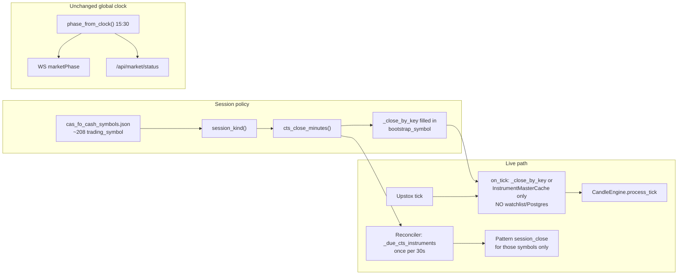
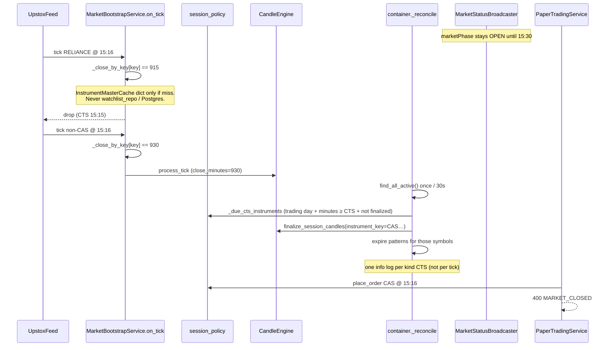

# SEBI Closing Auction Session (CAS) / F&O cash session timings for TIP-2

| Field | Value |
|---|---|
| **Author** | TIP-2 maintainers |
| **Date** | 2026-08-25 |
| **Status** | Draft |
| **Workspace** | `C:\Users\Khasim\Desktop\tradingapp\TIP-2` |
| **Audience** | Senior engineers implementing the regulation in FastAPI + React |

---

## Overview

SEBI’s Closing Auction Session has been live since 3 August 2026. Cash names with listed F&O contracts (~208) now end **continuous trading at 15:15 IST**; the official close is the auction equilibrium around 15:35. Non-F&O cash still trades until 15:30. Index values stop updating with cash CTS.

TIP-2 is a **cash + index intelligence app**. It does not trade F&O contracts, does not show auction tape, and must not grow boot RAM on Render’s free 512MB plan. Today every clock, candle grid, tick gate, pattern expiry, paper MIS square-off, and Woodie overlay still assumes a **single 09:15–15:30 session**.

This design introduces a static CAS universe (~208 trading symbols, JSON < 10KB), a `SessionKind` of `cas_cash | cash | index`, and **per-symbol continuous-trading-session (CTS) close**. Global WebSocket `marketPhase` stays `open` until 15:30 so non-CAS names keep live charts. Feature flag `TIP_CAS_SESSION_ENABLED` defaults **true** (regulation is live) and restores the old 15:30-for-all behavior when off.

---

## Background & Motivation

### Regulation (in force)

SEBI circular 16 Jan 2026; NSE `NSE/CMTR/73362` (18 Mar 2026), `NSE/CMTR/74466` and `NSE/FAOP/74467` (29 May 2026). Phase 1: stocks with listed F&O contracts (~208 names).

| Segment | Continuous trade | Official close |
|---|---|---|
| F&O stocks (cash) | 09:15–15:15 IST | Auction ~15:35 |
| Non-F&O stocks | 09:15–15:30 | Last-30m VWAP |
| Index / stock F&O contracts | to 15:40 | VWAP 15:10–15:40 (**OUT OF SCOPE**) |
| Post-close CNC/MTF | 15:50–16:00 | At official close (**OUT OF SCOPE**) |

CAS window (cash F&O names):

- 15:00–15:15 last CTS; 15m VWAP = auction reference ±3%
- 15:15–15:20 transition; no new cash orders (brokers may accept from Sep)
- 15:20–15:25 auction order entry
- 15:25–15:30 limit-only; random shut 15:28–15:30
- 15:30–15:35 match at equilibrium = official close
- Fallback if auction fails: 15:00–15:15 VWAP

Broker MIS (Zerodha as of Aug 2026): CAS stocks ~15:12, non-CAS 15:25, F&O contracts 15:26. Exchange cancels SL/iceberg on CAS cash at 15:15.

News 25 Aug 2026: first monthly F&O expiry under CAS; SEBI barred firms including a JPMorgan unit for alleged auction manipulation; SEBI will not scrap CAS. Pre-open changes from **7 Sep 2026 are out of scope** (follow-up only).

### Current TIP-2 state (verified)

Every path still assumes one 09:15–15:30 session:

| Location | Gap |
|---|---|
| `backend/app/market/nse_clock.py` | `_MARKET_CLOSE = time(15, 30)`; `phase_at(now)` / `phase_from_clock()` are global |
| `backend/app/market/candle_boundary.py` | `NSE_SESSION_CLOSE_MINUTES = 15*60+30`; last 5m starts 15:25 |
| `backend/app/market/bootstrap.py` `on_tick` | gates on `phase_from_clock() != OPEN` (global) |
| `backend/app/market/market_status.py` | one `_market_phase`; feed maps `CLOSING_START/END` → `CLOSED`; clock forces CLOSED at 15:30 |
| `backend/app/api/websocket/live.py` `MarketStatusBroadcaster` | one `marketPhase` to all clients |
| `backend/app/container.py` `_on_market_phase_for_candles` | `finalize_session_candles()` on global CLOSED |
| `backend/app/paper/service.py` | user orders iff `phase_from_clock() == OPEN`; `paper_mis_square_off` default `"15:20"` for **all** symbols (`config.py` `TIP_PAPER_MIS_SQUARE_OFF`) |
| `frontend/src/utils/woodieSr.ts` | `nseSessionUtcSeconds(..., 15, 30)` in tests; overlay span is last candle, not CTS |
| `frontend/src/chart/helpers.js` `resolveDisplayStatus` | global `closed` → `market_closed` |
| `frontend/src/hooks/useLiveMessageHandler.js` | global `market_status` closed banner |
| Pattern `session_close` | `SessionExpiryReconciler.on_phase_changed` + `PatternEvaluator.expire_session_timeframes` fire on **global** CLOSED |
| `backend/app/instrument/models.py` / `cache.py` | `segment` NSE_EQ / NSE_INDEX, `instrument_type` EQ/BE/INDEX — **no** `cas_eligible` flag |
| Repo | **no** F&O / CAS universe anywhere |

Woodie calculator of record is the backend freeze (`DailySrService`, `woodie_open_v1`). FE overlay only. `prev_close` is prior session close from daily candles. This work must **not** silently switch PDC to auction price.

### Pain

- RELIANCE (CAS) keeps forming 15:25 5m / 15:15 15m bars and accepts paper orders until 15:30.
- Paper MIS squares CAS names at 15:20 — after exchange CTS and after typical broker MIS cut (~15:12).
- If we naively flip the global clock to 15:15, **non-CAS cash and the whole app freeze at 15:15** (the original reason `on_tick` already ignores feed CLOSED).
- Auction / frozen-index ticks after 15:15 would floor into the last RTH bar (`floor_to_candle_start_epoch_second` maps `minutes >= close` to last-bar start) and fake a post-CTS candle.

---

## Goals & Non-Goals

### Goals

1. Per-symbol CTS: `cas_cash` and `index` stop live intraday bars, tick ingestion, pattern session-close, and CAS paper orders at **15:15 IST**.
2. Non-CAS cash (`cash`) keeps **15:30** CTS. Global WS `marketPhase` stays `open` until 15:30.
3. Last-bar math matches the shorter session (CAS 5m last start **15:10**, 15m last start **15:00**).
4. Paper: CAS MIS square-off **15:10**; non-CAS MIS **15:20**; reject user paper on CAS cash after 15:15; cancel open SL on CAS cash at CTS.
5. Woodie `prev_close` v1 unchanged (daily / last CTS close). Overlay **end time** for CAS cash and index = 15:15.
6. Drop post-CTS ticks for CAS cash/index (including ~15:35 auction prints). Never open an intraday bar from them.
7. Static JSON universe, lazy-loaded, no boot-time F&O master, no schema migration.
8. Kill-switch `TIP_CAS_SESSION_ENABLED=false` restores 15:30-for-all.
9. Tests for clock, last-bar math, tick gate (**no watchlist on `on_tick`**), `_due_cts_instruments` (weekend empty, CAS 1h once, leftover after-hours finalize), date-gated rebucket/Woodie, paper reject/MIS split. Existing `test_nse_clock_edge.py` and `test_candle_boundary.py` keep passing for default/non-CAS.

### Non-Goals

- F&O contracts, 15:40 derivatives clock, indicative equilibrium tape, ±3% auction band UI, CAS order types.
- Switching Woodie PDC to auction close.
- Synthesizing an indicative index close after 15:15.
- Post-close 15:50–16:00 CNC/MTF session.
- Pre-open changes from 7 Sep 2026.
- Boot-time extra work: no 1m enablement, no SR backfill, no NSE F&O scrape.
- DB column / Alembic-style migration for `cas_eligible`.
- Per-subscription WS “session” frame in v1 (REST payload is enough).

---

## Key Decisions

| # | Decision | Rationale |
|---|---|---|
| K1 | Stay a cash + index app. No F&O contracts, auction UI, or 15:40 clock. | Product scope. Auction microstructure is a broker/exchange problem. |
| K2 | Unknown trading symbol → `cash` (15:30), not CAS. | Safer than cutting a cash name early. Only static-list matches are CAS. |
| K3 | `NSE_INDEX` / `instrument_type=INDEX` → `index`. CTS 15:15. Ignore frozen LTP after 15:15 (same as no-tick). Do not synthesize indicative close. | Index is not in the CAS cash list; values freeze with cash CTS. |
| K4 | Woodie `prev_close` v1 = existing daily-candle / last CTS close. Overlay session **end** for CAS/index = 15:15. | Calculator of record is backend freeze. Auction PDC is a later, explicit change. |
| K5 | Auction prints (~15:35) never open an intraday bar. v1 **drops** post-CTS ticks for CAS cash/index. Daily close patch from auction is follow-up. | `floor()` after close maps to last RTH start; dropping is the only safe live path. |
| K6 | Paper MIS: CAS **15:10**, non-CAS **15:20**. Reject user paper on CAS after 15:15. Cancel open SL on CAS at CTS. | Aligns with broker MIS (~15:12) and exchange SL cancel at 15:15. |
| K7 | Global WS `marketPhase` stays `open` until 15:30. Charts/orders use **per-symbol** CTS. | Non-CAS still live 15:15–15:30. Do not freeze the whole app. |
| K8 | `TIP_CAS_SESSION_ENABLED` default **true**. Flag off → 15:30 for all. | Regulation is live; kill-switch is the rollback. |
| K9 | CAS universe = static JSON in repo (~208 strings). Membership by **trading_symbol** (upper). No DB flag in v1. Lazy load, not boot scrape. | 512MB / 15-min spin-down. JSON < 10KB, frozenset ≪ 50KB RAM. |
| K10 | Last 5m: CAS **15:10**, non-CAS **15:25**. Last 15m: CAS **15:00**, non-CAS **15:15**. | Direct from session length vs 09:15-anchored grid already in `last_session_bar_start_minutes`. |
| K11 | Pattern `session_close` / `finalize_session_candles` are **per-symbol at that symbol’s CTS**. | A 15:30 sweep that leaves CAS forming until 15:30 is the bug. A 15:15 global sweep freezes non-CAS. |
| K12 | Seed remap **drops** vendor bars with start ≥ that day’s **effective** CTS. Does **not** fold 15:25 into 15:10. Effective CAS close is 15:15 only for IST dates ≥ JSON `as_of` (`2026-08-03`); older days keep 15:30. Live ticks use **current** membership (no date-gate). | Folding poisons last-bar OHLC. Ungated drop would delete real 15:25 RTH bars from the 60/90-day lookback (CAS only since 3 Aug 2026). |
| K13 | No schema change. `WatchlistEntry.to_dict()` (API layer) adds computed `sessionKind` + `ctsEnd`. | Avoids Postgres migration on Render; cache already has `trading_symbol`. |
| K14 | `phase_from_clock()` remains 15:30 for health/WS/`MarketStatusService`. New optional `close_minutes` on `phase_at`. | Backward compatible. Existing tests keep passing. |

---

## Proposed Design

### Session kinds and close times

```python
class SessionKind(str, Enum):
    CAS_CASH = "cas_cash"  # F&O-listed equity; CTS 15:15
    CASH = "cash"          # other NSE_EQ; CTS 15:30
    INDEX = "index"        # NSE_INDEX; CTS 15:15 (no new bars / ignore frozen LTP)
```

| Kind | CTS | Last 1m | Last 5m | Last 15m | Last 1h | Last 4h |
|---|---|---|---|---|---|---|
| `cas_cash`, `index` | 15:15 (915 min) | 15:14 | **15:10** | **15:00** | **14:15** | 13:15 |
| `cash` (and flag off) | 15:30 (930 min) | 15:29 | **15:25** | **15:15** | 15:15 | 13:15 |

Formula is the existing one in `last_session_bar_start_minutes`:

```text
session_len = close_minutes - 555   # 09:15
n = (session_len - 1) // interval
start = 555 + n * interval
```

Daily (`interval >= 1440`) is unchanged: calendar midnight IST, **not** force-closed at CTS. Live **ticks** after CTS are still dropped (K5), so today’s daily close freezes at last CTS LTP — which is the Woodie v1 PDC we want.

### Architecture





### New module: `backend/app/market/session_policy.py`

Keep `nse_clock.py` as the **global** NSE calendar (holidays, pre-open 09:00–09:15, close 15:30). Put CAS policy next to it so clock tests stay stable.

```python
# backend/app/market/session_policy.py
from datetime import date
from enum import Enum
from functools import lru_cache
from pathlib import Path
import json

class SessionKind(str, Enum):
    CAS_CASH = "cas_cash"
    CASH = "cash"
    INDEX = "index"

CTS_CLOSE_MINUTES = {
    SessionKind.CAS_CASH: 15 * 60 + 15,  # 915
    SessionKind.INDEX: 15 * 60 + 15,
    SessionKind.CASH: 15 * 60 + 30,      # 930
}

_CAS_JSON = Path(__file__).parent / "data" / "cas_fo_cash_symbols.json"

@lru_cache(maxsize=1)
def cas_trading_symbols() -> frozenset[str]:
    """Lazy load. Not called at import. Safe on Render 512MB."""
    raw = json.loads(_CAS_JSON.read_text(encoding="utf-8"))
    return frozenset(s.strip().upper() for s in raw["trading_symbols"] if s and str(s).strip())

def session_kind(
    trading_symbol: str | None,
    *,
    segment: str | None = None,
    instrument_type: str | None = None,
) -> SessionKind:
    seg = (segment or "").upper()
    itype = (instrument_type or "").upper()
    if "INDEX" in seg or itype == "INDEX":
        return SessionKind.INDEX
    ts = (trading_symbol or "").strip().upper()
    if ts and ts in cas_trading_symbols():
        return SessionKind.CAS_CASH
    return SessionKind.CASH  # unknown → non-CAS

def cts_close_minutes(kind: SessionKind, *, cas_enabled: bool = True) -> int:
    if not cas_enabled:
        return 15 * 60 + 30
    return CTS_CLOSE_MINUTES[kind]

def cts_end_hhmm(kind: SessionKind, *, cas_enabled: bool = True) -> str:
    m = cts_close_minutes(kind, cas_enabled=cas_enabled)
    return f"{m // 60:02d}:{m % 60:02d}"

@lru_cache(maxsize=1)
def cas_as_of() -> date:
    """CAS go-live IST date from JSON ``as_of`` (v1: 2026-08-03)."""
    raw = json.loads(_CAS_JSON.read_text(encoding="utf-8"))
    return date.fromisoformat(str(raw["as_of"]))

def effective_close_minutes_for_date(
    bar_ist_date: date,
    live_close_minutes: int,
    *,
    as_of: date | None = None,
) -> int:
    """Historical remap/overlay: CAS 15:15 only on/after go-live. Live ticks ignore this."""
    if live_close_minutes >= 15 * 60 + 30:
        return live_close_minutes
    start = as_of if as_of is not None else cas_as_of()
    if bar_ist_date < start:
        return 15 * 60 + 30
    return live_close_minutes
```

**Tick-safe kind resolution (no Postgres).** `Tick` has only `instrument_key`. `UpstoxFeedClient._dispatch` delivers via `loop.call_soon_threadsafe(cb, tick)` onto the FastAPI event loop. Production `PostgresWatchlistRepository.find_by_symbol_id` opens a SQLAlchemy session (`s.get(WatchlistSymbolRow, symbol_id)`) — **forbidden on `on_tick`**.

Two in-memory sources, in order:

1. **Process-local `_close_by_key: dict[str, int]`** on `MarketBootstrapService`, filled in `bootstrap_symbol` from the `WatchlistEntry` already in hand (HTTP/bootstrap thread, not the tick loop).
2. **`InstrumentMasterCache.find_by_instrument_key`** — in-memory `dict.get` after `container.startup()` → `instruments.ensure_loaded()`. Cache already stores `trading_symbol` / `segment` / `instrument_type`.

```python
def session_kind_from_instrument(inst: ResolvedInstrument) -> SessionKind:
    return session_kind(
        inst.trading_symbol, segment=inst.segment, instrument_type=inst.instrument_type
    )

def session_kind_from_cache(instrument_key: str, instruments: InstrumentMasterCache) -> SessionKind:
    inst = instruments.find_by_instrument_key(instrument_key)
    if inst is not None:
        return session_kind_from_instrument(inst)
    if (instrument_key or "").upper().startswith("NSE_INDEX"):
        return SessionKind.INDEX
    return SessionKind.CASH  # unknown → non-CAS (K2)
```

**Watchlist/Postgres is allowed only off the tick path:** paper `place_order` / `modify_order` (already loads the entry for eligibility), REST `_entry_dto`, and the 30s reconciler `find_all_active()` (one query per cycle, not per key). Helper `session_kind_from_entry(entry: WatchlistEntry)` is a one-liner over `session_kind(...)`. Do **not** provide a `session_kind_for_key(..., watchlist_repo=)` that the tick path could call.

**Load cost:** JSON file < 10KB on disk; `frozenset` of ~208 short strings ≈ 5–8KB. First call is lazy (`lru_cache`). Not invoked from `InstrumentMasterCache.ensure_loaded` or container `startup()` except optionally one debug log: `"CAS universe loaded: n=208"`.

**No boot download.** Optional later admin/cron refresh is a follow-up; v1 ships the file in git.

### CAS JSON

Path: `backend/app/market/data/cas_fo_cash_symbols.json`

```json
{
  "version": 1,
  "source": "NSE F&O cash universe Phase 1 (SEBI CAS)",
  "as_of": "2026-08-03",
  "trading_symbols": ["RELIANCE", "TCS", "HDFCBANK"]
}
```

- Keys are **NSE trading symbols**, not ISIN, not `NSE_EQ|INE…` instrument keys.
- Match with `_normalize` culture already used in `instrument/cache.py` (strip + upper). `"Nifty 50"` is **not** in this list; it is `index` via segment.
- Seed names in `Settings.seed_symbols` that are equities (RELIANCE, TCS, HDFCBANK, INFY, ICICIBANK, HINDUNILVR, ITC, SBIN, BHARTIARTL) **must** be in the file. Tests assert that.
- Do not include indices, bonds, or F&O contract symbols.
- `as_of` is **2026-08-03** (CAS Phase 1 go-live). `cas_as_of()` and FE `CAS_AS_OF` must match. Tests lock the string.

### Clock: backward-compatible `phase_at`

`backend/app/market/nse_clock.py` — add optional close; **do not** change default:

```python
_MARKET_CLOSE = time(15, 30)  # global / WS / health

def phase_at(now: datetime, close_minutes: int | None = None) -> MarketPhase:
    ...
    close = (
        time(close_minutes // 60, close_minutes % 60)
        if close_minutes is not None
        else _MARKET_CLOSE
    )
    if t < _PRE_OPEN_START or t >= close:
        return MarketPhase.CLOSED
    if t < _MARKET_OPEN:
        return MarketPhase.PRE_OPEN
    return MarketPhase.OPEN

def phase_from_clock() -> MarketPhase:
    return phase_at(datetime.now(tz=NSE_ZONE))  # still 15:30
```

Callers that stay on the **global** clock (do not pass `close_minutes`):

- `MarketStatusService.refresh_phase_from_clock` / constructor
- `MarketStatusBroadcaster` (via `MarketPhaseChangedEvent`)
- `GET /api/market/status`, `GET /api/health` (`marketPhase`)
- `DailySrService.on_candle_updated` — freeze happens at first RTH; 15:15 vs 15:30 is irrelevant. Keep global so SR does not stop mid-session for non-CAS.

Callers that switch to **per-symbol** CTS:

- `MarketBootstrapService.on_tick` — via `_close_by_key` / instrument cache only
- `PaperTradingService.place_order` / `modify_order` — kind from the `WatchlistEntry` already loaded for eligibility (one HTTP-path query, not N extra)
- Reconciler finalize + pattern expiry — `find_all_active()` once per 30s
- Candle floor / last-bar / rebucket (rebucket is **date-gated**; live ticks are not)

### Candle boundaries: optional `close_minutes`

`backend/app/market/candle_boundary.py` — every function that uses `NSE_SESSION_CLOSE_MINUTES` gains `close_minutes: int | None = None` defaulting to 15:30:

```python
def _close(close_minutes: int | None) -> int:
    return NSE_SESSION_CLOSE_MINUTES if close_minutes is None else close_minutes

def last_session_bar_start_minutes(
    interval_minutes: int, close_minutes: int | None = None
) -> int: ...

def floor_to_candle_start_epoch_second(
    epoch_millis: int, interval_minutes: int, close_minutes: int | None = None
) -> int: ...

def is_session_bar_start(
    epoch_seconds: int, interval_minutes: int, close_minutes: int | None = None
) -> bool: ...

def should_seed_as_current(
    last_candle_time: int, now_epoch_ms: int, interval_minutes: int,
    close_minutes: int | None = None,
) -> bool: ...
```

Existing tests call without the new arg → non-CAS grid unchanged (`last_session_bar_start_minutes(5) == 15:25`).

New tests (CAS close = 915):

- `last_session_bar_start_minutes(5, 915) == 15*60+10`
- `last_session_bar_start_minutes(15, 915) == 15*60`
- `last_session_bar_start_minutes(60, 915) == 14*60+15`
- `floor` of 15:12 CAS 5m → 15:10; `is_session_bar_start(15:25, 5, 915)` is **False**
- `is_session_bar_start(15:25, 5)` (default) remains True

### Seed remap: drop, don’t fold — **date-gated**

`rebucket_session_candles` today drops `minutes < 09:15` and keeps after-close bars by flooring them into the last RTH bucket (`floor` at/after close → last start; `is_session_bar_start` then accepts that start).

**v1 change:** treat `minutes >= effective_close` like pre-open — **drop**. Do not merge a vendor 15:25 RELIANCE 5m into 15:10.

`Settings.historical_lookback_days_by_timeframe` is 60 days for 5m and 90 for 15m. CAS is in force only since **3 Aug 2026** (`as_of` in the JSON). Applying 15:15 to June/July bars would delete real RTH last bars. **Per-bar effective close:**

```text
if live_close is 15:30 or candle IST date < cas_as_of():
    close = 15:30
else:
    close = live_close   # 15:15 for CAS/index on/after 2026-08-03
```

```python
def rebucket_session_candles(
    candles: list[Candle],
    interval_minutes: int,
    close_minutes: int | None = None,
    *,
    cas_as_of: date | None = None,
) -> list[Candle]:
    live_close = _close(close_minutes)
    as_of = cas_as_of if cas_as_of is not None else cas_as_of()
    ...
    day = candle_ist_date(c.time)
    close = effective_close_minutes_for_date(day, live_close, as_of=as_of)
    if minutes < NSE_SESSION_OPEN_MINUTES:
        continue
    if minutes >= close:          # drop post-CTS for *that day*
        continue
    start = floor_to_candle_start_epoch_second(..., close_minutes=close)
    if not is_session_bar_start(start, interval_minutes, close):
        continue
```

Examples for a CAS name (`live_close=915`):

| Vendor bar | Action |
|---|---|
| 2026-07-10 15:25 5m | **Keep** (pre-`as_of`, close=930). Do not fold into 15:10. |
| 2026-08-04 15:10 5m | Keep (valid last CAS 5m). |
| 2026-08-04 15:25 5m | **Drop** (post-CTS). Do **not** merge into 15:10. |

`UpstoxMarketDataProvider.fetch_intraday_candles` / `fetch_historical_candles` add `close_minutes: int | None = None` (live close for that symbol) and pass it through; rebucket date-gates internally. `MarketBootstrapService._load_seed_candles` uses the `WatchlistEntry` already in `bootstrap_symbol` (bootstrap thread, not tick path) to compute live `close_minutes`.

Default `close_minutes=None` → 930 for every bar → current tests unchanged.

**Live ticks are not date-gated.** Today is after `as_of`; `on_tick` uses current membership / `_close_by_key`. If a name leaves the F&O list later, live CTS becomes 15:30 immediately; history on/after `as_of` still used 15:15 for days when it was CAS — acceptable v1 (universe is a snapshot).

### Tick gate (`bootstrap.py` `on_tick`) — **no watchlist / Postgres**

Today:

```python
if phase_from_clock() != MarketPhase.OPEN:
    return
```

This already drops auction 15:35 globally (clock CLOSED). It does **not** stop CAS ticks 15:15–15:30. `Tick` has no `trading_symbol`. Feed delivery is `UpstoxFeedClient._dispatch` → `loop.call_soon_threadsafe(cb, tick)` on the API event loop.

**Hard rule:** `on_tick` must not call `watchlist_repo.find_by_symbol_id` (or any other repo method). A test asserts the watchlist mock is not invoked.

Inject `InstrumentMasterCache` into `MarketBootstrapService.__init__`. Add process-local close memo filled on the bootstrap/add path (already has `WatchlistEntry`):

```python
class MarketBootstrapService:
    def __init__(..., instruments: InstrumentMasterCache) -> None:
        ...
        self._instruments = instruments
        self._close_by_key: dict[str, int] = {}  # instrument_key → close_minutes

    def _remember_close(self, entry: WatchlistEntry) -> int:
        cas_on = bool(getattr(self._settings, "cas_session_enabled", True))
        kind = session_kind(
            entry.trading_symbol, segment=entry.segment, instrument_type=entry.instrument_type
        )
        close = cts_close_minutes(kind, cas_enabled=cas_on)
        self._close_by_key[entry.symbol_id] = close
        return close

    def bootstrap_symbol(self, entry: WatchlistEntry) -> BootstrapSymbolResult:
        close = self._remember_close(entry)
        ...
        self._engine.seed(symbol_id, timeframe, seed_candles, close_minutes=close)

    def forget_close(self, instrument_key: str) -> None:
        self._close_by_key.pop(instrument_key, None)  # watchlist remove → also engine.evict

    def _close_for_tick(self, instrument_key: str) -> int:
        cached = self._close_by_key.get(instrument_key)
        if cached is not None:
            return cached
        cas_on = bool(getattr(self._settings, "cas_session_enabled", True))
        kind = session_kind_from_cache(instrument_key, self._instruments)
        close = cts_close_minutes(kind, cas_enabled=cas_on)
        self._close_by_key[instrument_key] = close  # subsequent ticks are dict lookup
        return close

    def on_tick(self, tick: Tick) -> None:
        if phase_from_clock() != MarketPhase.OPEN:
            return  # weekends, holidays, pre-open, after 15:30 — unchanged
        close = self._close_for_tick(tick.instrument_key)
        if phase_at(datetime.now(tz=NSE_ZONE), close_minutes=close) != MarketPhase.OPEN:
            return  # CAS/index after 15:15: drop frozen LTP / auction-adjacent prints
        if self._on_tick_extra is not None:
            self._on_tick_extra(tick)  # paper enqueue — also CTS-gated, still no DB
        for tf in self._settings.supported_timeframes:
            self._engine.process_tick(tick, tf, close_minutes=close)
```

`container.build_container` passes `instruments` into `MarketBootstrapService`. `WatchlistService.remove` already calls `candle_engine.evict`; also call `bootstrap.forget_close(symbol_id)`.

Defense in depth: `CandleEngine.process_tick` also no-ops if tick minutes ≥ `close_minutes` for **intraday** TFs. Daily is not updated because `on_tick` returned already.

**Index frozen LTP:** same drop. No synthetic bar, no indicative close.

**Cache miss:** `find_by_instrument_key` returns `None` → K2 `cash` (15:30). Safer than cutting a name early. Seeded/watchlist keys are remembered in `_close_by_key` before live ticks start (`bootstrap_symbol` / `recover_all_active`).

### CandleEngine: per-symbol close

Engine state key is still `{instrument_key}|{timeframe}` (`_state_key`). Do **not** split engines.

```python
def process_tick(self, tick: Tick, timeframe: str, close_minutes: int | None = None) -> None:
    interval = parse_timeframe(timeframe).interval_minutes()
    close = NSE_SESSION_CLOSE_MINUTES if close_minutes is None else close_minutes
    self._remember_close(tick.instrument_key, close)
    candle_start = floor_to_candle_start_epoch_second(
        tick.timestamp_ms, interval, close_minutes=close
    )
    ...

def seed(..., close_minutes: int | None = None) -> None:
    self._remember_close(instrument_key, close or NSE_SESSION_CLOSE_MINUTES)
    if should_seed_as_current(last.time, now_ms, interval, close_minutes=close):
        ...
```

Store `self._close_by_instrument: dict[str, int]` on the engine (default 930) in addition to bootstrap `_close_by_key`. Seed/`process_tick` keep them in sync. `close_stale_open_candles` and `finalize_session_candles` read the engine map per key (they already iterate engine state; no watchlist).

**Finalize — stop the global 15:30 sweep from being the only CTS:**

```python
def finalize_session_candles(
    self,
    now_epoch_ms: int | None = None,
    *,
    instrument_key: str | None = None,
) -> int:
    """Force-close open *intraday* bars. Optional single instrument."""
```

When `instrument_key` is set, only keys with that prefix are closed. Daily still skipped (`interval >= 1440`).

`close_stale_open_candles` must floor with that symbol’s `close_minutes`. After CAS CTS, `floor(now, close=915)` equals last-bar start (15:10 on 5m), so stale-close is a no-op on the last bar — **finalize** still required. Same pattern as today’s 15:30 last 5m @ 15:25 (`test_close_stale_does_not_close_last_rth_bar_after_hours`).

### Reconciler + pattern expiry (per-symbol CTS)

Today `AppContainer._reconcile` (every `phase_refresh_ms` = 30s):

1. `market_status.refresh_phase_from_clock()` → global 15:30; may publish `MarketPhaseChangedEvent`
2. `candle_engine.close_stale_open_candles(now_ms)`
3. If global CLOSED: `finalize_session_candles()` for **every** symbol
4. On flip to CLOSED: `pattern_service.expire_session_timeframes()` for **every** open 1m/5m/15m instance

And `_on_market_phase_for_candles` + `SessionExpiryReconciler.on_phase_changed` also fire on global CLOSED (subscription order: finalize **before** expiry). `phase_at` is `CLOSED` overnight, weekends, and holidays — today’s expiry only runs on a **phase flip** (`last_phase is not None and last_phase != phase`) and on `MarketPhaseChangedEvent`. A naive “CTS ended ⇒ expire” set would bump 1h/4h `sessions_seen` (`tracks_sessions_on_close`) on Saturday.

`_cts_finalized: set[tuple[date, str, str]]` lives on **`AppContainer`** (the reconciler owns it). Tuple is `(ist_date, instrument_key, kind.value)`.

#### `_due_cts_instruments` (full predicate)

Pure helper in `session_policy.py` (unit-tested without a container). `AppContainer._due_cts_instruments` loads entries once then calls it:

```python
# entries are duck-typed {symbol_id, trading_symbol, segment, instrument_type}
# (WatchlistEntry fits). Do not import watchlist.models from session_policy.
def due_cts_instruments(
    now_ist: datetime,
    entries: Sequence[Any],
    finalized: set[tuple[date, str, str]],
    *,
    cas_enabled: bool,
) -> list[tuple[str, SessionKind]]:
    """Keys that must finalize + expire *now*. Empty off-session.

    All of:
      1. is_trading_day(now_ist.date())     # not weekend / NSE holiday
      2. now_minutes >= cts_close_minutes(kind, cas_enabled=flag)
      3. (date, instrument_key, kind.value) not in finalized
    """
    day = now_ist.date()
    if not is_trading_day(day):
        return []
    now_minutes = now_ist.hour * 60 + now_ist.minute
    due: list[tuple[str, SessionKind]] = []
    for entry in entries:
        kind = session_kind(
            entry.trading_symbol,
            segment=entry.segment,
            instrument_type=entry.instrument_type,
        )
        close = cts_close_minutes(kind, cas_enabled=cas_enabled)
        if now_minutes < close:
            continue
        token = (day, entry.symbol_id, kind.value)
        if token in finalized:
            continue
        due.append((entry.symbol_id, kind))
    return due

def _due_cts_instruments(self, now_ist: datetime) -> list[tuple[str, SessionKind]]:
    # ONE watchlist scan per 30s — PostgresWatchlistRepository.find_all_active()
    # is a single SELECT, not per-key get. Not on the tick path.
    return due_cts_instruments(
        now_ist,
        self.watchlist_repo.find_all_active(),
        self._cts_finalized,
        cas_enabled=bool(getattr(self.settings, "cas_session_enabled", True)),
    )
```

| Clock | Due set (flag on) |
|---|---|
| Sat 16:00 | **empty** (`is_trading_day` false) — no 1h/4h `sessions_seen` |
| Weekday 15:10 | empty (both CTS still in the future) |
| Weekday 15:16 | CAS + index not yet in `_cts_finalized` |
| Weekday 15:31 | remaining **`cash` only** (CAS tokens already added at 15:15) |
| Weekday 16:00 **startup** (process just came up) | CAS + cash (nothing finalized yet) → leftover `current` bars still finalize |
| Weekday 09:05 pre-open | empty (`now_minutes < 915`) |

#### Flag on: reconciler owns CTS; unfiltered global handlers no-op

```python
def _reconcile_cas_on(self, now_ist: datetime, now_ms: int) -> None:
    self.market_status.refresh_phase_from_clock()  # WS still 15:30
    self.candle_engine.close_stale_open_candles(now_ms)
    due = self._due_cts_instruments(now_ist)
    if not due:
        return
    n_fin = 0
    ids: set[str] = set()
    by_bucket: dict[str, int] = {}  # "cas_index" | "cash" → symbol count
    for key, kind in due:
        n_fin += self.candle_engine.finalize_session_candles(
            now_ms, instrument_key=key
        )
        self._cts_finalized.add((now_ist.date(), key, kind.value))
        ids.add(key)
        bucket = "cash" if kind is SessionKind.CASH else "cas_index"
        by_bucket[bucket] = by_bucket.get(bucket, 0) + 1
    # Finalize *before* expiry (same order as today's event-bus subscriptions).
    self.session_expiry.expire_on_session_close(symbol_ids=ids)
    self.pattern_service.expire_session_timeframes(symbol_ids=ids)
    # one INFO per bucket that fired this cycle, not per symbol / tick
    # "CAS/index CTS ended (15:15 IST): finalized 12 candle(s) across 9 symbols"
    # "Non-CAS CTS ended (15:30 IST): finalized 4 candle(s) across 1 symbols"
```

When flag **on**, skip the unfiltered paths so CAS 1h/4h are not incremented again at 15:30:

```python
# AppContainer._on_market_phase_for_candles
def _on_market_phase_for_candles(self, event: MarketPhaseChangedEvent) -> None:
    if event.phase != "CLOSED":
        return
    if getattr(self.settings, "cas_session_enabled", True):
        return  # reconciler already finalized per-symbol
    n = self.candle_engine.finalize_session_candles()
    ...

# SessionExpiryReconciler.on_phase_changed
def on_phase_changed(self, event: MarketPhaseChangedEvent) -> None:
    if not self._settings.pattern_enabled:
        return
    if event.phase != "CLOSED":
        return
    if getattr(self._settings, "cas_session_enabled", True):
        return  # reconciler passes remaining cash ids only
    self.expire_on_session_close()  # flag off: all symbols, today's behavior

# reconciler phase-flip block
if last_phase is not None and last_phase != phase and phase.value == "CLOSED":
    if not cas_on:
        self.pattern_service.expire_session_timeframes()
```

At 15:30 with flag on, `_due_cts_instruments` returns **only keys not in `_cts_finalized`** (remaining `cash`). Those get finalize + `session_close` (5m) / `sessions_seen += 1` (1h/4h). CAS tokens were added at 15:15 → **not** in the 15:30 set → CAS 1h `sessions_seen` increments **once**.

When flag **off**: `_due_cts_instruments` uses `cts_close_minutes(..., cas_enabled=False)` = 930 for every kind, so the due set is empty until 15:30, then all active names fire together. Combined with the restored global handlers, behavior matches today. Prefer **one** owner when flag off: keep the existing global CLOSED finalize/expiry and **do not** also run `_due_cts_instruments` (avoid double `sessions_seen`). Concrete rule:

- `cas_session_enabled=True` → only `_reconcile_cas_on` (due-set). Global CLOSED handlers return immediately.
- `cas_session_enabled=False` → existing global CLOSED path only. `_due_cts_instruments` is not called.

`SessionExpiryReconciler.expire_on_session_close(symbol_ids: set[str] | None = None)` and `PatternEvaluator.expire_session_timeframes(symbol_ids=None)`: `None` = all (flag-off / unit tests). Set = filter `p.symbol_id in symbol_ids`.

`finalize_session_candles` stays idempotent (no-op if nothing open). After-hours **weekday** startup with flag on: due is non-empty (predicate 1–2 hold, `_cts_finalized` empty) → leftover `current` intraday bars close and emit `CandleClosed` for the same IST calendar day (`should_emit_session_finalize`). Weekend startup: due empty → no expire.

```mermaid
gantt
    title IST trading day (flag ON)
    dateFormat HH:mm
    axisFormat %H:%M
    section Global WS
    marketPhase OPEN           :09:15, 15:30
    marketPhase CLOSED         :15:30, 16:00
    section CAS cash / index
    CTS bars                   :09:15, 15:15
    Drop ticks + finalize      :15:15, 15:15
    Auction ignored            :15:15, 15:35
    section Non-CAS cash
    CTS bars                   :09:15, 15:30
    Finalize                   :15:30, 15:30
    section Paper MIS
    CAS square-off             :15:10, 15:10
    CAS SL cancel @ CTS        :15:15, 15:15
    Non-CAS square-off         :15:20, 15:20
```



### Market status & WebSocket

**No change** to `MarketStatusBroadcaster` payload:

```python
payload = {"type": "market_status", "marketPhase": market_phase}  # open until 15:30
```

Feed map in `market_status.py` stays as-is (`CLOSING_START/END` → CLOSED) **but** `refresh_phase_from_clock` already overrides a fresh feed CLOSED while clock is OPEN (`Phase clock: overriding feed … → OPEN`). That recovery remains essential 15:15–15:30 when Upstox starts sending closing-auction segment status on NSE_EQ.

Do **not** add a per-subscription session WS frame in v1. Charts learn CTS from REST and from the absence of `candle_update` plus a `candle_closed` on the last bar.

### Symbol payload (REST)

Do not add columns to `watchlist_entries`. Compute at DTO time.

`backend/app/api/watchlist.py`:

```python
def _entry_dto(e: WatchlistEntry, cas_enabled: bool) -> dict:
    d = e.to_dict()
    kind = session_kind(e.trading_symbol, segment=e.segment, instrument_type=e.instrument_type)
    d["sessionKind"] = kind.value
    d["ctsEnd"] = cts_end_hhmm(kind, cas_enabled=cas_enabled)
    return d
```

`GET /api/market/symbol` (primary) also includes `sessionKind` and `ctsEnd`.

`frontend/src/services/watchlistApi.ts` `WatchlistEntryDto`:

```ts
sessionKind?: 'cas_cash' | 'cash' | 'index'
ctsEnd?: string  // "15:15" | "15:30"
```

When flag off, `ctsEnd` is `"15:30"` for every kind; `sessionKind` still reflects the universe (useful in UI copy / debug) but FE **must clip using `ctsEnd`**, not raw kind.

### Config

`backend/app/config.py`:

```python
cas_session_enabled: bool = Field(default=True, alias="TIP_CAS_SESSION_ENABLED")
paper_mis_square_off: str = Field(default="15:20", alias="TIP_PAPER_MIS_SQUARE_OFF")
paper_mis_square_off_cas: str = Field(default="15:10", alias="TIP_PAPER_MIS_SQUARE_OFF_CAS")
```

Bind `TIP_CAS_SESSION_ENABLED` in `get_settings()` with the existing `_env_bool` helper (same as `TIP_TIMEFRAME_1M_ENABLED`). Default **true**.

Render: no new required env. Optional kill-switch in `render.yaml` comment only — do not force `"true"` unless we want it documented; code default is enough.

No extra boot RAM flags. Do not set `TIP_TIMEFRAME_1M_ENABLED` or `TIP_PATTERN_SR_BACKFILL_ON_STARTUP`.

### Paper trading

`PaperTradingService` already has `self._watchlist.find_by_symbol_id(instrument_key)` in `place_order`.

**Reject after CTS (user only)** — HTTP path already loads the watchlist entry for `is_paper_tradable`; derive kind from **that entry**, do not add a second `find_by_symbol_id`:

```python
# entry = self._watchlist.find_by_symbol_id(instrument_key)  # already required
kind = session_kind(
    entry.trading_symbol if entry else None,
    segment=entry.segment if entry else None,
    instrument_type=entry.instrument_type if entry else None,
)
close = cts_close_minutes(kind, cas_enabled=self._settings.cas_session_enabled)
if source == OrderSource.USER and phase_at(datetime.now(tz=NSE_ZONE), close_minutes=close) != MarketPhase.OPEN:
    raise HTTPException(400, detail={"code": "MARKET_CLOSED", "message": "Orders only during market OPEN"})
```

Same for `modify_order`. `OrderSource.SYSTEM_SQUARE_OFF` still bypasses the user OPEN check (existing). Index remains non-tradable via `is_paper_tradable` (`eligibility.py`).

**Split MIS square-off** — replace single `_square_off_dates: set[date]` with:

```python
self._square_off_ran: set[tuple[date, str]] = set()  # (day, "cas_cash" | "cash")
self._cts_sl_cancelled: set[date] = set()
```

`maybe_mis_square_off` (still polled every 5s by `PaperMatcherWorker`):

| Clock IST | Action |
|---|---|
| ≥ 15:10 (`TIP_PAPER_MIS_SQUARE_OFF_CAS`) | `_run_mis_square_off(day, kinds={cas_cash})` — cancel open **MIS** orders on those keys, place SYSTEM market closes |
| ≥ 15:15 CAS CTS | Force-close leftover CAS MIS lots at LTP (`_force_remaining_mis` filtered); cancel open **SL / SL_M** on CAS cash (`reason="CTS_END"`) including CNC SL — exchange cancels SL at CTS |
| ≥ 15:20 (`TIP_PAPER_MIS_SQUARE_OFF`) | `_run_mis_square_off(day, kinds={cash})` |
| Global CLOSED (15:30) | Existing `_force_remaining_mis`: leftover non-CAS MIS + expire remaining CNC working orders (`SESSION_END`) |

Filter lots/orders by kind from **`InstrumentMasterCache.find_by_instrument_key`** (in-memory) or a snapshot built once per `maybe_mis_square_off` from `watchlist.find_all_active()` — **not** `find_by_symbol_id` per lot. Log once: `"MIS square-off starting for 2026-08-25 kind=cas_cash"` / `kind=cash`.

Flag off: both times ignored; single 15:20 path for all (today’s behavior). CAS SL cancel at 15:15 is also skipped.

Ticks after CAS CTS never reach the matcher (`on_tick` drop ⇒ `_paper_enqueue` not called). Square-off at 15:10 still has ~5 minutes of CAS ticks to fill SYSTEM market orders; leftovers are force-closed at 15:15. MIS square-off fills (SYSTEM market closes and leftover force-close) incur the same charge engine as user fills (`TIP_PAPER_CHARGES_ENABLED`; illustrative NSE cash schedule).

### Frontend

**Global chrome stays 15:30-based.** `resolveDisplayStatus(ws, 'closed')` → `market_closed` only when **global** `marketPhase` is closed. Do not paint the whole header “Market closed” at 15:15.

**Per-symbol copy** (`frontend/src/chart/sessionMessages.js`):

```js
export const CTS_ENDED_MSG = {
  cas_cash: 'Continuous session ended (CAS). Last cash bar 15:10–15:15 IST.',
  index: 'Index session ended at 15:15 IST. Showing last continuous print.',
}

export function infoAfterCandleLoad(candles, marketPhase, { sessionKind, ctsEnd, nowMinutes } = {}) {
  if (marketPhase === 'closed') { /* existing MARKET_CLOSED_MSG */ }
  if (ctsEnded(ctsEnd, nowMinutes) && (sessionKind === 'cas_cash' || sessionKind === 'index')) {
    return empty ? '…' : CTS_ENDED_MSG[sessionKind]
  }
  ...
}
```

`useLiveMessageHandler`: on `market_status` closed → existing global banner. Do **not** clear a per-symbol CTS banner when phase is still `open`. Chart bootstrap / symbol switch reads `entry.sessionKind` + `entry.ctsEnd`.

**Woodie overlay end** — `buildSessionSegments` today sets `end` to the last candle’s NSE chart time (`woodieSr.ts`). Product: session end for CAS/index = 15:15.

```ts
export function nseSessionUtcSeconds(sessionDate: string, hour: number, minute: number): number
// existing; tests keep 09:15 and 15:30 mappings

export function clipSegmentEnd(
  lastCandleUtc: number,
  sessionDate: string,
  ctsHour: number,
  ctsMinute: number,
): number {
  const cts = nseSessionUtcSeconds(sessionDate, ctsHour, ctsMinute)
  return Math.max(lastCandleUtc, cts)
}
```

`applyWoodieOverlay(..., { candles, todayOnly, todayYmd, ctsHour, ctsMinute, casAsOf })` parses `ctsEnd` (`"15:15"` → 15, 15) from the active watchlist entry.

**Date-gate the overlay clip** the same way as rebucket. Constant in `woodieSr.ts` must match JSON `as_of`:

```ts
export const CAS_AS_OF = '2026-08-03'  // lockstep with cas_fo_cash_symbols.json

function clipHoursForDay(
  sessionDate: string,
  ctsHour: number,
  ctsMinute: number,
): [number, number] {
  if (sessionDate < CAS_AS_OF) return [15, 30]
  return [ctsHour, ctsMinute]
}
```

Live `ctsEnd` on the DTO is still the **current** membership (15:15 for CAS today). Pre-`as_of` session rows clip to 15:30 so July RELIANCE ladders span the real 15:25 last bar, not a false 15:15 end.

Do **not** change `prevClose` / `computeWoodieOpenV1`. Backend freeze (`DailySrService`) is unchanged.

`ConnectionStatus.jsx`: no new status required. Optional later: `cts_ended` dot on the symbol chip only.

### Logging

- Startup (once, lazy): `"CAS universe loaded: n=208"` at INFO when the JSON is first read.
- CTS: **one** INFO per kind per day from the reconciler (see above). No per-tick “dropped CAS tick” logs.
- Paper: existing `"MIS square-off starting for {date}"` plus `kind=`.
- Flag off at process start (optional INFO): `"CAS session policy disabled; CTS 15:30 for all symbols"`.

### RAM / boot

| Item | Cost |
|---|---|
| JSON on disk | < 10KB |
| `frozenset` ~208 symbols | ≪ 50KB |
| `_close_by_key` + engine `_close_by_instrument` | 8 bytes × watchlist size (≤ 50) each |
| `_cts_finalized` | handful of tuples/day |
| Boot | **no** extra HTTP, no 1m, no SR backfill, no F&O master |

---

## API / Interface Changes

### Settings

| Env | Default | Meaning |
|---|---|---|
| `TIP_CAS_SESSION_ENABLED` | `true` | Kill-switch to 15:30-for-all |
| `TIP_PAPER_MIS_SQUARE_OFF` | `15:20` | Non-CAS MIS (unchanged default) |
| `TIP_PAPER_MIS_SQUARE_OFF_CAS` | `15:10` | CAS cash MIS |

### REST

`WatchlistEntry` JSON (additive):

```json
{
  "symbolId": "NSE_EQ|INE002A01018",
  "tradingSymbol": "RELIANCE",
  "segment": "NSE_EQ",
  "instrumentType": "EQ",
  "sessionKind": "cas_cash",
  "ctsEnd": "15:15"
}
```

`GET /api/market/symbol` additive `sessionKind`, `ctsEnd`.

`GET /api/market/status` **unchanged** (`marketPhase` global).

### WS

`market_status` **unchanged**. `candle_update` / `candle_closed` already per `symbolId`.

### Python signatures (defaults preserve old tests)

```python
phase_at(now: datetime, close_minutes: int | None = None) -> MarketPhase
last_session_bar_start_minutes(interval_minutes: int, close_minutes: int | None = None) -> int
floor_to_candle_start_epoch_second(epoch_millis, interval_minutes, close_minutes=None) -> int
is_session_bar_start(epoch_seconds, interval_minutes, close_minutes=None) -> bool
rebucket_session_candles(candles, interval_minutes, close_minutes=None, *, cas_as_of=None) -> list[Candle]
effective_close_minutes_for_date(bar_ist_date, live_close_minutes, *, as_of=None) -> int
cas_as_of() -> date
CandleEngine.process_tick(tick, timeframe, close_minutes=None) -> None
CandleEngine.seed(..., close_minutes=None) -> None
CandleEngine.finalize_session_candles(now_epoch_ms=None, *, instrument_key=None) -> int
SessionExpiryReconciler.expire_on_session_close(symbol_ids: set[str] | None = None) -> int
PatternEvaluator.expire_session_timeframes(symbol_ids: set[str] | None = None) -> int
MarketBootstrapService._close_for_tick(instrument_key) -> int  # no watchlist
due_cts_instruments(now_ist, entries, finalized, *, cas_enabled) -> list[tuple[str, SessionKind]]
AppContainer._due_cts_instruments(now_ist) -> list[tuple[str, SessionKind]]
```

---

## Data Model Changes

**None in Postgres.** No `cas_eligible` on `watchlist_entries` or `ResolvedInstrument`.

Universe = git JSON. Membership = trading_symbol upper-case set.

If CAS Phase 2 adds names, ship a JSON edit (or a later admin POST). Not a migration.

---

## Alternatives Considered

### A. Global clock 15:15 for everyone

Pros: tiny diff (`_MARKET_CLOSE = 15:15`). Cons: **non-CAS cash dies at 15:15**; WS `closed` freezes every chart; contradicts K7. Rejected.

### B. DB `cas_eligible` on instruments / watchlist

Pros: queryable, admin-editable. Cons: migration on Render, boot coupling, still need a seed list. v1 JSON is enough (K9, K13). Revisit if NSE list churns weekly.

### C. Trust Upstox `CLOSING_START` as CAS CTS

Pros: no static list. Cons: feed is **segment-wide** (`select_segment_status` prefers `NSE_EQ` then `NSE_INDEX` — one status for all equities). Mixing CAS and non-CAS on the same segment is why we already ignore feed CLOSED while clock is OPEN. Rejected as source of truth; clock + static list wins.

---

## Security & Privacy Considerations

- No new auth. Watchlist DTO fields are public-to-authenticated users, same as `tradingSymbol`.
- Static JSON is not user-controlled; a corrupt file fails closed (`session_kind` → `cash` if load throws? **No** — fail loud at first load with exception + empty set would mark everyone non-CAS, which is the safe unknown path). Catch parse errors, log ERROR, use empty frozenset → all equities `cash` (15:30). Safer than crashing the tick thread.
- Paper reject does not leak CAS membership beyond the watchlist payload.
- Do not log full tick payloads at CTS.

---

## Observability

| Signal | Level | Cadence |
|---|---|---|
| `CAS universe loaded: n=%s` | INFO | once per process, lazy |
| `CAS session policy disabled; CTS 15:30 for all` | INFO | once if flag off |
| `CAS/index CTS ended (15:15 IST): finalized %s candle(s) across %s symbols` | INFO | once/day |
| `Non-CAS CTS ended (15:30 IST): finalized %s candle(s) across %s symbols` | INFO | once/day |
| `MIS square-off starting for %s kind=%s` | INFO | once/kind/day |
| Failed JSON parse | ERROR | once |

No new metrics backend (TIP-2 has no Prometheus today). Alerting = existing process logs on Render.

---

## Rollout Plan

1. Merge PR1 (policy unused) — zero behavior change.
2. Merge PR2 (regulation + paper) with flag **default true**. Watch Render logs at 15:10 / 15:15 / 15:20 / 15:30 on a weekday.
3. Merge PR3 (FE copy + Woodie clip).
4. If last-bar vs Upstox history looks wrong for **today** (15:25 5m still in seed on/after `as_of`), confirm rebucket drop; do not fold. Pre-`as_of` 15:25 bars must still be present.
5. **Rollback:** `TIP_CAS_SESSION_ENABLED=false` + restart. Restores 15:30 floor, tick gate, finalize sweep, paper 15:20-for-all, `ctsEnd=15:30` in DTO. No DB down-migration.

Staged traffic is N/A (single Render instance, shared watchlist).

---

## Risks

| Risk | Sev | Mitigation |
|---|---|---|
| Upstox History V3 still returns 15:25 5m for RELIANCE **on/after `as_of`**; live last bar is 15:10 | **High** | Rebucket **drops** `minutes >= effective CTS` for that IST date. Live ticks dropped at 15:15. Chart may miss a vendor 15:25 bar **today** — correct. Pre-`as_of` 15:25 bars are **kept**. |
| Global CLOSED at 15:15 freezes non-CAS | **High** | Do not change `phase_from_clock()`. WS stays open. |
| Auction / frozen index tick becomes a fake bar | **High** | Dual gate: `on_tick` drop + `process_tick` no-op when `minutes >= close`. |
| MIS 15:20 on CAS names (late vs broker 15:12) | **High** | Split square-off 15:10 / 15:20 (K6). |
| `CLOSING_START` feed marks NSE_EQ CLOSED ~15:15 while non-CAS still trade | **Med** | Existing clock override while `phase_from_clock()==OPEN`. Keep it. |
| CAS JSON stale / missing a name | **Med** | Unknown → `cash` 15:30 (K2). Tests lock seed EQ names in the set. |
| Last 1h for CAS starts 14:15 vs Upstox still emitting 15:15 1h (on/after `as_of`) | **Med** | Same date-gated drop. 15:15 1h vendor bar is post-CTS (`15:15 >= 15:15`) — dropped, not merged into 14:15. Pre-`as_of` 15:15 1h **kept**. |
| Double pattern expiry / double 1h `sessions_seen` (15:15 due-set + 15:30 `on_phase_changed`) | **High** | Flag on: global CLOSED handlers **return immediately**. Due-set at 15:30 is remaining `cash` only (`_cts_finalized`). Weekend due is empty (`is_trading_day`). |
| Blocking Neon `find_by_symbol_id` on the asyncio tick loop | **High** | `_close_by_key` + `InstrumentMasterCache` only. Test: `on_tick` does not call watchlist repo. |
| Rebucket/Woodie applying 15:15 to 60/90-day lookback before 3 Aug 2026 | **High** | `effective_close_minutes_for_date` / FE `CAS_AS_OF`. Tests: 2026-07-10 15:25 5m kept; 2026-08-04 15:25 5m dropped. |
| Daily seed later overwritten by auction close from vendor 1d | **Low** | Out of scope; Woodie freeze already happened at open. Follow-up if 1d history shifts PDC. |

---

## Open Questions

None. Product decisions K1–K14 are settled.

### Follow-ups (not this work)

- Pre-open changes from 7 Sep 2026.
- Patch daily close from auction print if the feed provides a distinct 15:35 official close.
- Switch Woodie PDC to auction close (explicit version bump, not silent).
- Admin/cron CAS JSON refresh (not at startup).
- Optional per-subscription WS `session` frame.

---

## Test plan

Keep passing unchanged (default `close_minutes`):

- `backend/tests/market/test_nse_clock.py`
- `backend/tests/market/test_nse_clock_edge.py` — 15:29 OPEN, 15:30 CLOSED
- `backend/tests/market/test_candle_boundary.py` — last 5m 15:25, 4h last 13:15
- `backend/tests/market/test_candle_engine_stale.py` — last 5m 15:25; stale no-op after 15:30
- `backend/tests/market/test_session_rebucket.py`
- `backend/tests/paper/test_matching_and_service.py` (monkeypatch `phase_from_clock` OPEN)

Add:

| File | Cases |
|---|---|
| `tests/market/test_session_policy.py` | RELIANCE → `cas_cash`; unknown `FOOBAR` → `cash`; `Nifty 50` + `NSE_INDEX` → `index`; flag off → close 930 for all; JSON loads `n>=200`; seed EQ names ⊆ set; `cas_as_of() == date(2026, 8, 3)`; `effective_close_minutes_for_date(2026-07-10, 915)==930`; `effective_close_minutes_for_date(2026-08-03, 915)==915` |
| `tests/market/test_nse_clock.py` | `phase_at(15:15, close_minutes=915)==CLOSED`; `phase_at(15:15)==OPEN`; `phase_from_clock` still uses 15:30 |
| `tests/market/test_candle_boundary.py` | CAS last-bar table above; 15:25 is not a CAS 5m start |
| `tests/market/test_session_rebucket.py` | **Date-gate:** 2026-07-10 CAS 15:25 5m **kept**; 2026-08-04 CAS 15:25 5m **dropped** (not merged into 15:10); 15:10 kept on/after `as_of`. Default `close_minutes=None` still identity for current tests. |
| `tests/market/test_tick_gate.py` (new) | CAS @ 15:16 does not call `process_tick`; non-CAS @ 15:16 does; both drop @ 15:31. **`on_tick` does not invoke `watchlist_repo`** (mock `find_by_symbol_id` / `find_all_active` assert `call_count==0`). Close comes from `_close_by_key` after `bootstrap_symbol` or from `InstrumentMasterCache`. |
| `tests/market/test_candle_engine_stale.py` | CAS last 5m 15:10; finalize at 15:15 closes it; 15:35 tick does not open a bar |
| `tests/market/test_due_cts.py` (new; can live next to `test_session_policy.py`) | **Weekend 16:00 due empty.** Weekday 15:16 due = CAS/index only. Weekday 15:31 due = remaining cash only (CAS already in `finalized`). Weekday 16:00 cold start (empty `finalized`) due = all active whose CTS passed. Pre-open weekday 09:05 due empty. Flag off: container does not call it. After-hours weekday startup still finalizes leftover `current` bars (engine test). |
| `tests/patterns/test_session_expiry.py` | `expire_on_session_close(symbol_ids={CAS})` does not expire non-CAS. **CAS 1h `sessions_seen` +1 at 15:15 and not again at 15:30.** Non-CAS 5m still `session_close`/`session_end` at 15:30. Flag-on `on_phase_changed(CLOSED)` is a no-op. |
| `tests/paper/test_cas_session.py` (new) | CAS user order @ 15:16 → 400; non-CAS allowed; MIS split 15:10 vs 15:20; SL cancel at 15:15 on CAS only |
| `frontend/src/utils/woodieSr.test.ts` | clip end 15:15 for CAS sessionDate ≥ `CAS_AS_OF`; sessionDate `2026-07-10` clips to 15:30 even if `ctsEnd` is 15:15; 15:30 mapping test remains |
| `frontend/src/chart/sessionMessages.test.js` | CTS banner when global still `open` |

---

## References

- SEBI circular 16 Jan 2026; NSE `NSE/CMTR/73362`, `NSE/CMTR/74466`, `NSE/FAOP/74467`
- `backend/app/market/nse_clock.py` — `phase_at`, `phase_from_clock`, `_MARKET_CLOSE`
- `backend/app/market/candle_boundary.py` — `NSE_SESSION_CLOSE_MINUTES`, `last_session_bar_start_minutes`, `floor_to_candle_start_epoch_second`
- `backend/app/market/candle_engine.py` — `process_tick`, `finalize_session_candles`, `close_stale_open_candles`
- `backend/app/market/bootstrap.py` — `on_tick`, `_load_seed_candles`
- `backend/app/market/session_rebucket.py` — `rebucket_session_candles`
- `backend/app/market/market_status.py` — `refresh_phase_from_clock`, `_STATUS_MAP`
- `backend/app/container.py` — `_on_market_phase_for_candles`, `_reconcile`
- `backend/app/paper/service.py` — `place_order`, `maybe_mis_square_off`, `_run_mis_square_off`
- `backend/app/config.py` — `paper_mis_square_off`, `seed_symbols`
- `backend/app/instrument/models.py`, `cache.py` — `ResolvedInstrument`, `find_by_instrument_key`
- `backend/app/patterns/session_expiry.py` — `expire_on_session_close`
- `backend/app/patterns/evaluator.py` — `expire_session_timeframes`
- `backend/app/watchlist/models.py` — `WatchlistEntry.to_dict`
- `frontend/src/utils/woodieSr.ts` — `nseSessionUtcSeconds`, `buildSessionSegments`
- `frontend/src/chart/woodieOverlay.js` — `applyWoodieOverlay`
- `frontend/src/chart/helpers.js` — `resolveDisplayStatus`, `MARKET_CLOSED_MSG`
- `frontend/src/hooks/useLiveMessageHandler.js`
- `docs/PRODUCT-DECISIONS.md` — market candles session-end section (update when shipping)

---

## PR Plan

Three independently reviewable PRs. Paper rides with the regulation PR so CTS reject and MIS split cannot land against a 15:30-only engine. FE is last so REST fields exist.

### PR1 — CAS universe + session policy helpers

**Title:** `feat(market): add CAS F&O cash universe and session_kind helpers`

**Files / components:**

- `backend/app/market/data/cas_fo_cash_symbols.json` (new, ~208 trading symbols)
- `backend/app/market/session_policy.py` (new) — `session_kind`, `cts_close_minutes`, `cas_as_of`, `effective_close_minutes_for_date`, `session_kind_from_cache` (no watchlist argument), pure `due_cts_instruments`
- `backend/app/config.py` — `cas_session_enabled` default true (unused by runtime yet)
- `backend/tests/market/test_session_policy.py` (new)
- `backend/app/market/nse_clock.py` — optional `close_minutes` on `phase_at` only (default unchanged)

**Depends on:** none

**Changes:** Ship JSON + session helpers including `as_of` date-gate and pure `due_cts_instruments(...)`. `phase_at(..., close_minutes=915)` works; `phase_from_clock()` still 15:30. **No** tick/candle/paper behavior change. Existing clock/boundary tests stay green.

### PR2 — Per-symbol CTS (candles, ticks, finalize, patterns, paper)

**Title:** `feat(market): per-symbol CAS/index CTS close at 15:15`

**Files / components:**

- `backend/app/market/candle_boundary.py` — optional `close_minutes`
- `backend/app/market/session_rebucket.py` — drop post-CTS vendor bars **date-gated** at `cas_as_of()`
- `backend/app/market/upstox_provider.py` — pass live `close_minutes` into rebucket
- `backend/app/market/candle_engine.py` — `_close_by_instrument`; `process_tick`/`seed`/`finalize_session_candles(instrument_key=)` / `close_stale`
- `backend/app/market/bootstrap.py` — `_close_by_key` filled in `bootstrap_symbol`; `on_tick` uses `_close_for_tick` (cache / memo only); inject `InstrumentMasterCache`; `forget_close` on remove
- `backend/app/container.py` — pass `instruments` into bootstrap; `_cts_finalized`; `_due_cts_instruments`; `_reconcile_cas_on`; flag-on global CLOSED handlers no-op
- `backend/app/watchlist/service.py` — `bootstrap.forget_close` on remove
- `backend/app/patterns/session_expiry.py` — `symbol_ids` filter; `on_phase_changed` no-op when flag on
- `backend/app/patterns/evaluator.py` — `expire_session_timeframes(symbol_ids=)`
- `backend/app/config.py` — `paper_mis_square_off_cas`
- `backend/app/paper/service.py` — CTS reject from already-loaded entry; split MIS; CAS SL cancel
- `backend/app/api/watchlist.py`, `backend/app/api/market.py` — `sessionKind` / `ctsEnd`
- Tests listed in Test plan (boundary, date-gated rebucket, tick gate **no watchlist**, `_due_cts_instruments`, CAS 1h sessions_seen once, paper CAS)

**Depends on:** PR1

**Changes:** This is the regulation. Flag off restores 15:30-for-all including paper. Global WS/health unchanged. Conservative tick-drop is in this PR (no logging-only PR).

### PR3 — Frontend session end, Woodie clip, copy

**Title:** `feat(ui): per-symbol CTS end for Woodie overlay and chart copy`

**Files / components:**

- `frontend/src/services/watchlistApi.ts` — DTO fields
- `frontend/src/utils/woodieSr.ts` + `woodieSr.test.ts` — clip to `ctsEnd`, date-gate with `CAS_AS_OF = '2026-08-03'`
- `frontend/src/chart/woodieOverlay.js` — pass CTS hour/minute from active entry
- `frontend/src/chart/sessionMessages.js` + `.test.js` — CTS banner while global still `open`
- `frontend/src/hooks/useLiveMessageHandler.js` — do not clobber CTS banner on `open`
- `frontend/src/hooks/useChartBootstrap.js` — `infoAfterCandleLoad(..., { sessionKind, ctsEnd })`
- `frontend/src/chart/helpers.js` — keep `resolveDisplayStatus` global; maybe export CTS helpers only if needed

**Depends on:** PR2 (REST fields)

**Changes:** Header `ConnectionStatus` still uses global `marketPhase`. Woodie span ends 15:15 for CAS/index **on/after `CAS_AS_OF`**; pre-CAS days still clip to 15:30. Chart info line explains CAS/index CTS without marking the whole app closed.

---

*End of design.*
