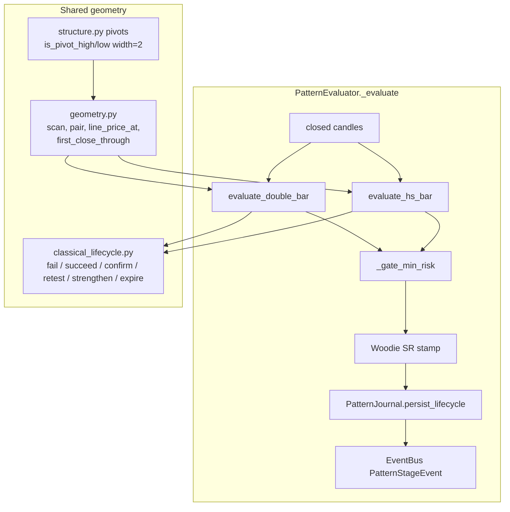
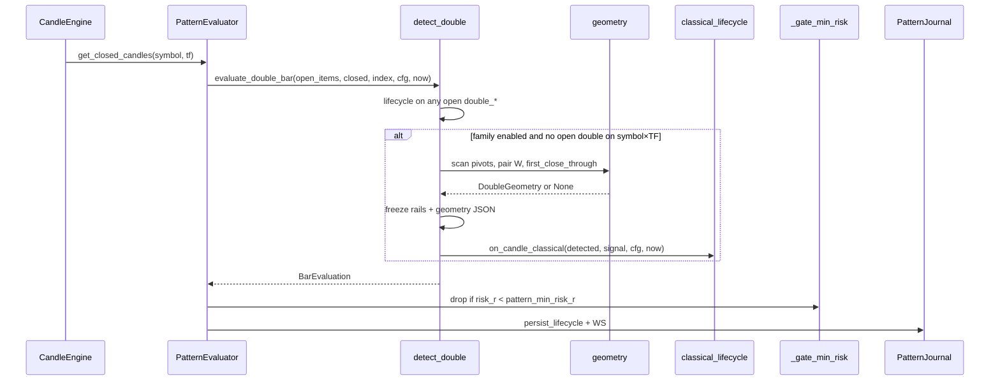

# Classical Multi-Pivot Patterns: Double Bottom / Double Top / Head & Shoulders / Inverse H&S

| Field | Value |
|---|---|
| **Author** | TBD |
| **Date** | 2026-08-27 |
| **Status** | Draft |
| **Scope** | Four new `PatternType`s + shared geometry + journal/overlay/Learn wiring |
| **Out of scope** | Roadmap P1 (confluence grade), P4 (high tight flag), P5 (candle replay) |
| **Related** | `docs/design-patterns-stack-and-filtered-stats.md` §3.2–3.3 (2026-08-06 sketch, **not implemented**); `docs/patterns/breakout.md` (lifecycle gold standard); `docs/patterns/hh-ll.md` (pivot contract) |

---

## Overview

TIP-2 already journals closed-candle, non-repainting setups through `PatternEvaluator` (`backend/app/patterns/evaluator.py`). Structure patterns (`higher_high` / `lower_low`) prove that Bill-Williams fractals in `backend/app/patterns/structure.py` are a stable primitive. This design adds four **classical multi-pivot** trade patterns that reuse those pivots, freeze virtual rails at detect, and ride the existing Detected → Confirmed → Retested → Strengthened → Succeeded | Failed | Expired machine.

The four types are:

| `PatternType` value | Direction | Geometry family |
|---|---|---|
| `double_bottom` | long | W: two troughs + intervening peak |
| `double_top` | short | M: two peaks + intervening trough |
| `head_shoulders` | short | Shoulder–head–shoulder + neckline |
| `inverse_head_shoulders` | long | Inverted H&S |

**Detected is the trade trigger**, not “pattern forming”: the first **closed** bar whose close is through the confirmation line (double) or neckline (H&S), after every required pivot is confirmed. Wick-through without a close does **not** detect. Geometry is persisted as JSON on the instance so the chart can redraw pivots/neckline after restart and so uniqueness is deterministic.

This is **not** the full historical roadmap in `docs/design-patterns-stack-and-filtered-stats.md`. That document’s P2/P3 tables are starting sketches only. P1/P4/P5 stay deferred.

---

## Background & Motivation

### Current state

- `PatternType` in `backend/app/patterns/models.py` is: `breakout`, `breakdown`, `consolidation`, `volume_breakout`, `hammer`, `shooting_star`, `bullish_engulfing`, `bearish_engulfing`, `inside_bar`, `higher_high`, `lower_low`.
- `PatternEvaluator._evaluate` dispatches a list of `(open-filter, settings attr, evaluate_fn, needs_index)` specs. Every family already: evaluates **closed** candles only, journals via `PatternJournal.persist_lifecycle`, publishes WS stages, stamps Woodie SR, and drops tiny-stop noise through `_gate_min_risk` → `passes_min_risk_r` (`pattern_min_risk_r` default **0.3**).
- Pivot helpers already exist and are tested (`backend/tests/patterns/test_swing_points.py`): `Pivot`, `is_pivot_high`, `is_pivot_low`, `pivot_highs_before`, `pivot_lows_before`, `confirmed_pivot_index`, `sanitize_stop`.
- Rails, MFE/MAE, planned R:R, and research filters are type-agnostic once an instance is journaled. `PATTERN_TYPES_ALLOWED` in `backend/app/patterns/research_filters.py` is `frozenset(p.value for p in PatternType)` — extending the enum is sufficient for research validation.
- Chart overlay (`frontend/src/utils/patternOverlay.ts`) draws **horizontal** price lines (reference / entry / stop / target) plus stage markers. No polyline neckline exists yet.
- DB `pattern_type` is a CHECK constraint last extended in `backend/db/migration/V4__pattern_types_classic.sql`. Latest migration is `V11__woodie_daily_sr.sql`. There is **no** instance-level geometry column; event `metadata` JSONB exists but instance GET (`ActivePattern.to_dto`) does not return events.

### Pain points

1. Classical W / M / H&S setups are what operators ask for; HH/LL is “new swing”, not a measured-move pattern.
2. `ActivePattern` is a flat rail record. Neckline slope, five pivot roles, and pattern height cannot be reconstructed from `reference_level` alone.
3. The 2026-08-06 sketch left tolerances, confirm-bar choice, uniqueness, and overlay unspecified — an engineer cannot implement from it without guessing.

### Why now

P0 research filters are shipped (`docs/design-composable-stack-filters.md`). New types automatically flow into `(symbol, type, TF)` stats and query-time stacks. We can add detectors without waiting on confluence grades.

---

## Goals & Non-Goals

### Goals

1. Detect the four patterns on closed candles only, non-repainting, same contract as `evaluate_breakout_bar` / `evaluate_structure_bar`.
2. Share one inverted geometry engine for double bottom/top, and one inverted engine for H&S / inverse H&S.
3. Freeze entry / stop / target / ATR at detect; map lifecycle onto existing stages; terminal outcomes journaled as today.
4. Persist geometry JSON on the instance; expose it on the instance DTO for overlay + inspect.
5. Wire enum, config, Flyway CHECK, frontend type lists, Learn pages, and unit tests.
6. Feature-flag the families (kill switch + per-TF enable) so 5m noise can stay off while 15m+ runs.

### Non-Goals

- Confluence grade / A+ stack (roadmap P1).
- High tight flag (P4).
- Historical replay / parameter sweep (P5).
- Changing global `pattern_min_risk_r`, `DEFAULT_MAX_RISK_R` (1.5), or 1d session expiry (30 bars).
- Auto-trading / paper OMS integration (patterns remain virtual journal offers).
- Rewriting breakout/structure detectors.
- Backfilling classical detects on old candles at deploy (live + subsequent closes only; seed history will fire as the engine already holds lookback bars).

---

## Key Decisions

1. **Detected = first close through the confirmation/neckline after pivots are confirmed**, not “last pivot just printed”. Matches breakout’s `close > reference` and gives a real virtual trade. Wick-through does not detect.
2. **Two shared inverted engines**, not four copies: `double.py` (W/M) and `head_shoulders.py` (H&S / iH&S). Fractal definition stays in `structure.py`; pairing/interpolation live in new `geometry.py`. Invert is **signed candles**, not a second copy of comparisons (unlike `breakdown.py` vs `breakout.py`): `sign = +1` runs the native pairing; `sign = −1` swaps high↔low and negates OHLC so the same ATR tolerances and “head is the extreme” predicates apply unchanged. Rails are unsigned back to market prices on emit.
3. **New `geometry_json` JSONB column** on `pattern_instances` (domain field `ActivePattern.geometry`), not event metadata. Overlay and uniqueness need the instance GET path (`fetchPatternInstance` → `to_dto`). Mirrors `sr_ladder_json`.
4. **Confirmation line / neckline at the break bar is frozen into `reference_level`**. Lifecycle (confirm / retest / fail-through-ref checks that use the line) uses this frozen horizontal level. The sloped neckline is stored for drawing and for the *detect* interpolation only.
5. **Measured-move target** (pattern height projected beyond the line), not ATR-only. `success_atr_mult` is a floor so a shallow pattern still has a reachable target. Target is **not** rewritten on retest (unlike breakout).
6. **Stop is structural** (beyond the lower trough / higher peak / right shoulder), plus `stop_buffer_atr`. This is textbook invalidation and matches the P2/P3 sketch. Consequence: `risk_r` is often 1–3 ATR — wider than breakout’s Donchian stop. Global `pattern_min_risk_r=0.3` still applies; research’s default `maxRiskR=1.5` will hide some instances (documented, not changed). A close back through the frozen confirmation/neckline that does **not** pierce this stop does **not** fail the instance (v1). See Key Decision 7 occupancy.
7. **Anti-spam = one open instance per family per symbol×TF**, plus a **consumed-geometry** rule: the current bar must be the *first* close-through after the right pivot is confirmed. Same W/H&S cannot re-fire on every subsequent close above the old line. **Occupancy is intended:** a false break that reclaims the neckline/peak while staying inside the structural stop keeps the family slot until stop, target, `max_candles_after_detect`, or session expiry. On 15m the usual slot-free is `session_end` (`expiry_session_close_timeframes`). No `invalidation_mode` in v1. Tested: close back below `P` but above stop → still open, no second detect.
8. **Double and H&S families are independent.** A 3-trough iH&S may also qualify as a double bottom on the same bar. v1 does **not** suppress; research can filter. Tested explicitly.
9. **Lifecycle is breakout-shaped, not `on_candle_short_trade`.** Retest of the neckline/confirmation line is textbook. Shared `classical_lifecycle.py` used by both families. Fail (close through stop) wins over succeed on the same bar (PI-21). Succeed uses high/low reaching target, not on the detect bar (same as `short_trade.py`).
10. **Default enable: families ON, 5m/1m OFF, 15m/1h/4h/1d ON.** Global `pattern_enabled` and `pattern_enabled_timeframes` still wrap everything. Extra kill switches `pattern_double_enabled` / `pattern_hs_enabled` for production.
11. **Detector versions** `double-v1` and `hs-v1`, frozen on the instance. Rule changes require a version bump; never silently retcon v1.
12. **Confirmation mode default `close`**, not breakout’s `both`. Volume is recorded as `volume_ok_at_detect` for research; optional `both`/`volume` follow breakout’s index fallback (`CLOSE_FALLBACK` when INDEX or volume unusable). Detect-bar `on_candle_classical` is the real lifecycle function (not a `confirm_ok=False` stub). `VOLUME` may set Confirmed on the detect bar; `CLOSE` / `BOTH` / `CLOSE_FALLBACK` do not. Confirmation lives in `_can_confirm_classical` inside `classical_lifecycle.py` — do **not** import breakout’s long-only `_can_confirm`.

---

## Proposed Design

### Architecture



### Module layout

| Module | Role |
|---|---|
| `backend/app/patterns/structure.py` | **Unchanged contract.** Fractal width-N pivots, `sanitize_stop`. Do not fork `is_pivot_high` / `is_pivot_low`. |
| `backend/app/patterns/geometry.py` | **New.** Lookback-clipped pivot scan, price equality in ATR, line interpolation, first-close-through, measured-move helpers. |
| `backend/app/patterns/double.py` | **New.** W/M pairing + `detect_double` + `evaluate_double_bar`. |
| `backend/app/patterns/head_shoulders.py` | **New.** 5-pivot pairing + `detect_head_shoulders` + `evaluate_hs_bar`. |
| `backend/app/patterns/classical_lifecycle.py` | **New.** Shared post-detect lifecycle for both families. |
| `backend/app/patterns/evaluator.py` | Two new specs in `_evaluate`, with enable/TF gates that still advance already-open instances. |
| `backend/app/patterns/models.py` | Four enum values, `is_double` / `is_head_shoulders` / `is_classical`, `ActivePattern.geometry`. |

Evaluator signature matches structure (no index) **except** we pass `index_segment` for volume fallback, same as breakout. Add `needs_index=True` for both new specs so the existing loop in `_evaluate` (lines 316–372) does not need a third calling convention.

```python
# PatternEvaluator._evaluate specs — append after volume_breakout
(
    lambda p: p.pattern_type.is_double(),
    "double",
    evaluate_double_bar,
    True,  # index_segment for volume fallback
),
(
    lambda p: p.pattern_type.is_head_shoulders(),
    "head_shoulders",
    evaluate_hs_bar,
    True,
),
```

Enable gate (inside `_evaluate`, before calling `evaluate_fn`):

```python
cfg = {**getattr(self._settings, cfg_attr), "atr_period": atr}
family_on = True
if cfg_attr == "double":
    family_on = bool(getattr(self._settings, "pattern_double_enabled", True))
elif cfg_attr == "head_shoulders":
    family_on = bool(getattr(self._settings, "pattern_hs_enabled", True))
tf_map = cfg.get("enabled_timeframes")
tf_on = True if not isinstance(tf_map, dict) else bool(tf_map.get(timeframe, True))
cfg = {**cfg, "_new_detects": bool(cfg.get("enabled", True) and family_on and tf_on)}
```

`detect_*` returns `None` when `not cfg["_new_detects"]`. Lifecycle on `open_items` **always** runs so a disable does not orphan live instances.

### Shared pivot contract (do not change)

From `docs/patterns/hh-ll.md` and `structure.py`:

- Pivot high at index `i` iff `high_i` is **strictly greater** than highs of `i-N..i+N` excluding `i`.
- Pivot low: strict minimum of lows in the window.
- Confirmed only when bar `i+N` has closed. `confirmed_pivot_index(n, N) = n - 1 - N`.
- Default `N = fractal_width = 2` (same as structure).

`geometry.scan_confirmed_pivots(closed, width, lookback)`:

1. `last = len(closed) - 1 - width` (must be `>= width`).
2. `start = max(width, len(closed) - lookback)`.
3. Reuse `pivot_highs_before(closed, len(closed), width)` / `pivot_lows_before(...)` and keep `p.index >= start`.

If fewer bars than `lookback`, scan whatever is confirmable. ATR(14) must exist (`AtrIndicator.latest`); else no detect (same as every other family).

### Invert mechanism (signed candles)

Both family engines implement **one** native polarity and invert with a sign, rather than duplicating comparison operators (`breakdown.py` is a full mirror of `breakout.py` — do not copy that).

```python
def signed_candle(c: Candle, sign: int) -> Candle:
    """sign=+1 identity; sign=-1 negates OHLC and swaps high↔low."""
    if sign >= 0:
        return c
    return Candle(c.time, -c.open, -c.low, -c.high, -c.close, c.volume)

def unsigned_price(px: float, sign: int) -> float:
    return px if sign >= 0 else -px
```

| Engine | Native (`sign=+1`) | Inverted (`sign=-1`) |
|---|---|---|
| `double.py` | W / `double_bottom` (pivot lows) | M / `double_top` |
| `head_shoulders.py` | Bearish H&S (pivot highs) | Inverse H&S |

On the signed series the native predicates run unchanged: “head is the highest high”, “troughs are equal within ATR”, “close through the line to the long side of the native engine”. After a hit, unsign every price (`unsigned_price`) before writing rails / geometry. ATR is computed on **unsigned** (real) candles — never negate ATR. Pivot indices and times are invariant.

`detect_double` / `detect_head_shoulders` each loop sides that are enabled (`enable_bottom` / `enable_top`, `enable_regular` / `enable_inverse`). A disabled side is not considered for a **new** detect. Lifecycle of an already-open instance of a now-disabled side still runs (`_new_detects` does not skip `open_items`).

### First-close-through (uniqueness + non-repaint)

```python
def line_price_at(i1: int, p1: float, i2: int, p2: float, at: int) -> float:
    if i2 == i1:
        return p1
    return p1 + (p2 - p1) * (at - i1) / (i2 - i1)

def first_close_through(
    bars: list[Candle],
    start: int,
    end: int,
    price_at,          # Callable[[int], float]
    long_side: bool,
) -> int | None:
    for i in range(start, end + 1):
        px = price_at(i)
        if long_side and bars[i].close > px:
            return i
        if not long_side and bars[i].close < px:
            return i
    return None
```

Detect iff `first_close_through(...) == len(bars) - 1`.

`start` = `right_pivot.index + width` (right pivot just-confirmed or earlier). Never use a bar before the right pivot is confirmable. Never backfill `detect_candle_time` onto a past bar — Detected is always the current closed bar, matching every existing detector.

This is the anti-spam that prevents “every close above last month’s W” from re-opening after the previous instance terminals.

### Sequence: double-bottom detect



---

## Pattern 1 — Double bottom (bullish)

### Geometric definition

A **W** of two confirmed pivot lows and one intervening confirmed pivot high.

| Role | Pivot | Price source |
|---|---|---|
| Trough 1 `L1` | pivot low | `bars[L1].low` |
| Peak `P` | **highest** pivot high with `L1.index < P.index < L2.index` | `bars[P].high` |
| Trough 2 `L2` | later pivot low | `bars[L2].low` |

Constraints (all must pass):

| Rule | Default | Config key |
|---|---|---|
| Fractal width | 2 | `double.fractal_width` |
| Lookback window | 80 bars | `double.lookback_candles` |
| Trough band (long): `−max_second_deeper_atr ≤ (L2.price − L1.price)/ATR ≤ trough_tolerance_atr` | +0.35 / −0.25 | `double.trough_tolerance_atr`, `double.max_second_deeper_atr` |
| Separation `L2.index − L1.index` (inclusive span; adjacent pivots = 1) in `[min_pivot_separation, max_pivot_separation]` | 5–50 | `double.min_pivot_separation`, `double.max_pivot_separation` |
| Height `P.price − min(L1,L2) ≥ min_height_atr × ATR` | 1.0 | `double.min_height_atr` |
| Height `≤ max_height_atr × ATR` | 8.0 | `double.max_height_atr` |
| `P.price > max(L1.price, L2.price)` | required | — |
| At least one intervening pivot high | required | — |

Pairing algorithm (deterministic):

1. Scan confirmed lows/highs in lookback (unsigned for ATR; signed candles if this is a top).
2. Collect **every** `(L1, P, L2)` that satisfies separation + trough band + height **and** whose `first_close_through == len(bars)-1`.
3. Rank: **newest `L2.index` first**; tie-break **largest height**; remaining tie **newest `L1.index`**.
4. Emit at most one W (or one M) from this ranked list, subject to same-bar dual-direction tie-break below.

Same-bar dual-direction (W and M both first-close now; family slot is one):

1. Drop a side when its `enable_bottom` / `enable_top` is false.
2. Remaining: **larger height** wins; if heights equal, **long (`double_bottom`) before short (`double_top`)**.

`enable_bottom` / `enable_top` are read inside `detect_double`, not only in config tables. An already-open instance of a disabled side still receives `on_candle_classical`.

Confirmation line is **horizontal** at `P.price` (classic double-bottom neckline). No slope.

### Detection trigger

- `start = L2.index + fractal_width`.
- `price_at(i) = P.price`.
- Long: `close > P.price`.
- Current bar must be the first such close.

Worked numbers (ATR = 2.0): L1 = 100.0, P = 108.0, L2 = 100.4 (`|Δ| = 0.2 ATR ≤ 0.35`). Height = 8.0 = 4.0 ATR. Break bar close 108.3 → Detected.

### Rails (frozen at detect)

| Field | Formula |
|---|---|
| Entry | detect-bar **close** |
| `reference_level` | `P.price` (confirmation line) |
| `lookback_high` | `P.price` |
| Stop | `sanitize_stop(True, entry, min(L1,L2) − stop_buffer_atr × ATR, ATR)` |
| Target | `P.price + measured_move_frac × height`; if `target < entry + success_atr_mult × ATR` then `entry + success_atr_mult × ATR` |
| R unit | `atr_at_detect` |
| `stop_buffer_atr` default | 0.15 |
| `measured_move_frac` default | 1.0 |
| `success_atr_mult` default | 1.5 |

Example: entry 108.3, stop `100.0 − 0.15×2 = 99.70`, target `108 + 8 = 116`. `risk_r ≈ 8.6/2 = 4.30` (wide). `reward_r ≈ 7.7/2 = 3.85`. `planned_rr ≈ 0.89`. This is expected for structural stops — do not “fix” by moving the stop up to the neckline.

### Lifecycle

| Stage | Rule (long) |
|---|---|
| **Detected** | First close `> P`. Flags false. |
| **Failed** | `close < stop_level` only (structural stop). Reason `invalidation`. Checked first (PI-21). A close back through `P` / `reference_level` that stays `≥ stop_level` is **not** a fail (occupancy — Key Decision 7). |
| **Succeeded** | Not detect bar, `high ≥ target_level`. Reason `price_target`. |
| **Confirmed** | `_can_confirm_classical`: mode `close` / `close_fallback` / `both` require a later bar still `close > reference_level` (`both` also needs `volume_ok_at_detect`). Mode `volume` confirms **on the detect bar** when `volume_ok_at_detect`. |
| **Retested** | After confirmed, `low ≤ reference + retest_atr_mult×ATR` and `close ≥ reference`. Set `retest_floor = low`. **Do not rewrite target.** |
| **Strengthened** | After confirmed, `high ≥ reference + strengthen_atr_mult×ATR`. |
| **Expired** | `duration_candles ≥ max_candles_after_detect` (default 40, reason `max_candles`) **or** existing session expiry (15m session_end; 1h/4h max_sessions/60 bars; 1d global 30 bars). |

Display status: existing `ActivePattern.refresh_display_status` (never demotes).

MFE/MAE: max high / min low since detect, same as `on_candle_short_trade`.

### Anti-spam

1. At most **one open** `double_bottom` **or** `double_top` per symbol×TF (shared family slot, like engulfing).
2. Consumed-geometry via first-close-through.
3. Journal fingerprint `(symbol_id, pattern_type, timeframe, detect_candle_time, reference_level)` still applies (`V2__pattern_journal.sql`).
4. **Occupancy:** while that instance is open, no newer W/M can Detected — including after a neckline/peak reclaim that did not hit the structural stop. Slot frees on Failed (stop), Succeeded, Expired (`max_candles_after_detect`), or 15m/`5m`/`1m` `session_end`. Document this in `docs/patterns/double-*.md` and Learn lifecycle bullets. Test: detect W, later close `< P` but `> stop` → still open, no second detect.

### Geometry JSON

Stored on `ActivePattern.geometry` / column `geometry_json`:

```json
{
  "kind": "double_bottom",
  "version": 1,
  "pivots": [
    {"role": "trough1", "index": 12, "time": 1710000000, "price": 100.0, "high": false},
    {"role": "peak",    "index": 20, "time": 1710004800, "price": 108.0, "high": true},
    {"role": "trough2", "index": 28, "time": 1710009600, "price": 100.4, "high": false}
  ],
  "confirmation": {
    "style": "horizontal",
    "price": 108.0,
    "leftTime": 1710004800,
    "rightTime": 1710012000
  },
  "patternHeight": 8.0,
  "breakIndex": 32,
  "breakTime": 1710012000,
  "breakPrice": 108.3
}
```

`confirmation.rightTime` = detect-bar time (line drawn from peak through break).

### Chart overlay

- Existing horizontal rails: Ref = confirmation 108, Entry, Stop, Target (`applyInstanceOverlay`).
- Pivot markers **merged into the existing `createSeriesMarkers` payload** (labels `L1` / `P` / `L2`; `belowBar` for lows, `aboveBar` for highs). Same-bar merge already joins texts with `·`. Do not add a second markers plugin.
- Skip a second horizontal confirmation price line when it equals Ref (price lines are infinite; a “segment” is not available). Sloped necklines (H&S only) use `extraSeries`.

### Timeframe defaults

| TF | Default |
|---|---|
| 1m | OFF (global already off) |
| 5m | **OFF** (fractal noise) |
| 15m, 1h, 4h, 1d | **ON** |

`double.enable_bottom: true`, `double.enable_top: true`.

### Detector version

`double.detector_version = "double-v1"`.

---

## Pattern 2 — Double top (bearish)

**Same engine, inverted.** `detect_double(..., inverted=True)` or `side="short"`.

| Double bottom (`sign=+1`) | Double top (`sign=-1`, unsigned formulas) |
|---|---|
| Pivot lows L1, L2 | Pivot highs H1, H2 |
| Intervening highest pivot high P | Intervening **lowest** pivot low T |
| Band `−max_second_deeper_atr ≤ (L2−L1)/ATR ≤ trough_tolerance_atr` | Band `−trough_tolerance_atr ≤ (H2−H1)/ATR ≤ max_second_deeper_atr` (H2 may be `0.35 ATR` lower, only `0.25 ATR` higher) |
| Separation `L2.index − L1.index` in `[5, 50]` | `H2.index − H1.index` in `[5, 50]` |
| Height = P − min(L) | Height = max(H) − T |
| Detect: close `> P` | Detect: close `< T` |
| Long | Short |
| Stop `min(L) − stop_buffer_atr × ATR` | Stop `max(H) + stop_buffer_atr × ATR` |
| Target = P + height; ATR floor `entry + success_atr_mult × ATR` | Target = T − height; ATR floor `entry − success_atr_mult × ATR` |

Geometry `kind: "double_top"`. Roles: `peak1`, `trough`, `peak2`.

Lifecycle inequalities invert (see `classical_lifecycle.py` `long_side` flag). Succeed: `low ≤ target`. Fail: `close > stop`. Retest: `high ≥ reference − retest_atr_mult×ATR` and `close ≤ reference`. Strengthen: `low ≤ reference − strengthen_atr_mult×ATR`.

Anti-spam shares the double family slot with double bottom.

---

## Pattern 3 — Head & shoulders (bearish)

### Geometric definition

Five confirmed pivots, chronological:

| Role | Kind | Notes |
|---|---|---|
| LS | pivot high | Left shoulder |
| A | pivot low | Left armpit — **lowest** confirmed pivot low strictly between LS and Head |
| H | pivot high | Head — strictly higher than both shoulders |
| B | pivot low | Right armpit — **lowest** confirmed pivot low strictly between Head and RS |
| RS | pivot high | Right shoulder |

Neckline = line through `(A.index, A.price)` and `(B.index, B.price)`, possibly sloped. Price at bar `i`:

\[
n_i = A.price + (B.price - A.price) \times \frac{i - A.index}{B.index - A.index}
\]

| Rule | Default | Config key |
|---|---|---|
| Fractal width | 2 | `head_shoulders.fractal_width` |
| Lookback | 100 bars | `head_shoulders.lookback_candles` |
| Head prominence `H.price − max(LS,RS) ≥ min_head_prominence_atr × ATR` | 0.5 | `head_shoulders.min_head_prominence_atr` |
| Shoulder symmetry `\|LS.price − RS.price\| ≤ shoulder_tolerance_atr × ATR` | 0.60 | `head_shoulders.shoulder_tolerance_atr` |
| Time symmetry `max(d1,d2)/min(d1,d2) ≤ max_time_asymmetry` where `d1 = H.index − LS.index`, `d2 = RS.index − H.index` (inclusive spans, same units as separation) | 2.5 | `head_shoulders.max_time_asymmetry` |
| Span `RS.index − LS.index` in `[min_span_bars, max_span_bars]` | 8–70 | `head_shoulders.min_span_bars`, `head_shoulders.max_span_bars` |
| `\|neckline slope\|` in price/bar `≤ max_neckline_slope_atr_per_bar × ATR` | 0.20 | `head_shoulders.max_neckline_slope_atr_per_bar` |
| Armpit predicate (regular): `A.price < LS.price and A.price < H.price and B.price < RS.price and B.price < H.price` | required | — |
| `H.price > LS.price` and `H.price > RS.price` | required | — |
| Sloping neckline allowed | true | `head_shoulders.allow_sloping_neckline` |

The armpit predicate is **per-side**, not `max(A,B) < min(LS,RS)`. An up-sloping neckline with `B.price > LS.price` is valid when the slope cap and `B.price < RS.price` still hold. Test that case.

If `allow_sloping_neckline` is false: require `|A.price − B.price| ≤ 0.25 ATR` (hardcoded, both regular armpit lows and inverse armpit highs) and treat neckline as horizontal at `(A.price+B.price)/2`.

Pairing (deterministic):

1. Collect **every** 5-pivot set that satisfies prominence, symmetry, span, slope, armpits **and** `first_close_through == len(bars)-1`.
2. Rank: **largest `head_to_neckline`** (pattern height); tie-break **newest `RS.index`**; remaining tie **newest Head**.
3. Do **not** walk RS newest-first as a filter that would discard a larger older pattern that also first-breaks now.

Same-bar dual-direction (regular H&S and inverse both first-close now; family slot is one): drop a side when `enable_regular` / `enable_inverse` is false; then **larger height**; then **long (`inverse_head_shoulders`) before short (`head_shoulders`)**. `enable_*` is read inside `detect_head_shoulders`. Already-open instances of a disabled side still run lifecycle.

**Armpits must be confirmed pivot lows** (not the raw interval minimum). Visual H&S whose armpits are not fractals are rejected — non-repaint consistency with HH/LL.

### Detection trigger

- `start = RS.index + fractal_width`.
- `price_at(i) = line_price_at(A, B, i)` (live slope **only** for the scan).
- Short: `close < n_i`.
- Current bar is the first such close after RS is confirmed.
- **Wick below neckline with close above does not detect** (failed-neckline test).

At detect, freeze `neckline_at_break = n_{detect_index}` into `reference_level`. Subsequent lifecycle uses this **horizontal** freeze so confirm/retest do not drift.

### Rails

| Field | Formula |
|---|---|
| Entry | detect-bar close |
| `reference_level` | `neckline_at_break` |
| `lookback_high` | `H.price` |
| Stop | `sanitize_stop(False, entry, RS.price + stop_buffer_atr × ATR, ATR)` |
| Pattern height | `H.price − line_price_at(A,B,H.index)` (head-to-neckline vertical) |
| Target | `neckline_at_break − measured_move_frac × height`; ATR floor `entry − success_atr_mult × ATR` |
| `max_candles_after_detect` | 50 |
| `stop_buffer_atr` | 0.15 |
| `measured_move_frac` | 1.0 |
| `success_atr_mult` | 1.5 |
| `retest_atr_mult` | 0.25 |
| `strengthen_atr_mult` | 1.0 |

Stop is **beyond the right shoulder**, not beyond the head (P3 sketch). Head is already the extreme; stopping there would be the entire pattern height of risk.

### Lifecycle

Same `classical_lifecycle` as double top (short): fail if `close > stop`; succeed if `low ≤ target`; confirm later close still `≤ reference`; retest of frozen neckline; strengthen 1×ATR beyond ref.

### Anti-spam

One open `head_shoulders` **or** `inverse_head_shoulders` per symbol×TF. First-close-through consumes that 5-pivot set. Occupancy matches double (Key Decision 7): a close back through frozen `neckline_at_break` that does not pierce the structural stop does not fail and does not free the slot. 15m slot-free is `session_end`.

### Geometry JSON

```json
{
  "kind": "head_shoulders",
  "version": 1,
  "pivots": [
    {"role": "left_shoulder",  "index": 10, "time": 1, "price": 110.0, "high": true},
    {"role": "left_armpit",    "index": 14, "time": 2, "price": 104.0, "high": false},
    {"role": "head",           "index": 20, "time": 3, "price": 116.0, "high": true},
    {"role": "right_armpit",   "index": 26, "time": 4, "price": 103.5, "high": false},
    {"role": "right_shoulder", "index": 32, "time": 5, "price": 109.5, "high": true}
  ],
  "neckline": {
    "style": "sloped",
    "p1Time": 2, "p1Price": 104.0,
    "p2Time": 4, "p2Price": 103.5,
    "priceAtBreak": 103.2,
    "slopePerBar": -0.0417
  },
  "confirmation": {
    "style": "sloped",
    "price": 103.2
  },
  "patternHeight": 12.15,
  "breakIndex": 36,
  "breakTime": 6,
  "breakPrice": 102.8
}
```

### Chart overlay

- Horizontal Ref = `priceAtBreak` (frozen), plus entry/stop/target.
- **Sloped neckline** as one extra LWC line series (`extraSeries`), from armpit1 → armpit2 → detect bar (extrapolated). `clearPatternOverlay` calls `chart.removeSeries` on each extra series.
- Five pivot markers **merged into the same `setMarkers` list** as stage events (labels `LS` / `A` / `H` / `B` / `RS`; `aboveBar` if `pivot.high` else `belowBar`). No second `createSeriesMarkers` plugin.

### Timeframe / version

Same TF map as double. `head_shoulders.enable_regular: true`, `head_shoulders.enable_inverse: true`. `detector_version: "hs-v1"`.

---

## Pattern 4 — Inverse head & shoulders (bullish)

**Same engine as Pattern 3, `sign = −1`.** Native pairing (bearish H&S) runs on signed candles; rails and geometry below are the **unsigned** (market) formulas an implementer must emit. Do not write a second copy of the scanner.

### Geometric definition (unsigned)

Five confirmed pivots, chronological:

| Role | Kind | Notes |
|---|---|---|
| LS | pivot **low** | Left shoulder |
| A | pivot **high** | Left armpit — **highest** confirmed pivot high strictly between LS and Head |
| H | pivot **low** | Head — strictly **lower** than both shoulders |
| B | pivot **high** | Right armpit — **highest** confirmed pivot high strictly between Head and RS |
| RS | pivot **low** | Right shoulder |

Neckline = line through `(A.index, A.price)` and `(B.index, B.price)`. `n_i` uses the same interpolation as Pattern 3.

| Regular H&S (`sign=+1`) | Inverse H&S (`sign=-1`, unsigned) |
|---|---|
| Pairing walks pivot **highs** as LS/H/RS | Pairing walks pivot **lows** as LS/H/RS (signed highs) |
| Armpits = lowest confirmed pivot **lows** in the intervals | Armpits = highest confirmed pivot **highs** in the intervals |
| Prominence `H.price − max(LS,RS) ≥ min_head_prominence_atr × ATR` | Prominence `min(LS.price, RS.price) − H.price ≥ min_head_prominence_atr × ATR` (vs shoulders, **not** vs neckline) |
| Height `H.price − line_price_at(A,B,H.index)` | Height `line_price_at(A,B,H.index) − H.price` |
| Armpit predicate `A < LS and A < H and B < RS and B < H` | `A.price > LS.price and A.price > H.price and B.price > RS.price and B.price > H.price` |
| Shoulder `\|LS − RS\| ≤ shoulder_tolerance_atr × ATR` | same (unsigned prices) |
| `d1 = H.index − LS.index`, `d2 = RS.index − H.index`, span `RS.index − LS.index` | identical index arithmetic |
| `allow_sloping_neckline=false` → `\|A−B\| ≤ 0.25 ATR` on armpit **lows** | same 0.25 ATR cap on armpit **highs** |
| Detect: `close < n_i` | Detect: `close > n_i` |
| Short | Long |
| Stop `sanitize_stop(False, entry, RS.price + stop_buffer_atr × ATR, ATR)` | Stop `sanitize_stop(True, entry, RS.price − stop_buffer_atr × ATR, ATR)` (RS is a **low**) |
| Target `neckline_at_break − measured_move_frac × height`; ATR floor `entry − success_atr_mult × ATR` | Target `neckline_at_break + measured_move_frac × height`; ATR floor `entry + success_atr_mult × ATR` |

Ranking, first-close-through, occupancy, and `enable_inverse` match Pattern 3. Geometry `kind: "inverse_head_shoulders"`. Roles: `left_shoulder`, `left_armpit`, `head`, `right_armpit`, `right_shoulder` (same keys; `high` flags flipped).

### Worked numbers (ATR = 2.0)

| Pivot | Index | Price |
|---|---|---|
| LS (low) | 10 | 100.0 |
| A (high) | 14 | 106.0 |
| H (low) | 20 | 94.0 |
| B (high) | 26 | 105.5 |
| RS (low) | 32 | 100.4 |

- Prominence: `min(100.0, 100.4) − 94.0 = 6.0 = 3.0 ATR ≥ 0.5`.
- Shoulder symmetry: `|100.0 − 100.4| = 0.20 ATR ≤ 0.60`.
- Spans: `d1 = 20 − 10 = 10`, `d2 = 32 − 20 = 12`, ratio `12/10 = 1.2 ≤ 2.5`; `RS − LS = 22` in `[8, 70]`.
- Armpits: `106 > 100`, `106 > 94`, `105.5 > 100.4`, `105.5 > 94`.
- Neckline at head: `n_20 = 106 + (105.5 − 106) × (20 − 14)/(26 − 14) = 105.75`.
- Height: `105.75 − 94.0 = 11.75`.
- Detect bar index 36, `n_36 = 106 + (−0.5) × (36 − 14)/12 = 105.083`. Close `105.50 > 105.083` → Detected long.
- Frozen `reference_level = 105.083`. Entry `105.50`. Stop `100.4 − 0.15 × 2 = 100.10`. Target `105.083 + 11.75 = 116.833` (ATR floor `105.50 + 3.0 = 108.50` does not bind).

Wick below `n_36` with close `≤ n_36` does not detect. A later close back through `105.083` that stays `≥ 100.10` is occupancy, not fail.

---

## Shared lifecycle (`classical_lifecycle.py`)

Modeled on `lifecycle_breakout` (`backend/app/patterns/breakout.py` lines 81–133) + PI-21 fail-first + `short_trade` “no succeed on detect bar”.

```python
def on_candle_classical(
    instance: ActivePattern,
    candle: Candle,
    config: dict,
    now: datetime,
) -> list[PatternStageEvent]:
    """Fail → Succeed → Confirm → Retest → Strengthen → max_candles expire."""
```

Ordering on each closed bar after MFE/MAE update — including the **detect bar**. There is no `confirm_ok=False` stub. `evaluate_*_bar` calls `on_candle_classical(detected, signal, config, now)` the same way breakout calls `lifecycle_breakout` on the new instance.

1. **Fail** if close through `stop_level` (long: `close < stop`; short: `close > stop`).
2. **Succeed** if not detect bar and favorable extreme reaches `target_level` (long high, short low).
3. **Confirm** via `_can_confirm_classical` (defined in this module; **do not import** `breakout._can_confirm`, which is long-only).
4. **Retest** once after confirmed, using `retest_atr_mult` (default 0.25). Record `retest_floor`. Do **not** change `target_level`.
5. **Strengthen** once after confirmed, `strengthen_atr_mult` (default 1.0).
6. **Expire** if `duration_candles >= max_candles_after_detect`.

```python
def _can_confirm_classical(instance: ActivePattern, candle: Candle) -> bool:
    long_side = instance.direction == PatternDirection.LONG
    still_through = (
        candle.close > instance.reference_level
        if long_side
        else candle.close < instance.reference_level
    )
    if not still_through:
        return False
    detect_bar = candle.time == instance.detect_candle_time
    mode = instance.confirmation_mode_used
    if mode == ConfirmationMode.VOLUME:
        return instance.volume_ok_at_detect and detect_bar
    if mode in (ConfirmationMode.CLOSE, ConfirmationMode.CLOSE_FALLBACK):
        return not detect_bar
    if mode == ConfirmationMode.BOTH:
        return instance.volume_ok_at_detect and not detect_bar
    return False
```

Default mode is `close`, so v1 typically confirms on a later bar. `VOLUME` **does** confirm on the detect bar when `volume_ok_at_detect`. `BOTH` / `CLOSE` / `CLOSE_FALLBACK` never confirm on the detect bar.

`duration_candles` increments when `candle.time != detect_candle_time` (same as `short_trade.py`).

Volume at detect (optional quality, always stored):

```python
vol = VolumeSmaIndicator.prior_average(closed, volume_avg_period)
volume_unusable = index_segment or vol is None or vol <= 0 or signal.volume <= 0
volume_ok = (not volume_unusable) and signal.volume >= volume_multiplier * vol
```

If configured mode is `volume` or `both` and volume is unusable → `ConfirmationMode.CLOSE_FALLBACK` (breakout PI-12).

---

## API / Interface Changes

### `PatternType` (`backend/app/patterns/models.py`)

```python
class PatternType(str, Enum):
    # ... existing ...
    DOUBLE_BOTTOM = "double_bottom"
    DOUBLE_TOP = "double_top"
    HEAD_SHOULDERS = "head_shoulders"
    INVERSE_HEAD_SHOULDERS = "inverse_head_shoulders"

    def is_double(self) -> bool:
        return self in (PatternType.DOUBLE_BOTTOM, PatternType.DOUBLE_TOP)

    def is_head_shoulders(self) -> bool:
        return self in (PatternType.HEAD_SHOULDERS, PatternType.INVERSE_HEAD_SHOULDERS)

    def is_classical(self) -> bool:
        return self.is_double() or self.is_head_shoulders()
```

### `ActivePattern`

Add `geometry: dict | None = None`. Include in `new_pattern`, `to_dto` as `"geometry"`. Not required for non-classical types.

### Instance GET / list

`PatternEvaluator.list_for_symbol` already returns `p.to_dto()`. Frontend `PatternInstanceDto` (`frontend/src/services/patternInstancesApi.ts`) gains optional `geometry?: ClassicalGeometry`.

WS payload (`evaluator._publish`) stays rail-flat. Overlay loads full instance for geometry (existing `loadInstanceForFocus`). No WS schema change required.

### Research / stats

No new endpoints. `PATTERN_TYPES_ALLOWED` tracks the enum. Stats key remains `(symbol_id, pattern_type, timeframe)` — four new buckets. Planned rails: these types are **not** in `_EXCLUDED_PATTERN_TYPES` (`planned_rails.py` only excludes `consolidation`), so `risk_r` / `reward_r` / `planned_rr` populate automatically.

### Evaluator detect functions

```python
def evaluate_double_bar(
    symbol_id: str,
    timeframe: str,
    open_items: list[ActivePattern],
    closed: list[Candle],
    index_segment: bool,
    config: dict,
    now: datetime,
) -> BarEvaluation: ...

def evaluate_hs_bar(
    symbol_id: str,
    timeframe: str,
    open_items: list[ActivePattern],
    closed: list[Candle],
    index_segment: bool,
    config: dict,
    now: datetime,
) -> BarEvaluation: ...
```

Same shape as `evaluate_breakout_bar`.

---

## Data Model Changes

### Migration `backend/db/migration/V12__classical_patterns.sql`

```sql
ALTER TABLE pattern_instances
    DROP CONSTRAINT IF EXISTS chk_pattern_instances_type;

ALTER TABLE pattern_instances
    ADD CONSTRAINT chk_pattern_instances_type
        CHECK (pattern_type IN (
            'breakout', 'breakdown', 'consolidation', 'volume_breakout',
            'hammer', 'shooting_star',
            'bullish_engulfing', 'bearish_engulfing', 'inside_bar',
            'higher_high', 'lower_low',
            'double_bottom', 'double_top',
            'head_shoulders', 'inverse_head_shoulders'
        ));

ALTER TABLE pattern_instances
    ADD COLUMN IF NOT EXISTS geometry_json JSONB;
```

Follow V4’s DROP/ADD CHECK pattern. Column is nullable; existing rows stay NULL.

### ORM / mapper

- `PatternInstanceRow.geometry_json` (`JSONType`, nullable) in `backend/app/journal/entities.py`.
- `to_new_row` / `to_domain` / `copy_mutable`:
  - Write geometry on insert.
  - `copy_mutable` does **not** rewrite geometry (frozen at detect), except a `fill_geometry_if_null` analog of `fill_sr_if_null` for fingerprint reuse.
- In-memory journal already stores the `ActivePattern` object — no extra table.

### Fingerprint

Unchanged: `(symbol_id, pattern_type, timeframe, detect_candle_time, reference_level)`. First-close-through means a given geometry produces one detect bar; float `reference_level` must be the frozen neckline/confirmation (use the same Python float that is stored — do not re-round).

---

## Config

Add to `backend/app/config.py` (mirroring existing detector dicts). Kill switches as top-level env-friendly fields:

```python
pattern_double_enabled: bool = Field(default=True, alias="TIP_PATTERN_DOUBLE_ENABLED")
pattern_hs_enabled: bool = Field(default=True, alias="TIP_PATTERN_HS_ENABLED")
```

### `double` dict defaults

| Key | Default |
|---|---|
| `enabled` | `True` |
| `enable_bottom` | `True` |
| `enable_top` | `True` |
| `enabled_timeframes` | `{1m: False, 5m: False, 15m: True, 1h: True, 4h: True, 1d: True}` |
| `fractal_width` | `2` |
| `lookback_candles` | `80` |
| `trough_tolerance_atr` | `0.35` (shallower side of the band) |
| `max_second_deeper_atr` | `0.25` (deeper/adverse side of the band) |
| `min_pivot_separation` | `5` (`L2.index − L1.index` inclusive) |
| `max_pivot_separation` | `50` |
| `min_height_atr` | `1.0` |
| `max_height_atr` | `8.0` |
| `stop_buffer_atr` | `0.15` |
| `measured_move_frac` | `1.0` |
| `success_atr_mult` | `1.5` |
| `target_mode` | `"measured"` (`"atr"` uses only `success_atr_mult`) |
| `retest_atr_mult` | `0.25` |
| `strengthen_atr_mult` | `1.0` |
| `confirmation_mode` | `"close"` |
| `volume_multiplier` | `1.5` |
| `volume_avg_period` | `20` |
| `max_candles_after_detect` | `40` |
| `detector_version` | `"double-v1"` |

### `head_shoulders` dict defaults

| Key | Default |
|---|---|
| `enabled` | `True` |
| `enable_regular` | `True` |
| `enable_inverse` | `True` |
| `enabled_timeframes` | same as double |
| `fractal_width` | `2` |
| `lookback_candles` | `100` |
| `shoulder_tolerance_atr` | `0.60` |
| `min_head_prominence_atr` | `0.50` |
| `max_time_asymmetry` | `2.5` |
| `min_span_bars` | `8` (`RS.index − LS.index` inclusive) |
| `max_span_bars` | `70` |
| `max_neckline_slope_atr_per_bar` | `0.20` |
| `allow_sloping_neckline` | `True` |
| `stop_buffer_atr` | `0.15` |
| `measured_move_frac` | `1.0` |
| `success_atr_mult` | `1.5` |
| `target_mode` | `"measured"` |
| `retest_atr_mult` | `0.25` |
| `strengthen_atr_mult` | `1.0` |
| `confirmation_mode` | `"close"` |
| `volume_multiplier` | `1.5` |
| `volume_avg_period` | `20` |
| `max_candles_after_detect` | `50` |
| `detector_version` | `"hs-v1"` |

`scripts/export_tip_defaults.py` `settings_projection()` must include both dicts so `frontend/src/learn/tipDefaults.json` stays in lockstep (`--check` CI). That whitelist update **lands in PR 5 with tipDefaults.json**, not in PR 1 — otherwise `--check` fails as soon as Settings grows keys the FE snapshot does not have.

Historical candle supply is already sufficient (`historical_lookback_days_by_timeframe`: 5m 60d, 15m 90d, 1h 180d, 4h 365d, 1d 730d). 80–100 bar lookback is well inside every enabled TF.

---

## Frontend

### Type lists (must stay in sync)

| File | Change |
|---|---|
| `frontend/src/learn/topicBuckets.ts` | Add four ids to `EXPECTED_PATTERN_TYPE_IDS`; map `double_bottom`/`double_top` → `['double', 'atr_period']`; H&S pair → `['head_shoulders', 'atr_period']`. |
| `frontend/src/learn/catalog.ts` | Register four Learn topics. |
| `frontend/src/pages/PatternStatsPage.jsx` | Append the four strings to `RESEARCH_TYPES`. Dashboard `BASE_PATTERN_TYPES` still merges live types. |
| `frontend/src/utils/patternInstanceMetrics.ts` | `patternConfigBucket`: double_* → `double`; head_shoulders / inverse → `head_shoulders`. Extend **both** `KNOB_LABELS` **and** the `preferred` array (labels without a `preferred` entry never render). Add `trough_tolerance_atr`, `measured_move_frac`, `stop_buffer_atr`, `fractal_width`, `min_height_atr`, `shoulder_tolerance_atr`, `min_head_prominence_atr`. `lookback_candles` is already in `preferred`. |
| `frontend/src/utils/patternInstanceMetrics.test.ts` | Cover new mappings. |
| `frontend/src/learn/catalog.test.ts` | Will fail until topics + buckets + tipDefaults exist — that is the gate. |
| `AlertsFeed.jsx` | No enum list (derives types from live alerts). Labels already `replace(/_/g, ' ')`. |

Optional research preset in `frontend/src/utils/researchFilters.ts` (not required for v1):

```ts
{
  id: 'classical-measured',
  name: 'Classical measured move',
  filters: {
    patternType: ['double_bottom', 'double_top', 'head_shoulders', 'inverse_head_shoulders'],
    resolvedOnly: true,
    excludeReasons: ['startup_recovery'],
    maxRiskR: 4.0, // structural stops are wide
  },
}
```

### Overlay (`frontend/src/utils/patternOverlay.ts` + `usePatternOverlay.js`)

This codebase uses **one** `createSeriesMarkers(series, …)` per overlay (`PatternOverlayHandle.markersPlugin`). A second plugin on the same series may replace or no-op the stage markers — do not add `pivotMarkersPlugin`.

1. Add `geometry?: ClassicalGeometry` to `OverlaySpec` and to `PatternInstanceDto`. `paintOverlayIfReady` passes `cached.geometry` (or instance DTO geometry) into `applyInstanceOverlay`.
2. `applyInstanceOverlay` keeps current horizontal rails. Skip a duplicate confirmation price line when it equals Ref (price lines are infinite; doubles do not need a “segment”).
3. **Merge** pivot markers into the existing `markerSpecs` / `setMarkers` payload: `text` = role (`L1`/`P`/`L2` or `LS`/`H`/`RS`), `position` = `aboveBar` if `pivot.high` else `belowBar`, snap times with `utcToNseChartTime` + `nearestInSorted`. The existing same-bar merge joins labels with `·`.
4. `PatternOverlayHandle.extraSeries?: any[]` is **only** for the sloped neckline polyline (`neckline.style === 'sloped'`). `clearPatternOverlay` calls `chart.removeSeries` on each extra series, then the existing price-line / markers cleanup.
5. If geometry is missing (old instances / WS-only rails): horizontal rails + stage markers only — no crash.

Do **not** zoom the viewport (`focusView` stays false on alert click).

### Learn

Four topics following `frontend/src/learn/content/patterns/higher_high.ts` / `breakout.ts`:

| slug = patternTypeId | title | group | direction |
|---|---|---|---|
| `double_bottom` | Double bottom | `structure` | `long` |
| `double_top` | Double top | `structure` | `short` |
| `head_shoulders` | Head and shoulders | `structure` | `short` |
| `inverse_head_shoulders` | Inverse head and shoulders | `structure` | `long` |

Each must include: `plainEnglish`, `howWeCalculate`, formulas, success + fail `workedExample.scenarios` with `LearnDiagram` candles, `tipParameters` covering **all** keys in the family bucket (catalog completeness test), `lifecycle` bullets, `closedCandleOnly: true`, `sourceDocs`, `sourceCode`, `detectorVersionHint`.

Gold-standard operator docs (in addition to Learn):

- `docs/patterns/double-bottom.md`
- `docs/patterns/double-top.md`
- `docs/patterns/head-shoulders.md`
- `docs/patterns/inverse-head-shoulders.md`

Format cloned from `docs/patterns/breakout.md` (purpose, indicators, frozen reference, virtual trade table, every stage, multi-instance, config keys).

`docs/README.md`: add the four pattern links; note that `design-patterns-stack-and-filtered-stats.md` P2/P3 is superseded by this implementation design.

Regenerate `frontend/public/learn-export/` via `frontend/scripts/export-learn-md.ts` in the frontend PR.

---

## Interaction with min-risk-R and planned rails

`PatternEvaluator._gate_min_risk` already drops **new** detects with `risk_r < pattern_min_risk_r` (default 0.3). Classical patterns almost always pass because stops sit beyond troughs/shoulders.

They can still fail the gate when ATR is huge relative to a tiny W (height just at `min_height_atr=1.0` but stop buffer collapsed by `sanitize_stop`). That is intended.

`passes_min_risk_r` returns False when rails are invalid (`planned_rails_from_pattern is None`). Detectors must produce `entry ≠ stop` and a target on the trade side. `sanitize_stop` guarantees stop side. If `target_mode=measured` somehow lands on the wrong side (should not, given height > 0), skip detect.

Research UI default `maxRiskR = 1.5` (`DEFAULT_MAX_RISK_R`) **will filter** many H&S/doubles. Do not change the global default (it exists to hide wide-stop breakout noise). Document in pattern docs and Learn: “For classical types, raise maxRiskR (e.g. 4) or clear it.” Optional preset above.

1d global expiry remains 30 bars (`expiry_max_candles_1d`). Family `max_candles_after_detect` of 40/50 is clipped by that for daily. v1 accepts this; do not special-case 1d expiry for classical only.

**Neckline reclaim vs slot:** fail is stop-only (Key Decision 6). A 15m false break that closes back through `P` / frozen neckline but not through the trough/shoulder stop occupies the family slot until `session_end` that day (typically). 1h/4h occupy until `max_candles_after_detect` (40/50) or global 60-bar / max_sessions. This is documented occupancy, not a bug; `invalidation_mode` is deferred (Open Questions).

---

## Tests

All under `backend/tests/patterns/`. Build candles with the existing `Candle(time, open, high, low, close, volume)` constructor (`backend/app/market/models.py`). Helper factories:

```python
def make_w_bars(...) -> list[Candle]: ...
def make_hs_bars(..., slope=0.0, invert=False) -> list[Candle]: ...
```

Pivots must be **strict** fractals (neighbors strictly lower/higher). Tests should use width=1 or 2 with explicit neighbor bars.

### `test_classical_geometry.py`

- `line_price_at` interpolation / zero-width / extrapolation.
- `first_close_through` finds the first bar, not a later one.
- Wick through line with close on the wrong side → not a through.
- `scan_confirmed_pivots` ignores unconfirmed last-N bars (repaint guard).

### `test_double.py`

| Case | Expect |
|---|---|
| Textbook W, close through peak | `double_bottom` detect, geometry 3 pivots, rails as specified |
| Mirror M | `double_top` |
| L2 is `0.35 ATR` **higher** than L1 (shallower) | pass |
| L2 is `0.36 ATR` higher (shallower) | no detect |
| L2 is `0.25 ATR` **deeper** than L1 | pass |
| L2 is `0.26 ATR` deeper | no detect |
| `L2.index − L1.index == 5` | pass; `== 4` reject; `== 50` pass; `== 51` reject |
| Height `< min_height_atr` | no detect |
| First-close-through was 3 bars ago | no re-detect on later closes |
| Open double already on series | no second detect (family slot) |
| After detect, close `< P` but `> stop` | still open; **no** second detect (occupancy) |
| Same bar W and M both first-close; both enables on | one instance; larger height, then long before short |
| `enable_bottom=false` | no new W; open W still lifecycles |
| Fail: close through stop | `FAILED` / `invalidation` |
| Succeed: high reaches measured target | `SUCCEEDED` / `price_target` |
| Same bar would hit target and stop | fail wins |
| Succeed not on detect bar | even if detect high ≥ target, stay open |
| Retest then strengthen flags | once each, target unchanged |
| `pattern_min_risk_r` gate | evaluator integration with huge stop vs tiny ATR if needed; or unit `passes_min_risk_r` |
| `_new_detects=False` | lifecycle still advances open instance |
| Volume/index fallback | INDEX → `CLOSE_FALLBACK` |

### `test_head_shoulders.py`

| Case | Expect |
|---|---|
| Textbook H&S, sloped neckline, close below interpolated line | detect short |
| Inverse (worked numbers in Pattern 4) | detect long; prominence `min(LS,RS)−H`; stop below RS low |
| Head not prominent | reject |
| Shoulders too uneven | reject |
| Time asymmetry `> 2.5` (`d1 = H.index − LS.index`) | reject |
| `RS.index − LS.index == 8` pass; `== 7` reject | span boundary |
| No armpit pivot | reject |
| Extreme neckline slope | reject |
| Up-sloping neckline with `B.price > LS.price` but `B.price < RS.price` | **detect** (per-side armpit predicate) |
| Two H&S both first-break now, different heights | pick **largest** `head_to_neckline`, not newest RS |
| Wick through neckline, close above | **no detect** |
| Close through after RS confirmed | detect on that bar |
| Close through **before** RS confirmed, still through on confirm bar | detect on RS-confirm bar (start index) if it is the first eligible close |
| After detect, close back through frozen neckline but not through RS stop | still open; no second detect (occupancy) |
| Overlap: 3-trough iH&S that also fits a W | **both** detect when families independently enabled and no open slots |
| Stop beyond right shoulder, not head | assert `stop > RS` (short); inverse `stop < RS` |

### Mapper / journal

Geometry round-trip in `backend/tests/journal/test_postgres_journal.py` (insert detect, `to_domain` has `geometry`). Fingerprint reuse fills null geometry once.

### Frontend

- `patternInstanceMetrics.test.ts` buckets.
- `catalog.test.ts` completeness (topics, buckets, tipDefaults keys).
- Overlay unit test: sloped geometry produces `extraSeries`; pivot labels appear in the **same** markers payload as DET/CNF; missing geometry does not throw; no second `createSeriesMarkers` call.

---

## Observability

- Existing `logger.info` suppress line in `_gate_min_risk` covers tiny-stop classical detects.
- Add debug (not info) on reject reasons inside `detect_double` / `detect_head_shoulders` only behind a cfg `log_rejects: false` default — avoid 50-symbol × 5-TF spam. If enabled: reason codes `no_pivots`, `no_pair`, `not_first_break`, `already_open`, `disabled`.
- Journal `detector_version` distinguishes v1 vs later for research (`confirmation_mode` already stored).
- No new metrics backend. Stats appear in Pattern Stats as soon as outcomes close (existing `_upsert_statistics`).
- Alerting: WS stages already include detect/confirm/retest/strengthen/terminal; `ws_broadcast_stages` unchanged.

**Alerting / ops:** if production 15m double-bottom volume is excessive, flip `TIP_PATTERN_DOUBLE_ENABLED=false` without deploy of code (kill switch). Per-TF: edit is nested dict (same limitation as other families) — kill switch is the supported emergency path.

---

## Security & Privacy

- No new auth surfaces. Pattern list/GET/stats/research stay behind existing JWT.
- Geometry JSON is price/time structure of public NSE candles — not user PII.
- CHECK constraint prevents arbitrary `pattern_type` strings in Postgres.
- JSONB size: five pivots + neckline ≪ 1 KB; no document-store abuse vector.
- Overlay polyline uses server-frozen geometry; client does not re-detect (cannot spoof journal stats).

Threat model addition: a crafted `geometry` on a future write API could confuse overlay. There is **no** client write of instances today; only the detector writes geometry.

---

## Rollout Plan

1. **PR 1–4 land with families enabled in code defaults** but operators can ship PR 1 with `pattern_double_enabled` / `pattern_hs_enabled` still true; detectors are absent until PR 3/4, so flags are inert.
2. After PR 4: 15m/1h/4h/1d start detecting on live closes. 5m stays off.
3. Watch Pattern Stats sample sizes for 2–3 sessions. If 15m doubles swamp the alert feed, set `TIP_PATTERN_DOUBLE_ENABLED=false` or tighten `trough_tolerance_atr` / raise `min_height_atr` in a follow-up (version bump if rules change).
4. **No backfill job.** Seeded lookback means the next closed bar can detect a W that completed during the historical window — that is live, not a batch rewrite of old journals.
5. **Rollback:** disable kill switches; already-open instances continue lifecycle (evaluator still runs open_items). To fully stop lifecycle too, set `pattern_enabled=false` (nuclear, all types). Removing the CHECK values requires a down-migration we will **not** ship; disabling is the rollback.
6. Feature flags: no frontend flag. Types appear in Learn/Stats as soon as FE PR merges; empty stats show `insufficient_history` until N≥20.

### Detector versioning policy

- v1 ships with this design’s numbers.
- Any change to fractal width, equality, first-close-through, stop placement, or measured-move formula → `double-v2` / `hs-v2` and a short note in the pattern doc. Old open instances keep their frozen `detector_version` and frozen rails.

---

## Risks

| Risk | Severity | Mitigation |
|---|---|---|
| 15m fractal doubles spam the journal | Medium | 5m off; `min_height_atr=1.0`; family one-open; kill switch; first-close-through |
| Double vs iH&S double-count the same turn | Low | Independent types by design; research filter; documented overlap test |
| Wide structural stops look “bad” under `maxRiskR=1.5` | Medium | Docs + optional preset; do not move stop to neckline |
| Sloped overlay mis-snaps times (NSE chart shift) | Low | Reuse `utcToNseChartTime` + `nearestInSorted` from stage markers |
| Pivot scan CPU on 50×5 TF | Low | Same order as `evaluate_structure_bar`; lookback 80–100; no extra DB |
| 1d H&S expired at 30 bars before measured move | Low | Accept v1; revisit global 1d expiry separately |
| Flyway CHECK drop/add on Neon | Low | Same pattern as V3/V4; additive JSONB column |
| `reference_level` float fingerprint collisions | Low | One detect bar per geometry; family one-open |
| Learn catalog test / tipDefaults drift | Low | `export_tip_defaults.py --check` + `catalog.test.ts` |

---

## Alternatives Considered

### A. Detect at right-pivot confirmation (forming pattern), trade later

Treat Detected as “W complete” and Confirmed as neckline break.

- **Pros:** More textbook “pattern identified”.
- **Cons:** Pollutes stats with setups that never trigger; Detected would not be a trade offer; breaks the product rule that Detected freezes rails and starts MFE/MAE. Rejected.

### B. Stop at the confirmation/neckline (breakout-style tight stop)

- **Pros:** Higher planned R:R, passes research `maxRiskR=1.5`.
- **Cons:** Invalidates the classical pattern (a dip back to the troughs is allowed and is the retest). Sketch says stop beyond trough / right shoulder. Rejected for v1. Could be a later `stop_mode` / `invalidation_mode: stop | reference` config without changing v1 default.
- **Occupancy follow-on (accepted, not a silent fail-rule change):** leaving fail at the structural stop means a neckline reclaim occupies the family slot until stop/expiry/`session_end`. v1 documents this and tests it (Key Decision 7) rather than moving the stop to the neckline.

### C. Store geometry only on the DETECTED event `metadata` JSONB

- **Pros:** No instance column.
- **Cons:** Instance GET / `to_dto` / inspect panel do not load events; overlay would need a new events API. Instance JSONB matches `sr_ladder_json`. Chosen: instance column.

### D. One combined `classical.py` with a `kind` switch vs two family modules

- **Pros:** Less wiring.
- **Cons:** H&S 5-pivot constraints do not belong in the W scanner; tests and config buckets split naturally (`double` vs `head_shoulders`, like `pinbar` vs `engulfing`). Two modules + one `geometry.py` + one lifecycle.

### E. Suppress double when iH&S also fires

- **Pros:** Cleaner alerts.
- **Cons:** Hides a real W; makes type-level WR incomparable. v1 independent; optional `suppress_double_if_hs` later (default false).

---

## Open Questions

1. **Should 1d classical patterns outlive the global 30-bar 1d expiry?** v1 no. Revisit if daily H&S systematically expire before measured-move completion.
2. **Ship the `classical-measured` research preset with `maxRiskR=4` in the FE PR?** Recommended yes; not required for detectors to work.
3. **Operator desire for 5m?** Default off. Enable per-TF via `double.enabled_timeframes["5m"]=true` after looking at 15m sample quality.
4. **Neckline freeze vs live slope after detect.** v1 freezes. A v2 could retest the *live* slope; that would change confirm/fail semantics and needs a version bump.
5. **`invalidation_mode: stop | reference`?** v1 is `stop` only (occupancy documented). Adding a reference-fail mode would free the family slot on neckline reclaim without tightening `risk_r`. Deferred until we see 15m false-break rates.

---

## References

- `docs/design-patterns-stack-and-filtered-stats.md` §3.1–3.3 (sketch)
- `docs/patterns/breakout.md` (lifecycle, PI-21, PI-22, confirmation modes)
- `docs/patterns/hh-ll.md` (fractal width, non-repaint)
- `docs/modules/journal.md` (fingerprint, stats keys)
- `docs/PRODUCT-DECISIONS.md` (virtual journal, no strategy bots)
- `backend/app/patterns/evaluator.py` (`PatternEvaluator._evaluate`, `_gate_min_risk`)
- `backend/app/patterns/structure.py` (`Pivot`, `is_pivot_*`, `sanitize_stop`, `evaluate_structure_bar`)
- `backend/app/patterns/breakout.py` (`lifecycle_breakout`, `_can_confirm`)
- `backend/app/patterns/short_trade.py` (fail-first, no succeed on detect bar)
- `backend/app/patterns/planned_rails.py` (`passes_min_risk_r`)
- `backend/app/patterns/research_filters.py` (`PATTERN_TYPES_ALLOWED`)
- `backend/db/migration/V4__pattern_types_classic.sql` (CHECK precedent)
- `frontend/src/utils/patternOverlay.ts`, `frontend/src/chart/usePatternOverlay.js`
- `frontend/src/learn/topicBuckets.ts`, `catalog.ts`, `catalog.test.ts`

---

## PR Plan

Incremental DAG: foundation → geometry (parallel) → doubles → H&S → frontend/docs. Each PR is independently reviewable and mergeable; later PRs sit idle (flags/types exist, no detects) until detectors land.

`scripts/export_tip_defaults.py` `settings_projection()` is a **whitelist**. `--check` fails if live Settings keys are missing from `frontend/src/learn/tipDefaults.json`, and `catalog.test.ts` asserts every Learn bucket. **Do not** add `double` / `head_shoulders` to `settings_projection()` in PR 1. Update the projection **together with** `tipDefaults.json` and Learn catalog files in PR 5.

### PR 1: Enum, V12 geometry column, config stubs
- **Files/components affected:** backend/app/patterns/models.py, backend/app/journal/entities.py, backend/app/journal/mapper.py, backend/db/migration/V12__classical_patterns.sql, backend/app/config.py, backend/tests/journal/test_postgres_journal.py
- **Dependencies:** None
- **Description:** Add `double_bottom`, `double_top`, `head_shoulders`, `inverse_head_shoulders` to `PatternType` with `is_double` / `is_head_shoulders` / `is_classical`. Add nullable `geometry` on `ActivePattern` (`to_dto` key `geometry`) and `geometry_json` JSONB on `pattern_instances` with mapper round-trip + `fill_geometry_if_null`. Flyway V12 extends the type CHECK (V4 style) and adds the column. Add `pattern_double_enabled` / `pattern_hs_enabled` and `double` / `head_shoulders` config dicts (defaults as specified; detectors not called yet). **Do not** change `settings_projection()`, `tipDefaults.json`, or `catalog.test.ts`. Journal test: insert a fake `double_bottom` with geometry, hydrate, assert JSON. Research allowlist updates automatically via the enum. Production behavior unchanged aside from a nullable column.

### PR 2: Shared geometry
- **Files/components affected:** backend/app/patterns/geometry.py, backend/tests/patterns/test_classical_geometry.py
- **Dependencies:** None
- **Description:** Implement `signed_candle` / `unsigned_price`, `scan_confirmed_pivots`, `line_price_at`, `first_close_through`, ATR equality helpers, and measured-move / stop-buffer helpers on top of `structure.py` (do not reimplement fractals). No `PatternType` dependency — can land in parallel with PR 1. Unit tests for interpolation, wick-vs-close, unconfirmed tail bars, first-vs-later close-through, and signed-candle high↔low swap. No detector yet.

### PR 3: Double family + shared lifecycle + evaluator spec
- **Files/components affected:** backend/app/patterns/double.py, backend/app/patterns/classical_lifecycle.py, backend/app/patterns/evaluator.py, backend/tests/patterns/test_double.py, docs/patterns/double-bottom.md, docs/patterns/double-top.md
- **Dependencies:** PR 1, PR 2
- **Description:** W/M pairing (`sign=±1`), `detect_double` / `evaluate_double_bar`, `_can_confirm_classical` in `classical_lifecycle.py` (VOLUME may confirm on detect bar; do not import breakout `_can_confirm`). Wire a `double` spec into `PatternEvaluator._evaluate` with index_segment, `_new_detects` gate, min-risk-R, SR stamp. One open double_* per symbol×TF; occupancy documented in pattern docs. Tests: asymmetric trough band, separation 5/50 boundaries, consumed geometry, family slot, neckline reclaim still open / no second detect, fail-wins, measured target, `enable_bottom`/`enable_top`, same-bar W vs M ranking, `_new_detects=False` still advances open instances.

### PR 4: H&S family + overlap tests
- **Files/components affected:** backend/app/patterns/head_shoulders.py, backend/app/patterns/evaluator.py, backend/tests/patterns/test_head_shoulders.py, docs/patterns/head-shoulders.md, docs/patterns/inverse-head-shoulders.md
- **Dependencies:** PR 3
- **Description:** 5-pivot pairing on signed candles, sloped neckline interpolation at detect, freeze `neckline_at_break` into `reference_level`, reuse `classical_lifecycle.py`. Wire `head_shoulders` spec next to double. Ranking: max `head_to_neckline`, then newest RS; per-side armpit predicate; inverse unsigned formulas as in Pattern 4 (prominence `min(LS,RS)−H`, stop below RS low). Tests: sloping neckline including `B.price > LS.price`, failed neckline (wick only), prominence/symmetry/slope/span rejects, occupancy reclaim, overlap with double bottom (both may fire). Operator docs for both types.

### PR 5: Learn / overlay / Stats lists / tipDefaults
- **Files/components affected:** frontend/src/learn/topicBuckets.ts, frontend/src/learn/catalog.ts, frontend/src/learn/content/patterns/double_bottom.ts, frontend/src/learn/content/patterns/double_top.ts, frontend/src/learn/content/patterns/head_shoulders.ts, frontend/src/learn/content/patterns/inverse_head_shoulders.ts, frontend/src/learn/tipDefaults.json, frontend/src/learn/catalog.test.ts, scripts/export_tip_defaults.py, frontend/src/utils/patternInstanceMetrics.ts, frontend/src/utils/patternInstanceMetrics.test.ts, frontend/src/utils/patternOverlay.ts, frontend/src/chart/usePatternOverlay.js, frontend/src/services/patternInstancesApi.ts, frontend/src/pages/PatternStatsPage.jsx, frontend/src/utils/researchFilters.ts, frontend/public/learn-export/, docs/README.md
- **Dependencies:** PR 1, PR 3, PR 4
- **Description:** Learn topics (slug = patternTypeId) covering every config key, including occupancy and inverse worked numbers. **In this same PR:** add `double` / `head_shoulders` to `settings_projection()`, write `tipDefaults.json`, and extend `catalog.test.ts` (detector buckets 8→10). Overlay: `OverlaySpec.geometry`, merge pivot markers into existing `setMarkers`, `extraSeries` only for sloped neckline, `chart.removeSeries` on clear. Inspect knobs: extend `preferred` as well as `KNOB_LABELS`. Stats `RESEARCH_TYPES` + optional `classical-measured` preset (`maxRiskR=4`). No detector logic in JS.

---

## Appendix A — Evaluator enable / detect sketch

```python
def evaluate_double_bar(symbol_id, timeframe, open_items, closed, index_segment, config, now):
    out = BarEvaluation()
    if not closed:
        for p in open_items:
            out.track(p)
        return out
    signal = closed[-1]
    still = []
    for p in open_items:
        if not p.pattern_type.is_double() or p.is_terminal():
            continue
        events = on_candle_classical(p, signal, config, now)
        out.advanced.append(p)
        out.add_events(events)
        if not p.is_terminal():
            still.append(p)
        else:
            out.track(p)

    already = any(not p.is_terminal() for p in still)
    allow_new = bool(config.get("_new_detects", True)) and not already
    detected = detect_double(symbol_id, timeframe, closed, index_segment, config, now) if allow_new else None
    if detected is not None:
        out.newly_detected.append(detected)
        out.events.append(PatternStageEvent(
            detected.id, PatternStage.DETECTED, signal.time, signal.close, now
        ))
        same = on_candle_classical(detected, signal, config, now)
        out.add_events(same)
        if detected.is_terminal():
            out.track(detected)
        else:
            still.append(detected)
    for p in still:
        out.track(p)
    return out
```

`detect_double` returns `None` when ATR missing, `enable_bottom`/`enable_top` off for the matched side, no valid pair, or `first_close_through != n-1`.

## Appendix B — Load sketch

Worst case per closed bar: 50 watchlist symbols × 5 enabled TFs × (double lookback 80 + H&S lookback 100) fractal checks. Structure already scans the full series for pivots every bar. Extra CPU is in the same ballpark; no I/O. Do not cache across symbols. If needed later, share one `scan_confirmed_pivots` per `(closed, width)` inside a bar when both families use width=2 — not required for v1.

Seeded history lengths (`config.historical_lookback_days_by_timeframe`) dwarf the 80–100 bar window, so geometry will be available on the first live close after deploy for 15m+.
