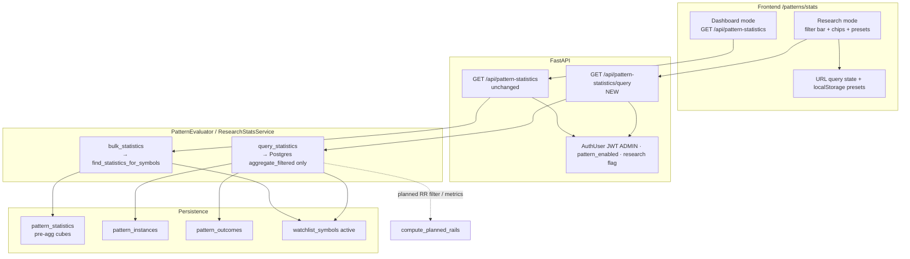

# Design: High-Probability Stack as Composable Filters (P0 Research Stats)

| Field | Value |
|-------|--------|
| **Document** | High-probability stack as composable filters |
| **Author** | TBD |
| **Date** | 2026-08-06 |
| **Status** | **Implemented** (P0) — see code roots below; design rev 3 |
| **Scope** | **P0 only** — filtered research stats + Stats UI Research mode |
| **Related** | `docs/design-patterns-stack-and-filtered-stats.md` (full roadmap P0–P5), `docs/modules/journal.md`, `docs/PRODUCT-DECISIONS.md` |
| **Code roots** | `backend/app/journal/`, `backend/app/api/pattern_statistics.py`, `backend/app/patterns/evaluator.py`, `frontend/src/pages/PatternStatsPage.jsx` |

---

## Overview

Today’s Pattern Stats Dashboard reads pre-aggregated rows from `pattern_statistics`, keyed only by `(symbol_id, pattern_type, timeframe)`. That cannot answer research questions such as “what is resolved win rate for breakouts that retested, had volume OK, and detected between 09:30–15:00 IST?”

This design introduces **query-time aggregation over raw journal rows** (`pattern_instances` ⨝ `pattern_outcomes`) driven by **composable UI filters**. The high-probability “stack” is not a hardcoded grade; it is a **named filter preset** (e.g. Retest + Volume + session window) whose application recomputes S/F/E, rates, path metrics, planned rails, and expectancy on the matching instance set.

P0 ships: a new research API, Postgres aggregation path, Research mode on `/patterns/stats`, shareable URL state, localStorage presets, and default stack hypotheses. Explicitly **out of P0**: new detectors, persisted confluence grades, cross-instance near-pattern joins, index regime, news calendar, full historical backtester, and **open-instance inclusion**.

---

## Background & Motivation

### Current state

| Layer | Behavior | Key files |
|-------|----------|-----------|
| Schema | Instances, events, outcomes, pre-agg stats | `backend/db/migration/V2__pattern_journal.sql`, `backend/app/journal/entities.py` |
| Write path | Terminal outcomes update stats via `_upsert_statistics` | `PostgresPatternJournal` |
| Read API | `GET /api/pattern-statistics?patternType=&timeframe=` | `backend/app/api/pattern_statistics.py` → `PatternEvaluator.bulk_statistics` |
| FE | Dense ranking table; client filters only type/TF/symbol/ready | `PatternStatsPage.jsx`, `patternStatisticsApi.ts` |
| Gate | Rates/means only when `sample_size >= stats_min_sample_size` (default 20) | `app/config.py`, `_snapshot_to_bulk_item` |
| Scope | Active watchlist symbols only | product rule in `bulk_statistics` |
| Journals | `PostgresPatternJournal` when `TIP_WATCHLIST_STORE=postgres`; **`InMemoryPatternJournal`** when memory (not NoOp) | `container.py` |

Formulas (from `docs/modules/journal.md`):

```text
sample_size   = success + fail + expired
success_rate  = success / sample_size          // inventory (includes expired)
resolved_n    = success + fail
resolved_success_rate = success / resolved_n   // performance (excludes expired)
// means only over non-null metric samples; startup_recovery skips excursion + rails stats
```

Plan R:R uses `compute_planned_rails` (`backend/app/patterns/planned_rails.py`): consolidation excluded; `avgPlannedRr = avg(reward_r) / avg(risk_r)` (ratio of averages).

### Pain points

1. **Cannot slice by lifecycle quality** — `flag_retested`, `volume_ok_at_detect`, etc. exist on instances but not on the stats key.
2. **Cannot slice by session quality** — user wants detect window 09:30–15:00 IST; only `detected_at` / `detect_candle_time` on instances support this.
3. **Cannot combine factors into a stack** — “retest + volume + planned RR ≥ 1.5” requires multi-predicate aggregation.
4. **Client-side filtering of bulk JSON is insufficient** — it only subsets already-baked buckets; it cannot recompute rates under new predicates (see deferred roadmap §5.7).
5. **False confidence risk after filters** — n collapses; UI must still show counts and ready gate.

### Why P0 before confluence grades / classical patterns

The deferred roadmap (`docs/design-patterns-stack-and-filtered-stats.md`) recommends **discovering** which combinations raise WR on *this* NSE watchlist journal before freezing a grade formula (P1) or adding H&S / double bottom (P2+). Filters-as-stack is the discovery tool.

---

## Goals & Non-Goals

### Goals

1. Enumerate and implement a complete **filter catalog** over existing instance/outcome fields (no schema change for v1 core path).
2. **Recompute metrics** from filtered instance ⨝ outcome sets with formulas aligned to journal.md, plus expectancy and win/loss split move.
3. Add **`GET /api/pattern-statistics/query`** (research); leave bulk endpoint unchanged for cheap Dashboard.
4. Ship **Research mode** on Pattern Stats with filter bar, chips, presets, shareable URL, research disclaimers.
5. Propose **named default stack presets** that encode high-probability hypotheses using only existing fields.
6. Stay within **watchlist-sized** performance budgets; primary path Postgres; **default date lookback bounds scans**.

### Non-Goals (P0)

| Non-goal | Notes |
|----------|--------|
| New pattern detectors | H&S, double bottom, HTF flag → roadmap P2–P4 |
| Persisted `confluence_score` / grade | P1 after P0 findings |
| Cross-instance near-pattern join | e.g. breakout near engulfing within N bars — v1.1+ if needed |
| Index-regime / Nifty context | Not in journal |
| News / event calendar | External |
| Full multi-year market-wide backtester | Separate product item |
| Replacing `pattern_statistics` table | Keep for Dashboard |
| Live / paper fill equivalence | Virtual journal outcomes ≠ paper/live fills — always disclosed |
| Claiming fixed “90% pattern” in copy | Empirical only |
| **Including open instances** (`includeOpen`) | Deferred past P0 — rates need outcomes; INNER JOIN only |

---

## Proposed Design

### Architecture



### Data flow (research query)

```mermaid
sequenceDiagram
  participant UI as PatternStatsPage Research
  participant API as /api/pattern-statistics/query
  participant EV as PatternEvaluator
  participant J as PostgresPatternJournal
  participant DB as Postgres

  UI->>API: GET filters + groupBy + minSampleSize
  API->>API: AuthUser ADMIN, pattern_enabled, research flag, validate caps
  API->>EV: query_statistics(FilterSpec)
  EV->>EV: require Postgres journal; resolve active watchlist
  EV->>J: aggregate_filtered(spec, symbol_ids)
  J->>DB: SELECT aggregates + summary FROM instances INNER JOIN outcomes
  Note over J,DB: IST via single AT TIME ZONE Asia/Kolkata;<br/>rails SQL oracle-tested vs compute_planned_rails
  J-->>EV: groups + summary + totalMatched + truncated
  EV->>EV: map status ok vs insufficient_history; attach labels
  EV-->>API: full research response
  API-->>UI: JSON
  UI->>UI: summary strip + table + chips
```

### Core principle

**Never filter or slice `pattern_statistics` for research dimensions.** That table is a running aggregate with a fixed grain. Research always starts from:

```sql
FROM pattern_instances i
INNER JOIN pattern_outcomes o ON o.pattern_instance_id = i.id
WHERE i.symbol_id = ANY(:watchlist_ids)
  AND i.status IN ('succeeded', 'failed', 'expired')
  AND /* filter predicates including default date lookback */
GROUP BY /* groupBy mode */
```

**P0 population: closed instances only** (outcome present). Open instances are **out of scope** for P0 (no `includeOpen` param).

---

## 1. Complete Filter Catalog

### Legend

| Column | Meaning |
|--------|---------|
| **Tier** | `v1` must-have · `v1.1` nice · `oos` out of scope / needs new data |
| **UI** | Control type |
| **Param** | Query string name (camelCase, match existing API style) |
| **Source** | SQL column / compute |
| **Closed?** | P0 is always closed; column retained for future open support docs |

### Multi-value encoding (authoritative)

**Two different parse paths** — do not use one “CSV parse everything” helper for all params.

#### Multi-value filters (comma-split allowlist)

Applies **only** to: `symbolId`, `patternType`, `timeframe`, `confirmationMode`, `outcome`, `excludeReasons`, `includeReasons`, `detectorVersion` (and v1.1 multi lists).

```text
patternType=breakout,volume_breakout
timeframe=5m,15m,1h
excludeReasons=startup_recovery,session_close,session_end
```

- BE: `split(",")` → trim → reject empty → validate allowlist → 400 on unknown.
- FE: serializer in `researchFilters.ts`; do **not** use repeated keys (`?a=1&a=2`) in v1.

#### `groupBy` — dedicated enum parse (never comma-split)

`groupBy` allowed values **contain commas**. Parse **only** via exact match on the raw URL-decoded string against a frozen allowlist. **Never** pass `groupBy` through the multi-value CSV splitter.

Allowed values exactly (full string match):

| Raw query value | Meaning |
|-----------------|---------|
| `symbol,patternType,timeframe` | Default Dashboard grain |
| `patternType,timeframe` | Type+TF rollup |
| `patternType` | Type only |
| `none` | Global single row |
| `hourBucket` | v1.1 only |

```python
# research_filters.py — contract
GROUP_BY_ALLOWED = frozenset({
    "symbol,patternType,timeframe",
    "patternType,timeframe",
    "patternType",
    "none",
    # "hourBucket",  # v1.1
})

def parse_group_by(raw: str | None) -> str:
    if raw is None or raw.strip() == "":
        return "symbol,patternType,timeframe"
    key = raw.strip()  # after URL-decode; do NOT split on comma
    if key not in GROUP_BY_ALLOWED:
        raise ValidationError("invalid groupBy")
    return key
```

FE: serialize with `encodeURIComponent(groupByEnum)` as a single value (e.g. `groupBy=symbol%2CpatternType%2Ctimeframe`).

### A. Universe / identity

| Filter | Tier | UI | Param | Source | Default | Edge cases |
|--------|------|-----|-------|--------|---------|------------|
| Symbol multi-select | v1 | Multi-select / chips from active watchlist | `symbolId` | `i.symbol_id` | All **active** watchlist symbols | Empty watchlist → empty result. Unknown ids after intersect → if none left, empty 200 (not 400). Soft-deleted never in active list. Max 200 after intersect. |
| Symbol search (client) | v1 | Text input | *(client-only; not in URL API filters)* | labels | — | Does not hit API |
| Include removed symbols | oos | — | — | — | — | Product keeps stats on active watchlist |

### B. Pattern / timeframe / direction

| Filter | Tier | UI | Param | Source | Default | Edge cases |
|--------|------|-----|-------|--------|---------|------------|
| Pattern type multi | v1 | Multi-select | `patternType` | `i.pattern_type` | all types | Valid: `breakout`, `breakdown`, `consolidation`, `volume_breakout`, `hammer`, `shooting_star`, `bullish_engulfing`, `bearish_engulfing`, `inside_bar`, `higher_high`, `lower_low`. Invalid → 400. |
| Timeframe multi | v1 | Multi-select | `timeframe` | `i.timeframe` | all | `1m`,`5m`,`15m`,`1h`,`4h`,`1d`. Product often disables `1m` in detector config; still filterable if historical rows exist. |
| Direction | v1 | Any / Long / Short | `direction` | `i.direction` | omit = any | Only `long`\|`short` |
| Status multi | v1.1 | Multi | `status` | `i.status` | n/a in P0 (always closed) | P0 forces closed statuses |
| Open instances | **oos (P0)** | — | ~~`includeOpen`~~ | — | — | **Not in P0 API.** Deferred |

### C. Lifecycle quality flags

| Filter | Tier | UI | Param | Source | Default | Edge cases |
|--------|------|-----|-------|--------|---------|------------|
| Confirmed | v1 | Tri-state Any/Yes/No | `flagConfirmed` | `i.flag_confirmed` | omit = any | `true`/`false` only when set |
| Retested | v1 | Tri-state | `flagRetested` | `i.flag_retested` | omit | High-value stack factor |
| Strengthened | v1 | Tri-state | `flagStrengthened` | `i.flag_strengthened` | omit | |
| Retest floor present | v1.1 | Tri-state | `hasRetestFloor` | `i.retest_floor IS NOT NULL` | omit | ≠ flag_retested |
| Sessions seen min | v1.1 | Number | `minSessionsSeen` | `i.sessions_seen` | omit | Multi-day patterns |

### D. Volume / confirmation mode

| Filter | Tier | UI | Param | Source | Default | Edge cases |
|--------|------|-----|-------|--------|---------|------------|
| Volume OK at detect | v1 | Tri-state | `volumeOkAtDetect` | `i.volume_ok_at_detect` | omit | False under close_fallback |
| Confirmation mode | v1 | Multi | `confirmationMode` | `i.confirmation_mode_used` | omit | `volume`, `close`, `both`, `close_fallback`. NULL excluded when filter set |
| Min volume at detect | v1.1 | Number | `minVolumeAtDetect` | `i.volume_at_detect` | omit | Absolute shares only |
| Relative volume vs SMA20 | oos | — | — | not stored | — | |

### E. Session / calendar time

| Filter | Tier | UI | Param | Source | Default | Edge cases |
|--------|------|-----|-------|--------|---------|------------|
| Detect candle IST TOD start | v1 | Time `HH:mm` | `detectTimeIstStart` | IST minute of `detect_candle_time` | omit (presets may set) | Empty Research: **no** default TOD (presets-only). Inclusive window with end. |
| Detect candle IST TOD end | v1 | Time `HH:mm` | `detectTimeIstEnd` | same | omit | **Inclusive end** (15:00 includes minute 15:00). Both required if either set → 400 if only one. Cross-midnight not supported. |
| Detect date from | v1 | Date | `detectedFrom` | IST **date** of detect candle | **default: today_IST − 180d** if both omitted | See date policy |
| Detect date to | v1 | Date | `detectedTo` | same | **default: today_IST** if both omitted | Inclusive end date |
| Day of week | v1.1 | Multi | `detectDowIst` | DOW of detect candle IST | omit | |
| Wall-clock `detected_at` range | v1.1 | DateTime | `detectedAtFrom/To` | `i.detected_at` | omit | Lag / hydrate differ from candle |

#### Date-range policy (P0 — bounds default scans)

`today_IST` = calendar date of `datetime.now(ZoneInfo("Asia/Kolkata")).date()` on the server (not UTC date, not client local date).

| Case | Behavior (deterministic — no “clamp or 400”) |
|------|----------|
| Both `detectedFrom` and `detectedTo` omitted | Apply **default lookback**: `[today_IST − research_stats_default_lookback_days, today_IST]` where default lookback = **180**. Response **always** echoes effective bounds in `filters.detectedFrom` / `filters.detectedTo` and `summary.scannedFrom` / `scannedTo`. |
| Only `detectedFrom` set | If `detectedFrom > today_IST` → **400**. Else set `detectedTo = min(today_IST, detectedFrom + 180 days)`. |
| Only `detectedTo` set | If `detectedTo > today_IST` → **400**. Else set `detectedFrom = detectedTo − 180 days`. |
| Both set | If either date `> today_IST` → **400**. If `detectedFrom > detectedTo` → **400**. If `(detectedTo − detectedFrom) > 180` days → **400**. No silent clamp when both provided. |
| After completion | Assert `detectedFrom ≤ detectedTo`; if not → **400** (should not happen if rules above applied). |

**Rationale for 400 on future dates (not clamp):** explicit client/URL errors stay visible; silent clamp of future “to” would hide bad share links.

#### IST conversion (authoritative — single expression)

Reuse `_as_epoch_seconds` from `postgres_journal.py` (ms ≥ `1_000_000_000_000` → seconds).

**Python (oracle / unit tests):**

```python
def detect_local_ist(detect_candle_time: int) -> datetime:
    sec = _as_epoch_seconds(detect_candle_time)
    return datetime.fromtimestamp(sec, tz=timezone.utc).astimezone(ZoneInfo("Asia/Kolkata"))

def detect_minute_of_day_ist(detect_candle_time: int) -> int:
    dt = detect_local_ist(detect_candle_time)
    return dt.hour * 60 + dt.minute
```

**Postgres (authoritative SQL — do NOT double `AT TIME ZONE`):**

`to_timestamp(seconds)` returns `timestamptz`. One `AT TIME ZONE 'Asia/Kolkata'` yields local wall time as `timestamp without time zone` (correct IST clock face).

```sql
-- Shared scalar for detect candle → IST local timestamp (no tz)
(
  to_timestamp(
    CASE
      WHEN i.detect_candle_time >= 1000000000000
        THEN i.detect_candle_time / 1000.0
      ELSE i.detect_candle_time::double precision
    END
  ) AT TIME ZONE 'Asia/Kolkata'
) AS detect_ist_local
```

**TOD filter (inclusive both ends):**

```sql
(
  EXTRACT(HOUR FROM detect_ist_local)::int * 60
  + EXTRACT(MINUTE FROM detect_ist_local)::int
) BETWEEN :start_min AND :end_min
```

**Calendar day filter (inclusive both ends):**

```sql
(detect_ist_local)::date BETWEEN :detectedFrom AND :detectedTo
```

Golden tests (required): known epoch → IST hour/minute (09:29 exclude, 09:30 include, 15:00 include, 15:01 exclude); sec **and** ms fixtures; IST midnight date boundary.

Mirror alerts’ `_IST = ZoneInfo("Asia/Kolkata")` culture (`list_session_day_alerts`). NSE cash ~09:15–15:30 IST; product example window **09:30–15:00**.

#### Session filter TF policy (locked)

| TF | When TOD filter is set |
|----|------------------------|
| `1m` / `5m` / `15m` / `1h` | Apply TOD predicate |
| `4h` | Apply TOD predicate + **UI warning** (weak meaning) |
| `1d` | **Exclude row entirely** when TOD start/end is set (`i.timeframe <> '1d'` required). UI copy: “Session time filter excludes 1d.” |

Do **not** “ignore TOD for 1d but keep the row” — that mixed semantics confuses presets with multi-TF.

### F. Rails / planned risk-reward

| Filter | Tier | UI | Param | Source | Default | Edge cases |
|--------|------|-----|-------|--------|---------|------------|
| Min planned RR | v1 | Number | `minPlannedRr` | `planned_rr` expr | omit | **Implies valid rails** (null rails excluded). Same as `requireValidRails` for inclusion. |
| Max planned RR | v1.1 | Number | `maxPlannedRr` | same | omit | Also implies valid rails |
| Min risk R | v1.1 | Number | `minRiskR` | `risk_r` | omit | |
| Max risk R | v1.1 | Number | `maxRiskR` | `risk_r` | omit | |
| Min reward R | v1.1 | Number | `minRewardR` | `reward_r` | omit | |
| Min ATR at detect | v1.1 | Number | `minAtr` | `i.atr_at_detect` | omit | |
| Require valid trade offer | v1 | Toggle | `requireValidRails` | rails IS NOT NULL | false | Explicit; redundant with minPlannedRr when that is set |

**Compute (Python oracle = `compute_planned_rails`):**

```text
exclude consolidation
require atr > 0, finite entry/stop/target
risk   = |entry − stop| > 0
reward = (entry − target) if short else (target − entry); require reward > 0
risk_r    = risk / atr
reward_r  = reward / atr
planned_rr = reward / risk     # NOT risk/reward
```

**Complete SQL expressions (test-oracled against Python):**

```sql
-- Intermediate
risk AS (
  abs(i.entry_price - i.stop_level)
),
reward AS (
  CASE WHEN lower(i.direction) = 'short'
       THEN i.entry_price - i.target_level
       ELSE i.target_level - i.entry_price
  END
),
rails_valid AS (
  lower(i.pattern_type) <> 'consolidation'
  AND i.atr_at_detect IS NOT NULL AND i.atr_at_detect > 0
  AND i.entry_price IS NOT NULL AND i.stop_level IS NOT NULL AND i.target_level IS NOT NULL
  AND abs(i.entry_price - i.stop_level) > 0
  AND (
    CASE WHEN lower(i.direction) = 'short'
         THEN i.entry_price - i.target_level
         ELSE i.target_level - i.entry_price
    END
  ) > 0
),
risk_r AS (
  CASE WHEN rails_valid THEN abs(i.entry_price - i.stop_level) / i.atr_at_detect END
),
reward_r AS (
  CASE WHEN rails_valid THEN
    (CASE WHEN lower(i.direction) = 'short'
          THEN i.entry_price - i.target_level
          ELSE i.target_level - i.entry_price
     END) / i.atr_at_detect
  END
),
planned_rr AS (
  CASE WHEN rails_valid THEN
    (CASE WHEN lower(i.direction) = 'short'
          THEN i.entry_price - i.target_level
          ELSE i.target_level - i.entry_price
     END) / abs(i.entry_price - i.stop_level)
  END
)
```

Filter `minPlannedRr`: `planned_rr IS NOT NULL AND planned_rr >= :minPlannedRr`.

Unit tests: long/short, consolidation → null, atr≤0, zero risk, non-positive reward, boundary 1.5.

### G. Outcome selection

| Filter | Tier | UI | Param | Source | Default | Edge cases |
|--------|------|-----|-------|--------|---------|------------|
| Outcome multi | v1 | Checklist S/F/E | `outcome` | `o.final_outcome` | all three | `succeeded`,`failed`,`expired` |
| Resolved only | v1 | Toggle | `resolvedOnly` | forces outcome ∈ {succeeded, failed} | **false** | See combination rules |
| Exclude reasons | v1 | Multi-select | `excludeReasons` | `o.reason` | omit | Allowlist below; unknown → 400 |
| Include reasons only | v1.1 | Multi | `includeReasons` | `o.reason` | omit | Mutually exclusive with exclude → 400 |
| Closed date range | v1.1 | Date | `closedFrom`/`closedTo` | `o.closed_at` | omit | |

#### Authoritative outcome reason allowlist (v1)

From detectors + expiry + startup (code-verified):

| Reason | Typical final_outcome | Source |
|--------|----------------------|--------|
| `price_target` | succeeded | breakout, breakdown, short_trade, pin/engulf paths |
| `invalidation` | failed | breakout, breakdown, short_trade |
| `expand_up` | succeeded | consolidation |
| `expand_down` | succeeded | consolidation |
| `max_duration` | failed | consolidation |
| `max_candles` | expired (or fail path on some detectors) | pinbar, engulfing, inside_bar, structure, volume_breakout, session_expiry |
| `session_close` | expired | `PatternEvaluator.expire_session_timeframes` |
| `session_end` | expired | `SessionExpiryReconciler.expire_on_session_close` |
| `max_sessions` | expired | session_expiry |
| `watchlist_remove` | expired | evaluator remove |
| `startup_recovery` | expired | startup hydrate; **skip means + rails** |

FE multi-select and BE validation share this closed list (module constant + FE constant mirror).

#### Combination rules (validation matrix)

| Inputs | Result |
|--------|--------|
| `resolvedOnly=true` alone | Effective outcomes = `{succeeded, failed}` |
| `resolvedOnly=true` + `outcome` subset of `{succeeded, failed}` | Intersect / use provided subset |
| `resolvedOnly=true` + `outcome` includes `expired` | **400** contradictory |
| `resolvedOnly=true` + `outcome=expired` only | **400** |
| `excludeReasons` + `includeReasons` both non-empty | **400** |
| `minPlannedRr` set | Null-rails instances excluded (implicit `requireValidRails`) |
| TOD start without end (or reverse) | **400** |
| Unknown enum token | **400** |

#### Metric skip for `startup_recovery` (full journal parity)

Match `_upsert_statistics` / `_planned_rr_extremes_for_bucket` / `recompute_planned_rails_stats`:

```text
skip_excursions = (o.reason = 'startup_recovery')
  # (suppress_excursion_stats only exists in-memory on ActivePattern;
  #  persisted path is representable via reason=startup_recovery)
```

When `skip_excursions`:

- Instance **remains** in S/F/E counts (unless `excludeReasons` removes it).
- **Excluded from:** `avgMoveR`, `avgMfeR`, `avgMaeR`, move/mfe/mae sample sizes, **and all planned-rails aggregates** (`avgRiskR`, `avgRewardR`, `avgPlannedRr`, min/max/median, `plannedRrSampleSize`).
- **Excluded from:** `expectancyR`, `avgWinMoveR`, `avgLossMoveR` (same move_r population).

`avgDurationCandles` still averages over all matched outcomes (journal includes duration for recovery rows).

### H. Path / duration quality

| Filter | Tier | UI | Param | Source | Default |
|--------|------|-----|-------|--------|---------|
| Min MFE R | v1.1 | Number | `minMfeR` | `o.max_favorable_r` | omit |
| Max MAE R | v1.1 | Number | `maxMaeR` | `o.max_adverse_r` | omit |
| Min move R | v1.1 | Number | `minMoveR` | `o.move_r` | omit |
| Min/max duration candles | v1.1 | Number | `minDurationCandles` / `maxDurationCandles` | `o.duration_candles` | omit |

**v1 stance:** path filters are **v1.1**. Label research-only if added (look-ahead risk if misread as entry filters).

### I. Detector version

| Filter | Tier | UI | Param | Source | Default |
|--------|------|-----|-------|--------|---------|
| Detector version multi | v1 | Multi | `detectorVersion` | `i.detector_version` | omit |

### J. Tier summary

| Tier | Filters |
|------|---------|
| **v1 must-have** | symbolId, patternType, timeframe, direction, flagConfirmed/Retested/Strengthened, volumeOkAtDetect, confirmationMode, detectTimeIstStart/End, detectedFrom/To (with default 180d lookback), minPlannedRr, requireValidRails, outcome, resolvedOnly, excludeReasons, detectorVersion, groupBy, minSampleSize, limitGroups |
| **v1.1 nice** | status multi, hasRetestFloor, minSessionsSeen, minVolumeAtDetect, detectDowIst, detectedAt range, maxPlannedRr, risk/reward/atr bounds, includeReasons, closed date, MFE/MAE/move/duration, hourBucket groupBy, compare presets, funnel |
| **Out of scope / needs data** | includeOpen, relative volume vs SMA, index regime, news, nearPattern join, confluence grade, classical geometry, CI bands |

---

## 2. Metrics Recomputed Under Filters

### Population

**M** = closed instances matching universe + instance + outcome filters (after default date lookback).

### Count metrics (always returned, even if thin)

| Field | Formula |
|-------|---------|
| `sampleSize` | \|M\| |
| `successCount` / `failCount` / `expiredCount` | by `final_outcome` |
| `resolvedSampleSize` | success + fail |

### Ready gate

- Ready when `sampleSize >= minSampleSize`.
- `minSampleSize` request param: **clamp to 5..500**; default = `settings.stats_min_sample_size` (20).
- `status`: `ok` if ready else `insufficient_history`.

### Rate metrics (null when not ready)

| Field | Formula | When null |
|-------|---------|-----------|
| `successRate` | success / sampleSize | not ready |
| `resolvedSuccessRate` | success / resolved_n if resolved_n > 0 else **null** | not ready **or** resolved_n=0 (e.g. all expired) |
| `expiredRate` | expired / sampleSize (optional) | not ready |

### Path / duration means

Exclude `startup_recovery` from move/MFE/MAE (see §1.G). Null metrics when not ready **or** sample size for that metric is 0.

| Field | Formula |
|-------|---------|
| `avgMoveR` / `avgMfeR` / `avgMaeR` | AVG over non-null non-skip |
| `avgDurationCandles` | AVG(duration_candles) over all M |
| `moveSampleSize` / `mfeSampleSize` / `maeSampleSize` | counts used |

### Planned rails (parity with journal)

Aggregate only where `rails_valid` **and not** `startup_recovery`:

| Field | Formula |
|-------|---------|
| `avgRiskR` / `avgRewardR` | AVG of risk_r / reward_r |
| `avgPlannedRr` | `avgRewardR / avgRiskR` if avgRiskR > 0 else null (**ratio of averages**) |
| `minPlannedRr` / `maxPlannedRr` / `medianPlannedRr` | over per-trade planned_rr (see SQL recipe below) |
| `plannedRrSampleSize` | count |

When not ready or `plannedRrSampleSize == 0` → planned fields null (match `_snapshot_to_bulk_item`).

**SQL recipe for per-trade planned RR extremes** (same filter for min/max/median: `rails_valid AND NOT skip_excursions` / `planned_rr IS NOT NULL`):

```sql
MIN(planned_rr) FILTER (WHERE rails_valid AND NOT skip_excursions)
  AS min_planned_rr,
MAX(planned_rr) FILTER (WHERE rails_valid AND NOT skip_excursions)
  AS max_planned_rr,
percentile_cont(0.5) WITHIN GROUP (ORDER BY planned_rr)
  FILTER (WHERE rails_valid AND NOT skip_excursions)
  AS median_planned_rr
```

**Median definition note:** Postgres `percentile_cont(0.5)` is a continuous percentile (may interpolate between the two middle values for even *n*). Python journal helper `median_planned_rr` also averages the two middles for even *n* (`planned_rails.py`). For research P0, **accept `percentile_cont(0.5)` as authoritative in SQL** — values match common even-*n* average-of-middles cases and are close enough when continuous interpolation differs. Unit tests may compare against Python median with a small epsilon (e.g. `1e-9` relative) rather than requiring bit-identical bulk-cube medians after every seed. Do **not** replace median with `AVG(planned_rr)`.

### New research metrics (v1)

| Field | Formula | Ready gate |
|-------|---------|------------|
| `expectancyR` | **Only** `AVG(move_r)` over resolved outcomes where `move_r IS NOT NULL` and not `startup_recovery` | Same as `avgMoveR`: **null when not ready**; also null when no eligible move samples |
| `avgWinMoveR` | AVG(move_r) where succeeded + non-null move + not skip | same ready gate; null if no win samples |
| `avgLossMoveR` | AVG(move_r) where failed + non-null move + not skip | same; typically ≤ 0 |

**Do not** claim equivalence to WR×avgWin+(1−WR)×avgLoss when `move_r` can be null — win/loss averages are **diagnostic only**.

### Response-level cardinality (locked)

| Field | Definition |
|-------|------------|
| `totalMatched` | `COUNT(*)` over filtered population **M** **before** group limit (true “n after filters”) |
| `totalGroups` | number of groups after GROUP BY, **before** `limitGroups` |
| `count` | `len(items)` actually returned (≤ limitGroups) |
| `truncated` | `true` if `totalGroups > count` |
| `summary` | Aggregates over full **M** (pre-limit) — see §3 |

### groupBy modes

| `groupBy` value | GROUP BY | Item identity |
|-----------------|----------|---------------|
| `symbol,patternType,timeframe` (**default**) | symbol_id, pattern_type, timeframe | Bulk table shape |
| `patternType,timeframe` | pattern_type, timeframe | `symbolId` = `"*"` |
| `patternType` | pattern_type | |
| `none` | none | Single global row |
| `hourBucket` | IST hour of detect candle | **v1.1** |

### Sort (research vs bulk)

**Research default sort (groups):** ready first → `resolvedSuccessRate` desc (nulls last) → `sampleSize` desc → symbol/type/tf stable tie-break.

Then apply `limitGroups` **after** this ORDER BY on the **outermost SQL SELECT** (deterministic truncation). Do not rely on CTE-internal `ORDER BY` alone (see §4).

**Note:** Bulk API uses ready → **`successRate`** → n (`_bulk_stats_sort_key`). Research intentionally prefers **resolved** rate. FE table default sort remains `resolvedSuccessRate` (already `PatternStatsPage`). Empty-filter research order may differ from bulk order even when metrics are close — document in UI legend.

---

## 3. API Design

### Keep unchanged

```http
GET /api/pattern-statistics?patternType=&timeframe=
```

- Auth: `AuthUser` (ADMIN / USER)  
- 503 if `pattern_enabled` false  
- Source: `pattern_statistics` via `bulk_statistics`  
- Tests: `backend/tests/api/test_pattern_statistics_shape.py` must stay green  

### New endpoint

```http
GET /api/pattern-statistics/query
```

**Why GET:** filter sets are shareable via URL; param count is manageable. Switch to POST only if URL length becomes a practical problem (not v1).

**Router:** extend `backend/app/api/pattern_statistics.py`.

#### Query parameters (P0)

| Param | Type | Notes |
|-------|------|-------|
| `symbolId` | string[] (CSV) | default = all active watchlist |
| `patternType` | string[] | |
| `timeframe` | string[] | |
| `direction` | `long`\|`short` | |
| `flagConfirmed` | bool | |
| `flagRetested` | bool | |
| `flagStrengthened` | bool | |
| `volumeOkAtDetect` | bool | |
| `confirmationMode` | string[] | |
| `detectTimeIstStart` | `HH:mm` | requires end |
| `detectTimeIstEnd` | `HH:mm` | inclusive; requires start |
| `detectedFrom` | `YYYY-MM-DD` | IST candle date; defaulted if omitted |
| `detectedTo` | `YYYY-MM-DD` | inclusive; defaulted if omitted |
| `outcome` | string[] | |
| `resolvedOnly` | bool | default false |
| `excludeReasons` | string[] | allowlist |
| `minPlannedRr` | float | implies valid rails |
| `requireValidRails` | bool | |
| `detectorVersion` | string[] | |
| `groupBy` | enum string | default `symbol,patternType,timeframe` |
| `minSampleSize` | int | default settings; **clamp 5..500** |
| `limitGroups` | int | default 500; max 2000 |

**Not in P0:** `includeOpen`.

#### Validation & caps

| Cap | Value | On violation |
|-----|-------|--------------|
| Date range | max **180** days; **default lookback 180** when omitted | 400 if explicit span > 180 |
| Symbols after watchlist intersect | max **200** | 400 if explicit list exceeds after intersect |
| `minSampleSize` | **5..500** (clamp) | clamp silently or 400 if <1 — **prefer clamp** |
| `limitGroups` | 1..2000; default 500 | clamp |
| Query timeout | `statement_timeout` **5s** | **503** with detail `Research query timed out` (single status; not 504) |
| Research flag off | | **503** `Research stats disabled` |
| Non-Postgres journal | | **503** `Pattern research requires Postgres journal` |

Empty active watchlist → `{ count: 0, totalMatched: 0, totalGroups: 0, truncated: false, summary: {...zeros}, items: [] }` (200).

#### Auth & settings

- Auth: **ADMIN only** on research endpoint (USER → **403**). Bulk stats remain ADMIN/USER.
- Kill switch under load: `TIP_PATTERN_RESEARCH_STATS_ENABLED` / VITE research flag → **503**.
- Patterns disabled → 503.
- Config (explicit aliases, mirror paper flags):

```python
pattern_research_stats_enabled: bool = Field(
    default=True, alias="TIP_PATTERN_RESEARCH_STATS_ENABLED"
)
research_stats_max_range_days: int = Field(
    default=180, alias="TIP_RESEARCH_STATS_MAX_RANGE_DAYS"
)
research_stats_default_lookback_days: int = Field(
    default=180, alias="TIP_RESEARCH_STATS_DEFAULT_LOOKBACK_DAYS"
)
research_stats_statement_timeout_ms: int = Field(
    default=5000, alias="TIP_RESEARCH_STATS_STATEMENT_TIMEOUT_MS"
)
```

Document in `frontend/.env.example` (VITE) and backend env / RENDER notes.

#### Response shape

```json
{
  "minSampleSize": 20,
  "groupBy": "symbol,patternType,timeframe",
  "totalMatched": 142,
  "totalGroups": 25,
  "count": 18,
  "truncated": true,
  "filters": {
    "detectedFrom": "2025-02-07",
    "detectedTo": "2026-08-06",
    "flagRetested": true,
    "volumeOkAtDetect": true,
    "detectTimeIstStart": "09:30",
    "detectTimeIstEnd": "15:00"
  },
  "summary": {
    "sampleSize": 142,
    "successCount": 40,
    "failCount": 55,
    "expiredCount": 47,
    "resolvedSampleSize": 95,
    "ready": true,
    "readyGroupCount": 12,
    "successRate": 0.282,
    "resolvedSuccessRate": 0.421,
    "expectancyR": 0.12,
    "avgMoveR": 0.12,
    "avgPlannedRr": 1.6,
    "scannedFrom": "2025-02-07",
    "scannedTo": "2026-08-06"
  },
  "disclaimer": "Research over virtual pattern-journal outcomes; not brokerage advice; not paper/live fills.",
  "items": [ /* same fields as bulk item + expectancyR, avgWinMoveR, avgLossMoveR */ ]
}
```

**`summary` rules:**

- Computed on full filtered set **M** (pre-`limitGroups`), **not** mean of group expectancies (avoids Simpson bias).
- Rate/expectancy/means in `summary` use the **same ready gate** on `summary.sampleSize` vs `minSampleSize` (`ready` flag). When not ready, rates/expectancy/means are null; counts still present.
- `readyGroupCount` = number of **returned** groups with `status=ok` (or pre-limit ready groups — prefer **pre-limit** for honesty when truncated; document as pre-limit).

Thin groups: S/F/E always; rates/means/expectancy null; `status: insufficient_history`.

#### Errors

| Code | Case |
|------|------|
| 401 | Not logged in |
| 400 | Invalid enum, bad time, contradictory filters, range > 180d |
| 503 | Patterns disabled; research flag off; non-Postgres journal; statement timeout |

#### Journal gate (precise)

| Runtime | Type | Research |
|---------|------|----------|
| `TIP_WATCHLIST_STORE=postgres` | `PostgresPatternJournal` | Supported |
| `TIP_WATCHLIST_STORE=memory` | **`InMemoryPatternJournal`** (not NoOp) | **503** — bulk may still work from in-process snaps |
| Stub | `NoOpPatternJournal` | **503** |

Do **not** use `journal.is_active()` alone (true for InMemory and Postgres). Detect via:

```python
# preferred
getattr(journal, "supports_research_aggregation", lambda: False)()
# PostgresPatternJournal → True; InMemory/NoOp → False
# or: settings.tip_watchlist_store == "postgres" and isinstance(..., PostgresPatternJournal)
```

InMemory Python aggregate is an explicit **non-goal** for v1.

---

## 4. Backend Implementation Approach

### Module layout

| Piece | Location |
|-------|----------|
| Filter DTO / parse / validate | `backend/app/patterns/research_filters.py` |
| Metric formulas (pure) | `backend/app/patterns/research_metrics.py` |
| Aggregation | `PostgresPatternJournal.aggregate_filtered` or `backend/app/journal/research_stats.py` |
| Orchestration + labels | `PatternEvaluator.query_statistics` |
| HTTP | `pattern_statistics.py` |
| Config | Settings fields with `TIP_*` aliases above |
| Outcome reason constant | `backend/app/patterns/outcome_reasons.py` (shared allowlist) |
| Tests | see Testing Plan / PR plan |

### Query strategy

Single SQL aggregation with conditional aggregates + a second pass or CTE for `summary` / `totalMatched` / `totalGroups`.

**Critical:** `ORDER BY` + `LIMIT` for `limitGroups` must live on the **outermost** `SELECT`. Postgres does **not** guarantee that `ORDER BY` inside a CTE is preserved by an outer `SELECT * FROM cte LIMIT n`. Do not put the only `ORDER BY` inside an `ordered` CTE.

```sql
WITH base AS (
  SELECT i.*, o.*,
         /* detect_ist_local, planned_rr, risk_r, reward_r,
            rails_valid, skip_excursions (reason = startup_recovery) */
  FROM pattern_instances i
  INNER JOIN pattern_outcomes o ON o.pattern_instance_id = i.id
  WHERE i.symbol_id = ANY(:ids)
    AND i.status IN ('succeeded', 'failed', 'expired')
    AND /* filters incl. date + optional TOD */
),
grouped AS (
  SELECT
    /* group keys depending on groupBy */,
    COUNT(*) AS sample_size,
    COUNT(*) FILTER (WHERE final_outcome = 'succeeded') AS success_count,
    /* ... other aggregates ... */
    MIN(planned_rr) FILTER (WHERE rails_valid AND NOT skip_excursions) AS min_planned_rr,
    MAX(planned_rr) FILTER (WHERE rails_valid AND NOT skip_excursions) AS max_planned_rr,
    percentile_cont(0.5) WITHIN GROUP (ORDER BY planned_rr)
      FILTER (WHERE rails_valid AND NOT skip_excursions) AS median_planned_rr
    /* resolved_success_rate may be computed in SQL or in Python from counts */
  FROM base
  GROUP BY /* groupBy columns */
)
-- Outer query is the ONLY sort+limit site (deterministic truncation)
SELECT *
FROM grouped
ORDER BY
  CASE WHEN sample_size >= :min_n THEN 0 ELSE 1 END,  -- ready first
  resolved_success_rate DESC NULLS LAST,              -- or compute from counts in ORDER BY
  sample_size DESC,
  /* stable tie-break — include only columns present for the groupBy mode: */
  symbol_id NULLS FIRST,
  pattern_type NULLS FIRST,
  timeframe NULLS FIRST
LIMIT :limit_groups;
```

Also compute (separate statements or CTEs without relying on CTE order):

```sql
SELECT COUNT(*) FROM base;                    -- totalMatched
SELECT COUNT(*) FROM grouped;                 -- totalGroups (before LIMIT)
SELECT ... same metrics as one global group ... FROM base;  -- summary
```

Aligns with §2 sort: ready → resolved WR → n → stable keys, then `limitGroups`.

**Planned RR:** per-row expressions + `percentile_cont` median as in §2; Python `compute_planned_rails` is the per-trade oracle in tests. Emergency fallback: fetch filtered rows and aggregate in Python only if SQL fails review — avoid for large n.

### Indexes

Existing (V2): symbol/type/tf/status, detected_at, fingerprint.

**Ship with P0 or immediately after HTTP (PR 4) — plain indexes (no CONCURRENTLY):**

This repo’s `apply_flyway_sql` runs migrations inside `engine.begin()` (one transaction). PostgreSQL **rejects** `CREATE INDEX CONCURRENTLY` inside a transaction. Use:

```sql
-- V10__pattern_research_indexes.sql
CREATE INDEX IF NOT EXISTS idx_pi_research_closed
  ON pattern_instances (symbol_id, pattern_type, timeframe, detect_candle_time)
  WHERE status IN ('succeeded', 'failed', 'expired');

CREATE INDEX IF NOT EXISTS idx_po_reason
  ON pattern_outcomes (reason)
  WHERE reason IS NOT NULL;

CREATE INDEX IF NOT EXISTS idx_po_final_outcome
  ON pattern_outcomes (final_outcome);
```

Acceptable for watchlist-sized tables. Optional later: generated `detect_minute_ist` column if TOD dominates cost.

**Indexes are recommended for first FE ship** because default lookback is 180d (bounded but non-trivial). Not “optional forever.”

### Performance budget

| Assumption | Estimate |
|------------|----------|
| Active watchlist | ~20–100 symbols |
| Default scan window | **180 days** detect-candle IST |
| Target p95 | ≤ 800 ms cold, ≤ 300 ms warm |
| Hard timeout | 5 s → 503 |

If exceeded: narrower date, fewer groups, indexes, or **hot preset response cache** (see Alternatives).

### In-memory journal

See §3 Journal gate. Dashboard bulk continues to use `InMemoryPatternJournal` snaps in memory profile; research does not.

---

## 5. Frontend UX

### Placement

Route **`/patterns/stats`**. Mode toggle:

| Mode | Data source | Use |
|------|-------------|-----|
| **Dashboard** (default) | `GET /api/pattern-statistics` | Cheap ranking |
| **Research** | `GET /api/pattern-statistics/query` | Stack filters |

FE flag: `VITE_FEATURE_PATTERN_RESEARCH_STATS` default **ON** (`envTruthy` pattern in `featureFlags.ts`). When off, hide Research toggle.

### Research layout

```
┌ Header: …  [Dashboard | Research] ┐
├ Disclaimer banner                    ┤
├ Filter bar (collapsible mobile)      ┤
├ Chips + Clear + Copy link + Save     ┤
├ Presets row                          ┤
├ Summary strip from response.summary  ┤
│  totalMatched · ready groups ·       │
│  resolved WR · expectancy (gated)    │
└ Table (+ Expectancy / Win R / Loss R)┘
```

Summary strip **must** use `response.summary` (not average of row expectancies).

### Filter bar behavior

- **Apply** button (no auto-query storm); URL updates on Apply.
- Chips remove individual filters.
- Ready-only client checkbox retained; **URL-backed**.
- Sort options include `expectancyR`, `avgWinMoveR`; **URL-backed** `sort`.
- Empty Research: **no** default TOD window (only presets inject 09:30–15:00).
- `resolvedOnly` default **OFF** in empty Research.
- Session TOD + 4h: show soft warning; 1d excluded when TOD set.

#### Date pickers / “today” (locked — avoid client TZ drift)

**Preferred (P0 default):** On first Research load when the URL has **no** `detectedFrom`/`detectedTo`:

1. Call the query API **without** date params (server applies `today_IST` lookback).
2. Hydrate date pickers from the response echo: `filters.detectedFrom` / `filters.detectedTo` (or `summary.scannedFrom` / `scannedTo`).
3. Subsequent Apply / Copy link uses those explicit dates so share URLs are stable.

**Do not** initialize pickers from `new Date()` local calendar alone (US/EU midnight ≠ IST day).

**Optional client-side IST today** (only if UI must show dates before the first response, e.g. skeleton):

```ts
// Asia/Kolkata calendar date — never bare Date#toISOString().slice(0,10) for "today"
function todayIstYmd(now = new Date()): string {
  return new Intl.DateTimeFormat('en-CA', {
    timeZone: 'Asia/Kolkata',
    year: 'numeric',
    month: '2-digit',
    day: '2-digit',
  }).format(now) // en-CA → YYYY-MM-DD
}
```

FE unit test: mock `now` near IST midnight and assert `todayIstYmd` matches server `today_IST` policy; assert hydrate-from-response path overwrites any provisional picker values.

### Shareable URL (locked contract)

| Rule | Detail |
|------|--------|
| Mode | Always include `mode=dashboard` or `mode=research` |
| Research params | **Ignored** unless `mode=research` |
| Dashboard | Does not require URL filters; if only legacy client state, fine. Landing with research params without `mode=research` → treat as dashboard (ignore research keys) |
| Multi-value filters | Comma-separated only for multi-lists (see §1); **not** used for `groupBy` |
| `groupBy` | Exact enum string; `encodeURIComponent` whole value; BE matches allowlist without splitting |
| URL-backed | All v1 API filters + `sort` + `readyOnly` + `minSampleSize` + `limitGroups` |
| Not URL-backed | Client symbol label search only |

Example:

```text
/patterns/stats?mode=research&flagRetested=true&volumeOkAtDetect=true&detectTimeIstStart=09%3A30&detectTimeIstEnd=15%3A00&groupBy=patternType%2Ctimeframe&resolvedOnly=true&sort=resolvedSuccessRate&readyOnly=false
```

### Presets (localStorage)

Key: `tip.patternResearch.presets.v1` → `{ name, filters, updatedAt }[]` (max ~20 user). Built-ins from §6.

### Comparison

v1.1 only.

### Disclaimers

> Research mode recomputes statistics from the **virtual pattern journal** (detector outcomes), not paper or live fills. Filters simulate a “stack”; small n after filters is common — rates unlock at n ≥ minSampleSize. Session time uses **detect candle** in IST; **1d excluded** when session filter is on. Default scan is last **180** days. Not trade advice.

### Mobile

Filter bar accordion/sheet; horizontal table scroll; preset chips scroll; touch ≥ 40px.

### Files to touch

| File | Change |
|------|--------|
| `patternStatisticsApi.ts` | query client + full types + `summary` |
| `featureFlags.ts` | `isPatternResearchStatsEnabled` |
| `utils/researchFilters.ts` | serialize/parse URL ↔ params (shared contract) |
| `PatternStatsPage.jsx` / css | modes, filters, summary, table |
| Optional splits | `ResearchFilterBar.jsx`, `ResearchSummaryStrip.jsx` |

---

## 6. Stack Presets (Default Hypotheses)

Built-in FE constants. All respect default 180d lookback unless they set dates.

| # | Name | Filters (intent) | Hypothesis |
|---|------|------------------|------------|
| 1 | **Retest + Volume + Session** | `flagRetested=true`, `volumeOkAtDetect=true`, `detectTimeIstStart=09:30`, `detectTimeIstEnd=15:00`, `excludeReasons=startup_recovery`, `timeframe=5m,15m,1h` | Liquid-session volume retests outperform raw detects |
| 2 | **Full lifecycle quality** | `flagConfirmed=true`, `flagRetested=true`, optional strengthened, exclude `startup_recovery` | Full stage progression |
| 3 | **Resolved only (performance)** | `resolvedOnly=true`, `excludeReasons=startup_recovery,session_close,session_end` | Strip expiry noise (**both** session_close and session_end) |
| 4 | **Plan R:R ≥ 1.5 breakouts** | `patternType=breakout,volume_breakout`, `minPlannedRr=1.5` (implies valid rails) | Better planned asymmetry |
| 5 | **Long breakout quality** | breakout + long + retested + volume + session window | Directional long stack |
| 6 | **Short / breakdown quality** | breakdown + short + retested + volume + session | Short mirror |
| 7 | **Intraday pin & engulf** | pin+engulf types, `5m,15m`, session, resolvedOnly | Candle family under session quality |
| 8 | **Clean exclude recovery** | `excludeReasons=startup_recovery` only | Hygiene baseline vs default scan |

---

## 7. Explicit Non-Goals (Recap)

- No new detectors / geometry / type CHECK migrations in P0.
- No confluence grade columns or alert “A+ only”.
- No near-pattern join in P0.
- No index regime, news, relative volume SMA.
- No full backtester.
- Do not rewrite bulk cube path.
- Do not present virtual WR as paper OMS expectancy.
- **No open-instance research in P0.**

---

## API / Interface Changes

### Backend

```python
def query_statistics(self, spec: ResearchFilterSpec) -> dict:
    """Returns minSampleSize, groupBy, totalMatched, totalGroups, count, truncated,
    filters (echo effective), summary, disclaimer, items."""

def supports_research_aggregation(self) -> bool:  # on journal
    ...
```

### Frontend

```typescript
export type ResearchFilterParams = {
  symbolId?: string[]
  patternType?: string[]
  timeframe?: string[]
  direction?: 'long' | 'short'
  flagConfirmed?: boolean
  flagRetested?: boolean
  flagStrengthened?: boolean
  volumeOkAtDetect?: boolean
  confirmationMode?: string[]
  detectTimeIstStart?: string
  detectTimeIstEnd?: string
  detectedFrom?: string
  detectedTo?: string
  outcome?: string[]
  resolvedOnly?: boolean
  excludeReasons?: string[]
  minPlannedRr?: number
  requireValidRails?: boolean
  detectorVersion?: string[]
  groupBy?:
    | 'symbol,patternType,timeframe'
    | 'patternType,timeframe'
    | 'patternType'
    | 'none'
  minSampleSize?: number
  limitGroups?: number
}

/** UI-only (URL-backed but not all sent to API) */
export type ResearchUiState = ResearchFilterParams & {
  sort?: string
  readyOnly?: boolean
}

export type ResearchSummary = {
  sampleSize: number
  successCount: number
  failCount: number
  expiredCount: number
  resolvedSampleSize: number
  ready: boolean
  readyGroupCount: number
  successRate: number | null
  resolvedSuccessRate: number | null
  expectancyR: number | null
  avgMoveR: number | null
  avgPlannedRr: number | null
  scannedFrom: string
  scannedTo: string
}

export type PatternStatisticsQueryResponse = {
  minSampleSize: number
  groupBy: string
  totalMatched: number
  totalGroups: number
  count: number
  truncated: boolean
  filters: Record<string, unknown>
  summary: ResearchSummary
  disclaimer: string
  items: PatternStatisticsItem[]  // + expectancyR, avgWinMoveR, avgLossMoveR
}
```

---

## Data Model Changes

**v1: no business schema changes.** Index-only migration V10 as above (transactional `CREATE INDEX IF NOT EXISTS`).

P1 may add confluence columns — out of scope.

---

## Alternatives Considered

### A. Client-side only

Rejected — payload/growth, duplicates logic (roadmap §5.7).

### B. Expand pre-aggregated cubes

Rejected for P0 — combinatorial explosion.

### C. Query-time SQL aggregation (chosen)

Correct and flexible; needs caps, default lookback, indexes, oracle tests.

### D. Materialized views

Deferred until metrics show pain.

### E. Hot preset response cache

After production metrics prove need, cache the 8 built-in preset query results server-side (short TTL). Not P0.

---

## Security & Privacy Considerations

| Topic | Approach |
|-------|----------|
| Auth | JWT `AuthUser`; **research query + Research UI = ADMIN only**; bulk Dashboard = ADMIN/USER |
| Kill switch under load | **Research BE + VITE flags** → 503; role gate is separate (403) |
| Pattern kill switch | `pattern_enabled=false` → 503 |
| Injection | Parameterized SQL; allowlists |
| Abuse | Default 180d lookback, max range, group limit, 5s timeout; ADMIN-only reduces blast radius |
| Memory profile | Research 503 without Postgres; USER never hits research SQL |
| Advice | API + UI disclaimer |

Optional later: rate-limit research route.

---

## Observability

| Signal | Detail |
|--------|--------|
| Logs | `research_stats query groupBy=… totalMatched=… duration_ms=… truncated=… filters_hash=…` |
| Metrics | duration, status counts, timeout count |
| FE | Error banner; thin-sample copy; truncated groups notice |

---

## Rollout Plan

1. BE settings with `TIP_*` aliases; default enabled in local.  
2. Ship PR1–3 (helpers → SQL → HTTP) + parity/timeout tests.  
3. Ship V10 indexes before or with first FE (bounded 180d scans).  
4. FE flag default ON; Dashboard remains default mode.  
5. Rollback: VITE off and/or `TIP_PATTERN_RESEARCH_STATS_ENABLED=false` → 503; bulk untouched.

---

## Risks

| Risk | Severity | Mitigation |
|------|----------|------------|
| Small n → false confidence | **High** | Ready gate; S/F/E always; summary gated; disclaimer |
| IST SQL / ms-sec bugs | **High** | Single AT TIME ZONE formula; golden tests; Python oracle |
| Planned RR SQL inverted | **High** | Full expression + oracle tests long/short |
| startup_recovery rails skew | **High** | Skip rails + path metrics; parity test vs bulk |
| Query cost | Medium | Default 180d, indexes, 5s timeout, Apply button |
| Truncation hiding groups | Medium | `truncated` + `totalGroups` + stable ORDER BY |
| Lookahead path filters | Medium | v1.1 only |
| Overfitting presets | Medium | Multiple presets; n visible; no 90% claims |
| Sort differs from bulk | Low | Document resolved vs success rate sort |
| InMemory vs Postgres confusion | Low | Explicit 503 + type gate |

---

## Key Decisions

| Decision | Choice | Rationale |
|----------|--------|-----------|
| Aggregation source | Query-time instances ⨝ outcomes | Cubes lack dimensions |
| Keep bulk endpoint | Unchanged | Cheap Dashboard |
| API style | GET `/api/pattern-statistics/query` | Shareable URLs |
| Session clock | `detect_candle_time` → IST via **one** `AT TIME ZONE 'Asia/Kolkata'` | Correct PG semantics; matches Python |
| TOD end inclusivity | **Inclusive** | “Until 15:00” mental model |
| TOD + `1d` | **Exclude 1d rows** when TOD set | Clear UX; not “ignore filter keep row” |
| TOD + `4h` | Apply + UI warning | Weak but still defined |
| Empty Research TOD | **No default TOD** (presets only) | Avoid surprising n collapse |
| Date default | **Last 180 IST days** when range omitted | Bound scans |
| Max date span | 180 days | Cap cost |
| Population | **Closed only**; no `includeOpen` in P0 | Rates need outcomes |
| Excursion + rails skip | `startup_recovery` excluded from path **and** planned-rails aggregates | Full journal parity |
| Plan R:R formula | `reward/risk`; aggregate ratio of averages | `planned_rails.py` |
| `minPlannedRr` | Implies valid rails | Avoid null comparisons |
| Expectancy | AVG(move_r) only; ready-gated like avgMoveR | No false WR×avg equivalence |
| `minSampleSize` | Clamp **5..500**; default 20 | Exploration floor + parity with settings |
| `resolvedOnly` default | **false** | Inventory view; preset #3 turns on |
| `groupBy` default | `symbol,patternType,timeframe` | Familiar Dashboard table |
| Multi-value encoding | Comma-separated for multi-lists only | One FE/BE contract |
| `groupBy` parse | Exact allowlist match; **never** CSV-split | Values contain commas |
| Date “today” | Server `today_IST`; FE hydrates from response echo | Avoid client TZ drift |
| Single-sided / future dates | Complete with 180d rules; future dates → **400** (no silent clamp) | Deterministic validation |
| `medianPlannedRr` | `percentile_cont(0.5) WITHIN GROUP` in SQL | Research OK vs Python even-n average |
| URL mode | `mode=research` required to apply research params | No Dashboard collision |
| Summary strip | Response `summary` over full M | Avoid Simpson bias |
| `totalMatched` | COUNT over M before group limit | Honest n after filters |
| Group limit | **Outer** `ORDER BY` ready/resolvedWR/n/tie-break then `LIMIT`; `truncated` flag | Deterministic (no CTE-only ORDER BY) |
| Auth | **ADMIN only** for research query API + Research mode UI | Product decision 2026-08-06; bulk Dashboard remains all authenticated users |
| Load kill switch | Research flags + ADMIN gate | Flags still force 503 when off |
| Journal support | Postgres only via `supports_research_aggregation()` | InMemory ≠ NoOp; both 503 for research |
| Research flag off / timeout | **503** | Single error class |
| Settings env | Explicit `Field(alias="TIP_…")` | Match paper flags |
| Indexes | V10 plain `CREATE INDEX IF NOT EXISTS` | Flyway transactional |
| Path filters | v1.1 | Avoid look-ahead confusion |
| Presets storage | localStorage + URL | No prefs table |
| Near-pattern / grades | Out of P0 | Discover via filters first |

---

## Open Questions

**None remaining for P0.** Product answers (2026-08-06):

| Question | Decision |
|----------|----------|
| Who can use Research mode / query API? | **ADMIN only** (bulk Dashboard stays all authenticated) |
| Default date lookback | **Last 180 IST days** when dates omitted |
| Preset storage in P0 | **localStorage + shareable URL only** (no server prefs table) |
| v1.1 priority after P0 | **Neither yet** — ship P0 only; choose heatmap vs path filters after real use |

**Also accepted:** empty-filter research is **not** all-time history (180d default) while bulk cubes are all-time — document in UI disclaimer; optional all-history override is post-P0.

**Closed earlier (Key Decisions):** empty TOD, inclusive end, resolvedOnly default, groupBy default, minSampleSize floor, flag 503, includeOpen out of P0, 1d exclude when TOD set.

---

## Testing Plan

| Layer | Cases |
|-------|-------|
| Unit IST | 09:29 exclude, 09:30 include, 15:00 include, 15:01 exclude; sec + ms; midnight date boundary |
| Unit rails SQL/Python oracle | long/short, consolidation null, atr≤0, zero risk, non-positive reward, minPlannedRr=1.5 |
| Unit formulas | rates, expectancy ready gate, win/loss diagnostic, ratio-of-averages |
| Unit validation | resolvedOnly×outcome matrix; single-sided dates; future dates → 400; minSampleSize clamp; CSV multi-lists; **groupBy exact enum (no split)** |
| Unit median | `percentile_cont` vs Python `median_planned_rr` within epsilon on even/odd n |
| Integration aggregate | seed flags/hours/outcomes; assert counts/WR |
| **Parity** | empty filters (within lookback) + closed pop: rails/path means skip startup_recovery; per-bucket comparison guidance vs bulk where history ⊆ lookback |
| **startup_recovery** | in S/F/E counts; absent from move/MFE/MAE/**rails** means |
| **limitGroups** | ORDER BY stable; `truncated`/`totalGroups`/`totalMatched` correct |
| API | Auth 401; pattern 503; research flag off 503; memory journal 503; validation 400; timeout 503 |
| Regression | bulk shape tests unchanged |
| FE | URL round-trip for `groupBy` enum encode + multi `patternType`; mode isolation; summary strip uses `summary`; date hydrate from `filters.detectedFrom/To` after omit-dates first fetch; optional `todayIstYmd` TZ tests |

---

## References

- `docs/design-patterns-stack-and-filtered-stats.md`  
- `docs/modules/journal.md`  
- `docs/PRODUCT-DECISIONS.md`  
- `backend/app/patterns/planned_rails.py`  
- `backend/app/journal/postgres_journal.py` — `_IST`, `_as_epoch_seconds`, `_upsert_statistics`  
- `backend/app/patterns/evaluator.py` — `bulk_statistics`, `_snapshot_to_bulk_item`, `_bulk_stats_sort_key`  
- `backend/app/container.py` — `InMemoryPatternJournal` vs Postgres  
- `backend/app/db/session.py` — transactional Flyway apply  
- `frontend/src/pages/PatternStatsPage.jsx`, `patternStatisticsApi.ts`, `featureFlags.ts`  

---

## PR Plan

### PR 1 — Research filter model + pure metrics helpers

- **Title:** `feat(patterns): research filter spec and aggregate metric helpers`
- **Files:** `research_filters.py`, `research_metrics.py`, `outcome_reasons.py`, Settings `TIP_*` fields, unit tests (IST helper, validation matrix, expectancy gate, rails pure metrics)
- **Dependencies:** none  
- **Description:** Parse/validate (CSV multi-lists, **groupBy exact enum**, date defaults + future→400, resolvedOnly rules, minSampleSize clamp 5..500). No HTTP.

### PR 2 — Postgres `aggregate_filtered` + oracle tests

- **Title:** `feat(journal): query-time filtered pattern statistics aggregation`
- **Files:** `postgres_journal.py` / `research_stats.py`, `supports_research_aggregation`, journal tests  
- **Dependencies:** PR 1  
- **Description:** SQL INNER JOIN closed path; correct IST (single AT TIME ZONE); full planned_rr + `percentile_cont` median; startup_recovery skip for path **and** rails; summary/totalMatched/totalGroups; **outer** ORDER BY+LIMIT (not CTE-only); **oracle tests** vs `compute_planned_rails`; **parity** seeds for recovery skip. InMemory returns not supported.

### PR 3 — HTTP query endpoint + contract tests

- **Title:** `feat(api): pattern statistics research query endpoint`
- **Files:** `pattern_statistics.py`, `evaluator.query_statistics`, `test_pattern_statistics_query.py`  
- **Dependencies:** PR 2  
- **Description:** **ADMIN-only** auth on research endpoint (USER → 403); flags → 503; Postgres gate 503; validation 400; response shape with `summary`/`truncated`; statement_timeout → 503; bulk regression still green for all roles. **Mandatory acceptance:** empty-filter parity guidance test, recovery skip test, timeout test, memory 503 test, non-admin 403 test.

### PR 4 — Indexes migration (transaction-safe)

- **Title:** `chore(db): indexes for pattern research queries`
- **Files:** `V10__pattern_research_indexes.sql` — **`CREATE INDEX IF NOT EXISTS` only (no CONCURRENTLY)**  
- **Dependencies:** PR 2; prefer merge before or with first FE  
- **Description:** Support 180d default scans at p95 budget.

### PR 5 — FE API client + feature flag + URL serializer

- **Title:** `feat(fe): pattern research stats client, flag, and URL codec`
- **Files:** `patternStatisticsApi.ts`, `featureFlags.ts`, `utils/researchFilters.ts` (+ unit tests for CSV/groupBy encode)  
- **Dependencies:** PR 3  
- **Description:** Full `ResearchFilterParams` / `ResearchSummary` types; serialize/parse contract; flag default ON.

### PR 6a — Research mode shell (fetch + summary + table columns)

- **Title:** `feat(fe): Pattern Stats Research mode shell`
- **Files:** `PatternStatsPage.jsx`, css  
- **Dependencies:** PR 5  
- **Description:** **ADMIN-only** Research mode toggle (USER never sees Research controls); disclaimer; fetch query API; render `summary` strip; table columns for expectancy/win/loss; ready gate styling; truncated notice. Minimal filters (or fixed smoke params) acceptable.

### PR 6b — Full filter bar + chips + Apply + URL hydration

- **Title:** `feat(fe): Pattern Stats research filter bar and shareable URL`
- **Files:** filter bar components, page wiring, mobile accordion  
- **Dependencies:** PR 6a  
- **Description:** Full v1 filters, Apply, chips, URL hydrate with `mode=research` isolation, date defaults 180d, TOD 1d copy, 4h warning.

### PR 7 — Built-in stack presets + localStorage user presets

- **Title:** `feat(fe): high-probability stack presets for research stats`
- **Files:** preset constants (include session_end in #3), localStorage, preset row UI  
- **Dependencies:** PR 6b; **defaults locked in Key Decisions** so presets don’t thrash  
- **Description:** 8 built-ins + save/delete user presets.

### PR 8 — Docs + residual hardening

- **Title:** `docs: research stats journal module + decision log`
- **Files:** `docs/modules/journal.md`, deferred design decision log, RENDER/env examples  
- **Dependencies:** PR 3–7  
- **Description:** Document research API, default lookback, parity caveats (180d vs all-time cubes).

---

*End of design document (rev 3).*
