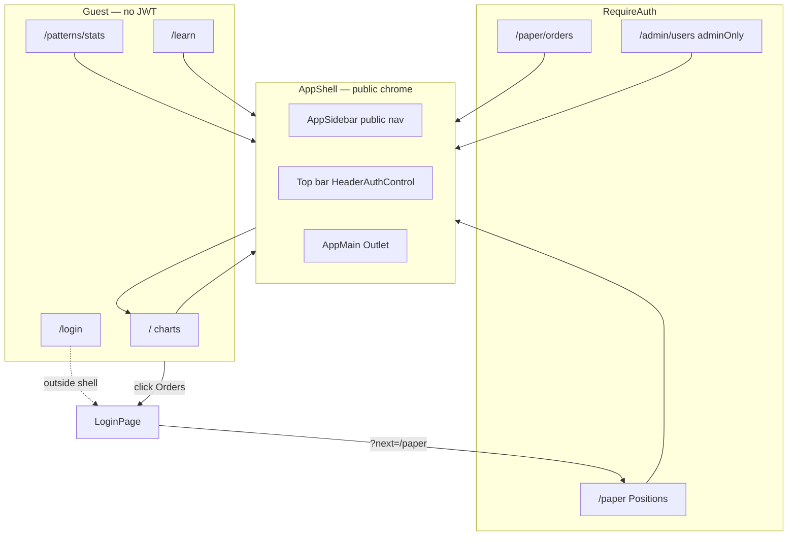
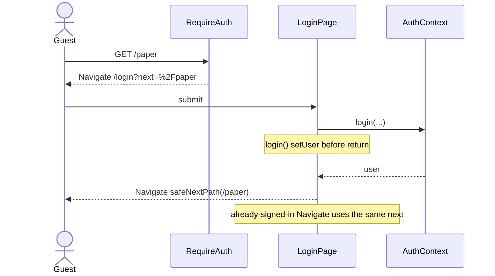
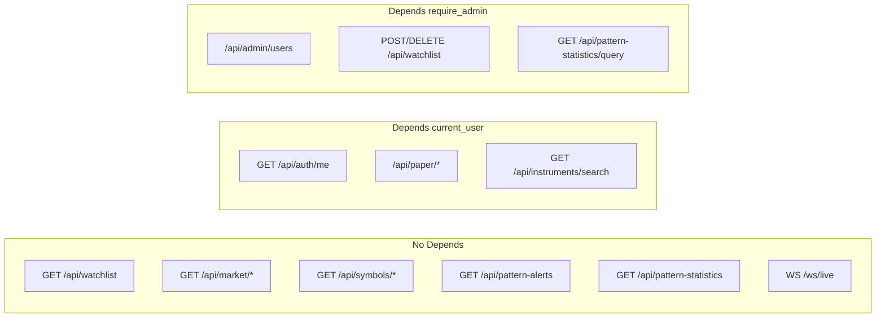

# Public Market Desk + Header Login

| Field | Value |
|-------|--------|
| **Document** | TIP-2 Public Market Desk & Header Auth |
| **Author** | _(TBD)_ |
| **Date** | 2026-09-15 |
| **Status** | Draft |
| **Product** | TIP-2 trading app |
| **Workspace** | `C:\Users\Khasim\Desktop\tradingapp\TIP-2` |
| **Related** | `docs/PRODUCT-DECISIONS.md`, `UI-Layout-Design-v1.0.md`, `docs/design-admin-learn-education.md`, `Chart-Paper-Trade-Design-v1.0.md` |

---

## Overview

TIP-2 currently treats the entire broker-style app (charts, watchlist, alerts, pattern stats, paper desk, admin) as an authenticated product. `frontend/src/App.jsx` wraps those routes in `<RequireAuth><AppShell /></RequireAuth>`, unknown paths bounce to `/login`, and almost every FastAPI handler takes `Depends(current_user)` — so a non-memory (Render/Postgres) profile returns **401** for unauthenticated `GET /api/watchlist`, candles, alerts, and stats.

The product change is to split the surface into a **public market desk** and a **private trading/admin desk**, without building a second layout:

1. **Anyone** (guest) can open Charts, Watchlist (read), Alerts (read), Pattern Stats (dashboard), and Learn. After the server starts, the SPA lands on **`/` (charts)**, not `/login`.
2. **Login lives in the shell chrome** (header control) plus a dedicated `/login` route for deep-links and 401 recovery. After login, Orders, Positions, chart Buy/Sell, and Admin appear.
3. **Backend public-read / auth-write**: market data, watchlist GET, alerts GET, and stats GET work without JWT in **non-memory profiles too**. Paper OMS, admin APIs, and watchlist mutations stay authenticated.

This is an IA + authz change, not a new data model. No schema migration. Paper lots/orders/cash remain per-user and must not leak.

---

## Background & Motivation

### Current state (verified in code)

**Frontend routing** (`frontend/src/App.jsx`):

| Route | Layout | Auth |
|-------|--------|------|
| `/login` | Standalone `LoginPage` | Public |
| `/learn`, `/learn/:kind/:slug` | `LearnLayout` → `PublicLearnShell` (guest) or `AppShell` (signed-in) | Public |
| `/` charts | `AppShell` → `ChartContainer` | `RequireAuth` |
| `/patterns/stats` | `AppShell` → `PatternStatsPage` | `RequireAuth` |
| `/paper`, `/paper/orders` | `AppShell` | `RequireAuth` |
| `/admin/users` | `AppShell` + nested `RequireAuth adminOnly` | ADMIN |
| `*` | `<Navigate to="/login" />` | — |

`RequireAuth` (`frontend/src/auth/RequireAuth.jsx`) redirects unauthenticated users to `/login` with `state.from`, but **`LoginPage` ignores `from` and always `navigate('/')`**. There is no `?next=` handling.

**App chrome:** `AppShell` is a left sidebar + main outlet (`frontend/src/components/shell/AppShell.jsx`). Account UI is `UserAccountMenu` in the **sidebar footer** (`AppSidebar.jsx`). There is no desktop top bar; `app-main__mobile-bar` is `display:none` above 899px (`shell.css`). Nav comes from `getNavItems({ isAdmin })` in `navConfig.js` and always includes Orders/Positions; Admin is `isAdmin`-only; Learn is flag-gated (`VITE_FEATURE_ADMIN_LEARN`, default ON).

**Chart trading chrome:** `ChartContainer.jsx` mounts `ChartTradeButtons`, `ChartOpenOrdersStrip`, and `PaperOrderModal` whenever `isChartPaperTradeEnabled()` is true (default ON). It does **not** check `user`. `ChartOpenOrdersStrip` calls `GET /api/paper/orders`. A guest hitting that would 401, and `frontend/src/services/http.ts` would fire `unauthorizedHandler` → `AuthContext.clearSession`. Keyboard `B`/`S` also fire while the flag is on.

Watchlist mutate UI is already admin-gated: `canManage={isAdmin}` in `ChartContainer` → `SymbolSwitcher` hides `InstrumentSearch` and row `×` when false.

**Backend auth** (`backend/app/api/deps.py`):

- Non-memory: missing/invalid JWT → 401 `"Not logged in"`.
- Memory profile (`TIP_PROFILE=memory` or `TIP_WATCHLIST_STORE=memory`): missing token → **synthetic ADMIN**. **Pytest** (`backend/tests/conftest.py`) forces this, so unit tests look “open.” **Local `scripts/start-backend.bat` / `start-tip2.bat` do not:** they default `TIP_WATCHLIST_STORE=postgres` and a local `DATABASE_URL`. Incognito against a local postgres API is already a real guest (same as Render: `TIP_PROFILE=""` + postgres). Do not treat memory as the local-run story.
- `require_admin` → 403 unless `role == ADMIN` (memory bypasses).

Handlers that currently take `AuthUser` (so they 401 in secure profile):

| Module | Endpoints |
|--------|-----------|
| `watchlist.py` | `GET ""` (POST/DELETE already `AdminUser`) |
| `market.py` | `GET /timeframes`, `/symbol`, `/status`, `/candles` |
| `symbols.py` | `GET /{id}/candles`, `/sr`, `/patterns`, `/statistics` |
| `instruments.py` | `GET /search` |
| `pattern_alerts.py` | `GET ""` |
| `pattern_statistics.py` | `GET ""` (bulk dashboard). `GET /query` is already `AdminUser` |
| `paper.py` | all `/api/paper/*` including `GET /ltp/{key}` |
| `auth.py` | `GET /me` |
| `admin_users.py` | all `/api/admin/users*` (`AdminUser`) |

**Already public (no JWT):** `GET /api/health`, `POST /api/auth/login`, `POST /api/auth/logout`, **`WebSocket /ws/live`** (`backend/app/api/websocket/live.py` accepts any connection; subscribe is restricted to watchlist symbols). Live WS tests in `backend/tests/api/test_live_ws.py` connect with no token.

**Alerts semantics (verified):** `GET /api/pattern-alerts` reads `pattern_journal.list_session_day_alerts` — session-day pattern stage events, **no `user_id`**. Client `AlertsFeed` “clear” is local overlay only (`overlay.clearAllAlerts`). There are **no per-user alerts** in this codebase. Public-read is correct.

**Security tests today** (`backend/tests/api/test_security.py`): `test_unauthenticated_api_returns_401` expects 401 for `/api/watchlist`, `/api/market/status|timeframes|symbol`, `/api/auth/me`, `/api/admin/users`. `test_logout_is_stateless` also asserts `GET /api/watchlist` without token is 401. These tests are the contract this design changes.

### Pain points

1. **Login wall on market data** — charts/watchlist/alerts/stats are the product’s public value; forcing JWT before a candle is shown is the wrong default.
2. **Landing is `/login`** — `*` and unauthenticated `/` both dump visitors on a form whose copy says “sign in to continue.”
3. **Login is a separate app** — `LoginPage` is outside `AppShell`; there is no in-chrome sign-in. `location.state.from` is unused, so a bounce from `/paper` still lands on `/` after success.
4. **FE/BE mismatch vs memory profile** — **pytest** memory tests pass without JWT (`test_market_controller.py`, `test_pattern_alerts.py` already GET 200). Secure/Render **and local postgres launcher** 401 today. The public-read design must not depend on memory-profile synthetic admin.
5. **Stale product docs** — `docs/PRODUCT-DECISIONS.md` still says Learn is ADMIN-only and watchlist read is “any authenticated user”; `UI-Layout-Design-v1.0.md` K1 says login stays outside the shell. Code already made Learn public via `LearnLayout`.

### Why now

The user wants the running app to **open on charts**, keep market surfaces shareable, and treat login as chrome for trading/admin — implementation follows this design in one session (PR1 backend, PR2 frontend).

---

## Goals & Non-Goals

### Goals

1. Guest can load `/`, `/?panel=watchlist`, `/?panel=alerts`, `/patterns/stats`, `/learn` without a JWT, in **postgres/secure** profile.
2. Default landing for guests **and** signed-in users is `/` (charts).
3. Same `AppShell` (sidebar + main) for guests and users; not a marketing microsite.
4. Header chrome: **Login** when logged out; **username + Logout** when logged in.
5. Authenticated USER: Orders, Positions, chart Buy/Sell / paper ticket, own paper data.
6. Authenticated ADMIN: user admin, watchlist mutate, research stats query, plus USER surfaces.
7. Visiting `/paper` or `/admin/users` while logged out → `/login?next=…` → return after success.
8. Header login on a public page **stays on that page**.
9. Logout on a public page stays; logout on a private page → `/` (**navigate to `/` before `logout()`** so `RequireAuth` cannot bounce to `/login`).
10. Backend public-read GETs 200 without JWT; paper/admin/watchlist mutate still 401/403.
11. Live ticks remain available to guests (`/ws/live` stays token-optional, watchlist-bounded).
12. Update product docs and the security test matrix.

### Non-Goals

1. Public self-signup (still ADMIN-created users).
2. OAuth, session cookies, refresh tokens, JWT revocation.
3. Per-user watchlists or per-user alerts.
4. Making research query (`GET /api/pattern-statistics/query`) public.
5. Exposing other users’ paper orders/positions/cash/ledger.
6. Rate-limiter / CDN / WAF in v1 (called out as residual risk).
7. New `VITE_FEATURE_PUBLIC_MARKET_DESK` dual-path UI (see Key Decisions).
8. Pixel redesign of `LoginPage` beyond copy + `next` handling.
9. React Testing Library / jsdom App mount (repo is Vitest + node; test helpers instead).
10. Changing detector math, candle grid, or paper OMS rules.

---

## Key Decisions

| # | Decision | Rationale |
|---|----------|-----------|
| **K1** | **Public surface** = Charts `/`, Watchlist panel, Alerts panel, Pattern Stats dashboard, Learn. **USER** adds Orders, Positions, chart paper Buy/Sell. **ADMIN** adds `/admin/users`, watchlist POST/DELETE, research stats mode. | Matches the requested map. Learn is already public in `LearnLayout`; keep it public. Research query stays ADMIN (`pattern_statistics.py` + `PatternStatsPage` `researchEnabled = flag && isAdmin`). |
| **K2** | **Default landing is `/` for everyone.** Unknown routes `*` → `/`, not `/login`. `/admin` still redirects to `/admin/users` (then authz). | “After the server starts, land on charts.” A 404 should not look like a login wall. |
| **K3** | **Keep dedicated `/login` AND add a header auth control.** Header is a **popover form** (username/password) so login on a public page does not unmount the chart. `/login` remains for deep-links, 401 recovery, and bookmarking. | User phrasing “login on top” = chrome, not “delete `/login`”. Popover satisfies “stay on that page”; `?next=` satisfies return-to-private-page. |
| **K4** | **Guests get the real `AppShell`.** Hide Orders / Positions / Admin in the sidebar until authenticated. Do **not** show locked-with-CTA rows. Login lives in chrome. | Teaser rows that bounce to login feel like a paywall and add extra clicks. Hide is the prompt’s recommended option. |
| **K5** | **Chart Buy/Sell, open-orders strip, paper modal, B/S hotkeys: not mounted for guests.** Appear after login iff `VITE_FEATURE_CHART_PAPER_TRADE` and `paperTradeDisabledReason` is empty. | `ChartOpenOrdersStrip` → `GET /api/paper/orders` would 401 and trip the global unauthorized handler. Hide, don’t disable. |
| **K6** | **Public-read endpoints drop `Depends(current_user)` entirely** (do not parse JWT). Invalid leftover tokens cannot 401 guest charts. `/api/auth/me`, paper, admin, watchlist writes, **and `GET /api/instruments/search`**, stay strict. | Simplest, race-safe vs `AuthProvider` still probing `/me`. Public-read must work in **non-memory** profile; memory synthetic admin is **not** the mechanism. Instrument search is admin-only UI (`canManage={isAdmin}`); leaving it authed keeps the public surface = what guests actually call. |
| **K7** | **`/ws/live` stays anonymous.** Subscribe already requires a watchlist (or default) symbol. No token query param. Do not put paper payloads on this socket. | Already implemented and tested. Adding optional JWT now would break guests and is unnecessary. |
| **K8** | **No product feature flag.** Ship as the new default. Rollback = revert. A dual-path `VITE_FEATURE_PUBLIC_MARKET_DESK` would fork routing, nav, and API 401 behavior. | Flag is overkill for a whole-product IA change. Existing flags (`CHART_PAPER_TRADE`, `ADMIN_LEARN`, `STARTUP_READY`) stay. |
| **K9** | **Learn moves into `AppShell` for guests too.** Retire the `LearnLayout` → `PublicLearnShell` vs `AppShell` split. | Guests should see the same broker chrome. `PublicLearnShell` existed only because `AppShell` was behind `RequireAuth`. |
| **K10** | **Header auth control lives in a persistent main-column top bar** (promote `app-main__mobile-bar` to all breakpoints) **and** remains in the sidebar footer on desktop. Mobile: top bar is required because the sidebar is a drawer. | “On top” + existing account slot. Chart loses ~40px on desktop; acceptable vs burying Login only at the sidebar bottom. |
| **K11** | **`LoginPage` honors `?next=` (and `state.from` as fallback) in both the already-signed-in `<Navigate>` and `onSubmit`.** Shared `resolveLoginNext` + `safeNextPath()` allowlist. Today **both** branches hardcode `/`; updating only `onSubmit` still dumps `/paper` recovery on charts because `login()` `setUser`s before return and the early `<Navigate to="/" />` wins. | Required for private-route recovery. Open-redirect safe. Historical flash (`LoginPage` comment: do not bounce through admin) applies **only when `next` is missing**. |
| **K12** | **Watchlist remains one shared global list.** Guests **read**; only ADMIN mutates (unchanged POST/DELETE `AdminUser`). Alerts are global pattern events → public-read. | Verified: no per-user watchlist/alert tables. |
| **K13** | **`GET /api/paper/ltp/{key}` stays auth-required.** Guests already have candles + WS. | Keeps the public API surface = market desk, not OMS. |
| **K14** | **Startup gate stays.** `AppShell` (now public) shows `StartupStatus` while `blocking` (API → Postgres → session probe). Anonymous `/me` 401 is a successful “no session”, not a hard fail (`AuthContext` already treats it as such). | Guests must not hit a half-booted API. |
| **K15** | **401 on a public page logs the user out in place; 401 on a private page still redirects to `/login?next=`.** No global “always go to login” in `http.ts`. | `unauthorizedHandler` already only `clearSession`. `RequireAuth` is what redirected. After this change, charts are not behind `RequireAuth`. |
| **K16** | **Logout from a private route `navigate('/', { replace: true })` first, then `await logout()`.** Never `logout()` while still mounted under `RequireAuth`. | `RequireAuth` lives in the shell `<Outlet />`. `AuthContext.logout()` sets `user = null` in `finally` before the caller continues; the next `/paper` render is `<Navigate to={loginUrl('/paper')} />` and races (usually wins) against a later `navigate('/')`. Same class of flash as today’s LoginPage admin bounce. |
| **K17** | **Strip `liveFeed` (Upstox `diagnostics()`) from `GET /api/market/status`.** Keep `liveFeedConnected`. Ops dump stays on `GET /api/health` (already public). | Status is the SPA market endpoint guests will hit on every chart boot. Diagnostics include `hasAccessToken`, `lastError`, `lastTickInstrument`. FE `MarketStatusDto` only types `liveFeedConnected`. |

---

## Public vs authenticated surface map

### Frontend routes

| Path | Guest | USER | ADMIN |
|------|-------|------|-------|
| `/` charts + `?panel=watchlist\|alerts` | yes | yes | yes |
| `/patterns/stats` dashboard | yes | yes | yes |
| `/patterns/stats?mode=research` | ignored (forced dashboard) | ignored | yes if `VITE_FEATURE_PATTERN_RESEARCH_STATS` |
| `/learn`, `/learn/:kind/:slug` | yes if Learn flag ON | yes | yes |
| `/paper`, `/paper/orders` | redirect `/login?next=` | yes | yes |
| `/admin/users` | redirect login, then admin-only page | “Admin only” card | yes |
| `/login` | form | `Navigate` to `safeNext` or `/` | same |
| `/admin` | → `/admin/users` | same | same |
| `/admin/learn/*` | existing standalone Learn redirect | same | same |
| `*` | → `/` | → `/` | → `/` |

### Sidebar / mobile bottom nav

`getNavItems({ isAdmin, isAuthenticated })`:

| Item | Guest | USER | ADMIN |
|------|-------|------|-------|
| Stats `/patterns/stats` | show | show | show |
| Charts `/` | show | show | show |
| Watchlist `/?panel=watchlist` | show | show | show |
| Alerts `/?panel=alerts` | show | show | show |
| Learn `/learn` | show if flag | show if flag | show if flag |
| Orders `/paper/orders` | **hide** | show | show |
| Positions `/paper` | **hide** | show | show |
| Admin `/admin/users` | **hide** | hide | show |

Mobile bottom nav remains `items.slice(0, 5)` (`AppShell.jsx`). **Insert order is the spec (do not reorder Alerts ahead of Orders):**

`Stats, Charts, Watchlist, [Orders, Positions if authenticated], Alerts, [Learn if flag], [Admin if isAdmin]`.

| Audience | `slice(0, 5)` ids |
|----------|-------------------|
| Guest, Learn flag ON | `['dashboard','charts','watchlist','alerts','learn']` |
| Authenticated non-admin | `['dashboard','charts','watchlist','orders','positions']` — **same as today** |

`AppShell.jsx` (mobile nav) **and** `AppSidebar.jsx` both call `getNavItems({ isAdmin })` today. Both **must** pass `{ isAdmin, isAuthenticated: Boolean(user) }`. Forgetting `AppShell` would leave Orders/Positions in the guest bottom nav.

### Chart chrome

| Control | Guest | Signed-in |
|---------|-------|-----------|
| Timeframe, chart type, indicators, Woodie | yes | yes |
| Symbol switch (read watchlist) | yes | yes |
| Instrument search / remove | no (`canManage={isAdmin}`) | USER: no; ADMIN: yes |
| Buy / Sell / ticket / open-orders strip / B·S keys | **unmount** | mount if flag + tradable |
| Alerts feed (read + local clear) | yes | yes |

### Backend HTTP

| Method / path | Guest (secure profile) | USER | ADMIN |
|---------------|------------------------|------|-------|
| `GET /api/health` | 200 | 200 | 200 |
| `POST /api/auth/login`, `POST /api/auth/logout` | 200/401 | 200 | 200 |
| `GET /api/auth/me` | **401** | 200 | 200 |
| `GET /api/watchlist` | **200** | 200 | 200 |
| `POST/DELETE /api/watchlist*` | **401** | **403** | 200/4xx |
| `GET /api/market/timeframes\|symbol\|candles` | **200** (candles may 503 if bootstrap failed) | 200 | 200 |
| `GET /api/market/status` | **200**, **no `liveFeed` blob** | 200, no `liveFeed` | 200, no `liveFeed` |
| `GET /api/symbols/{id}/candles\|sr\|patterns\|statistics` | **200** (404/503 if symbol missing / SR off — **never 401**) | 200 | 200 |
| `GET /api/instruments/search` | **401** (stays `AuthUser`; admin-only UI) | 200 | 200 |
| `GET /api/pattern-alerts` | **200** | 200 | 200 |
| `GET /api/pattern-statistics` | **200** | 200 | 200 |
| `GET /api/pattern-statistics/query` | **401** | **403** | 200/4xx |
| `GET/POST/PATCH/DELETE /api/paper/*` | **401** | 200 (own rows) | 200 (own rows) |
| `GET/POST/PUT /api/admin/users*` | **401** | **403** | 200 |
| `WS /ws/live` | accept + subscribe | same | same |

Paper isolation is unchanged: `_uid(user)` in `backend/app/api/paper.py`. Guests never get a uid.

---

## Proposed Design

### High-level architecture



### Routing (target `App.jsx`)

Keep the existing per-page `<ErrorBoundary>` wrappers (snippet omits them only for length — **do not drop them**). Add a three-line Learn flag gate so unplugging `LearnLayout` does not leave `/learn` reachable when `VITE_FEATURE_ADMIN_LEARN` is off.

```jsx
function RequireLearnFlag({ children }) {
  if (!isAdminLearnEnabled()) return <Navigate to="/" replace />
  return children
}

<Route path="/login" element={<LoginPage />} />

<Route element={<AppShell />}>          {/* PUBLIC shell — no RequireAuth */}
  <Route
    index
    element={<ErrorBoundary><ChartContainer key="chart-home" /></ErrorBoundary>}
  />
  <Route
    path="patterns/stats"
    element={<ErrorBoundary><PatternStatsPage key="pattern-stats" /></ErrorBoundary>}
  />
  <Route
    path="learn"
    element={
      <RequireLearnFlag>
        <ErrorBoundary><LearnIndexPage key="learn-index" /></ErrorBoundary>
      </RequireLearnFlag>
    }
  />
  <Route
    path="learn/:kind/:slug"
    element={
      <RequireLearnFlag>
        <ErrorBoundary><LearnDetailPage key="learn-detail" /></ErrorBoundary>
      </RequireLearnFlag>
    }
  />

  <Route
    path="paper"
    element={
      <RequireAuth>
        <ErrorBoundary><PaperTradingPage key="paper-trading" /></ErrorBoundary>
      </RequireAuth>
    }
  />
  <Route
    path="paper/orders"
    element={
      <RequireAuth>
        <ErrorBoundary><PaperOrdersPage key="paper-orders" /></ErrorBoundary>
      </RequireAuth>
    }
  />
  <Route
    path="admin/users"
    element={
      <RequireAuth adminOnly>
        <ErrorBoundary><AdminUsersPage key="admin-users" /></ErrorBoundary>
      </RequireAuth>
    }
  />
</Route>

<Route path="/admin" element={<Navigate to="/admin/users" replace />} />
<Route path="/admin/learn/*" element={<LegacyAdminLearnRedirect />} />
<Route path="*" element={<Navigate to="/" replace />} />
```

`LearnLayout.jsx` / `PublicLearnShell.jsx`: stop using them as the Learn parent; **delete the dual-shell switch** (delete the files in PR2 if unused). Learn flag off → `RequireLearnFlag` → `/` (not `/login`). `/learn` is inside `AppShell`, so **`HeaderAuthControl` is visible** (PublicLearnShell’s “Log in” CTA is replaced by the top bar).

`AppShell` must render `StartupStatus` when `blocking` (copy the gate currently in `RequireAuth` / `LearnLayout`) so guests wait for API+DB before the chart bootstrap fires. After the gate, the header popover does **not** need its own `StartupStatus`.

### Auth redirect helper (new)

Add `frontend/src/auth/paths.ts` (tested, no RTL). Use **one** prefix helper so `safeNextPath` cannot accept `/paperxyz` or `/administration` while `isPrivatePath` rejects them:

```ts
const PRIVATE_PREFIXES = ['/paper', '/admin'] as const
const PUBLIC_DESK_PREFIXES = ['/patterns', '/learn'] as const

export function pathMatchesPrefix(pathname: string, prefix: string): boolean {
  return pathname === prefix || pathname.startsWith(`${prefix}/`)
}

export function isPrivatePath(pathname: string): boolean {
  const p = pathname || '/'
  return PRIVATE_PREFIXES.some((pre) => pathMatchesPrefix(p, pre))
}

/** Allowlisted in-app next; default "/". Strings only — objects are invalid. */
export function safeNextPath(raw: unknown): string {
  if (typeof raw !== 'string') return '/'
  const path = raw.trim()
  if (!path.startsWith('/') || path.startsWith('//')) return '/'
  if (path.startsWith('/login')) return '/'
  const pathname = path.split('?')[0].split('#')[0]
  const allowed =
    pathname === '/' ||
    isPrivatePath(pathname) ||
    PUBLIC_DESK_PREFIXES.some((pre) => pathMatchesPrefix(pathname, pre))
  return allowed ? path : '/'
}

/**
 * Query `next` wins. `state.from` may be a string (this design) or a
 * location object (today’s RequireAuth). Never pass the object to safeNextPath.
 */
export function resolveLoginNext(
  searchNext: string | null | undefined,
  stateFrom: unknown,
): string {
  if (searchNext) return safeNextPath(searchNext)
  if (typeof stateFrom === 'string') return safeNextPath(stateFrom)
  if (stateFrom && typeof stateFrom === 'object' && 'pathname' in (stateFrom as object)) {
    const loc = stateFrom as { pathname?: unknown; search?: unknown }
    const pathname = typeof loc.pathname === 'string' ? loc.pathname : ''
    const search = typeof loc.search === 'string' ? loc.search : ''
    return safeNextPath(`${pathname}${search}`)
  }
  return '/'
}

export function loginUrl(nextPathAndSearch: string): string {
  const next = safeNextPath(nextPathAndSearch)
  if (next === '/') return '/login'
  return `/login?next=${encodeURIComponent(next)}`
}

export function logoutTarget(pathname: string): string {
  return isPrivatePath(pathname) ? '/' : '' // '' = stay
}
```

`RequireAuth` change (store a **string** in `state.from`; `resolveLoginNext` still accepts a leftover location object):

```jsx
if (!user) {
  const next = `${location.pathname}${location.search}`
  return <Navigate to={loginUrl(next)} replace state={{ from: next }} />
}
```

`LoginPage` — resolve `next` **once** and use it in **both** branches (K11). `AuthContext.login()` `setUser`s before it returns; if the already-signed-in `<Navigate>` still hardcodes `/`, a successful `/login?next=/paper` submit re-renders and **undoes** `onSubmit`’s navigate:

```jsx
const [searchParams] = useSearchParams()
const location = useLocation()
const next = resolveLoginNext(searchParams.get('next'), location.state?.from)

if (!loading && user) {
  return <Navigate to={next} replace />
}

async function onSubmit(e) {
  ...
  await login(username.trim(), password)
  navigate(next, { replace: true })
}
```

- Copy: “Sign in to place paper orders, view positions, and (admins) manage the desk. Charts, watchlist, alerts, and stats are public.”
- Keep Learn footer link.
- Share field constraints with the header popover via `LoginForm` (see Header auth control).
- Generic login with **no** `next` still lands on `/` (do not restore `/admin` from a stale mental model).

### Header auth control (new)

`frontend/src/components/shell/HeaderAuthControl.jsx`  
`frontend/src/components/shell/LoginForm.jsx` — **shared presentational form** used by the popover **and** `LoginPage` so minLength/autoComplete/copy cannot drift.

`LoginForm` props: `{ username, password, onUsername, onPassword, error, submitting, disabled, onSubmit, idPrefix }`. Constraints copied from today’s `LoginPage.jsx`:

- username `minLength={3}`, `autoComplete="username"`, `required`
- password `type="password"`, `minLength={4}`, `autoComplete="current-password"`, `required`
- on input: `clearError()` + local error dismiss (same `dismissErrors` pattern)

**Logged out** (`!user`)

- Button **Log in** (`aria-haspopup="dialog"`). Sidebar instance: `compact` — icon + `aria-label="Log in"` when `.app-sidebar--collapsed` (68px at 900–1099px); full “Log in” label when expanded.
- Click opens a compact popover (`.auth-field` / `.auth-submit`, width ~280px) wrapping `LoginForm` → `useAuth().login()`.
- On success: close popover; **do not navigate** (already on the public page).
- Link “Full login page” → `/login?next=<current>` for a11y / password-manager fallback.
- Popover must `stopPropagation` on pointer events so the chart canvas does not steal focus (same pattern as `ChartTradeButtons`).
- **Do not mount `UserAccountMenu` when `!user`.** Today `AppSidebar.jsx` always renders it; with `user == null` the label is `"Account"` and Logout is a no-op. Guests must only see the Login control.

**Logged in**

- Render existing `UserAccountMenu` (`placement="bottom"` in the top bar; `placement="top"` in sidebar footer).
- Logout handler (owned by `AppShell`). **Navigate off the private route before clearing the session** (K16):

```js
async function handleLogout() {
  if (isPrivatePath(location.pathname)) {
    navigate('/', { replace: true })
  }
  await logout()
}
```

After location is `/`, `RequireAuth` is unmounted, then `user` becomes null, and the guest stays on charts.

**Placement**

1. **Main-column top bar** — rename/extend `app-main__mobile-bar` → `app-main__top-bar`: page title + `HeaderAuthControl` on the right. **Show at all breakpoints** (`display:flex`). Hamburger `.app-main__menu-btn` remains **≤899px only** (`display:none` at `min-width: 900px`). Promoting the bar to desktop without this rule would show a dead hamburger on desktop.
2. **Sidebar footer** — `HeaderAuthControl compact` when `!user`; `UserAccountMenu` when `user`. Expand/collapse toggle stays.

Do **not** add a third copy on `ChartHeader` (UI-Layout K11 dual placement is already obsolete; account lives in shell).

Popover vs `/login` (sequence):

```mermaid
sequenceDiagram
  actor U as Guest
  participant H as HeaderAuthControl
  participant A as AuthContext
  participant API as POST /api/auth/login
  participant ME as GET /api/auth/me
  participant C as ChartContainer

  U->>H: Log in (popover)
  H->>A: login(user, pass)
  A->>API: credentials
  API-->>A: accessToken + user
  A->>ME: Bearer
  ME-->>A: user dto
  A-->>H: setUser
  Note over C: stays mounted; Buy/Sell appear
  H-->>U: popover closes
```

Private bounce (login):



Logout from a private page (K16 — navigate first):

```mermaid
sequenceDiagram
  actor U as USER on /paper
  participant S as AppShell
  participant R as RequireAuth
  participant A as AuthContext

  U->>S: Logout
  S->>S: navigate('/', replace)
  Note over R: /paper unmounts; RequireAuth gone
  S->>A: logout()
  A->>A: user = null
  Note over S: guest chrome on /
```

If `logout()` ran first, `RequireAuth` on `/paper` would `<Navigate to=/login?next=%2Fpaper>` and win the race.

### Nav config

**This is the only insert order.** Do not push Alerts before Orders — that would change authenticated mobile `slice(0, 5)` to Stats, Charts, Watchlist, Alerts, Orders.

```js
export function getNavItems({ isAdmin = false, isAuthenticated = false } = {}) {
  const items = [
    { id: 'dashboard', label: 'Stats', to: '/patterns/stats', icon: 'dashboard' },
    { id: 'charts', label: 'Charts', to: '/', icon: 'charts' },
    { id: 'watchlist', label: 'Watchlist', to: '/?panel=watchlist', panel: 'watchlist', icon: 'watchlist' },
  ]
  if (isAuthenticated) {
    items.push(
      { id: 'orders', label: 'Orders', to: '/paper/orders', icon: 'orders' },
      { id: 'positions', label: 'Positions', to: '/paper', icon: 'positions' },
    )
  }
  items.push(
    { id: 'alerts', label: 'Alerts', to: '/?panel=alerts', panel: 'alerts', icon: 'alerts' },
  )
  if (isAdminLearnEnabled()) {
    items.push({ id: 'learn', label: 'Learn', to: '/learn', icon: 'learn' })
  }
  if (isAdmin) {
    items.push({ id: 'admin', label: 'Admin', to: '/admin/users', icon: 'admin', adminOnly: true })
  }
  return items
}
```

Required tests (`navConfig.test.js`):

- Guest + Learn ON: ids `['dashboard','charts','watchlist','alerts','learn']` (equals `slice(0,5)`).
- Authenticated non-admin: first five `['dashboard','charts','watchlist','orders','positions']`.
- Admin adds `'admin'` after Learn; still not in the first five.

Callers: `AppSidebar.jsx` **and** `AppShell.jsx` (`mobileNav`) pass `{ isAdmin, isAuthenticated: Boolean(user) }`. Today both are `getNavItems({ isAdmin })` only.

### ChartContainer / paper chrome

```js
const signedIn = Boolean(user)
const chartPaperTradeOn = isChartPaperTradeEnabled() && signedIn
```

- `tradeSlot` / `ChartOpenOrdersStrip` / `PaperOrderModal` / B·S `useEffect`: gated on `chartPaperTradeOn` as they already are — once the flag is AND-ed with `signedIn`, guests are clean. **Unmount is the real control** (K5). The strip’s `catch` is silent but `http.ts` still fires `unauthorizedHandler` on 401 — a missed unmount is not a cosmetic bug.
- Optional defense in `paperTradeDisabledReason`: after `!entry?.symbolId` (`'Select a symbol'`), if `user == null` return `'Log in to paper trade'`. Do **not** put this check first — `paperTradable.test.ts` asserts `paperTradeDisabledReason(null) === 'Select a symbol'` and `paperTradeDisabledReason(eqReady) === ''`. Update the valid-EQ case to pass a signed-in user (`{ tradingEnabled: true }`); add `paperTradeDisabledReason(eqReady, null) === 'Log in to paper trade'`.
- `canManage={isAdmin}` already false for guests. Optional copy in `SymbolSwitcher` readonly hint: “Shared list — only admins can add or remove symbols.” (fine for guests too).

`useChartBootstrap.js` comment “401 → RequireAuth → login” is **wrong after this change**. Public fetches must not 401. If they do, `isUnauthorizedError` currently swallows the banner; after public-read, a 401 would mean a stale Bearer on a **still-authenticated-looking** handler — K6 removes the dependency so this path dies. Keep the swallow as belt-and-suspenders.

### Backend public-read split

**Do not add `optional_user` to public GETs.** Remove the unused `_user: AuthUser` parameter.

Files / functions:

| File | Change |
|------|--------|
| `backend/app/api/watchlist.py` | `list_watchlist`: drop `_user: AuthUser` |
| `backend/app/api/market.py` | `get_timeframes`, `get_symbol`, `get_status`, `get_candles`: drop `_user`. **`get_status`: do not attach `feed.diagnostics()` / `liveFeed`** (keep `liveFeedConnected`) |
| `backend/app/api/symbols.py` | `get_candles`, `get_daily_sr`, `get_patterns`, `get_statistics`: drop `_user` |
| `backend/app/api/instruments.py` | **keep `AuthUser`** — guests never call search |
| `backend/app/api/pattern_alerts.py` | `list_pattern_alerts`: drop `_user` |
| `backend/app/api/pattern_statistics.py` | `bulk_statistics`: drop `_user`. Keep `research_statistics(..., _admin: AdminUser)` |
| `backend/app/api/deps.py` | **no behavior change required** for `current_user` / `require_admin`. Optional: add a comment listing public routers. |
| `backend/app/api/websocket/live.py` | **no code change**. Comment: anonymous WS; watch `LiveWebSocketHub.session_count` after public launch. |
| `paper.py`, `admin_users.py`, `auth.me` | unchanged |

Watchlist POST/DELETE stay `AdminUser`. In memory profile, `require_admin` still passes without a token (local convenience). Secure profile: unauthenticated mutate 401; USER 403. **Public-read must not use memory-profile synthetic admin** — there is simply no `Depends`.



### Memory profile vs secure profile

| | Pytest memory (`conftest.py` sets `TIP_PROFILE=memory`) | Local launcher + Render |
|--|--------------------------------------------------------|-------------------------|
| How it is selected | `TIP_PROFILE=memory` **or** `TIP_WATCHLIST_STORE=memory` | `scripts/start-backend.bat` defaults `TIP_WATCHLIST_STORE=postgres` + local `DATABASE_URL`. `render.yaml`: `TIP_PROFILE=""` + postgres |
| Public GET after PR1 | 200 (no Depends) | **200 (this design)** |
| `GET /api/auth/me` no token | 200 synthetic admin (**unchanged**) | 401 → FE guest chrome |
| `GET /api/paper/*` no token | 200 as synthetic admin | 401 |
| FE `fetchMe` on boot | appears signed in as Memory Admin | `null` → guest chrome |
| Guest QA | **Not** a guest (auto-admin). Do not use pytest memory / `TIP_PROFILE=memory` to “see the public desk.” | Incognito against local `:5173` (Vite → `:8080`) **is** a real guest — same as `tip2-web` |

**Do not implement public-read by “always using memory profile.”** Do not document memory as a way to skip auth.

### WebSocket / live ticks

`live_ws` already:

1. `await hub.connect(websocket)` with no auth handshake.
2. Accepts `{ type: "subscribe", symbolId, timeframe }`.
3. Rejects symbols not on the watchlist (`_is_accepted_symbol`).
4. Fan-out: `candle_update`, `candle_closed`, `pattern_event`, `market_status` only.

**Keep this.** Do not add `?token=` or a first-message auth frame. Paper fills never go over `/ws/live` (paper matcher is server-side; FE polls `/api/paper/orders`).

Guest chart path: `useChartBootstrap` → `fetchWatchlist` + `fetchMarketStatus` + `fetchTimeframes` (now 200) → `loadCandles` via `marketApi.fetchCandles` → **`GET /api/symbols/{id}/candles`** (not `/api/market/candles`) → `createLiveSocket` (`frontend/src/services/liveSocket.ts`, no token) → subscribe. Woodie: `GET /api/symbols/{id}/sr`. Pattern inspect: `GET /api/symbols/{id}/patterns`. Overlay restore: `GET /api/pattern-alerts`. PR1 tests must cover these URLs or CI will not catch a missed `symbols.py` drop.

**Capacity (order of magnitude):** watchlist hard-max 50 (`SymbolSwitcher` `hardMax = 50`). Candle WS throttle `candle_update_throttle_ms = 1000`. Each guest holds one WS + REST candle payloads of a few thousand bars per symbol/tf. Residual risk: unbounded guest WS count — see Security.

### HTTP client

`frontend/src/services/http.ts`:

- Continue attaching Bearer **when a token exists** (`options.auth !== false`). Public endpoints ignore it.
- `NO_UNAUTHORIZED_NOTIFY` already includes `/api/auth/me`. Do **not** add public GETs: if a public GET ever 401s, clearing a bad token is correct.
- Guest paper calls must not happen (K5). If they did, 401 → `clearSession` (user already null) → no navigation.

### Copy / empty states

- `LoginPage` hint: public desk + why to sign in.
- Guest watchlist: existing “only admins can add or remove” is accurate.
- No “locked Orders” row.

---

## API / Interface Changes

### Backend — before / after (representative)

```python
# before (watchlist.py)
@router.get("")
def list_watchlist(request: Request, _user: AuthUser):
    ...

# after
@router.get("")
def list_watchlist(request: Request):
    ...
```

Same pattern for every public GET listed in K6 (watchlist GET, `market.py` four handlers, `symbols.py` four handlers, pattern-alerts, bulk stats). **Not** `GET /api/instruments/search`. No new routes. `GET /api/market/status` response **drops** `liveFeed` (schema narrowing, not a new field).

`GET /api/auth/me` remains:

```python
@router.get("/me")
def me(user: AuthUser):
    return user
```

401 without JWT in secure profile is how the SPA decides “guest.”

### Frontend — new / changed interfaces

```ts
// frontend/src/auth/paths.ts  (new)
export function pathMatchesPrefix(pathname: string, prefix: string): boolean
export function isPrivatePath(pathname: string): boolean
export function safeNextPath(raw: unknown): string
export function resolveLoginNext(searchNext: string | null | undefined, stateFrom: unknown): string
export function loginUrl(nextPathAndSearch: string): string
export function logoutTarget(pathname: string): string
```

```js
// navConfig.js
export function getNavItems({ isAdmin = false, isAuthenticated = false } = {})
```

```jsx
// LoginForm.jsx (new) — shared by LoginPage + popover
function LoginForm({ username, password, onUsername, onPassword, error, submitting, disabled, onSubmit, idPrefix })

// HeaderAuthControl.jsx (new)
function HeaderAuthControl({ user, onLogout, compact = false })
```

`RequireAuth` stays; it is applied **per private route**, not around `AppShell`.

---

## Data Model Changes

**None.** No Alembic/SQL under `backend/db/migration/`. Watchlist rows, pattern journal, `app_users`, `cash_ledger`, paper orders/lots are unchanged.

Paper isolation continues to key on JWT `sub` → `user["id"]` (`paper.py` `_uid`). Guests never call these endpoints.

---

## Alternatives Considered

### A1. Locked-with-CTA nav items for Orders/Positions/Admin

Show the rows with a lock icon; click → `/login?next=`.

- **Pros:** Discovers trading; matches some broker marketing sites.
- **Cons:** Extra bounce; looks gated; mobile `slice(0,5)` would still spend slots on locked items instead of Alerts/Learn.
- **Rejected** in favor of K4 (hide until login).

### A2. Header Login is only a link to `/login` (no popover)

- **Pros:** Less UI; one form.
- **Cons:** Logging in from charts **unmounts** `ChartContainer` (loses WS, LWC state), then `LoginPage` currently (and even with `next`) remounts `/`. Violates “stay on that page” in spirit.
- **Rejected** as the primary control; `/login` remains the fallback (K3).

### A3. Optional JWT on public GETs (`optional_user`)

Parse Bearer if present; ignore if missing; 401 if invalid.

- **Pros:** Could personalize later.
- **Cons:** Invalid/stale tokens 401 guest charts during the `/me` race. Extra code. Nothing on public pages uses the user except chrome, which already has `AuthContext`.
- **Rejected** (K6).

### A4. `VITE_FEATURE_PUBLIC_MARKET_DESK` default ON

- **Pros:** Kill switch without revert.
- **Cons:** Dual routing, dual nav, FE public + BE still 401 if flags drift. This is the product, not an experiment.
- **Rejected** (K8). Rollback = git revert of PR1+PR2.

### A5. Keep `PublicLearnShell` for guests

- **Pros:** Zero Learn layout work.
- **Cons:** Guests on `/learn` lose Charts/Watchlist nav; contradicts “same AppShell for the public desk.”
- **Rejected** (K9).

### A6. Token query param on `/ws/live`

- **Pros:** Could rate-limit by user later.
- **Cons:** Tokens in URLs leak via logs/proxies; guests have no token; socket is already public and watchlist-bounded.
- **Rejected** (K7).

---

## Security & Privacy Considerations

### Threat model

| Threat | Severity | Mitigation |
|--------|----------|------------|
| Guest reads another user’s paper orders/positions/cash | **High** | Paper routers keep `AuthUser`; FE never mounts paper chrome for guests; tests assert 401. Service layer already filters `_uid(user)`. |
| Guest mutates shared watchlist | **High** | POST/DELETE stay `AdminUser`; USER 403; guest 401. FE hides search/`×`. Existing `test_user_can_list_watchlist_but_not_mutate`. |
| Guest hits research query (heavy journal scan) | **Med** | `GET /query` stays `AdminUser`. UI already `isAdmin`. |
| Open-redirect via `?next=` | **Med** | `safeNextPath` strings only; `pathMatchesPrefix` (not `startsWith('/paper')`); must start with `/`, not `//`, not `/login`. |
| Stale JWT on public GET | **Low** | Public handlers do not read Authorization. `/me` still 401s and `apiAllow401` clears storage. |
| Anonymous WS / candle scrape | **Med** | Universe = watchlist (≤50) + default instrument; subscribe rejects unknown keys; CORS allowlist (`CORS_ALLOWED_ORIGINS`); no cookies. No v1 rate limit — residual. |
| Memory profile auto-admin on public internet | **High if misdeployed** | Pre-existing. Render sets postgres store. Public-read does not widen this. Do not document memory as a way to “skip auth in prod.” |
| Login brute force | **Med** | Unchanged (`POST /login` already public). Out of scope to add lockout in this PR. |
| Pattern alert / stats data is “proprietary” | **Product** | Explicitly public. Research composable filters stay ADMIN. |
| `GET /api/market/status` ops dump (`liveFeed.diagnostics`: `hasAccessToken`, `lastError`, tick keys) | **Low** | **Strip `liveFeed` from this handler** (K17). Same blob remains on already-public `GET /api/health`. FE does not read `liveFeed` (`MarketStatusDto` only has `liveFeedConnected`). |
| Guest `GET /api/instruments/search` | **Low** | **Keep `AuthUser`.** UI is `canManage={isAdmin}` only; guests never call it. |

### Auth model (unchanged)

- JWT HS256, 8h, `localStorage` key `tip_access_token` (`tokenStorage.ts`).
- `Authorization: Bearer` on FE calls when token present.
- CORS `allow_credentials=False` (`main.py`) — correct for header JWT.
- No public signup.

### Data handling

- Public responses are the same DTOs authenticated users already receive for market/watchlist/alerts/stats, **except** `GET /api/market/status` no longer includes `liveFeed` diagnostics (K17).
- Do not add user ids, cash, or order ids to public payloads or WS frames.

---

## Observability

| Signal | Where | Use |
|--------|-------|-----|
| `LiveWebSocketHub.session_count()` | `live.py` | Existing; log on connect/disconnect already (`logger.info("Live WebSocket connected: %s", sid)`). **PR1 comment on `live.py`:** anonymous WS; watch `session_count` after public launch. First ops knob if CPU/RAM climbs. No v1 max-connections / WS origin check (CORS does not bind sockets). Optional later: cap sessions per IP. |
| `GET /api/health` | `health.py` | Unchanged FE startup gate. |
| Auth failures | FastAPI 401/403 | No new middleware. Security tests are the contract. |
| FE `AuthContext.error` | login form / popover | Unchanged. |
| Chart bootstrap errors | `useChartBootstrap` `setError` | After public-read, these should be 503 bootstrap / network, not 401. |

**Not in v1:** request-id middleware, guest vs user metric labels, Prometheus. If Render CPU/RAM climbs after launch, first look at `session_count` and candle GET volume.

**Alerting (ops, not code):** existing health checks stay. Optional later: alert if WS sessions >> typical authenticated user count.

---

## Rollout Plan

### Flag

**None** (K8). This is the new product default.

### Order (same session, independently reviewable)

1. **PR1 backend public-read** — merge first. Authenticated FE keeps working (Bearer still accepted; handlers just ignore it). Guests still cannot see charts until PR2 (FE `RequireAuth` remains). Brief window where APIs are public but UI is gated — acceptable.
2. **PR2 frontend shell/routing** — depends on PR1; otherwise guest `/` would 401 on watchlist/candles and show an empty chart.
3. **PR3 docs** — can land with PR2 if smaller is preferred; listed separately so the code PRs stay reviewable.

### Staging checks

- **Local (postgres launcher, not pytest memory):** incognito `http://localhost:5173/` shows charts, live ticks, watchlist, alerts, stats, Learn. `start-tip2.bat` is already a real guest — do not set `TIP_PROFILE=memory` to QA this.
- Incognito → Render `https://tip2-web…/` same as local.
- Incognito → `/paper` → `/login?next=%2Fpaper` → after submit land on `/paper` (not `/`).
- Header popover login on `/` and on `/learn` stays on that page; Buy/Sell appear only after login on charts.
- USER cannot POST watchlist (403).
- Logout on `/` stays on `/`; logout on `/paper` **navigates to `/` first**, then clears session — must **not** flash `/login?next=/paper`.

### Rollback

- Revert PR2 first (FE) if UI is wrong — API public-read is harmless to the old FE.
- Revert PR1 if public API load is unacceptable — old FE still has JWT so charts keep working.

---

## Tests

Repo constraints: backend `pytest` + `TestClient`; frontend Vitest **`environment: 'node'`**, **no RTL**. Do not add Testing Library for this change.

### Backend (`backend/tests/api/test_security.py`)

Replace `test_unauthenticated_api_returns_401` with two tests:

**Public-read (secure_app, no Authorization) — never 401.** These are the URLs the guest chart actually calls (`useChartBootstrap` + `fetchCandles` + Woodie + overlay). Status **200 or 404/503** (missing seed / SR off / bootstrap failed) is acceptable; **401 is not.**

- `GET /api/watchlist`
- `GET /api/market/status` — 200 **and** body has no `liveFeed` key (K17)
- `GET /api/market/timeframes`, `/symbol`
- `GET /api/market/candles`
- `GET /api/symbols/NSE_INDEX%7CNifty%2050/candles` (seeded default; encode `|`)
- `GET /api/symbols/NSE_INDEX%7CNifty%2050/sr`
- `GET /api/symbols/NSE_INDEX%7CNifty%2050/patterns`
- `GET /api/symbols/NSE_INDEX%7CNifty%2050/statistics?patternType=breakout&timeframe=5m`
- `GET /api/pattern-alerts`
- `GET /api/pattern-statistics`
- `GET /api/health` (already in `test_health_and_login_permit_all`)

If Nifty is not seeded in `secure_app`, any instrument id is fine: **assert `status_code != 401`**. Missing `symbols.py` in PR1 must fail CI.

**Auth-required 401 (secure_app, no Authorization):**

- `GET /api/auth/me`
- `GET /api/admin/users`
- `GET /api/paper/account`
- `GET /api/paper/orders` (locks K5: missed strip unmount still 401s)
- `GET /api/paper/positions`
- `GET /api/paper/ltp/NSE_EQ%7CX` (locks K13)
- `GET /api/pattern-statistics/query`
- `GET /api/instruments/search?q=REL` (stays authed)
- `POST /api/watchlist`
- `DELETE /api/watchlist/NSE_EQ%7CX`

Keep: `test_unauthenticated_watchlist_mutations_401`, `test_user_can_list_watchlist_but_not_mutate` (USER GET 200 + POST 403), `test_user_cannot_access_admin_endpoints`.

**Fix** `test_logout_is_stateless`: after logout, `GET /api/auth/me` without token still 401; **`GET /api/watchlist` without token is 200** (was 401). Token still works on `/me` until expiry (stateless JWT).

Add `test_unauthenticated_paper_401` if not folded into the matrix.

WS: existing `test_live_ws.py` already proves anonymous subscribe — add a one-line comment in the test module, no behavior change.

Memory-profile tests (`test_market_controller.py`, `test_pattern_alerts.py`) already GET 200; they remain valid.

### Frontend

`frontend/src/auth/paths.test.ts` (new):

- `isPrivatePath('/paper')` true; `'/'` false; `'/patterns/stats'` false; `'/learn/x'` false; `'/admin/users'` true; `'/paperxyz'` **false**; `'/administration'` **false**.
- `safeNextPath('/paper')` → `/paper`; `'/paper/orders?x=1'` kept; `'/paperxyz'` → `/`; `'https://evil.com'` → `/`; `'//evil.com'` → `/`; `'/login'` → `/`; `'/login?next=/paper'` → `/`.
- **Location-like object is not a valid next:** `safeNextPath({ pathname: '/paper' })` → `/`. `resolveLoginNext(null, { pathname: '/paper', search: '' })` → `/paper` (LoginPage fallback). `resolveLoginNext('/paper', { pathname: '/' })` → `/paper` (query wins).
- `loginUrl('/paper')` → `/login?next=%2Fpaper`.
- `logoutTarget('/paper')` → `/`; `logoutTarget('/')` → `''`.

`navConfig.test.js` (required, not optional):

- Guest + Learn ON: `getNavItems({ isAuthenticated: false }).map(i => i.id)` equals `['dashboard','charts','watchlist','alerts','learn']`.
- Authenticated non-admin: `.slice(0, 5)` ids `['dashboard','charts','watchlist','orders','positions']`.
- Admin: includes `'admin'`; first five unchanged.

`paperTradable.test.ts`: keep `null` entry → `'Select a symbol'`. Change valid-EQ `paperTradeDisabledReason(eqReady)` to pass `{ tradingEnabled: true }`. Add `paperTradeDisabledReason(eqReady, null)` → `'Log in to paper trade'`.

`featureFlags.test.ts`: **no new flag**.

Do **not** require an `App.jsx` mount test without jsdom.

### Manual QA (PR2)

- **Local postgres** incognito (`start-tip2.bat`, not memory profile): `/`, `/?panel=watchlist`, `/?panel=alerts`, `/patterns/stats`, `/learn` (top-bar Login visible on Learn).
- Direct `/paper` → `/login?next=%2Fpaper` → submit → `/paper` (not `/`).
- Header popover on charts: stay on `/`; Buy/Sell appear.
- Logout from `/paper`: land on `/` **without** flashing `/login`. Logout from `/` stays on `/`.

---

## Open Questions

None blocking implementation. Recorded for awareness:

1. **Desktop top bar vs chart height** — K10 spends ~40px. If QA finds the chart too tight at 900×600, hide the top bar at `min-width: 900px` and rely on sidebar-footer Login only. Default is show-always so “login on top” is literal. Hamburger stays hidden at desktop either way.
2. **Rate limiting / WS cap** — out of v1; first knob is `LiveWebSocketHub.session_count`. Optional later: cap sessions per IP. CORS does not bind WebSockets.

Resolved during review (no longer open):

- Instrument search stays **authed** (`AuthUser`); guests never call it.
- `liveFeed` diagnostics stripped from `GET /api/market/status`; remain on `/api/health`.

---

## Risks

| Risk | Severity | Mitigation |
|------|----------|------------|
| PR2 merges before PR1 | **High** | Guest chart bootstrap 401s. Order is PR1 then PR2. |
| `ChartOpenOrdersStrip` left mounted | **High** | Gate on `user && isChartPaperTradeEnabled()`. |
| `LoginPage` still ignores `next` **or** only `onSubmit` is updated | **Med** | Both `<Navigate>` and `onSubmit` use `resolveLoginNext`; paths tests include location-object case. |
| Logout from `/paper` flashes `/login` | **High** | K16: `navigate('/')` then `logout()`. Manual QA. |
| Public WS resource exhaustion | **Med** | Watchlist-bounded subscribe; PR1 comment on `session_count`; revert PR1 if needed. |
| Docs drift | **Low** | PR3 updates PRODUCT-DECISIONS + UI-Layout K1. |
| Pytest memory `/me` auto-admin | **Low** | Tests only. Local launcher is postgres guests. Not used as the public-read mechanism. |

---

## Implementation notes (file-level)

### PR1 — backend

- `backend/app/api/watchlist.py`
- `backend/app/api/market.py` — drop `_user`; strip `liveFeed` from `get_status`
- `backend/app/api/symbols.py` — drop `_user` on candles/sr/patterns/statistics (**CI-covered**)
- `backend/app/api/pattern_alerts.py`
- `backend/app/api/pattern_statistics.py` (`bulk_statistics` only)
- `backend/app/api/instruments.py` — **no change** (stays `AuthUser`)
- `backend/tests/api/test_security.py` — include `/api/market/candles` and `/api/symbols/{id}/*`
- Comment on `backend/app/api/websocket/live.py`: anonymous WS; watch `session_count` after public launch
- Optional comment on `deps.py` listing public vs authed surfaces

### PR2 — frontend

- `frontend/src/App.jsx` — public `AppShell`; `RequireAuth` on paper/admin only; `RequireLearnFlag`; keep per-route `ErrorBoundary`; `*` → `/`
- `frontend/src/auth/RequireAuth.jsx` — `loginUrl()`; `state.from` string
- `frontend/src/auth/paths.ts` + `paths.test.ts` — **new** (`pathMatchesPrefix`, `resolveLoginNext`)
- `frontend/src/pages/LoginPage.jsx` — **both** `<Navigate>` and `onSubmit` use `resolveLoginNext`; compose `LoginForm`
- `frontend/src/components/shell/LoginForm.jsx` — **new** shared fields
- `frontend/src/components/shell/AppShell.jsx` — startup gate; **logout navigates first**; `getNavItems({ isAdmin, isAuthenticated: Boolean(user) })`
- `frontend/src/components/shell/AppSidebar.jsx` — same `getNavItems` args; **no `UserAccountMenu` when `!user`**; compact Login
- `frontend/src/components/shell/AppMain.jsx` — persistent top bar + `HeaderAuthControl`; hamburger ≤899px
- `frontend/src/components/shell/HeaderAuthControl.jsx` — **new**
- `frontend/src/components/shell/navConfig.js` + `navConfig.test.js` — insert order + slice assertions
- `frontend/src/components/shell/shell.css` — top bar all breakpoints; hide `.app-main__menu-btn` at `min-width: 900px`; collapsed sidebar icon-only Login
- `frontend/src/components/shell/LearnLayout.jsx` / `PublicLearnShell.jsx` — unplug/delete
- `frontend/src/components/ChartContainer.jsx` — `chartPaperTradeOn && user` (unmount)
- `frontend/src/utils/paperTradable.ts` + tests — guest reason **after** missing symbol
- `frontend/src/hooks/useChartBootstrap.js` — comment fix
- `frontend/src/components/UserAccountMenu.jsx` — reuse as-is when `user`

### PR3 — docs

- `docs/PRODUCT-DECISIONS.md` — Users & admin / Learn, Watchlist read, App shell
- `UI-Layout-Design-v1.0.md` — K1 login-outside-shell; architecture mermaid
- `docs/RENDER-DEPLOY.md` — note public market GETs + WS
- `docs/design-admin-learn-education.md` — status note: Learn is public (already true in code)

---

## References

- `frontend/src/App.jsx` — current route table
- `frontend/src/auth/RequireAuth.jsx`, `AuthContext.jsx`, `tokenStorage.ts`
- `frontend/src/pages/LoginPage.jsx`
- `frontend/src/components/shell/{AppShell,AppSidebar,AppMain,navConfig,LearnLayout,PublicLearnShell}.*`
- `frontend/src/components/{ChartContainer,ChartTradeButtons,ChartOpenOrdersStrip,SymbolSwitcher,UserAccountMenu}.*`
- `frontend/src/services/http.ts`, `watchlistApi.ts`, `liveSocket.ts`, `paperApi.ts`
- `backend/app/api/deps.py`, `watchlist.py`, `market.py`, `symbols.py`, `pattern_alerts.py`, `pattern_statistics.py`, `paper.py`, `admin_users.py`, `websocket/live.py`
- `backend/tests/api/test_security.py`, `test_live_ws.py`
- `docs/PRODUCT-DECISIONS.md`
- `UI-Layout-Design-v1.0.md` (K1, K10, K11)

---

## PR Plan

Each PR is independently reviewable. **PR1 must merge before PR2 is deployed.** Same-session apply order: PR1 → PR2 → PR3.

### PR1 — Backend public-read split

- **Title:** `fix(api): allow unauthenticated GET for market desk (watchlist, candles, alerts, stats)`
- **Files:** `backend/app/api/watchlist.py`, `market.py` (also strip `liveFeed`), `symbols.py`, `pattern_alerts.py`, `pattern_statistics.py`; comments in `deps.py` and `websocket/live.py` (`session_count`); `backend/tests/api/test_security.py`. **Do not** unauth `instruments.py`.
- **Depends on:** none
- **Changes:** Remove `AuthUser` from public GET handlers (watchlist GET, all `market.py` GETs, all `symbols.py` GETs, pattern-alerts, bulk stats). Leave `AuthUser`/`AdminUser` on mutations, paper (including `GET /ltp/{key}`), admin, `/me`, research query, **instrument search**. Rewrite security matrix so CI fails if `symbols.py` / `GET /api/market/candles` still 401: assert those paths `status_code != 401`. Public `/api/market/status` has no `liveFeed`. Paper/admin/watchlist write/`/me`/instruments search/`GET /api/paper/orders`/`GET /api/paper/ltp/{key}` 401. USER still 403 on watchlist mutate. Fix `test_logout_is_stateless` watchlist assertion (200). Do not change memory-profile `current_user`.

### PR2 — Frontend public AppShell, header login, routing

- **Title:** `feat(ui): public market desk in AppShell with header login`
- **Files:** `App.jsx`; `RequireAuth.jsx`; new `auth/paths.ts` + tests; `LoginPage.jsx`; new `LoginForm.jsx`; `AppShell.jsx`, `AppSidebar.jsx`, `AppMain.jsx`, `navConfig.js` + tests, `shell.css`; new `HeaderAuthControl.jsx`; `ChartContainer.jsx`; `paperTradable.ts` + tests; Learn layout unplug; `useChartBootstrap.js` comment
- **Depends on:** **PR1** (guest REST 200). **Do not merge PR2 to Render before PR1.**
- **Changes:** `AppShell` wraps public routes (keep `ErrorBoundary`); `RequireAuth` only on `/paper`, `/paper/orders`, `/admin/users`; `RequireLearnFlag` on Learn. Default `/`; `*` → `/`. Nav insert order as specified; both shell callers pass `isAuthenticated`. Persistent top bar + shared `LoginForm` popover; `/login?next=` recovery in **both** LoginPage branches. **Logout: navigate `/` then `logout()`.** Unmount chart paper chrome without `user`. Learn uses `AppShell` (header Login on `/learn`). Startup gate moves onto `AppShell`. Hide desktop hamburger; do not mount `UserAccountMenu` for guests.

**PR2 review checklist (not just a file dump):**

- [ ] `navConfig` guest ids `['dashboard','charts','watchlist','alerts','learn']`
- [ ] authenticated first five `['dashboard','charts','watchlist','orders','positions']`
- [ ] `AppShell` **and** `AppSidebar` pass `isAuthenticated: Boolean(user)`
- [ ] `handleLogout` navigates off `/paper` **before** `logout()`
- [ ] `LoginPage` already-signed-in `<Navigate>` uses `resolveLoginNext`, not `"/"`
- [ ] `UserAccountMenu` unmounted when `!user`
- [ ] `.app-main__menu-btn` hidden at `min-width: 900px`
- [ ] `ChartOpenOrdersStrip` not mounted for guests

### PR3 — Product docs

- **Title:** `docs: public market desk, header login, watchlist read=anyone`
- **Files:** `docs/PRODUCT-DECISIONS.md`, `UI-Layout-Design-v1.0.md`, `docs/RENDER-DEPLOY.md`, `docs/design-admin-learn-education.md` (status note)
- **Depends on:** PR1+PR2 conceptually; can merge after either as long as it describes the shipped behavior
- **Changes:** Watchlist **Read = anyone**. App shell: public chrome; login in header + `/login`; login is not outside the product. Learn public (align doc with code). Auth section: JWT still required for paper/admin. Security matrix note: not all `/api/*` require JWT.

No further PRs required to ship the requested product change.
