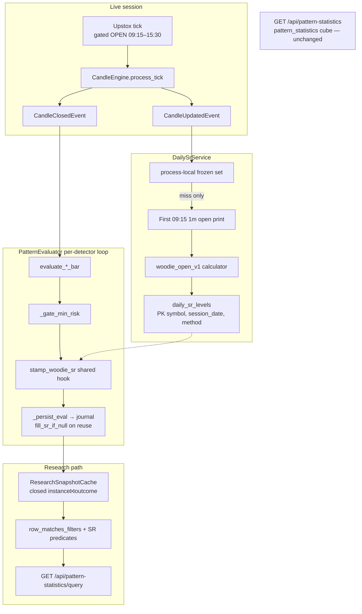
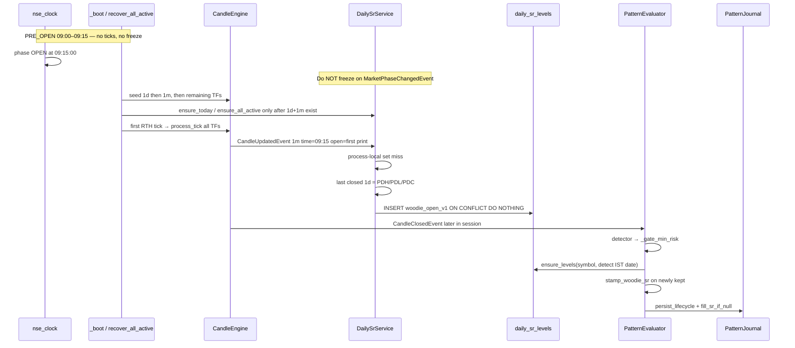

# Design: Woodie Daily Support/Resistance Context for Pattern Journal + Research

| Field | Value |
|-------|--------|
| **Document** | Woodie daily S/R context (`woodie_open_v1`) |
| **Author** | TIP-2 |
| **Date** | 2026-08-18 |
| **Status** | **Draft** (rev 3) |
| **Scope** | Daily Woodie ladder freeze, detect-time stamp on journal instances, research query-time filters. Chart overlay is a later PR. |
| **Related** | `docs/modules/journal.md`, `docs/design-composable-stack-filters.md`, `docs/PRODUCT-DECISIONS.md`, `docs/indicators/atr-14.md`, `docs/indicators/donchian-20.md` |
| **Code roots** | `backend/app/journal/`, `backend/app/patterns/evaluator.py`, `backend/app/patterns/research_*.py`, `backend/app/market/`, `backend/app/api/pattern_statistics.py`, `frontend/src/utils/researchFilters.ts`, `frontend/src/pages/PatternStatsPage.jsx` |

---

## Overview

Pattern research can slice by lifecycle flags (`volume_ok_at_detect`, `flag_retested`) and planned rails, but it cannot answer “how many successful hammers when we detect at S2?”, “did this symbol’s detect break down through S2?”, “did a breakout clear R1?”, or “what happens on gap-up / gap-down days?”

This design adds a **session-frozen Woodie pivot ladder that uses today’s RTH open** so a gap-up or gap-down moves the S/R stack. At the first 09:15 IST trade we persist one daily row per symbol. After the existing min-risk gate, every accepted detect is stamped with named-level context (nearest, ATR distance, signal-bar cross, numeric open-through tokens, gap dir). Those stamps are frozen like `volume_ok_at_detect` and are **research query-time filters only** — they never land on `pattern_outcomes` and never explode the `pattern_statistics` primary key.

Named-order 8-bins (`s3_s2`, `pp_r1`, …) are **not** a v1 research dimension: on large-gap days Woodie identities invert (S1 can sit above S2). “Gapped through S2” is a **numeric** compare (`today_open < S2`) persisted as a token at stamp time.

---

## Background & Motivation

### Current state

| Layer | Behavior | Key files |
|-------|----------|-----------|
| Daily candles | Calendar midnight IST; **not** force-closed at 15:30. Last **closed** 1d bar is the previous trading day. | `docs/PRODUCT-DECISIONS.md`, `candle_boundary.floor_to_candle_start_epoch_second` (`interval >= 1440` → midnight IST) |
| Live ticks | Gated to wall-clock `OPEN` (09:15–15:30 IST) in `MarketBootstrapService.on_tick` | `backend/app/market/bootstrap.py` |
| Phase clock | `PRE_OPEN` 09:00–09:15, `OPEN` 09:15–15:30, else `CLOSED`; holidays/weekends → `CLOSED` | `backend/app/market/nse_clock.py` |
| Pattern eval | On `CandleClosedEvent` only; closed bars from `CandleEngine.get_closed_candles` | `PatternEvaluator.on_candle_closed` / `_evaluate` |
| Detect freeze | Rails + `volume_ok_at_detect` + `atr_at_detect` written once in `mapper.to_new_row`; `copy_mutable` never touches them | `backend/app/journal/mapper.py` |
| Min-risk gate | Drops brand-new detects with `risk_r < TIP_PATTERN_MIN_RISK_R` (default 0.3) **before** journal/WS | `PatternEvaluator._gate_min_risk` |
| Research | ADMIN-only in-memory daily snapshot of `instance ⨝ outcome`; filters in `research_filters.py` | `docs/design-composable-stack-filters.md` |
| Dashboard cube | `pattern_statistics` PK `(symbol_id, pattern_type, timeframe)` — unfiltered rollup | **leave alone** |
| Structure pivots | Fractal HH/LL only (`Pivot` in `structure.py`) | `backend/app/patterns/structure.py` |
| Donchian(20) | Breakout/breakdown reference (`signal.close > ref`) — **tautological if reused as S/R** | `docs/indicators/donchian-20.md`, `breakout.py` |
| Research cache | `ResearchSnapshotCache.ensure(force=False)` on request; `refresh_if_stale()` does **not** reload a warm snapshot; startup `_research_cache_loop` warms immediately | `research_cache.py`, `postgres_journal.py` |
| Fingerprint | `uq_pattern_detect_fingerprint` + `_ensure_instance_row` reuses the existing UUID; then only `copy_mutable` | `postgres_journal.py` |
| Bootstrap | `startup()` launches `recover_all_active` on a daemon thread and does **not** wait; feed connects at the **end** of recover | `container.py` |
| Seed TFs | `supported_timeframes` = `1m, 5m, 15m, 1h, 4h, 1d` in that order | `config.py`, `bootstrap_symbol` |
| History seed | `1m=10, 5m=60, 15m=90, 1h=180, 4h=365, 1d=730` days | `historical_lookback_days_by_timeframe` |

### Pain points

1. No named daily S/R on the journal, so research cannot condition on S2 / R1 / PP.
2. Classic / close-based Woodie would **not** move the ladder on a gap — the product question “what happens on gap-up / gap-down days?” requires **today’s RTH open** in PP.
3. Phase-change `OPEN` can fire at 09:15:00 **before the first trade**. Freezing then would use a stale or missing open.
4. Detectors each invent their own geometry (`breakout.py`, `pinbar.py`, …). S/R tags must be a **shared post-accept hook**, not copied into every detector.

### Why Woodie-with-today-open (not Classic, not Donchian)

- **Woodie `woodie_open_v1`** (TradingView / Sierra Chart / Ken Wood / Investar): `PP = (prevHigh + prevLow + 2 × todayOpen) / 4`. Gap-up lifts PP and the derived levels.
- **Not** the lookalike `PP = (H + L + 2 × prevClose) / 4` — that ignores today’s open and does not answer gap questions.
- **Not Classic** on the same detect. Keep raw prev OHLC + today open on the daily row so Classic can be computed later for A/B.
- **Not Donchian** — a breakout *is* a Donchian high break; tagging “near Donchian high” is circular.

---

## Goals & Non-Goals

### Goals

1. Freeze one Woodie ladder per `(symbol_id, session_date, method)` on the **first RTH open print** (09:15 IST first trade). Persist so a mid-day restart recomputes identically.
2. Stamp every accepted detect (all pattern types, all enabled TFs) with named-level context, frozen at detect, never updated (fill-if-null on fingerprint reuse only).
3. Language split stored explicitly:
   - “Broke down through S2” → `sr_cross = s2_down` (signal bar only).
   - “Set up / bounced at S2” → `sr_nearest = s2` + `sr_confluence`.
   - “Broke through R1” → `sr_cross = r1_up`.
   - “Gapped through S2” → `today_open < S2` (numeric token `s2_down` on `sr_open_through`).
4. Research filters + `groupBy=srNearest` / `patternType,srNearest` over the existing in-memory snapshot path. Dashboard `GET /api/pattern-statistics` unchanged.
5. Backfill existing journal rows in the 180-day research window from seeded 1d history; **force-reload** the research snapshot afterwards.
6. Feature-flag / kill-switch consistent with `TIP_*` / `VITE_FEATURE_*`, plus a **repair path** (method string + `--force` + documented delete+replay).

### Non-Goals

| Non-goal | Notes |
|----------|--------|
| Chart overlay of today’s levels | Later PR. Thin overlay is allowed only after stamps are trusted; do not block journal + research. |
| Classic (or any second method) stamped on the detect | Store inputs only; compute later for A/B. |
| S/R columns on `pattern_outcomes` | Outcomes stay terminal metrics. |
| New dimensions on `pattern_statistics` PK | Dashboard cube stays `(symbol, type, tf)`. |
| Donchian / structure-fractal as S/R | Explicitly forbidden. |
| Session-so-far high/low for `sr_cross` | Look-ahead. Signal candle only. |
| Daily ATR as the proximity unit | Use instance `atr_at_detect` (TF ATR). |
| R4 / S4 as v1 research filters | Store on the daily row only. |
| Named-order 8-bins as v1 research filters / `groupBy` | Invert on large gaps. Use nearest + numeric through + gap dir. |
| Open-instance research | Still closed-only INNER JOIN / snapshot. |
| Editing each detector’s math | Shared hook after min-risk only. |

---

## Key Decisions

| Decision | Choice | Rationale |
|----------|--------|-----------|
| Method | `woodie_open_v1` with **today’s RTH open** | Gap moves the ladder; matches TV / Sierra / Ken Wood / Investar. |
| Rejected formula | `PP = (H+L+2×prevClose)/4` | Does not use today’s open. |
| Ladder v1 | S3, S2, S1, PP, R1, R2, R3 **as named prices**, not a monotone stack | Named levels for nearest / through / cross. Store R4/S4 + PDC/PDH/PDL/today_open/gap on the daily row. |
| Named-order bins | **Dropped as a v1 research dimension** | `S1 ≤ PP` iff `todayOpen ≤ H + range/2`. Large gaps invert S1/S2 and R1/PP. See Binning. |
| `srOpenThrough` | **Numeric** compares at stamp time; persist tokens on the instance | `today_open < S2` remains true even when S1 > S2. |
| Freeze trigger | First **RTH print** (canonical: 1m bar whose start is 09:15 IST `.open`) | `MarketPhaseChangedEvent → OPEN` can fire before the first tick. PRE_OPEN / IEP is not RTH. |
| Persist | `daily_sr_levels` PK `(symbol_id, session_date, method)` | Mid-day restart is a read. Default `ON CONFLICT DO NOTHING`. |
| Live vs backfill open | Live = 1m 09:15 first print; historical Phase A = that day’s **1d open**; last 10d Phase A prefers 1m if seeded | 1m seed is only 10 days. `freeze_source` is the audit field. UI must not claim every historical open is the first RTH print. |
| Detect stamp | After `_gate_min_risk`, before `_persist_eval`, **inside the per-detector loop** | Same population as journaled detects; one hook for every detector. |
| Instance storage | Typed nullable columns for filterable fields + **required-on-stamp** `sr_ladder_json` | Snapshot filters need cheap predicates; JSON is the numeric source of truth for through-tokens / replay. |
| Stamp discriminator | `sr_method IS NOT NULL` | Partial NULL is legal only for `sr_cross` / `sr_break` when the signal bar is missing. |
| ATR for distance | `ActivePattern.atr_at_detect` (TF Wilder ATR-14), **not** daily ATR | Same contract as rails / MFE. Guard `math.isfinite(atr) and atr > 0`. |
| Proximity | `sr_near ⇔ distance_atr ≤ 0.5` (configurable) | Product lock. |
| `sr_cross` | Signal candle only; **total function** (ups/downs → single extreme; both → candle color; doji both → `none`) | Two-sided bars must not fork implementations. |
| Confluence / break | Long@S* / short@R* vs long through R* / short through S* | Distinct research questions. `sr_break` is NULL when `sr_cross` is NULL. |
| Classic | Not stamped | Raw OHLC on daily row enables later A/B. |
| Outcomes / stats cube | Untouched | Research is query-time only. |
| Backfill | 180d window; 5m **and 15m** (and 1m) missing signal → stamp without cross | Seed windows: 5m=60d, 15m=90d, 1m=10d vs research 180d. |
| Cache after backfill | `ResearchSnapshotCache.ensure(force=True)` via `reload_research_cache()` | `refresh_research_cache_if_stale` will not replace a warm snapshot. |
| Freeze SQL | Process-local completed-set; `exists`/insert **only on miss** | Avoids an EXISTS per `CandleUpdatedEvent` × 6 TFs. |
| Fingerprint reuse | `fill_sr_if_null` once; never via `copy_mutable` | Reused journal rows would otherwise stay unstamped forever. |
| Bootstrap hook | Seed `["1d", "1m"] + rest`; call `ensure_today` **only after 1d and 1m are seeded** (end of `bootstrap_symbol` and/or `ensure_all_active` at end of `_boot`). Never immediately after 1d alone. | 1d-first makes prev H/L ready; calling `ensure_today` before 1m is in the engine would persist 1d/IEP open forever (`ON CONFLICT DO NOTHING`). |
| Repair | Method string versioning + CLI `--force` (backfill rows) + documented delete+replay | Insert-only default must not trap a formula bug for 180d. |
| Flag defaults | Freeze / stamp / research **ON**; overlay **OFF** | Calculator fixtures (PR 1) land first. Repair path makes ON acceptable. |
| Overlay | Later PR, flag default OFF | Journal + research must ship first. |

---

## Proposed Design

### Architecture



### Session / data-flow



### Formula (`woodie_open_v1`)

Pure function. No I/O. Module: `backend/app/sr/woodie.py`.

```text
range = prevHigh − prevLow
PP  = (prevHigh + prevLow + 2 × todayOpen) / 4
R1  = 2×PP − prevLow
S1  = 2×PP − prevHigh
R2  = PP + range
S2  = PP − range
R3  = prevHigh + 2×(PP − prevLow)
S3  = prevLow  − 2×(prevHigh − PP)
R4  = R3 + range    # persist on daily row; not a v1 research filter
S4  = S3 − range
gap     = todayOpen − prevClose
gap_pct = gap / prevClose   if prevClose > 0 else NULL
```

**These identities do not keep `S3 ≤ S2 ≤ S1 ≤ PP ≤ R1 ≤ R2 ≤ R3`.** Algebra:

- `S1 ≤ PP` iff `todayOpen ≤ H + range/2`
- `PP ≤ R1` iff `todayOpen ≥ L − range/2`

A gap larger than half the prior day’s range **inverts named levels**. Implementations must never assume name order equals price order.

Canonical numeric fixtures (must appear in unit tests):

```text
prevHigh=12, prevLow=10, prevClose=11, todayOpen=11
range=2, PP=11, R1=12, S1=10, R2=13, S2=9, R3=14, S3=8, R4=16, S4=6, gap=0

boundary gap-up todayOpen=13 (= H + range/2):
PP=12, R1=14, S1=12, R2=14, S2=10, R3=16, S3=10, gap=+2

LARGE gap-up todayOpen=16 (> H + range/2 = 13):
PP=13.5, R1=17, S1=15, R2=15.5, S2=11.5, R3=19, S3=13
# S1=15 > S2=11.5; R2=15.5 < R1=17  (inverted)

LARGE gap-down todayOpen=6 (< L − range/2 = 9):
PP=8.5, R1=7, S1=5, R2=10.5, S2=6.5, R3=9, S3=3
# S1=5 < S2=6.5; R1=7 < PP=8.5; R3=9 < R2=10.5  (inverted)
# today_open=6: 6 < S2=6.5 (true), 6 > S1=5 (did NOT gap through S1)
```

Inputs are **previous trading day’s completed 1d OHLC** plus **today’s RTH open**. Never use the still-open 1d bar’s high/low as “prev”.

Reject non-finite inputs (`math.isfinite` on H, L, C, O). `range` may be 0 (`H == L`); do not refuse the daily row.

### When the ladder freezes

| Candidate trigger | Use? | Why |
|-------------------|------|-----|
| `MarketPhaseChangedEvent(OPEN)` | **No** | Can fire at 09:15:00 with zero prints. |
| PRE_OPEN / IEP | **No** | Not RTH. Live ticks are not processed (`on_tick` returns unless `phase_from_clock() == OPEN`). |
| Midnight IST (1d bucket open) | **No** | Daily bar start ≠ first trade. |
| First `CandleUpdatedEvent` whose 1m `candle.time` is that candle’s IST session 09:15 bar start | **Yes — canonical** | `CandleEngine` `open_new(start, tick.price)` so `.open` is the first print. 1m is always in `supported_timeframes` even when `pattern_enabled_timeframes["1m"]=False`. Session date = `candle_ist_date(ev.candle.time)` only. |
| Mid-session restart / symbol add | **Yes — recover** | `ensure_today` only after 1d **and** 1m are seeded. Prefer 1m 09:15 `.open`; else 5m/15m 09:15; last resort the 1d bar whose `candle_ist_date == day` from **closed or current** (not `get_current_candle("1d")` alone). `freeze_source=mid_session_recover`. |
| Existing row | **Read only** (default) | `ON CONFLICT DO NOTHING`. `--force` may overwrite `freeze_source='backfill'` only. |

`session_date` for a freeze is **`candle_ist_date` of the triggering candle** (or, for `ensure_today(recovering=True)`, `today_ist()` of the wall clock **only** when looking up “today’s” 09:15 bar — the row key is still that bar’s IST date). No row on Sat/Sun/holiday (`nse_clock.is_trading_day`).

Idempotence: process-local **completed set** `set[(symbol_id, session_date)]` + in-flight lock per key + PK conflict ignore. Concurrent first ticks on 1m/5m/15m/1h/4h/1d must produce one identical row and **must not** hit Postgres after the first success.

### Compute pipeline (live)

New module `backend/app/sr/service.py` (`DailySrService`), subscribed in `AppContainer.wire_events` to `CandleUpdatedEvent`.

Two methods — do not overload one handler with a `recovering` flag that the event bus cannot pass:

```text
# process-local
_frozen: set[tuple[str, date]]
_inflight: set[tuple[str, date]]   # lock with threading.Lock

on_candle_updated(ev: CandleUpdatedEvent) -> None:
  if not settings.pattern_sr_enabled: return
  if phase_from_clock() != OPEN: return
  day = candle_ist_date(ev.candle.time)     # NEVER today_ist()
  if not is_trading_day(day): return
  key = (ev.instrument_key, day)
  if key in _frozen: return                 # no store.exists

  today_open, open_ts = resolve_today_open_from_event(ev)
  if today_open is None: return             # not the canonical 1m 09:15 print

  _try_freeze(ev.instrument_key, day, today_open, open_ts, "first_rth_tick")

ensure_today(symbol_id, *, session_date: date | None = None) -> None:
  """Mid-session recover / post-seed / post-bootstrap. Not the tick handler."""
  if not settings.pattern_sr_enabled: return
  day = session_date or today_ist()
  if not is_trading_day(day): return
  if (symbol_id, day) in _frozen: return
  today_open, open_ts, src = resolve_today_open_recover(symbol_id, day)
  if today_open is None: return
  _try_freeze(symbol_id, day, today_open, open_ts, src)

_try_freeze(symbol, day, today_open, open_ts, source):
  key = (symbol, day)
  with lock:
    if key in _frozen or key in _inflight: return
    _inflight.add(key)
  try:
    prev = last_closed_daily_before(symbol, day)
    if prev is None:
        log WARNING missing_1d; metric; return
    levels = compute_woodie_open_v1(...)
    inserted = store.insert_if_absent(...)   # ON CONFLICT DO NOTHING
    _frozen.add(key)                         # even on conflict — day is done
  finally:
    _inflight.discard(key)
```

**SQL rule:** `store.exists` / `insert_if_absent` run **only** when `key not in _frozen`. After a successful freeze or a PK conflict, the key stays in `_frozen` for the process lifetime. Test: a second 09:15 1m tick and a 5m tick on the same symbol/day must not call the store.

Hydrate `_frozen` at `ensure_all_active()` from `SELECT symbol_id, session_date FROM daily_sr_levels WHERE session_date = :today AND method = :method` so a restart does not re-probe.

`last_closed_daily_before`:

1. `closed = candle_engine.get_closed_candles(symbol, "1d")`.
2. Walk from the end; take the last bar with `candle_ist_date(bar.time) < session_date`.
3. Do **not** use `get_current_candle(..., "1d")` as prev (that is today).
4. Seeded 1d lookback is 730 days (`historical_lookback_days_by_timeframe["1d"]`).

`resolve_today_open_from_event` (tick path only):

- Return `candle.open` iff `ev.timeframe == "1m"` and `ev.candle.time == floor_to_candle_start_epoch_second(09:15 IST of candle_ist_date(ev.candle.time), 1)`.
- Else `None` (other TFs are ignored for freeze; the 1m event on the same tick arrives first because `on_tick` iterates `supported_timeframes` with `1m` first and the bus is synchronous).

`resolve_today_open_recover` priority:

1. 1m current/closed 09:15 bar for `day` → that bar’s `.open` (first print of the 09:15 1m). Source `mid_session_recover` if this process did not observe the print. **Do not call this helper until 1m has been seeded** (or looked up and found missing — then fall through).
2. Else 5m 09:15, then 15m 09:15.
3. Else the **1d bar for `day`**, not “whatever is current”:

```text
def daily_bar_for_session(symbol, day) -> Candle | None:
    current = candle_engine.get_current_candle(symbol, "1d")
    if current is not None and candle_ist_date(current.time) == day:
        return current
    for bar in reversed(candle_engine.get_closed_candles(symbol, "1d")):
        if candle_ist_date(bar.time) == day:
            return bar
    return None
```

   Use `daily_bar_for_session(...).open` with `freeze_source=mid_session_recover`. This is required for `ensure_today(session_date=Monday)` on Tuesday (Monday’s 1d is closed; `get_current_candle("1d")` is Tuesday). Upstox 1d open *might* be IEP — prefer (1)–(2) whenever those bars exist.

Required recover test: seed 1d with open **100** and 1m 09:15 with open **101** → persisted `today_open=101` and `today_open_candle_time` = that 1m start. Must **not** persist 100.

#### Bootstrap / add alignment

`AppContainer.startup()` must **not** call `ensure_all_active()` on the main thread (CandleEngine is still empty). Wire it at the **end of `_boot()`**:

```python
def _boot() -> None:
    try:
        self.bootstrap.recover_all_active()   # seeds, then connects feed
    except Exception:
        logger.exception("Bootstrap recovery failed")
        return
    sr = getattr(self, "daily_sr_service", None)
    if sr is not None:
        try:
            sr.ensure_all_active()            # after recover seeded 1d+1m (and rest)
        except Exception:
            logger.exception("Daily SR ensure_all_active failed")
    if settings.pattern_sr_backfill_on_startup:
        try:
            run_backfill(...)                 # Phase A+B
            self.pattern_journal.reload_research_cache()
        except Exception:
            logger.exception("Woodie SR backfill failed")
```

Mid-day **add** and mid-session **restart** (`WatchlistService.add` / `recover_all_active` → `bootstrap_symbol`):

Feed is **not** subscribed to the new (or recovering) instrument until seed finishes (`ensure_live_feed_connected` runs after `bootstrap_symbol` returns on add, and after **all** symbols on recover). Do not freeze during the 1d-only window.

1. When `pattern_sr_enabled`, `bootstrap_symbol` iterates `["1d", "1m"] + [tf for tf in supported_timeframes if tf not in ("1d", "1m")]`.
2. **Do not** call `ensure_today` immediately after the 1d seed — 1m is not in the engine yet, so recover would take the 1d/IEP fallback, `ON CONFLICT DO NOTHING` would lock it, and `_frozen` / later `ensure_all_active` would not correct it.
3. After **both** 1d and 1m have been seeded (end of `bootstrap_symbol` is enough; 5m/15m/… may already be in too), call `daily_sr_service.ensure_today(symbol_id)` **once**.
4. `_boot` still calls `ensure_all_active()` after `recover_all_active()` returns (idempotent via `_frozen`). That is the book-wide recover hook; it must also run only after each symbol’s 1d+1m seed (true if recover finished `bootstrap_symbol` per name).
5. Detects that still land unstamped (missing prev) stay `sr_method IS NULL`. **Phase B is the repair path** — including **same-session** closed rows.

### Detect stamp hook

**Location (locked):** `PatternEvaluator._evaluate`, **inside the per-detector `specs` loop**, after `_gate_min_risk`, before `_persist_eval`.

Current code (`backend/app/patterns/evaluator.py` ~364–367):

```364:367:backend/app/patterns/evaluator.py
            advanced, newly, events, still_open = self._gate_min_risk(
                ev.advanced, ev.newly_detected, ev.events, ev.still_open
            )
            self._persist_eval(advanced, newly, events)
```

Becomes:

```python
            advanced, newly, events, still_open = self._gate_min_risk(
                ev.advanced, ev.newly_detected, ev.events, ev.still_open
            )
            if newly and self._sr_stamp_enabled():
                self._stamp_sr(symbol_id, timeframe, closed, newly)
            self._persist_eval(advanced, newly, events)
```

```python
def _sr_stamp_enabled(self) -> bool:
    return bool(self._settings.pattern_sr_enabled) and bool(
        self._settings.pattern_sr_stamp_enabled
    )
```

- Only **`newly`** (ids that survived min-risk). Already-open `advanced` are not re-stamped.
- `closed[-1]` is the signal bar (`detect_pinbar` / `detect_breakout` already use `closed[-1]`; `detect_candle_time=signal.time`).
- `session_date = detect_candle_ist(signal.time).date()` — **not** wall-clock today. Critical for 1d: a Monday daily closes at Tuesday midnight (`close_stale_open_candles`) or on the first Tuesday 09:15 tick; the detect is Monday’s bar and must use **Monday’s** Woodie (Monday open + Friday H/L).
- `ensure_levels(symbol, session_date)` synchronously if the daily row is missing (09:16 race, or add-during-seed). This may compute+insert; it also updates `_frozen`.
- Detectors (`breakout.py`, `breakdown.py`, `pinbar.py`, `engulfing.py`, `inside_bar.py`, `structure.py`, `consolidation.py`, `volume_breakout.py`) are **not** edited for S/R math.

### Stamp contract (frozen like `volume_ok_at_detect`)

`volume_ok_at_detect` is set in `new_pattern(...)` at detect, written in `mapper.to_new_row`, and **absent from** `mapper.copy_mutable`. SR follows that write-once pattern, with two extras: **required JSON on stamp** and **fill-if-null on fingerprint reuse**.

**Discriminator:** a row is stamped iff `sr_method IS NOT NULL`. Do not say “all SR columns NULL.”

| Field | Unstamped | Stamped (live, signal present) | Stamped (backfill, signal missing) |
|-------|-----------|--------------------------------|-------------------------------------|
| `sr_method` | NULL | `woodie_open_v1` | `woodie_open_v1` |
| `sr_session_date` | NULL | detect IST date | detect IST date |
| `sr_nearest` | NULL | `{s3,s2,s1,pp,r1,r2,r3}` | same |
| `sr_near` | NULL | bool | bool |
| `sr_distance_atr` | NULL | finite `≥ 0` | finite `≥ 0` |
| `sr_cross` | NULL | `none` or `{level}_{up,down}` | **NULL** |
| `sr_confluence` | NULL | bool | bool (from nearest+near; no signal needed) |
| `sr_break` | NULL | bool | **NULL** |
| `sr_open_through` | NULL | CSV tokens or `''` | CSV tokens or `''` |
| `sr_gap_dir` | NULL | `up`/`down`/`flat` | same |
| `sr_ladder_json` | NULL | **required** object | **required** object |

`sr_open_through = ''` (empty string) means stamped and the open did not numerically clear any of {S3,S2,S1,PP,R1,R2,R3}. NULL means unstamped.

Do **not** default `sr_near=false` or `sr_cross='none'` on unstamped rows.

`copy_mutable` must not write these columns. Hydrate must restore them.

#### `new_pattern` / `to_dto` (PR 2 — not automatic)

`new_pattern` in `models.py` **explicitly lists kwargs**; unknown keys are dropped. PR 2 must add fields to `ActivePattern`, `new_pattern`, `to_dto`, `to_new_row`, and `to_domain`:

```python
# ActivePattern + new_pattern kwargs (all default None)
sr_method: str | None = None
sr_session_date: date | None = None
sr_nearest: str | None = None
sr_near: bool | None = None
sr_distance_atr: float | None = None
sr_cross: str | None = None
sr_confluence: bool | None = None
sr_break: bool | None = None
sr_open_through: str | None = None   # CSV; '' if none
sr_gap_dir: str | None = None
sr_ladder_json: dict | None = None
```

`to_dto` includes the same keys in camelCase (`srMethod`, `srNearest`, …) so alerts/overlay can read them later.

#### Fingerprint reuse (`fill_sr_if_null`)

`PostgresPatternJournal._ensure_instance_row` reuses `(symbol_id, pattern_type, timeframe, detect_candle_time, reference_level)` and then only `copy_mutable`. A stamped `ActivePattern` would otherwise **never** write SR.

New helper `mapper.fill_sr_if_null(p, row) -> None`:

```text
if row.sr_method is not None:
    return
if p.sr_method is None:
    return
# write all SR columns from the domain object once
```

Call it from `_persist_mutable_and_events_in_session` **after** `_ensure_instance_row` and **not** from `copy_mutable`. `to_new_row` still writes SR on first insert.

Journal test: existing fingerprint row with `sr_method IS NULL`; persist a stamped pattern → columns populated; second persist with different nearest **does not** change them.

Phase B (backfill) is the batch equivalent of fill-if-null for rows that were journaled before SR existed, and for same-session NULLs after a mid-add race.

### Open-through tokens (numeric — replaces named-order bins)

Computed at stamp time from **prices**, never from bin labels:

```text
def open_through_tokens(today_open, lv) -> list[str]:
    out = []
    if today_open < lv.s3: out.append("s3_down")
    if today_open < lv.s2: out.append("s2_down")
    if today_open < lv.s1: out.append("s1_down")
    if today_open < lv.pp: out.append("pp_down")
    if today_open > lv.pp: out.append("pp_up")
    if today_open > lv.r1: out.append("r1_up")
    if today_open > lv.r2: out.append("r2_up")
    if today_open > lv.r3: out.append("r3_up")
    return out   # join with "," ; empty → ""
```

On the large-gap-down fixture (`O=6`, `S3=3`, `S2=6.5`, `S1=5`, `PP=8.5`): tokens = `{s2_down, pp_down}`. Assert `s3_down` absent (`6 ≮ 3`) and `s1_down` absent (`6 ≮ 5`). That is still the product sentence “Gapped through S2” (`today_open < S2`).

Persist CSV on `sr_open_through`. Also persist `sr_ladder_json` so a later method / repair can recompute tokens without joining `daily_sr_levels` on the request path.

`sr_ladder_json` required object:

```json
{
  "pp": 8.5, "r1": 7, "s1": 5, "r2": 10.5, "s2": 6.5, "r3": 9, "s3": 3,
  "r4": 11, "s4": 1,
  "pdh": 12, "pdl": 10, "pdc": 11, "pdo": null,
  "today_open": 6, "gap": -5, "range": 2
}
```

`ResearchRow` carries `sr_open_through: tuple[str, ...]` (split CSV) **and** the ladder dict. Filter `srOpenThrough=s2_down` is membership in that tuple. Do **not** reconstruct through-tokens from a named-order bin set.

### Named-order bins (explicitly not v1 research)

The original eight labels (`below_s3 | s3_s2 | … | above_r3`) assume name order equals price order. That is false on the days this feature exists to study.

**v1 does not** expose `srBin`, `srOpenBin`, or `groupBy=srBin`. Daily table has **no** `open_bin` column. Instance has **no** `sr_bin` / `sr_open_bin`.

A price-sorted debug helper may live in `woodie.py` for tests (`bin_price_sorted`) but is not persisted and is not a research param.

`range == 0` (`H == L`): many named prices collapse onto PP. `sr_nearest = pp`. No bin to pollute “above R3”.

### Nearest + proximity

```text
levels = {s3:S3, s2:S2, s1:S1, pp:PP, r1:R1, r2:R2, r3:R3}
sr_nearest = argmin |entry − level|
  tie-break: pp, then direction-matching (long→s*, short→r*),
             then name order s3<s2<s1<pp<r1<r2<r3
distance_atr = |entry − level[sr_nearest]| / atr_at_detect
sr_near = (isfinite(atr) and atr > 0) and (distance_atr ≤ settings.pattern_sr_near_atr)
```

ATR / distance guard (locked):

```python
import math

def atr_ok(atr: float | None) -> bool:
    return atr is not None and math.isfinite(atr) and atr > 0
```

If not `atr_ok(pattern.atr_at_detect)`: leave the **entire** stamp unstamped (`sr_method` stays None). Never write NaN/`inf` into `sr_distance_atr` — Postgres `CHECK (sr_distance_atr >= 0)` would abort the whole `persist_lifecycle` transaction and **drop the detect**.

**ATR unit callout:** `atr_at_detect` is Wilder ATR-14 of the **pattern timeframe** (`AtrIndicator.latest(closed, settings.atr_period)` in each detector). A 5m hammer can be `sr_near` S2 while a 1d hammer at the same rupee distance is not. Research copy must say this. Do **not** silently switch to daily ATR.

### `sr_cross` — total function (signal candle only)

Let `bar = closed[-1]`. Named levels `L = {s3,s2,s1,pp,r1,r2,r3}` with their prices (not name-ordered).

```text
cross_down(price): bar.high >= price and bar.close < price
cross_up(price):   bar.low  <= price and bar.close > price

NAME_ORDER = (s3, s2, s1, pp, r1, r2, r3)

def signal_cross(bar, lv) -> str:          # never None when a signal bar exists
    ups   = [n for n in NAME_ORDER if cross_up(price[n])]
    downs = [n for n in NAME_ORDER if cross_down(price[n])]
    if not ups and not downs:
        return "none"
    if ups and downs:
        if bar.close < bar.open:
            chosen = downs
        elif bar.close > bar.open:
            chosen = ups
        else:
            return "none"                 # doji, both sides
    else:
        chosen = ups or downs
    if chosen is downs:
        # extreme = lowest price among downs; price-tie → NAME_ORDER
        pick = min(chosen, key=lambda n: (price[n], NAME_ORDER.index(n)))
        return f"{pick}_down"
    pick = max(chosen, key=lambda n: (price[n], -NAME_ORDER.index(n)))
    return f"{pick}_up"
```

A gap through a level **without trading it** is **not** a cross (that is `sr_open_through`).

Do **not** use session high/low, 1d current high/low, or any bar after the signal.

Required unit test: bar that **wicks S2 and R1** with `S2 < close < R1` (both `cross_up(S2)` and `cross_down(R1)`). Color decides; doji → `none`.

When the signal bar is missing (backfill): do **not** write `none`. Leave `sr_cross` NULL so `srCross=none` does not swallow those rows.

### Confluence vs break

```text
S_STAR = {s3,s2,s1}
R_STAR = {r1,r2,r3}

sr_confluence =
    sr_near and (
      (direction==long  and sr_nearest in S_STAR) or
      (direction==short and sr_nearest in R_STAR)
    )

# only when sr_cross is not None:
sr_break =
    (direction==long  and sr_cross in {r1_up, r2_up, r3_up}) or
    (direction==short and sr_cross in {s3_down, s2_down, s1_down})
```

PP is neither. `sr_break` does not require `sr_near`. When `sr_cross` is NULL, `sr_break` is NULL.

### 1d / 4h / holiday session_date

| Detect TF | `sr_session_date` | Levels used |
|-----------|-------------------|-------------|
| 1m/5m/15m/1h | IST date of detect candle (session-anchored start) | That session’s Woodie |
| 4h | IST date of the 09:15 or 13:15 bar | Same day’s Woodie (both 4h bars share the ladder) |
| 1d | IST date of the **closed** daily bar (`candle_ist_date` = midnight IST of that day) | That day’s Woodie (that day’s open + prior day’s H/L) |

`is_trading_day` false → do not create a daily row. If a detect IST date is a weekend (should not happen live), leave stamp NULL.

Monday 1d close: `close_stale_open_candles` (30s reconciler) closes Monday’s 1d at Tuesday 00:00 **without a tick** if the process is up; otherwise the first Tuesday 09:15 tick closes it. Always use `detect_candle_ist(signal.time).date()` (Monday), never `today_ist()`.

### Expected load / latency / storage

| Item | Estimate |
|------|----------|
| Watchlist | hard max 50 (`Settings.hard_max_size`) |
| Daily rows | 50 × ~260 trading days/year × ~250 B ≈ 3 MB/year |
| Stamp | O(1) per accepted detect |
| Freeze | 1 insert/symbol/session; after that **zero** SQL per tick (process-local set) |
| Research | No extra SQL on request path — fields ride `ResearchRow` |
| Instance add | ~10 typed columns + JSON ≈ 80–200 B/row |

---

## API / Interface Changes

### New Python modules

| Module | Role |
|--------|------|
| `backend/app/sr/woodie.py` | Pure `compute_woodie_open_v1`, `nearest_level`, `signal_cross`, `open_through_tokens`, `gap_dir` |
| `backend/app/sr/stamp.py` | `stamp_woodie_sr(pattern, signal, levels, *, near_atr) -> None` |
| `backend/app/sr/models.py` | `WoodieLevels` dataclass (inputs + S3..R4 + gap; **no** `open_bin`) |
| `backend/app/sr/store.py` | `DailySrStore` protocol; `PostgresDailySrStore`; `InMemoryDailySrStore` |
| `backend/app/sr/service.py` | `DailySrService` (`on_candle_updated`, `ensure_today`, `ensure_all_active`) |
| `backend/app/sr/backfill.py` | Daily rows + instance stamps over 180d |
| `backend/scripts/backfill_woodie_sr.py` | CLI (`--force`, `--force-live`) |

### Domain / mapper

See Stamp contract. `fill_sr_if_null` is the only post-insert SR writer. Optional: include `srNearest` / `srCross` on `_publish` payload. Not required for research.

### Research filters (v1)

Extend `ResearchFilterSpec`, `parse_research_filters`, `echo_filters`, `row_matches_filters`, `ResearchRow`, `_to_research_row`, **`match_research_row`** (must forward the new fields — today’s helper only forwards existing columns).

Multi-value params stay comma-split (`parse_csv_list`). `groupBy` stays exact-match allowlist (never CSV-split).

| Param | Type | Source | Default | Notes |
|-------|------|--------|---------|--------|
| `srNearest` | CSV of `{s3,s2,s1,pp,r1,r2,r3}` | `i.sr_nearest` | omit | Unknown token → 400 |
| `srCross` | CSV of `none` ∪ `{level}_{up,down}` | `i.sr_cross` | omit | NULL ≠ `none` (excludes 5m/15m backfill holes) |
| `srNear` | bool | `i.sr_near` | omit | **Nullable tri-state** — see below |
| `srConfluence` | bool | `i.sr_confluence` | omit | Nullable tri-state |
| `srBreak` | bool | `i.sr_break` | omit | Nullable tri-state; NULL crosses excluded |
| `srOpenThrough` | CSV of `{s3,s2,s1,pp}_{down}` ∪ `{pp,r1,r2,r3}_{up}` | membership in `sr_open_through` tokens | omit | Numeric tokens from stamp time |
| `srGapDir` | `up` \| `down` \| `flat` | `i.sr_gap_dir` | omit | `flat` ⇔ `gap == 0` |
| `srMethod` | `woodie_open_v1` (later `v2` if repaired) | `i.sr_method` | omit | |
| `srStamped` | bool | `i.sr_method IS NOT NULL` | omit | Coverage / backfill QA |

There is **no** `srBin` / `srOpenBin`.

#### Nullable tri-state predicates (locked)

`volume_ok_at_detect` is `NOT NULL`. SR bools are nullable. `srNear=false` must **not** treat NULL as false.

```python
if spec.sr_near is not None and (row.sr_near is None or row.sr_near != spec.sr_near):
    return False
# same for sr_confluence, sr_break

if spec.sr_nearest is not None:
    if row.sr_nearest is None or row.sr_nearest not in spec.sr_nearest:
        return False
# same membership pattern for sr_cross, sr_gap_dir, sr_method

if spec.sr_open_through is not None:
    if row.sr_open_through is None:
        return False
    if not set(spec.sr_open_through) & set(row.sr_open_through):
        return False   # any-of

if spec.sr_stamped is True and row.sr_method is None:
    return False
if spec.sr_stamped is False and row.sr_method is not None:
    return False
```

Tests: NULL vs `srNear=true` / `srNear=false` / omitted; NULL `sr_cross` vs `srCross=none`.

UI copy (filter bar + QA): **`srCross` / `srBreak` shrink the 5m sample before ~60d and the 15m sample before ~90d** (and any 1m rows before ~10d) because those backfill stamps leave cross/break NULL.

### `groupBy` extensions

Add to `GROUP_BY_ALLOWED` (exact strings only):

```text
srNearest
patternType,srNearest
```

Do **not** add `srBin` or `srNearest,patternType,timeframe` in v1 (table / types / `rowKey` cost without a product question that `patternType,srNearest` + a timeframe filter cannot answer).

#### Backend types

Today `group_key` / `_Bucket` are a 3-tuple `(symbol_id, pattern_type, timeframe)`.

Locked v1 shape: `group_key` becomes a **4-tuple** `(symbol_id, pattern_type, timeframe, sr_nearest)`. Unused `sr_nearest` is `""`. When grouping by nearest, NULL stamps use `"unset"` (not `""`):

```python
def group_key(row: ResearchRow, group_by: str) -> tuple[str, str, str, str]:
    nearest = row.sr_nearest if row.sr_nearest else "unset"
    if group_by == "none":
        return ("*", "*", "*", "")
    if group_by == "patternType":
        return ("*", row.pattern_type, "*", "")
    if group_by == "patternType,timeframe":
        return ("*", row.pattern_type, row.timeframe, "")
    if group_by == "srNearest":
        return ("*", "*", "*", nearest)
    if group_by == "patternType,srNearest":
        return ("*", row.pattern_type, "*", nearest)
    return (row.symbol_id, row.pattern_type, row.timeframe, "")

@dataclass
class _Bucket:
    symbol_id: str
    pattern_type: str
    timeframe: str
    sr_nearest: str   # "" when unused; "unset" when grouping and NULL
    ...
```

NULL `sr_nearest` is its **own bucket** `"unset"` (unstamped rows must not collapse into S2). Do not drop them.

`bucket_to_item` always emits:

```json
"srNearest": "s2" | "unset" | null
```

- `groupBy` in `{srNearest, patternType,srNearest}` → string (`"s2"` / `"unset"`).
- All other `groupBy` → JSON `null`.

Existing identity fields stay as today (`symbolId="*"`, `patternType="*"`, `timeframe="*"` when unused).

Example `groupBy=patternType,srNearest`:

```json
{
  "symbolId": "*",
  "patternType": "hammer",
  "timeframe": "*",
  "srNearest": "s2",
  "sampleSize": 40
}
```

#### Frontend

| Piece | Change |
|-------|--------|
| `GroupBy` union | add `'srNearest' \| 'patternType,srNearest'` |
| `<select>` | two new `<option>`s |
| `rowKey` | `` `${item.symbolId}\|${item.patternType}\|${item.timeframe}\|${item.srNearest ?? ''}` `` — **required** or S2/R1 groups collapse into one React row |
| Table | show a **Nearest** column when `groupBy` includes `srNearest`; hide otherwise |
| `PatternStatisticsItem` | optional `srNearest?: string \| null` |

“How many successful hammers at S2?” without new groupBy: `patternType=hammer&srNearest=s2&srNear=true&groupBy=none`.

### HTTP

`GET /api/pattern-statistics/query` **declares** every query param (`pattern_statistics.py` copies only declared names into `raw`). PR 6 must add each of:

`srNearest`, `srCross`, `srNear`, `srConfluence`, `srBreak`, `srOpenThrough`, `srGapDir`, `srMethod`, `srStamped`.

- If any SR param is present and `TIP_PATTERN_SR_RESEARCH_ENABLED` is false → **400** `Woodie SR research disabled`.
- Master flag off + no SR params → behavior unchanged.
- Bulk `GET /api/pattern-statistics` — **no change**.

### Frontend (research controls)

| File | Change |
|------|--------|
| `frontend/src/utils/researchFilters.ts` | Types, `CSV_KEYS` (`srNearest`, `srCross`, `srOpenThrough`), parse/serialize, chips, 3 presets |
| `frontend/src/pages/PatternStatsPage.jsx` | Filter controls, groupBy options, `rowKey`, Nearest column (~1.3k-line file — budget the table/`rowKey` change) |
| `frontend/src/services/patternStatisticsApi.ts` | `srNearest?: string \| null` on items |
| `frontend/src/config/featureFlags.ts` | `isPatternSrResearchEnabled()` via `envTruthy(VITE_FEATURE_PATTERN_SR_RESEARCH, true)` — same template as `VITE_FEATURE_PATTERN_RESEARCH_STATS` |

Helper copy:

- “Near uses the pattern timeframe ATR at detect, not daily ATR.”
- “Cross / break filters exclude older 5m (beyond ~60d) and 15m (beyond ~90d) backfill rows.”
- “Historical gap/open uses that day’s 1d open, except the last ~10d when a 1m 09:15 bar was seeded. Live stamps use the first RTH print.”

Presets (keep `maxRiskR=1.5`):

| id | Name | Filters | Hypothesis |
|----|------|---------|------------|
| `sr-hammer-s2` | Hammer at S2 | `patternType=hammer`, `srNearest=s2`, `srNear=true`, `srConfluence=true` | Long pins into support outperform raw hammers |
| `sr-breakout-clear-r1` | Breakout cleared R1 | `patternType=breakout`, `srCross=r1_up` | Breakouts that also clear Woodie R1 |
| `sr-gap-down-s2` | Gap through S2 | `srOpenThrough=s2_down`, `srGapDir=down` | Gap-down days vs hold of S2 |

### Chart overlay (later PR, not blocking)

`frontend/src/chart/usePatternOverlay.js` already draws instance rails. A later PR can add `GET /api/market/sr?symbolId=` that reads **today’s** `daily_sr_levels` and draws named horizontals. Gate with `VITE_FEATURE_PATTERN_SR_OVERLAY` default **OFF**.

---

## Data Model Changes

### Why typed columns (not JSON-only)

Research filters (`srNearest=s2`, `srCross=s2_down`, `srOpenThrough=s2_down`) run on every closed row in the 180d snapshot. Typed columns map onto `ResearchRow` / SQLite tests / `row_matches_filters` and allow CHECKs.

`sr_ladder_json` is **required on stamp** (not optional): it freezes the prices used for numeric through-tokens and lets repair/recompute work without a join. Filter membership still uses the typed `sr_open_through` CSV so the request path does not parse JSON.

### Flyway `V11__woodie_daily_sr.sql`

`apply_flyway_sql` runs inside `engine.begin()` — **no `CREATE INDEX CONCURRENTLY`**. Next free version is **V11**.

Method CHECK lists only `woodie_open_v1`. A formula bug is a **new method string** (`woodie_open_v2`) via a later migration that expands the CHECK — you cannot version a bug inside a frozen CHECK without that.

```sql
-- V11__woodie_daily_sr.sql
-- Daily Woodie ladder (woodie_open_v1) + frozen detect-time S/R stamps.
-- Dashboard pattern_statistics is intentionally untouched.
-- No named-order bins (invert on large-gap days).

CREATE TABLE daily_sr_levels (
    symbol_id               TEXT NOT NULL REFERENCES watchlist_symbols(symbol_id),
    session_date            DATE NOT NULL,
    method                  TEXT NOT NULL,
    prev_high               DOUBLE PRECISION NOT NULL,
    prev_low                DOUBLE PRECISION NOT NULL,
    prev_close              DOUBLE PRECISION NOT NULL,
    prev_open               DOUBLE PRECISION,
    today_open              DOUBLE PRECISION NOT NULL,
    range                   DOUBLE PRECISION NOT NULL,
    prev_candle_time        BIGINT NOT NULL,
    today_open_candle_time  BIGINT,
    pp                      DOUBLE PRECISION NOT NULL,
    r1                      DOUBLE PRECISION NOT NULL,
    s1                      DOUBLE PRECISION NOT NULL,
    r2                      DOUBLE PRECISION NOT NULL,
    s2                      DOUBLE PRECISION NOT NULL,
    r3                      DOUBLE PRECISION NOT NULL,
    s3                      DOUBLE PRECISION NOT NULL,
    r4                      DOUBLE PRECISION NOT NULL,
    s4                      DOUBLE PRECISION NOT NULL,
    gap                     DOUBLE PRECISION NOT NULL,
    gap_pct                 DOUBLE PRECISION,
    frozen_at               TIMESTAMPTZ NOT NULL,
    freeze_source           TEXT NOT NULL,
    created_at              TIMESTAMPTZ NOT NULL DEFAULT now(),
    updated_at              TIMESTAMPTZ NOT NULL DEFAULT now(),
    PRIMARY KEY (symbol_id, session_date, method),
    CONSTRAINT chk_daily_sr_method
        CHECK (method IN ('woodie_open_v1')),
    CONSTRAINT chk_daily_sr_freeze_source
        CHECK (freeze_source IN (
            'first_rth_tick', 'mid_session_recover', 'backfill'
        )),
    CONSTRAINT chk_daily_sr_range
        CHECK (range >= 0)
);

CREATE INDEX idx_daily_sr_session
    ON daily_sr_levels (session_date DESC);

CREATE INDEX idx_daily_sr_symbol_session
    ON daily_sr_levels (symbol_id, session_date DESC);

ALTER TABLE pattern_instances
    ADD COLUMN sr_method         TEXT,
    ADD COLUMN sr_session_date   DATE,
    ADD COLUMN sr_nearest        TEXT,
    ADD COLUMN sr_near           BOOLEAN,
    ADD COLUMN sr_distance_atr   DOUBLE PRECISION,
    ADD COLUMN sr_cross          TEXT,
    ADD COLUMN sr_confluence     BOOLEAN,
    ADD COLUMN sr_break          BOOLEAN,
    ADD COLUMN sr_open_through   TEXT,
    ADD COLUMN sr_gap_dir        TEXT,
    ADD COLUMN sr_ladder_json    JSONB;

ALTER TABLE pattern_instances
    ADD CONSTRAINT chk_pi_sr_method
        CHECK (sr_method IS NULL OR sr_method IN ('woodie_open_v1'));

ALTER TABLE pattern_instances
    ADD CONSTRAINT chk_pi_sr_nearest
        CHECK (sr_nearest IS NULL OR sr_nearest IN (
            's3', 's2', 's1', 'pp', 'r1', 'r2', 'r3'
        ));

ALTER TABLE pattern_instances
    ADD CONSTRAINT chk_pi_sr_cross
        CHECK (sr_cross IS NULL OR sr_cross IN (
            'none',
            's3_up', 's3_down', 's2_up', 's2_down',
            's1_up', 's1_down', 'pp_up', 'pp_down',
            'r1_up', 'r1_down', 'r2_up', 'r2_down',
            'r3_up', 'r3_down'
        ));

ALTER TABLE pattern_instances
    ADD CONSTRAINT chk_pi_sr_gap_dir
        CHECK (sr_gap_dir IS NULL OR sr_gap_dir IN ('up', 'down', 'flat'));

ALTER TABLE pattern_instances
    ADD CONSTRAINT chk_pi_sr_distance
        CHECK (sr_distance_atr IS NULL OR sr_distance_atr >= 0);

-- Composite invariant: unstamped = all NULL; stamped requires the core set.
-- sr_cross / sr_break may stay NULL when the signal bar was missing.
ALTER TABLE pattern_instances
    ADD CONSTRAINT chk_pi_sr_stamp_invariant
        CHECK (
            (
                sr_method IS NULL
                AND sr_session_date IS NULL
                AND sr_nearest IS NULL
                AND sr_near IS NULL
                AND sr_distance_atr IS NULL
                AND sr_cross IS NULL
                AND sr_confluence IS NULL
                AND sr_break IS NULL
                AND sr_open_through IS NULL
                AND sr_gap_dir IS NULL
                AND sr_ladder_json IS NULL
            )
            OR (
                sr_method IS NOT NULL
                AND sr_session_date IS NOT NULL
                AND sr_nearest IS NOT NULL
                AND sr_near IS NOT NULL
                AND sr_distance_atr IS NOT NULL
                AND sr_confluence IS NOT NULL
                AND sr_open_through IS NOT NULL
                AND sr_gap_dir IS NOT NULL
                AND sr_ladder_json IS NOT NULL
            )
        );

CREATE INDEX idx_pi_sr_nearest
    ON pattern_instances (sr_nearest)
    WHERE sr_nearest IS NOT NULL;

CREATE INDEX idx_pi_sr_cross
    ON pattern_instances (sr_cross)
    WHERE sr_cross IS NOT NULL;

CREATE INDEX idx_pi_sr_session
    ON pattern_instances (sr_session_date)
    WHERE sr_session_date IS NOT NULL;

CREATE INDEX idx_pi_sr_method
    ON pattern_instances (sr_method)
    WHERE sr_method IS NOT NULL;
```

No FK from `pattern_instances` to `daily_sr_levels`. Join key when needed: `(symbol_id, sr_session_date, sr_method)`.

`watchlist_symbols` is soft-delete. Daily rows stay after remove.

SQLite tests: `PatternInstanceRow.sr_ladder_json` uses existing `JSONType` (JSONB on Postgres, JSON elsewhere) — **not** a raw `JSONB()` column type. CHECKs are Postgres-authoritative; `create_all` on SQLite will not enforce them (same as the rest of the journal tests).

### ORM

`DailySrLevelRow` lives on `app.journal.entities` **or** `app.sr.entities` imported from `backend/tests/journal/test_postgres_journal.py` so `Base.metadata.create_all` sees it. Same `Base` as `PatternInstanceRow`.

### Migration strategy

1. Deploy V11 (nullable instance columns — old rows stay fully NULL).
2. Live freeze writes today’s daily rows.
3. Background / CLI backfill fills 180d daily rows + instance stamps.
4. **`reload_research_cache()` → `ensure(force=True)`**. Do not call `refresh_research_cache_if_stale`.
5. No rewrite of `pattern_statistics`. No outcome backfill.

---

## Backfill algorithm

Script: `backend/scripts/backfill_woodie_sr.py` (and `backend/app/sr/backfill.py`).

Window: `today_ist − (research_stats_max_range_days − 1)` … `today_ist` (default 180d).

### Phase A — daily rows

For each **active** watchlist symbol (and any `symbol_id` on a journal instance in-window):

1. Read 1d series from `CandleEngine` (after bootstrap; CLI may fetch 1d like `_load_seed_candles`).
2. For each 1d bar `D` whose IST date `d` is in-window and is a trading day:
   - `prev` = last 1d bar with IST date `< d` (not calendar `d-1`).
   - Default `today_open = D.open` (`freeze_source='backfill'`).
   - **Last 10 IST days:** if a 1m bar starting at 09:15 IST of `d` exists in the engine (1m seed lookback is 10d), use that bar’s `.open` instead and still tag `freeze_source='backfill'` (audit via `today_open_candle_time` = that 1m start). Do not pretend it is `first_rth_tick` unless this process observed the print.
   - `insert_if_absent` unless `--force` (see Repair).
3. Default: never overwrite `first_rth_tick` / `mid_session_recover`.

### Phase B — instance stamps

For each `pattern_instances` row with IST(`detect_candle_time`) in-window and `sr_method IS NULL` (this **includes same-session NULLs** from mid-add / missing-1d races):

1. `session_date = detect_candle_ist(detect_candle_time).date()`.
2. Load `daily_sr_levels(symbol, session_date, current method)`. If missing, try Phase A for that day; if still missing, leave NULL.
3. Signal bar:
   - Look up `candle_engine.get_closed_candles(symbol, timeframe)` by `detect_candle_time` (sec or ms via `as_epoch_seconds` in `research_filters.py` — **not** `_as_epoch_seconds`).
   - **1d detects:** the 1d bar for `session_date` **is** the signal (730d seed).
   - If missing, stamp nearest / distance / near / confluence / open_through / gap_dir / ladder JSON; set **`sr_cross = NULL`, `sr_break = NULL`**. Do not invent `none`.
   - Missing signal is expected for **5m beyond ~60d**, **15m beyond ~90d**, and **1m beyond ~10d** (`historical_lookback_days_by_timeframe`). 1h (180d) / 4h / 1d should have the bar.
4. Skip if not `atr_ok(atr_at_detect)`.
5. UPDATE instance SR columns only (not status, outcomes, or `pattern_statistics`).
6. Idempotent: skip if `sr_method IS NOT NULL` unless `--force` (then only rows whose `sr_method` equals the method being replaced).

### Phase C — cache (mandatory)

```python
# PostgresPatternJournal
def reload_research_cache(self) -> None:
    cache = self._research_cache
    if cache is None or not getattr(cache, "enabled", False):
        return
    cache.ensure(force=True)
```

Phase C and PR 5 **must** call `reload_research_cache()`. **Never** `refresh_research_cache_if_stale()` — that method returns the warm snapshot without reloading (`research_cache.py` `refresh_if_stale`).

The startup `_research_cache_loop` calls `warm()` immediately, usually **before** bootstrap/backfill finish. Without `force=True`, ADMIN research serves a 24h snapshot with all SR columns NULL.

Test: load a warm snapshot with unstamped rows; run Phase B; `reload_research_cache()`; `closed_event_snapshot()` rows have `sr_method` set.

### Startup

`TIP_PATTERN_SR_BACKFILL_ON_STARTUP` default **true**, run at the **end of `_boot()`** (after `recover_all_active` + `ensure_all_active`), then `reload_research_cache()`. Must not block `startup()`’s main thread. CLI remains the operator hatch.

---

## Feature flags

```python
# backend/app/config.py
pattern_sr_enabled: bool = Field(default=True, alias="TIP_PATTERN_SR_ENABLED")
pattern_sr_stamp_enabled: bool = Field(default=True, alias="TIP_PATTERN_SR_STAMP_ENABLED")
pattern_sr_research_enabled: bool = Field(default=True, alias="TIP_PATTERN_SR_RESEARCH_ENABLED")
pattern_sr_backfill_on_startup: bool = Field(default=True, alias="TIP_PATTERN_SR_BACKFILL_ON_STARTUP")
pattern_sr_near_atr: float = Field(default=0.5, alias="TIP_PATTERN_SR_NEAR_ATR")
pattern_sr_method: str = Field(default="woodie_open_v1", alias="TIP_PATTERN_SR_METHOD")
```

```ts
// frontend/src/config/featureFlags.ts
// VITE_FEATURE_PATTERN_SR_RESEARCH — default ON (envTruthy)
// VITE_FEATURE_PATTERN_SR_OVERLAY   — default OFF (later PR)
```

| Combo | Behavior |
|-------|----------|
| Master off | No freeze, no stamp, no SR params. Research without SR params unchanged. |
| Stamp off, master on | Daily rows still freeze; new detects unstamped. |
| Research off | Daily + stamp live; SR query params → 400. |
| `pattern_enabled=false` | Existing 503; no eval, so no new stamps. |
| Evaluator stamp | `pattern_sr_enabled ∧ pattern_sr_stamp_enabled` (`_sr_stamp_enabled`) |

Document in **`.env.example` and `docs/RENDER-DEPLOY.md`** (PR 3).

Kill switch: `TIP_PATTERN_SR_ENABLED=false` and/or `TIP_PATTERN_SR_RESEARCH_ENABLED=false`.

### Repair path (required because default is insert-only + ON)

1. **Method versioning.** A formula/stamp bug ships as `woodie_open_v2`: V12 expands both method CHECKs; settings `TIP_PATTERN_SR_METHOD=woodie_open_v2`; freeze/stamp write v2; research `srMethod` can select. v1 rows remain for audit.
2. **CLI `--force`:** overwrite `daily_sr_levels` where `freeze_source='backfill'` **and** `method` equals the method being recomputed. Re-stamp instances with that `sr_method` (set core columns; preserve live `first_rth_tick` daily rows).
3. **`--force-live`:** also overwrite `first_rth_tick` / `mid_session_recover`. Operator-only; log WARNING with count. Prefer the SQL runbook for one-day surgical fixes.
4. **SQL delete+replay** (documented in the script docstring and `RENDER-DEPLOY.md`):

```sql
-- one session (example)
DELETE FROM daily_sr_levels
 WHERE method = 'woodie_open_v1'
   AND session_date = DATE '2026-08-18';

UPDATE pattern_instances
   SET sr_method = NULL, sr_session_date = NULL, sr_nearest = NULL,
       sr_near = NULL, sr_distance_atr = NULL, sr_cross = NULL,
       sr_confluence = NULL, sr_break = NULL, sr_open_through = NULL,
       sr_gap_dir = NULL, sr_ladder_json = NULL
 WHERE sr_method = 'woodie_open_v1'
   AND sr_session_date = DATE '2026-08-18';
```

Then restart mid-session (`ensure_all_active` re-freezes from 1m 09:15 `.open`) and re-run backfill (fill-if-null). Composite CHECK requires the UPDATE to null **all** SR columns together.

---

## Observability

### Logs

| Event | Level | Fields |
|-------|-------|--------|
| Freeze created | INFO | symbol, session_date, today_open, pp, freeze_source |
| Freeze skipped missing 1d | WARNING | symbol, session_date |
| Freeze conflict (already present) | DEBUG | symbol, session_date |
| Stamp applied | DEBUG | instance_id, nearest, cross, distance_atr |
| Stamp skipped | **DEBUG** | instance_id, reason=`missing_levels`\|`zero_atr`\|`flag_off` — INFO would drown the book |
| Missing-levels rate high | WARNING | once per symbol/session from the freeze path, not per detect |
| Backfill progress | INFO | symbols, days, instances_stamped, instances_skipped, cross_null |
| Cache force-reload | INFO | rowCount after `ensure(force=True)` |

### Metrics (log-line counters acceptable in v1)

- `sr.freeze.created` / `sr.freeze.conflict` / `sr.freeze.missing_prev`
- `sr.stamp.applied` / `sr.stamp.skipped{reason}`
- `sr.backfill.instances{stamped,skipped,cross_null}`

### Coverage alert hook

The 30s reconciler (`AppContainer._reconcile`, `phase_refresh_ms`) is the hook. Once per trading day, when `phase == OPEN` and `now_ist >= 09:30`:

```text
n_frozen = count daily_sr_levels where session_date=today_ist and method=current
n_active = len(active watchlist)
if n_frozen < 0.8 * n_active: WARNING coverage
```

No page for individual missing stamps.

---

## Alternatives Considered

### 1. Classic pivots (or close-based Woodie) as the live method

**Rejected for v1.** Product question is gap-up / gap-down. Classic remains computable later from stored `prev_*` + `today_open`.

### 2. Stamp a single `near_support` boolean

**Rejected.** User wants named levels and distinct language (“at S2” vs “through S2” vs “gapped through S2”).

### 3. JSON-only instance blob; no typed columns

**Rejected as the only store.** JSON is required *in addition* for the ladder snapshot.

### 4. Reuse Donchian(20) or structure fractals as S/R

**Rejected.** Donchian high **is** the breakout reference. Structure pivots exist only to confirm HH/LL.

### 5. Freeze on `MarketPhaseChangedEvent(OPEN)` or midnight

**Rejected.** Phase can precede the first print; midnight 1d open is not RTH.

### 6. Put S/R dimensions on `pattern_statistics`

**Rejected.** Query-time only.

### 7. Named-order 8-bins as a research dimension

**Rejected for v1.** Large gaps invert S1/S2 and R1/PP; bin-set mappings for “through S1” then lie. Numeric tokens + nearest answer the product questions without a fake geometry.

### 8. Always use 1d open (live and backfill)

**Rejected for live.** Product lock is first RTH print. Backfill cannot reconstruct 09:15 1m beyond 10d; 1d open is the honest historical default, audited by `freeze_source`.

### 9. Default stamp/research OFF until a shadow session

**Rejected** given the repair path (method string + `--force` + SQL runbook). Calculator fixtures land in PR 1 before any writes. Operators can still flip flags off.

---

## Security & Privacy Considerations

| Topic | Handling |
|-------|----------|
| Auth | Research remains **ADMIN only** (`AdminUser` on `/query`). Bulk stats unchanged. Daily SR table is not a public API in v1. |
| Overlay GET (later) | Authenticated watchlist readers only; levels are derived from public OHLC. |
| Data | OHLC + derived pivots. No PII. No broker orders. |
| Threat | No PATCH. `--force-live` is CLI/operator only. |
| Injection | SR params go through the same allowlist parse as `patternType` (400 on unknown). |
| Soft-delete | `symbol_id` FK keeps levels after watchlist remove; research still intersects **active** watchlist. |

---

## Rollout Plan

1. **PR 1–2** land calculator (including large-gap fixtures) + V11. Production journal keeps working; stamps are NULL.
2. **PR 3** freeze (`TIP_PATTERN_SR_ENABLED` default ON). Process-local set + `_boot` hook + 1d-first seed. Observe `sr.freeze.created` vs watchlist after one open.
3. **PR 4** stamp (`TIP_PATTERN_SR_STAMP_ENABLED` default ON) + `fill_sr_if_null`.
4. **PR 5** backfill 180d + `reload_research_cache()`. QA:
   - `srStamped=false` → 0 for 1d / 4h / 1h in-window (given 1d history).
   - 15m: stamped, but `sr_cross` NULL for detects older than ~90d.
   - 5m: stamped, `sr_cross` NULL older than ~60d.
5. **PR 6–7** research API + FE (`rowKey`, groupBy types). Existing presets unchanged.
6. Overlay PR later, flag OFF.

**Rollback**

- Flags off: stop writes / hide filters. Columns stay.
- Do **not** DROP columns in an emergency.
- Bad formula: ship `woodie_open_v2` or `--force` / SQL runbook. Deleting today’s daily row + restart mid-session recomputes from the same 09:15 1m open + same prev 1d.

---

## Testing Plan

| Area | File (proposed) | Cases |
|------|-----------------|-------|
| Calculator | `backend/tests/sr/test_woodie.py` | Canonical O=11; boundary O=13; **large gap-up O=16**; **large gap-down O=6** (assert S1>S2 / R1<PP); `gap=0` → `flat`; `H=L` range=0 (nearest=PP); non-finite rejected |
| Through tokens | same | O=6 → tokens `{s2_down, pp_down}`; `s3_down` and `s1_down` absent |
| Cross total fn | `backend/tests/sr/test_stamp.py` | Wick S2 and R1, close between → color; doji both → `none`; only downs → min price; ATR NaN → no stamp (detect still persistable) |
| First-open freeze | `backend/tests/sr/test_daily_sr_service.py` | Phase OPEN, no tick → no row; first 1m 09:15 → row; **second 1m tick and a 5m tick do not call the store**; PRE_OPEN ignored; session date from `candle_ist_date` not `today_ist()`; **mid-session recover: 1d open 100 + 1m 09:15 open 101 → persist 101** (not 100); `ensure_today` before 1m seed must not be invoked / must not persist |
| Restart idempotence | same | Pre-insert row hydrates `_frozen`; `ensure_today` no SQL |
| Journal persist | `backend/tests/journal/test_postgres_journal.py` | `to_new_row` writes SR; `copy_mutable` does not; hydrate via extended `new_pattern`; **fingerprint reuse fill-if-null**; second persist no change |
| Evaluator hook | `backend/tests/patterns/test_sr_stamp_hook.py` | Min-risk reject → no stamp; accept → stamp; 1d detect uses detect date; `_sr_stamp_enabled` conjunction |
| Research filters | `backend/tests/patterns/test_research_filters.py` | Tri-state NULL vs true/false; `srOpenThrough=s2_down` membership; `srCross=none` excludes NULL cross; groupBy allowlist + 4-tuple key; `"unset"` bucket |
| Cache | `backend/tests/patterns/test_research_cache.py` | Warm snapshot replaced after `ensure(force=True)` post-backfill |
| Backfill | `backend/tests/sr/test_backfill.py` | Historical day uses 1d open; last 10d prefers 1m when present; 5m **and 15m** missing signal → cross NULL; `--force` overwrites backfill only |
| Holiday | `backend/tests/sr/test_session_date.py` | No daily row on Saturday / `nse_holidays` |

Do not require live Upstox. Use in-memory `CandleEngine.seed` + synthetic ticks.

---

## Risks

| Risk | Severity | Mitigation |
|------|----------|------------|
| Missing 1d history | High | No stamp. WARNING on freeze. Phase B repairs when 1d appears. |
| NaN ATR aborting persist | High | `atr_ok` (`isfinite and > 0`); never write non-finite `sr_distance_atr`. |
| First-tick SQL storm | High | Process-local `_frozen`; store I/O only on miss. |
| `MarketPhaseChangedEvent(OPEN)` before first print | High if used | Do not subscribe freeze to phase. |
| Inverted named levels on large gaps | High if binned | Bins dropped; numeric `sr_open_through`. Golden tests O=6 and O=16. |
| Cache serves NULL stamps for 24h | High | `reload_research_cache()` / `ensure(force=True)` only. |
| Fingerprint reuse drops stamp | High | `fill_sr_if_null` + Phase B. |
| Live vs backfill open mix | Medium | Key Decision; `freeze_source` audit; last 10d prefer 1m; UI copy. |
| Upstox 1d “today” open = IEP | Medium | Prefer 1m/5m/15m 09:15 for live recover. |
| `gap == 0` | Low | `sr_gap_dir=flat`. |
| `H == L` | Medium | Persist `range=0`; nearest=PP; no bins. |
| Mid-day add / empty engine at startup | Medium | Seed `1d` then `1m` then rest; `ensure_today` only after 1m exists; `ensure_all_active` in `_boot`; Phase B repair. Never freeze on 1d seed alone. |
| 1d detect after midnight | Medium | Detect-candle IST date, not `today_ist()`. |
| Holiday / weekend | Low | `is_trading_day`. |
| 5m 60d / **15m 90d** / 1m 10d vs 180d research | Medium | Stamp without cross; UI + QA. |
| Index symbols | Low | Price-only Woodie is valid. |
| Look-ahead session H/L | High | Stamp API takes the **signal** `Candle` only. |
| TF ATR misread as daily quality | Medium | UI callout. |
| Default-ON formula bug | Medium | Method v2 + `--force` + SQL runbook. |

---

## Open Questions

None blocking. Rev 3 also locks recover timing (no `ensure_today` until 1m is seeded):

| Topic | Default |
|-------|---------|
| Near threshold | `0.5` ATR |
| Canonical live open | 1m 09:15 bar open |
| Recover `ensure_today` | After 1d **and** 1m seeded (end of `bootstrap_symbol` / `ensure_all_active`); last-resort 1d = bar with `candle_ist_date == day` |
| Historical open | That day’s 1d open; last 10d prefer 1m if seeded |
| Missing 5m **and 15m** (and 1m) signal | Stamp without cross/break |
| Dual-direction `sr_cross` | Color; doji both → `none` |
| Named-order bins | Not a v1 research dimension |
| `srOpenThrough` | Numeric tokens at stamp time |
| groupBy | `srNearest` and `patternType,srNearest`; NULL → `"unset"` |
| Flags | Freeze/stamp/research ON; overlay OFF |
| Repair | Method string + `--force` + SQL |
| R4/S4 | Store, do not filter |
| Overlay | Later PR |
| Classic A/B | Inputs stored; no stamp |

---

## References

### Internal

- Journal module: `docs/modules/journal.md`
- Research filters: `docs/design-composable-stack-filters.md`
- Product / session grid: `docs/PRODUCT-DECISIONS.md`
- ATR-14: `docs/indicators/atr-14.md` (`AtrIndicator.latest`)
- Donchian (do not reuse): `docs/indicators/donchian-20.md`
- Schema: `backend/db/migration/V2__pattern_journal.sql` … `V10__pattern_research_indexes.sql`
- Persist: `backend/app/journal/mapper.py` (`to_new_row`, `copy_mutable`, `_ensure_instance_row`)
- Detect hook: `backend/app/patterns/evaluator.py` ~364–367 (`_gate_min_risk`, `_persist_eval` in the per-detector loop)
- Clock / ticks: `backend/app/market/nse_clock.py`, `bootstrap.py` `on_tick` / `bootstrap_symbol`
- Daily midnight: `backend/app/market/candle_boundary.py` (`candle_ist_date`)
- Structure pivots (HH/LL only): `backend/app/patterns/structure.py`
- Research snapshot: `backend/app/patterns/research_cache.py` (`ensure(force=…)`, `refresh_if_stale`)
- Epoch helper: `app.patterns.research_filters.as_epoch_seconds`

### Textbook and online sources

`woodie_open_v1` is the **open-weighted** Ken Wood / Woodie CCI-club formula, not the close-weighted lookalike many primers publish as “Woodie.”

| Rule | Source | TIP v1 |
|---|---|---|
| \(PP = (H + L + 2 \times Open) / 4\) | [MyPivots Woodie](https://www.mypivots.com/dictionary/definition/228/woodie-pivot-points); [Sierra Chart Formula Type 3](https://www.sierrachart.com/index.php?page=doc/PivotPoints.html); [eSignal Woodie_Pivots.efs](https://efs.kb.esignal.com/hc/en-us/articles/6362892232987-Woodie-Pivots-efs) | `today_open` is the first 09:15 IST print; H/L are **previous** session |
| R1/S1 from \(2 \times PP - L/H\); R2/S2 = PP ± range | Same pages | Identical |
| Named after Ken Wood | [thinkorswim WoodiesPivots](https://toslc.thinkorswim.com/center/reference/Tech-Indicators/studies-library/V-Z/WoodiesPivots) | Method string `woodie_open_v1` |
| What a daily pivot ladder is | [ChartSchool Pivot Points](https://chartschool.stockcharts.com/table-of-contents/technical-indicators-and-overlays/technical-overlays/pivot-points) | ChartSchool documents **Standard** \((H+L+C)/3\), not this formula |
| Close-weighted “Woodie” \(PP = (H+L+2C)/4\) | BabyPips and many TradingView scripts | **Not used** — that ignores today’s gap, which is the product question |

---

## PR Plan

Incremental, each PR independently reviewable and mergeable.

### PR 1 — Pure Woodie calculator

- **Title:** `sr: woodie_open_v1 calculator and fixtures`
- **Files:** `backend/app/sr/woodie.py`, `backend/app/sr/models.py`, `backend/app/sr/__init__.py`, `backend/tests/sr/test_woodie.py`
- **Depends on:** none
- **Changes:** Formula, nearest, total-function `signal_cross`, `open_through_tokens`, `gap_dir`. No I/O. Fixtures: O=11, O=13, **O=16**, **O=6**, `H=L`, two-sided wick S2+R1.

### PR 2 — Schema + ORM + mapper columns

- **Title:** `sr: V11 daily_sr_levels and instance stamp columns`
- **Files:** `backend/db/migration/V11__woodie_daily_sr.sql`, `backend/app/journal/entities.py` (`PatternInstanceRow` + `DailySrLevelRow` on the same `Base`; `JSONType` for `sr_ladder_json`), `backend/app/journal/mapper.py` (`to_new_row`, `to_domain`, **`fill_sr_if_null`**, not `copy_mutable`), `backend/app/patterns/models.py` (`ActivePattern`, **`new_pattern` kwargs**, **`to_dto`**), `backend/app/sr/store.py`, `backend/tests/journal/test_postgres_journal.py` (**import `DailySrLevelRow`** so `create_all` registers it)
- **Depends on:** PR 1
- **Changes:** Nullable instance columns + composite CHECK; `DailySrLevelRow`; hydrate/persist SR; fingerprint fill-if-null test. No live behavior.

### PR 3 — Daily freeze pipeline

- **Title:** `sr: freeze woodie ladder on first RTH open print`
- **Files:** `backend/app/sr/service.py`, `backend/app/sr/store.py`, `backend/app/container.py` (`wire_events`; **`ensure_all_active` at end of `_boot` only**), `backend/app/market/bootstrap.py` (when SR enabled: seed `["1d", "1m"] + rest`, then **`ensure_today` once at end of `bootstrap_symbol`** — not after 1d alone), `backend/app/watchlist/service.py` (pass-through), `backend/app/config.py`, `.env.example`, **`docs/RENDER-DEPLOY.md`**, `backend/tests/sr/test_daily_sr_service.py`
- **Depends on:** PR 1, PR 2
- **Changes:** `on_candle_updated` vs `ensure_today`; process-local `_frozen`; last-resort 1d via `daily_bar_for_session` (closed or current, matching `day`); ignore phase-OPEN; `candle_ist_date` only; coverage check in `_reconcile`. Test: 1d open 100 + 1m 09:15 open 101 → persist 101. Flag `TIP_PATTERN_SR_ENABLED`.

### PR 4 — Detect stamp hook

- **Title:** `sr: stamp woodie context after min-risk gate`
- **Files:** `backend/app/sr/stamp.py`, `backend/app/patterns/evaluator.py` (`_sr_stamp_enabled` = master ∧ stamp; hook in the **per-detector loop**), `backend/app/config.py` (`TIP_PATTERN_SR_STAMP_ENABLED`, `TIP_PATTERN_SR_NEAR_ATR`), `backend/tests/patterns/test_sr_stamp_hook.py`
- **Depends on:** PR 3
- **Changes:** Shared hook on `newly` only. `atr_ok`. 1d uses detect IST date. Missing levels → unstamped (Phase B repairs).

### PR 5 — Backfill

- **Title:** `sr: backfill 180d daily levels and journal stamps`
- **Files:** `backend/app/sr/backfill.py`, `backend/scripts/backfill_woodie_sr.py` (`--force`, `--force-live`, SQL runbook in docstring), `backend/app/journal/postgres_journal.py` (**`reload_research_cache`**), `backend/app/container.py` (backfill at **end of `_boot`**, then force reload), `backend/tests/sr/test_backfill.py`, `backend/tests/patterns/test_research_cache.py` (warm cache replaced)
- **Depends on:** PR 4 (`stamp.py`); Phase A alone could follow PR 3
- **Changes:** Phase A/B/C. Historical open = 1d open; last 10d prefer 1m. 5m **and 15m** missing signal → cross NULL. Same-session NULL repair. Never `refresh_research_cache_if_stale`.

### PR 6 — Research backend filters

- **Title:** `sr: research filters and groupBy for woodie stamps`
- **Files:** `backend/app/patterns/research_filters.py`, `research_metrics.py` (`group_key` 4-tuple, `_Bucket.sr_nearest`, `bucket_to_item`), `research_cache.py` (`match_research_row` forwards new fields), `backend/app/journal/postgres_journal.py` (`_to_research_row`), `backend/app/api/pattern_statistics.py` (**declare each SR query param**), `backend/tests/patterns/test_research_filters.py`
- **Depends on:** PR 2; ideally PR 5 + force cache. Sparse stamps after PR 4 are OK.
- **Changes:** Params, tri-state predicates, `srNearest` / `patternType,srNearest`, `"unset"` bucket. Bulk dashboard untouched. `TIP_PATTERN_SR_RESEARCH_ENABLED`.

### PR 7 — Research frontend

- **Title:** `sr: Pattern Stats research controls for woodie S/R`
- **Files:** `frontend/src/utils/researchFilters.ts` (`CSV_KEYS`, `GroupBy` union, codec, chips, presets), `frontend/src/pages/PatternStatsPage.jsx` (controls, **groupBy `<option>`s**, **`rowKey`**, Nearest column), `frontend/src/services/patternStatisticsApi.ts` (`srNearest` on items), `frontend/src/config/featureFlags.ts` (`envTruthy`), FE unit tests next to `researchFilters`
- **Depends on:** PR 6
- **Changes:** Filters + ATR / seed-window / live-vs-1d-open helper text. `VITE_FEATURE_PATTERN_SR_RESEARCH` default ON.

### PR 8 — Chart overlay (optional, later)

- **Title:** `sr: optional chart overlay of today's woodie levels`
- **Files:** new `GET /api/market/sr`, `frontend/src/chart/*`, `VITE_FEATURE_PATTERN_SR_OVERLAY` default OFF
- **Depends on:** PR 3 (daily rows trusted)
- **Changes:** Named horizontals for today only. Must not block PRs 1–7.
